# SCRAPKEEP: Art & Game Bible

**Approved product reference · 6 September 2026**

Read this before writing, drawing, modeling or changing the game. SCRAPKEEP's shared identity is greasy electromagnetic salvage, expressive rolling mechs, visible internal fabrication and expansive Southwest landscapes. Andrew approved this Art & Game Bible as the source of truth for what the game is. Explicit creative selections and implementation details marked open below remain open; this approval does not select an A/B/C direction or authorize build work. Throwaway Godot sketches under `sketches/` run separately in the [light play lane](ORCHESTRATOR.md#light-play-lane) that Andrew authorized on 22 September 2026 ([TRACKING](TRACKING.md) line 12, EV-0479, EV-0480); promoting a sketch into this Bible remains a heavy-lane decision. On 26 September 2026 this edition was harmonized in place (card DF-04, TRACKING EV-0579) with Andrew's verdicts in the [playtest log](docs/playtests/PLAYTEST-LOG.md), entries 1 to 5, and with the [accepted engineering ADRs](adr/README.md) TADR-006 to TADR-010: the run's level unit is now the open stage, and orchard-era material is marked superseded prototype evidence where it stands. On 2 October 2026 the run rules were harmonized in place with Andrew's rulings of 1 and 2 October 2026 ([alpha plan](sketches/core-loop/design-v3/ALPHA-PLAN.md), [owner interview](sketches/core-loop/design-v3/OWNER-INTERVIEW-2026-10-02.md)): a run crosses three worlds in a fixed order, a winning run targets 30 to 45 minutes, and each world allowed one retry. On 22 October 2026 the run rules were harmonized with Andrew's ruling ([decisions](project-guide/handoff/DECISIONS.md)): there is no free retry. Every run starts with zero saves, and a death sends the player back to world 1 with a fast restart (same pilot, or pick another). A rare earned item can save one death (details to come, DECISIONS 22 Oct).

**The game in one line (Andrew, 9 November 2026, ruling cj in [the register](project-guide/handoff/DECISIONS.md)):** A crew of loose cannons, bulls in the Foreman's china shop, take their world back from a machine that believes life can be run perfectly. The moral under it: life is dynamic and cannot be fully optimised; give and take, and people and systems working together, beat any single point of view. For the Godot alpha, the [Story map](sketches/core-loop/design-v3/STORY-MAP.md) carries the story facts and what each place, system, enemy and item means; where it and an older section of this bible differ on story, the Story map and the register are the newer word.

Start with the three pillars, then read the section relevant to your work. Use the same names, material language and system rules across disciplines. The [cohesion report](COHESION_REPORT.md) records image and text review; the [decisions list](BIBLE_DECISIONS.md) collects the choices still belonging to Andrew.

## How to read this edition

| Status | Meaning |
| --- | --- |
| Established direction | Andrew's accepted game requirements or approved Art Direction. Preserve these unless he changes them. |
| Creative proposal | Developed fiction, names, character directions, region content or presentation ideas offered for selection. Detailed writing and finished art do not make them approved production scope. |
| Open detail | A consequential rule or content choice the planning sources do not settle. The decisions list names it. |
| Prototype example | Behavior or terminology from a bounded existing proof. It illustrates a relationship without defining the full game's final rules. Text marked "superseded prototype evidence" comes from the orchard proof Andrew played and set aside on 22 September 2026 (playtest entry 1); it stays readable as history and no longer guides direction. |

The five regions are a candidate catalogue. The run crosses three worlds in a fixed order: Spillway Works from this catalogue, then the Dig and the Highdraft, two new worlds outside it. The other four regions stay candidates. The five highlighted animal characters are visual candidates. Their species, names and A/B/C designs remain choices, and an animal-only cast is not locked.

The weapon and three skills are the four established slots: weapon, main hero skill, mobility and ultimate. Electromagnetic collection and internal recycling explain how salvage becomes growth and mechanical advancement. They do not silently replace gameplay milestones with a new priced economy or required loss of body mass.

This is a design reference. The game code and its existing verification records remain the source for what runs today. The original yard and orchard entries stay separate. No gameplay implementation, engine migration, deployment or new audio recording accompanies this edition.

## Contents

1. [Pillars & Fantasy](#1-pillars--fantasy)
2. [World & Lore](#2-world--lore)
3. [Maps & Areas](#3-maps--areas)
4. [Characters](#4-characters)
5. [Weapons & Items](#5-weapons--items)
6. [Core Systems](#6-core-systems)
7. [Art Direction](#7-art-direction)
8. [Audio & Feel](#8-audio--feel)
9. [Glossary](#9-glossary)
10. [Appendix A: Image prompts and provenance](#appendix-a-image-prompts-and-provenance)
11. [Appendix B: Sources and approval record](#appendix-b-sources-and-approval-record)

## 1. Pillars & Fantasy

### Game identity

SCRAPKEEP is a solo-first, close-third-person action roguelite about piloting an improvised electromagnetic mech through a greasy, inhabited steam-cyberpunk Southwest. Roll into trouble, aim through it, collect the wreckage and build something outrageous inside the machine you are driving. The mech's irregular mass records the run in dented tanks, welded repairs and recovered tools. A protected cockpit keeps the pilot recognizable through that growth.

The target is a standalone PC/controller game. A successful run crosses three worlds in a fixed order (Spillway Works, the Dig, the Highdraft) through open stages, each a bounded 3D space on momentum terrain that the player enters, roams for loot, secrets and threats, and leaves through an exit, with a boss in each world. Every run starts in world one. A winning run targets 30 to 45 minutes, about 10 to 15 per world, to be measured in play. The Highdraft's boss, the Mind, ends the run. The browser prototypes test parts of the experience; they do not establish the full run or choose the production engine.

Combat power is rebuilt each run. Permanent discoveries and unlocks broaden future options. The four build slots are weapon, main hero skill, mobility and ultimate, with themed loot, quick autonomous devices and one main assembled companion adding combinations around them. The game must earn interest through its own movement, decisions and replay value.

### The three pillars

#### Joyful physical mastery

The player should want to move before a reward tells them to. Rolling has weight, jumps make space, rebounds turn collisions into opportunities, and aim lets a chosen target matter inside a crowded fight. Quick deployments extend that control while the pilot keeps moving. A class begins with a useful weapon and special mobility; ordinary movement always works. Its identity cannot depend on finding a rare item that finally makes the starting kit enjoyable.

Enemies create understandable threats and openings through committed mechanisms. The player reads the working tool, chooses a response and sees why contact succeeded or failed. Frequent abilities and class-earned ultimates sustain active decisions. The spectacle can grow loud, but the next useful action should remain apparent.

Use these decision tests:

- Give the starting kit an ordinary encounter without rare loot. Does moving, aiming and using its special mobility already create satisfying choices? If the class only becomes interesting after a particular drop, improve its base actions.
- Stop an encounter immediately before impact. Can a player locate the threatening tool, its intended danger area and an available response? If the effect suggests a different area from the actual hit, fix the shared geometry before adding more visual polish.

#### Scrap becomes your build

Collecting scrap should feel like taking possession of the fight. Electromagnetic coils pull material into the mech's growing body; internal recycling turns that material into working changes to weapons and skills. Show both parts of the process. A fuller silhouette conveys accumulation; a changed mechanism explains its new action.

For the exported alpha, each pilot follows one connected route through one binary tree: four choices through two, four, eight and sixteen possible nodes at successive depths, with sixteen endpoints and no crosspathing. Growth milestones offer choices at safe grounded moments; world one reaches depths one and two, and the Dig and Highdraft open depths three and four. Path, Relic and Parts combine into the build. Scrap provides size and temporary armour; Cogs are the spend currency and cores stay zone-local, with one exception: a single core socketed in SPIL-9 rides on into the next stage (ruling df, 11 November 2026). Compatible loot can change attacks and the main companion; exceptional combinations may dominate without changing ordinary handling or collision size.

Use these decision tests:

- Compare a mech before and after a major upgrade. Can the player identify both the hardware change and what it now does differently in combat? Extra panels and larger damage numbers alone do not explain the construction fantasy.
- Watch a strong combination resolve an encounter. Can the player follow the chain from their action through equipment or companion support to the result? Keep surprising dominance when that chain remains readable; revise effects or interactions that make the machine's behavior impossible to understand.

#### A world worth crossing

The route should tell the player where they are and why people work there. Sandstone water corridors, cactus foothills, cultivated valleys, forested mountains and pale dunes offer different spatial experiences. Settlements fit the land. Local tools grow out of irrigation, salvage, transport and repair, with different engineering traditions changing how machines are built and used. Themed discoveries carry those differences into the player's build.

Leave room for natural scale. A little workbench under a huge canyon wall can make the adventure feel vast. Communities, maintained paths and fresh repairs give machinery a life before the battle. Humor comes from practical ingenuity pushed too far, and from a pilot's response when an improvised solution works with unreasonable force.

Use these decision tests:

- Remove an area's name and color grading. Do its landform, route structure, vegetation and working machinery still distinguish it? If recognition depends on a tint, develop the place's physical character.
- Place a discovery beside its source. Does the equipment suggest a local job or engineering habit, and does acquiring it offer an interesting build possibility? A different-looking reward with no relationship to the place needs another pass.

### Player fantasy

You are the pilot who sees a future machine in everyone else's discarded parts. You bank a lopsided ball of salvage around a cutting arm, rebound clear, and feel loose metal tug toward the cockpit's coils. Inside, something clatters into place. The next shot behaves differently because of what you found and how you chose to build it. Your companion buys you a moment; you turn that moment into an absurd chain reaction. Then the noise drops away, and the road opens toward a green river settlement beneath an enormous sandstone wall. Your mech is heavier, uglier and unmistakably yours. There is another way through the world ahead, and you want to find out what it will let you make.

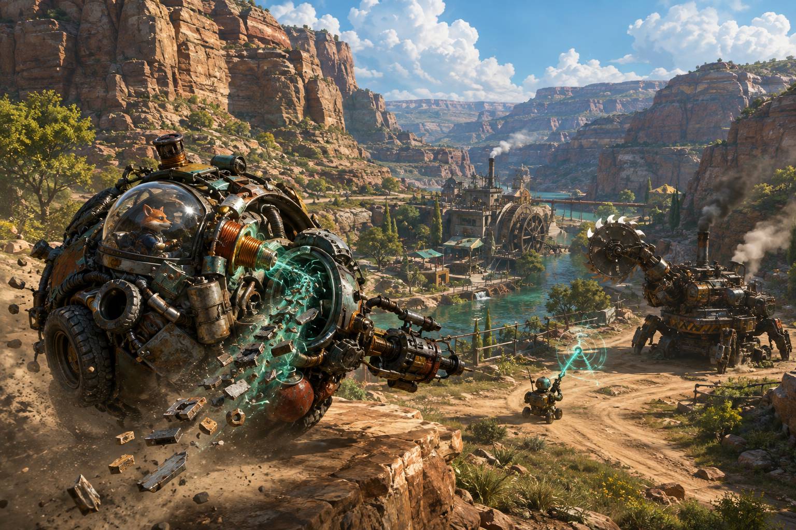

*P01. Fantasy key image, creative proposal. Magnetic collection, an enclosed pilot and a worked-in canyon settlement express the intended relationship between machine and world. The anonymous fox-like pilot does not select a character direction. The front three-quarter viewpoint serves this key image. Collection is the focus; the fabrication sequence is developed in the equipment and audio sheets.*

Source basis: [Publisher discovery](docs/DISCOVERY.md), [approved art direction](docs/bible/ART-DIRECTION-LOCK.md), and [shared production brief](docs/bible/production/SECTION-BRIEF.md).

## 2. World & Lore

### A place that keeps working

SCRAPKEEP's world has learned to live with machinery too useful to throw away and too troublesome to leave alone. A pump has three generations of repairs. A rolling mech wears the remains of several other trades. Beyond the yard fence, a canyon wall catches the last light while someone argues over a missing socket.

The history, customs and relationships developed in this section are creative proposals for this review edition. They follow the approved visual direction; they do not establish final canon, a launch roster or a mandatory route. Here, a world means a run-region. The wider universe's astronomy remains unspecified.

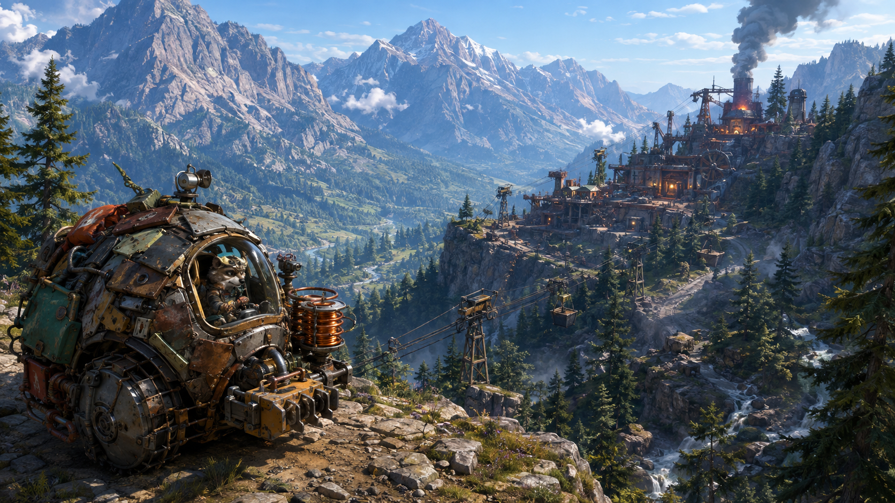

*W01 · Regional establishing shot, proposal. Foundry Crown places worked metal beneath forested slopes and immense mountain walls. The anonymous pilot is a scale reference, not a selected character direction.*

### Candidate history

Before small salvage mechs could carry their own fabrication equipment, distant communities depended on enormous fixed machines. Pumps lifted water through canyon channels. Cableways carried metal over slopes that wheels could barely cross. Orchard mechanisms tended terraces too broad for a workshop crew to manage by hand. Those machines made settlement possible, and their size made replacing them difficult.

Over generations, repairs outlived their original suppliers. A broken pump casing became a roof brace; a retired rail clamp became a winch jaw. Workshops developed their own ways of joining incompatible parts. Shared drawings accumulated corrections in several hands. The familiar landscape took shape around functioning old infrastructure, abandoned sections and new work bolted onto both. There need be no single apocalypse behind every ruin. Some machines were exhausted, some superseded, and some simply stranded when a route changed.

Compact electromagnetic collectors changed who could repair what. A pilot could draw loose metal into a protected rolling body, sort and process it internally, then fabricate hardware while traveling. The same equipment that cleared a blocked road could make the tool needed farther along it. Mechs grew into personal workshops, with visible additions recording what their pilots had recovered and learned. Steam-pressure hardware and patched electronics share those bodies; this history does not specify their ultimate power source.

That capability also made commandeering machinery profitable. The Furnace Fleet began treating local equipment as a reserve it could requisition. Its collectors gather material efficiently, but its demands ignore why a community kept a particular pump running or saved a casting pattern. The conflict reaches the player through interrupted work, altered machines and the people who must live with the damage.

### Five regions, many reasons to travel

The five area candidates give the world distinct kinds of work. Yard Commons sits among Sonoran foothills and rocky washes, where field repair, shade and clear service routes shape everyday life. Spillway Works follows a green river corridor through sandstone, with pumps and suspended paths fitted to the canyon. The Iron Orchard occupies cultivated uplands, where repaired irrigation and patched greenhouses show sustained care. Foundry Crown climbs forested mountains into exposed ridges, with furnaces and cableways built on metalworking terraces. Pale Basin brings white dunes, wind, buried machinery and exposed horizons into the catalogue.

These places exchange skills and components without becoming interchangeable. A river mechanic spots water wear that a basin scavenger might overlook. A mountain shop knows how to move a heavy load along a narrow ledge. An orchard repairer values a mechanism that can repeat a delicate action all season. Themed discoveries should carry that work into a player's build through their construction and behavior.

The accepted run visits three worlds in a fixed order: Spillway Works, then the Dig underground, then the Highdraft's floating flotilla. A winning run targets 30 to 45 minutes, to be measured in play. The other comparison pages stay candidates for later worlds. Every world must introduce its local conflict clearly on its own.

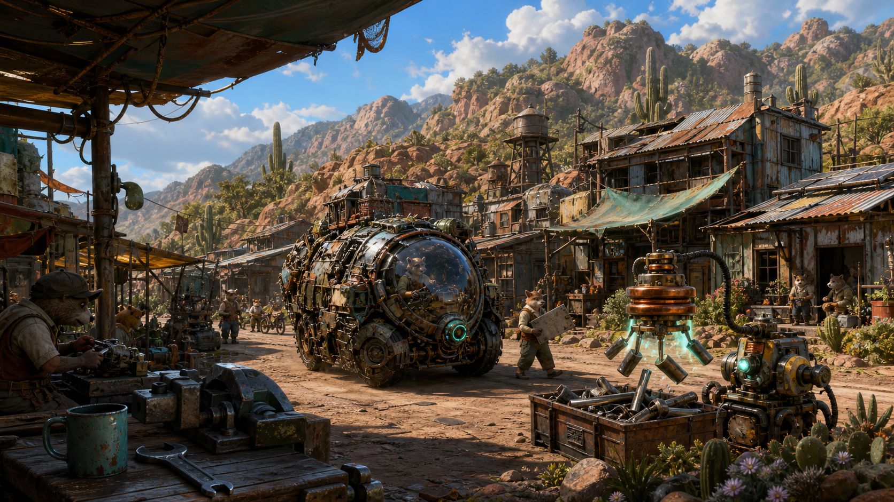

*W02 · Settlement establishing shot, proposal. Yard Commons has homes, shared shade and an open repair court. A visible magnetic handler makes salvage part of ordinary work.*

### Engineering cultures and their relationships

The following candidate cultures describe learned practice. Individuals can borrow from them, reject a workshop habit or belong to several communities. Species never determines temperament or confines an entire culture to one biome.

| Candidate culture | Construction and daily habits | Relationships that create scenes |
| --- | --- | --- |
| Switchback Enclaves | Compact winches, muffled housings, replaceable cable guides and tools that fold within a tight profile. Repairers value access to a fault without dismantling the whole machine. | Their quiet mechanisms help other workshops work in delicate places. They resent collaborators who hide a service bolt behind a larger attachment. Sable's stealth and grapple direction draws on this tradition. |
| Highdraft Roosts | Open frames, suspended work cradles, lift hardware and clear paths for air and moving loads. Shops hang components where their balance can be checked. | They trade lifting expertise for durable bearings and dislike unnecessary chassis weight. Kest's hovering mortar direction interprets this practice without selecting a final mech design. |
| Redjaw Workshops | Strong foreassemblies, articulated clamps, replaceable cutting teeth and conspicuous load-bearing repairs. Worn teeth stay on the bench until someone proves a better replacement. | They supply difficult cutting and recovery work. Their robust fixes can frustrate light-frame builders, while precision workers improve their alignment. Tarn's claw direction makes this force visible. |

An itinerant apprentice such as Fuse gives those relationships motion. Fuse collects techniques faster than judgment, sees an elegant shortcut in a strange tool, and sometimes discovers why the old repairer used the slower method. Directed chaos and harmful or inconvenient miscasts remain part of that character candidate. Rivet's machinist identity provides a different response to unfamiliar machinery: measure the alignment, understand the material, then cut. Neither needs to represent an entire civilization.

Shared work should reveal affection without a speech. One mechanic braces a housing before the other asks. Someone adds a muffler to a borrowed tool and returns the old part in a labeled pouch. Moss, as a supporting workshop keeper, remembers which pilot never packs spare insulation. These moments give the player reasons to recognize a place on a later run.

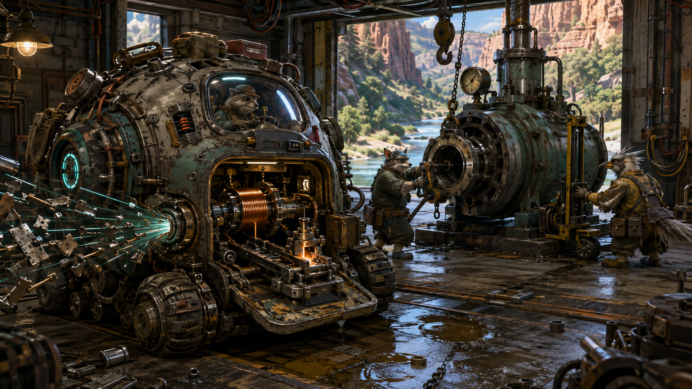

*W03 · Workplace establishing shot, proposal. At Spillway Works, pump maintenance and the mech's internal fabrication sit in one working room. The service bay does not establish a required crafting station.*

### The Furnace Fleet's claim

The retained antagonist proposal makes the Furnace Fleet a mobile organization dependent on an expensive, aging machine stock. Admiral Brindle believes centralized collection will keep its people supplied. He sees deferred maintenance everywhere and takes that as evidence that local workshops need his management. Each successful requisition increases the equipment he must maintain, giving him another reason to demand more.

His danger comes from decisions with physical consequences. A collector receives a new destination and strips a repair reserve. A pruning mechanism gets an override that values throughput over the orchard around it. A useful service route fills with machinery assigned to a collection quota. The player can understand the wrongness before reading a notice.

Fleet workers retain reasons to cooperate, hesitate or disagree. A mechanic may maintain the override because their own crew needs supplies, then quietly leave access to its retaining bolts. The proposed tone allows sympathy for those pressures without excusing the harm. Brindle can recur through messages, equipment and encounters in different route positions. His presence does not commit the game to a named final boss or a fixed reveal sequence.

### Small comforts, large consequences

The three shared pillars shape how this fiction reaches play. **Joyful physical mastery** gives repair tools satisfying weight, clear motion and openings the player can exploit. **Scrap becomes your build** makes recovered material visibly become working hardware inside the mech. **A world worth crossing** keeps the valley, settlement and local occupation recognizable even when the player's build dominates a battle.

Humor comes from skilled people and temperamental machinery. A triumphant prototype catches its maker's spare wrench. A repaired door works perfectly after its owner has learned to climb through the window. Damage can be loud and absurd, while the next quiet shot still shows somebody tending a plant in a reused tin.

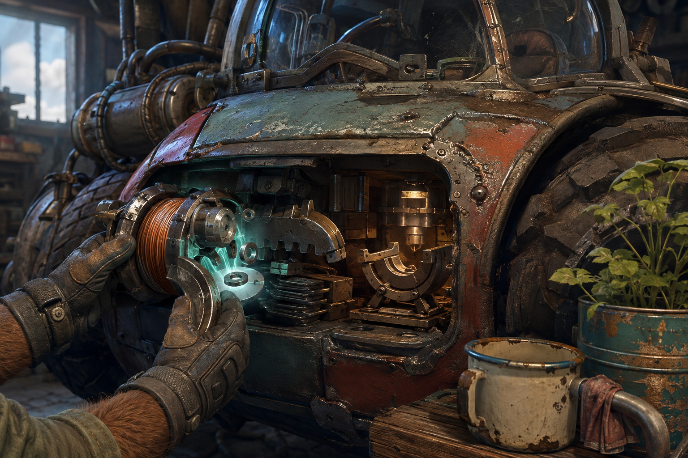

*W04 · Intimate mechanism and life detail, proposal. A new brace, used tools and a small comfort show what continuing to repair this world feels like. Fabrication imagery defines neither upgrade costs nor a new progression schedule.*

Source context: [Publisher discovery](docs/DISCOVERY.md), [character development](docs/CHARACTER-BIBLE.md), [environment candidates](docs/WORLD-ENVIRONMENTS.md) and the [approved art direction](docs/bible/ART-DIRECTION-LOCK.md). Their older fixed-route, roster and finish proposals are superseded where this review's shared brief says so.

## 3. Maps & Areas

### Reading the catalogue

These five area pages compare possible worlds for SCRAPKEEP. They are a creative review catalogue, not a selected launch roster. The run visits three worlds in a fixed order (section 2). Of these pages only Spillway Works is in it, as world one. The other pages claim no place in that sequence.

The overview is a conceptual catalogue map, explicitly **not a fixed route or geographic survey**. Its separated landform samples express differences in terrain, work and atmosphere. Their positions carry no travel distance, adjacency or astronomical meaning. Read the individual key art for natural scale and the prose for proposed play.

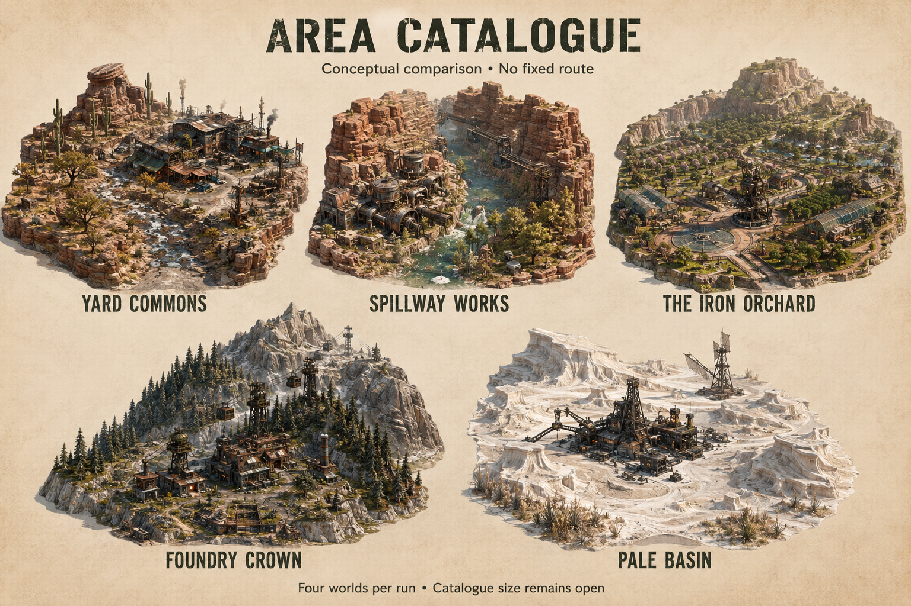

*M00. Conceptual catalogue diagram. Yard Commons, Spillway Works, The Iron Orchard, Foundry Crown and Pale Basin receive equal status. No fixed route. The Pale Basin sample overstates hard white cliffs; its intended identity is the sculpted dune field developed in M05.*

Each selected world must accommodate the build arriving there. It introduces its own threats without assuming a lesson from another named world. Broad ordinary routes remain usable as the mech grows. Optional branches can reward a clever jump, angle or class interaction, but a required exit cannot depend on a rare drop. Local equipment gives rewards a reason to belong to the place; discovery and material recycling do not require a new economy or upgrade schedule.

### Yard Commons

*Creative proposal adapting an existing area candidate. Sonoran desert foothills, repair settlement and rocky washes; no starting-world assignment.*

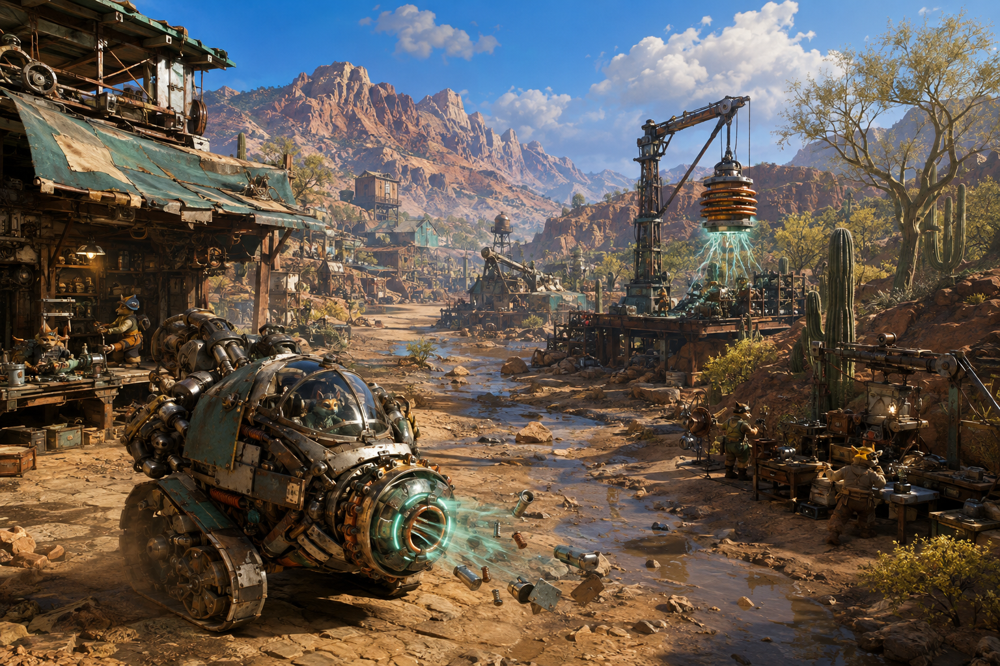

*M01. Yard Commons key-art proposal. Saguaros, sparse branching trees, raised repair benches and an open wash establish the setting. The protected scrap body and attached tread forms are a silhouette study; this still image does not resolve rolling articulation.*

Yard Commons makes salvage feel social. Residents know which broken machines can work again and which parts somebody is still looking for. Repairs spill out beneath patched awnings; clear benches and rubbed handles distinguish active work from abandoned stock. The mood is noisy, dusty and welcoming, with enough uninterrupted foothill and sky behind the yards to make the settlement feel small.

Its physical vocabulary starts with irregular rocky washes, sloping gravel fans and firm raised workshop aprons. Saguaros belong on suitable hillsides, with cholla-like scrub and green-trunk branching trees providing different silhouettes. Buildings follow stable ground above the wash. Reused curbs and short retaining walls can offer readable banking and rebound opportunities; ramps connect broad aprons. Tall scrap racks stay outside the camera's useful view of an approaching threat.

An open stage might spread a working repair bay, a collector's sorting court and a contested depot apron across the foothills for the player to roam in any order. Magnetic handlers and clamp mechanisms supply attacks derived from recognizable jobs. A loose load can make a battle consequence visible, provided its fall is announced and leaves a reachable ground route. The old compulsory tutorial-yard interpretation is not carried forward. Any first visit supplies the local lesson the player needs.

Discoveries draw on insulated collector parts, rugged couplings and compact service tools. Proposed effects could alter collection behavior or how a device withstands pressure; their identities and balance need later design. Residents' possessions and working gardens are not indiscriminate salvage. **Joyful physical mastery** asks whether the wash-to-apron transitions invite useful movement. **A world worth crossing** asks whether an unlabelled view still reads as a Sonoran working settlement. **Scrap becomes your build** ties its recovered service tools to visibly changed hardware.

### Spillway Works

*Creative proposal adapting an existing area candidate. Sandstone canyon, green river corridor and reclaimed water infrastructure.*

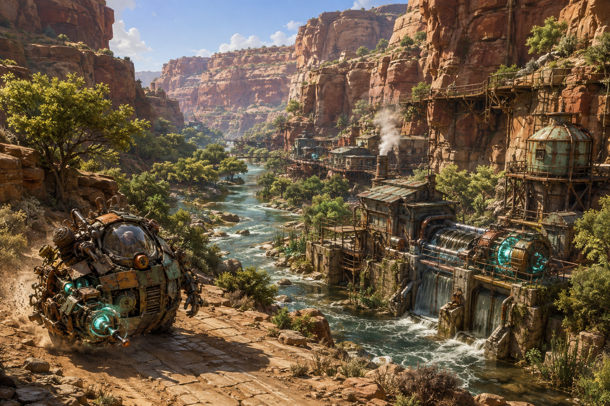

*M02. Spillway Works key-art proposal. The river, leafy corridor and canyon walls carry the scale; patched machinery follows their edges. The concept suggests a dry bypass but does not verify continuous traversal clearance.*

Spillway Works turns a route into a negotiation with water and height. Huge sandstone walls shade a green river corridor. Cottonwood-like trees occupy the banks, reeds mark wet edges, and sparse dry scrub climbs the higher shelves. Pump houses, sluices and suspended service paths fit into this arrangement. Water has supported the place for longer than any current machine.

The mood is cool relief under enormous warm stone. Sun catches the far canyon rim while shaded machinery drips beside the player. Mineral stains record water levels, fresh seals show maintenance, and a mended rail suggests people still cross the service paths. Keep foliage visibly green; petrol enamel belongs to the pumps, not to every leaf and patch of river.

Terrain vocabulary includes river shelves, settling basins, channel bends, gate aprons and higher dry service routes. Water currents are a proposed traversal variable, with direction made visible through surface motion and debris. As stage events they are a candidate event layer, settled by play, and the Spillway basin flood Andrew kept in playtest entry 4 is that layer's first test. Their effect on handling remains undecided. A reliable dry route gives the player a legible alternative. Suspended paths contribute depth and local history; they do not authorize mandatory tightrope travel for a growing ball.

Encounters can contest a pump intake, interrupt a moving screen rake or turn around a basin whose water level changes. Such a change must announce the new ground and reachable exits before it becomes dangerous. Floods, drains and currents are stage events that rise and recede, core stage mechanics the player reads, weaves through and turns to advantage rather than spectacle (playtest entry 4). An optional branch might expose a maintenance chamber or reveal equipment beneath a lowered basin.

The reward vocabulary comes from sealed housings, flow-control vanes and magnetic debris-sorting assemblies. Proposed items might redirect a deployed effect or help a companion operate through pressure, but exact effects are open. **Joyful physical mastery** tests whether the channel offers informed movement choices. **Scrap becomes your build** ties recovered pump hardware to a useful mechanism. **A world worth crossing** is the difference between a canyon people inhabit and an industrial corridor painted red.

### The Iron Orchard

*Creative proposal for a full region adapted from the existing bounded orchard encounter. Upland cultivated valley, irrigation and maintained machinery.*

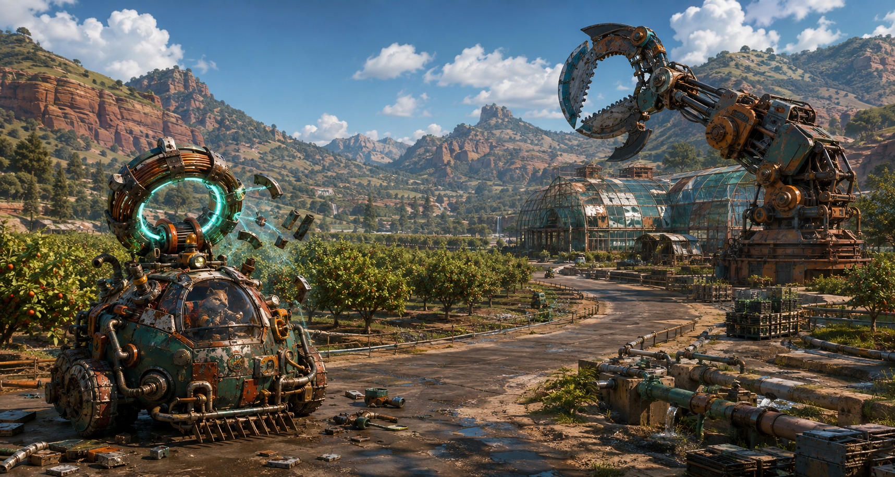

*M03. The Iron Orchard key-art proposal. Cultivation, generous turning space and an oversized working tool express the region. This scene is not a screenshot or a design proof for a complete Grand Pruner boss.*

The Iron Orchard gives the player's force something delicate to move around. Tree rows follow a cultivated valley into foothills; irrigation hardware and patched greenhouses reveal years of patient work. Worn turning aprons show where machines normally reverse, unload and wait. The atmosphere is bright morning industry, with cool foliage and soil under a large blue-green sky. Healthy growth and repeated repairs make the place feel cared for.

Fruit trees belong in managed rows, with upland scrub and sparse pinyon-like forms on the distant shoulders. Keep this planting distinct from Spillway's continuous river ribbon and Foundry Crown's dark mountain forest. Terraces, service ramps, irrigation edges and greenhouse courts supply its terrain language. Softer soil and swept aprons could support different handling, but no grip values are selected. Their surfaces should communicate that difference before a movement rule depends on it.

(Superseded prototype evidence, 22 Sep 2026; see TADR-010.) Snipcart, Spreadleg and the Pruner arm already give the prototype identifiable orchard mechanisms. Their jobs create different threats through inward jaws, outward feet and a large committed cutting stroke. The implemented arm is a bounded encounter element. A complete Grand Pruner boss, a sequence of generated orchard levels and terrain-changing boss consequences remain proposals.

A region could alternate intimate nursery workspaces with exposed machine aprons. A defense encounter might protect access to a seedhouse; an optional service branch could lead behind a greenhouse to a repaired mechanism and a discovery. A defeated large arm might settle onto visible supports and form a usable bank. That consequence needs a clear landing and a preserved outer route, not a decorative collapse across the exit.

Reward vocabulary includes cutting linkages, bracing shoes and compact tending mechanisms. Shear Linkage, Brace Shoe and Shear Buddy offer recognizable prototype examples, not a completed region loot table. **Joyful physical mastery** asks whether tool geometry and escape agree. **Scrap becomes your build** connects defeated machinery to changed hardware. **A world worth crossing** asks whether the player can still see the orchard's living purpose after the fight.

### Foundry Crown

*Creative proposal adapting an existing foundry candidate. Forested mountain slopes, metalworking terraces and high rocky ridges.*

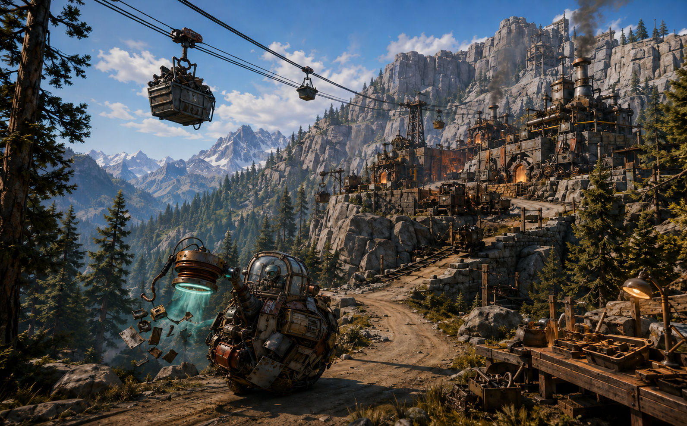

*M04. Foundry Crown key-art proposal. Forest, ridge and supported workshops define the setting. The corrected scene encloses the pilot in a framed glass cockpit integrated with the rolling scrap body.*

Foundry Crown should make altitude tangible. Tall pines crowd the lower slopes, then give way to broken gray rock and open ridge. Metalworking terraces occupy broad natural benches. Cable baskets cross above the ground road because hauling awkward scrap up the mountain is daily work. Furnace mouths are small warm marks in a much larger cool scene. The mountain remains the dominant shape.

The mood is crisp, strenuous and industrious. Smoke darkens the stone immediately above a vent; it does not turn the whole sky into furnace haze.

Broad switchbacks, rock benches, rail sidings and open forging aprons form the terrain vocabulary. High edges require advance visibility and usable room to turn. Cableways explain transport and may carry announced moving loads. They do not make aerial traversal compulsory. The older mass-gated rail proposal remains unadopted; this area does not select a weight threshold, automatic rail capture or altered steering model.

Encounters can use the rhythm of a clamp, swinging load or furnace hammer to create openings. On an exposed apron, the player sees a working tool commit, moves clear and aims into its recovery. A larger machine might buckle an interior platform or drop a supported bank while leaving the ground escape route intact. Quiet forest approaches give the following metal impact room to feel heavy.

Discoveries draw on cable drums, heat-shield panels, alignment fixtures and reusable cast housings. Proposed effects can connect to controlled positioning, tool stability or device interactions without choosing an item recipe. **Joyful physical mastery** requires readable responses even beside a dramatic drop. **Scrap becomes your build** makes forged salvage function visibly. **A world worth crossing** requires the forest-to-ridge transition to remain recognizable when the furnaces are hidden.

### Pale Basin

*New creative area proposal. Fictional white gypsum-like dunes, buried machinery and wind-driven maintenance; no finale assignment.*

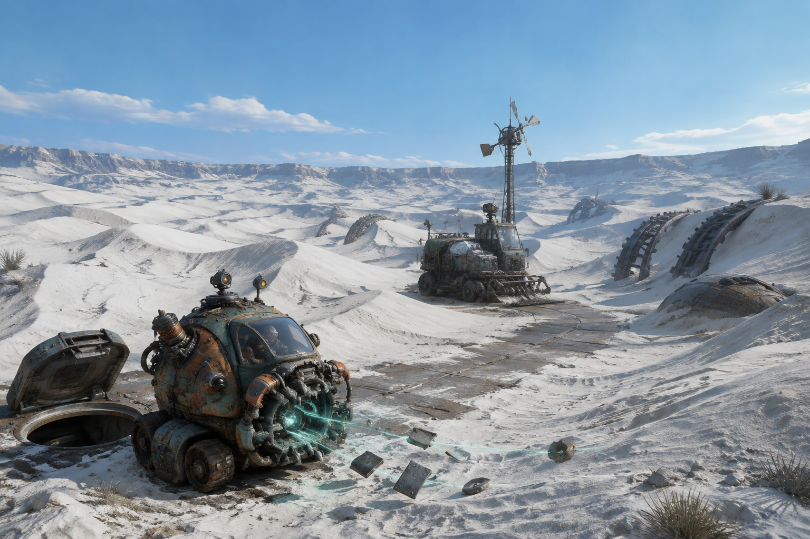

*M05. Pale Basin key-art proposal. White mineral dunes, sparse margin plants and dark exposed machinery establish the contrast. The pale ground is dry mineral sand. The foreground body's tread-heavy contact forms remain a concept study of an irregular rolling mech, with locomotion articulation unresolved by the still image.*

Pale Basin gives the journey an enormous pause in scale. White dunes roll toward a low distant rim; isolated machine ribs interrupt the horizon. Wind exposes an inspection hatch and begins burying yesterday's cleared route. Someone still tends the rigs. That small evidence of effort keeps the place from becoming a generic dead world.

The mood is quiet, strange and sunstruck. Hard light and cool shadows carve dune shoulders. The ground is pale mineral sand, not snow; open sky, granular ripples and sparse dry margin plants must carry that distinction. Low grass tufts and yucca-like forms belong on stable edges. The dune interior should remain largely bare. No repeated saguaro library or transplanted mountain forest belongs here.

Terrain vocabulary includes smooth shoulders, shallow troughs, exposed service pads and hard-packed maintenance strips. A crest should reveal an encounter before committing the player to its danger. Firm routes can weave among softer surfaces, but automatic sliding and traction penalties remain unchosen mechanics. Weather-driven route changes are a candidate event layer, settled by play, with the Spillway flood as the layer's first test. Distinctive buried ribs and a service mast give direction without filling the open space with arrows or debris.

An encounter might begin as a salvage inspection, then reveal the working portion of a larger buried mechanism. Sand-moving maintenance tools offer sweeps and scoops with visible mechanical preparation. A boss-scale excavation could uncover more of a machine and change the stage's internal contours while preserving a dependable route. Discovery can be patient and local: a maintained hatch, unusual wear or a wind-cleared seam invites investigation without inventing a scanner requirement.

Reward vocabulary comes from abrasion guards, intake screens, wind-driven linkages and exposed collector parts. Their proposed build roles involve shaping collection or adapting a device's behavior; none are required counters for entering the region. **Joyful physical mastery** tests the visibility beyond a crest. **Scrap becomes your build** gives excavated hardware a working purpose. **A world worth crossing** asks whether vast pale land and stubborn maintenance hold interest between fights.

Source basis: [Publisher discovery](docs/DISCOVERY.md), [world environment candidates](docs/WORLD-ENVIRONMENTS.md), [level-design study](docs/LEVEL-DESIGN.md), [decision register](docs/project/DECISION-REGISTER.md), and the [approved art direction](docs/bible/ART-DIRECTION-LOCK.md). Earlier kit measurements, fixed route roles and old palettes are not specifications for these revised region proposals.

## 4. Characters

The pilot gives a growing pile of machinery a face. The machine explains how that person works. 

These five pages remain the historical character comparison catalogue, not the alpha roster. The exported alpha has six pilots: Sable, Rivet, Kest, Tarn, Tally the pack-rat caster and an unnamed rebuilt ancient known during development as the remembered cannon. Tarn uses the approved close-contact claw kit, Tally selects three fitted mechanical program cards with 1, 2 and 3, and the cannon mirrors the Mind. Fuse remains a catalogue proposal. The pilot stays inside the ball; the A/B/C sheets are construction alternatives, not progression sequences.

Every candidate retains an irregular rolling salvage body, electromagnetic collection and internal fabrication. The weapon and special mobility work at run entry; the main hero skill and ultimate unlock through play during world one. The kit sketches below describe a starting fantasy and directions for visible change. The movement abilities Andrew played in the mobility-kit sketch already have candidate homes in these mobility rows (playtest entry 3; TADR-008): the grapple he kept in Sable's grapple, the glide in Kest's brief lift, the slam, with the anchor beat he asked for, in Tarn's planted claw pull, the air dash in Fuse's vent-assisted burst, and the pylon mount he requested in place of mag-cling in Rivet's braced reposition or Sable's planted anchor hardware. These are candidates, not assignments. Whether each is a tree root, a node or an item stays open under Q-P11, since transformative items may also replace movement, and whether the pylon mount is a mobility action or a deployed device stays open under Q-P15. 

### 4.1 Sable, fox from the Switchback Enclaves

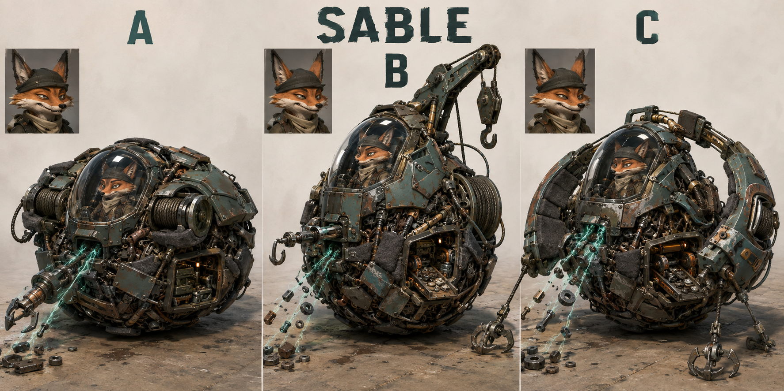

*C01, proposal. A at left uses paired compact winches; B in the middle uses an offset crane arch; C at right uses a crescent collector collar and folding anchors. The fox remains the same individual across all three.*

Sable retrieves machinery from places where the road has gone missing. They measure an opening by the angle of the cable that could cross it. Quiet, observant and socially mischievous, Sable enjoys making a difficult arrival appear accidental. A narrow russet face, dark-tipped ears and close work cap remain readable through the glass; the body leans toward a chosen exit even while the eyes watch an enemy.

The Switchback Enclaves are a candidate engineering culture whose workshops value compact mechanisms, recoverable anchors and noise control. Felt around rattling panels, rubber-bushed mounts and covered cable runs express that practice. It is a learned tradition, not a claim that foxes are naturally secretive, and it does not assign the Enclaves to a mandatory home biome.

Sable's personal arc concerns accepting visible responsibility. At first, a perfect job leaves no sign of who helped. Later scenes can reveal that a community needs someone willing to stay and be counted. Sample bark: "Quiet part's over."

| Slot | Qualitative direction |
| --- | --- |
| Weapon | An aimed hook-driver strikes exposed mechanisms. Upgrades change jaw shape, cable handling and the physical follow-through of a successful shot. |
| Main hero skill | A quick winch anchor provides autonomous pulls against nearby threats. Active aim redirects its next useful pull; acoustic damping gives a proposed stealth opening without making enemies inexplicably blind. |
| Mobility | A grapple converts approach speed into a swing, rebound or sharp change of line. Folding guides and stronger spools visibly explain later capabilities. The rope is physical: it should collide with and wrap around what it passes, so a grapple thrown across the direction of travel swings the ball around its anchor like a ride (requested in playtest entry 3). A reach indicator shows before commitment whether the grapple can connect, as an honest placement preview under "A committed attack means what it shows". The reel rework and the wrapping mechanism remain open. |
| Ultimate | Useful grapples and displacements earn a committed slingshot surge. Deployable anchor hardware loads, then releases a player-chosen path through a fight. |

A emphasizes a low center of mass and tightly packed quiet machinery. B exposes the pulley path and makes traversal equipment unmistakable at distance. C frames the rolling scrap with a padded horseshoe; its anchors should fold clear during ordinary rolling. Sable's equipment can grow without hiding the eyes or turning stealth into a featureless black shell. The unresolved choice is which construction makes swinging mass feel most convincing while preserving sightlines.

### 4.2 Kest, bird from the Highdraft Roosts

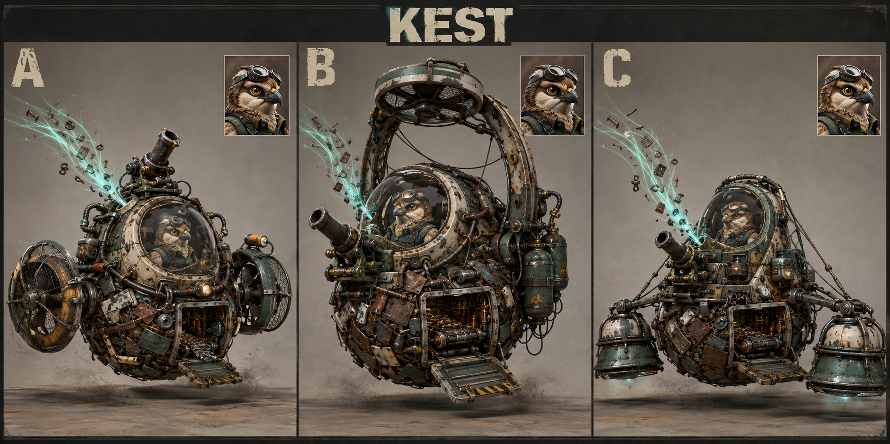

*C02, proposal. A at left carries two guarded lift fans; B in the middle suspends a rotor inside a tall hoop; C at right distributes lift through bell-shaped ducts. All retain a rolling scrap core and enclosed cockpit.*

Kest maintains suspended equipment and watches how loads move before touching the controls. Their patience has a competitive streak. A swept feather crest, pushed-up goggles and small hooked beak carry the identity; the head makes precise corrections while the shoulders stay relaxed.

Highdraft Roosts construction favors open trusses, tensioned cables and replaceable lift assemblies. Lightness is something workers achieve by distributing loads, not a magical property of a bird pilot. Scrap still gathers around a dense protected core. Thin braces can look repaired and worked hard without becoming a cloud of fragile visual noise.

Kest's arc asks when careful observation becomes an excuse to delay. They can begin by waiting for the ideal line, then learn to commit when somebody else needs the opening now. A gust-battered service path or a rushed rescue provides a scene seed wherever the generated route permits. Sample bark: "There. Give it a moment."

| Slot | Qualitative direction |
| --- | --- |
| Weapon | An aimed mortar rewards reading movement and placing an arc. A short recoil cradle develops visible changes to shell handling and firing geometry. |
| Main hero skill | A rapidly deployed mortar nest fires autonomously along a useful approach. An airborne designation focuses its next volley while Kest continues moving. |
| Mobility | Brief lift adjusts position and carries momentum over an opening. Guarded fans or ducts expand and articulate as the chosen route develops; ordinary rolling remains useful. |
| Ultimate | Effective bombardment and designations earn a temporary artillery stance with expanded lift and coordinated fire. The pilot still chooses where the barrage matters. |

A puts lateral lift hardware beside a compact mortar and reads broad and nimble. B makes height the defining feature, with a hanging pressure system and overhead rotor. C uses folding outriggers to distribute lift around a smaller silhouette. The sheet shows only shallow hover, not an unrestricted flying vehicle. Mortar aim, enclosure and accumulated mass must survive whichever direction is chosen. Rotor clearance and camera occlusion need later motion studies; the illustration cannot settle them.

### 4.3 Tarn, tiger from the Redjaw Workshops

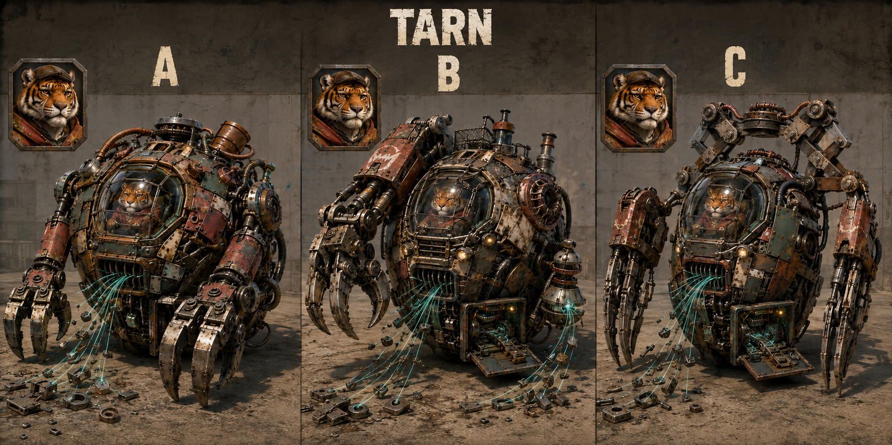

*C03, proposal. A at left has paired piston claws; B is the middle panel with one large braced claw; C at right has slender linked talons. The corrected sheet labels all three directions explicitly; none is selected.*

Tarn is a repairer of heavy gripping equipment who treats force as a responsibility. Deliberate and unexpectedly gentle, they test a bent latch with one finger before deciding to tear the whole assembly loose. Broad cheeks, small rounded ears and a battered welding cap give the pilot a calm compact silhouette. The machine supplies the aggression. Tarn's face should never have to snarl constantly to sell a claw class.

The Redjaw Workshops' candidate tradition uses strong foreassemblies, pinned joints and replaceable cutting teeth. A tool is built to be repaired after a hard contact. Fresh teeth can contrast with old rusty carriers; polished pin edges show where the mechanism moves. Their culture does not require every tiger to be a brawler.

Tarn's arc develops the difference between being useful and taking every load alone. An early scene shows them refusing assistance with a jammed machine. A later independent scene lets them hold a dangerous assembly steady while someone else makes the essential repair. Sample bark: "Hold still. The machine, I mean."

| Slot | Qualitative direction |
| --- | --- |
| Weapon | Articulated claws make aimed sweeps, catches and forceful releases. Replaceable teeth and changed linkage geometry explain different attack shapes. |
| Main hero skill | A quick clamping device catches a local threat and creates an opening. Tarn can exploit that commitment with a deliberate claw strike while the device works autonomously. |
| Mobility | A planted claw pulls the rolling body into a short forceful movement. Later construction can alter the plant, rebound or release without adding a separate walking body. |
| Ultimate | Successful committed contacts and useful holds earn an expanded grapple-and-rend sequence. Its moving claws define the danger area; debris follows the action rather than hiding it. |

A concentrates strength into short paired wrists. B makes leverage and counterweight visible with one dominant claw. C uses linked segmented talons for a narrower, higher silhouette. In motion, all three must retract equipment around the rolling core; planted limbs are temporary actions. Tarn's claws need readable commitment and recovery so heavy contact feels earned instead of producing damage wherever a particle effect happens to spread.

### 4.4 Fuse, squirrel itinerant apprentice

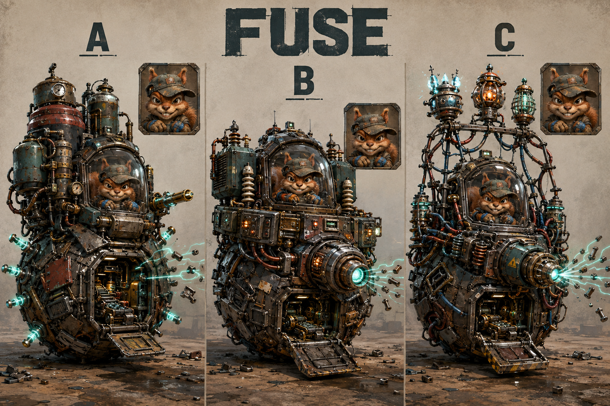

*C04, proposal. A at left stacks pressure canisters beside an aiming barrel; B in the middle uses a low switchboard collar and transformer blocks; C at right suspends discharge heads on a cable hoop.*

Fuse has learned enough to do remarkable work and not enough to understand why the remaining lessons exist. They arrive with borrowed tools, an oversized cap and a confident explanation for the smoke. A directed shot goes where intended, until an occasional miscast produces a real problem and the grin disappears for a beat. The tufted ears and curled tail stay inside the cockpit; expressiveness comes from the whole seated body.

Itinerant training leaves several shop traditions in one mech. Mismatched connectors meet through ingenious adapters. Replaced ceramic insulation sits beside an old copper winding, while blue tape marks a repair Fuse considers finished. The machinery must look capable of controlled work, because failure has no comic weight if everything always malfunctions.

Fuse's arc is learning to own consequences without losing invention. A mishap might scorch an escape line or frost a mechanism they needed; the meaningful later scene is staying to repair it. This can happen in a workshop or encounter event in any region. Sample bark: "Still technically worked."

| Slot | Qualitative direction |
| --- | --- |
| Weapon | A directed emitter delivers the intended elemental attack most of the time. Swappable working chambers visibly support multiple elements and effects. |
| Main hero skill | A short automatic field acts around the moving mech. Deployable discharge hardware can extend a local opportunity while the aimed weapon remains active. |
| Mobility | A controlled vent-assisted burst provides a dependable repositioning tool. Branch construction can alter its release and aftermath; exact exposure to miscasts remains open. |
| Ultimate | Useful class actions earn a brief high-output casting state that coordinates emitter and field. It remains actively steered rather than becoming a screen-filling random event. |

A wears its precarious equipment stack openly. B packs the same ambition into a squat electrical workbench. C makes separate elemental outlets legible above an open cable frame. No direction selects a final element pool, failure rate, instability meter or self-damage amount. Genuine harm or inconvenience is required for some failures; exact limits need design and playtesting. The current lightning prototype supplies reference material, not proof that this proposed Fuse kit or its miscasts exist.

### 4.5 Rivet, mole machinist

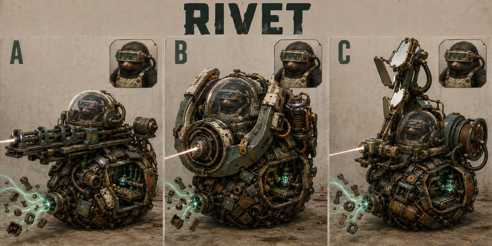

*C05, proposal. A at left carries a long optical bench; B in the middle surrounds a large collimator with a split yoke; C at right folds an articulated mirror tower above the rolling body.*

Rivet can hear a bad bearing through a conversation and will politely wait for the speaker to finish before fixing it. Precise, literal and kind, they trust an instrument enough to act decisively. The rectangular visor, blunt nose and nearly hidden ears distinguish the pilot inside the enclosure. A protected instrument cable connects the visor to the cockpit controls; cyborg expression should look like useful personal equipment, not an injury spectacle.

Rivet's material language comes from machinists who preserve references while rebuilding everything around them. Straight optical rails contrast with the irregular salvage body. Cooling lines follow deliberate routes. Rubbed calibration surfaces remain clean enough to work amid oily housings and chipped enamel. No mandatory home biome is assigned here; earlier foundry work remains useful occupational history rather than a fixed introduction location.

Their arc concerns trusting judgment when the instrument cannot supply certainty. An unresolved reading first stops a repair; a later scene lets Rivet make a considered choice and accept the imperfect result. They remain precise throughout. Sample bark: "Measured twice. Firing once."

| Slot | Qualitative direction |
| --- | --- |
| Weapon | An aimed cutting beam rewards alignment through weak points or several threats. Lens blocks, cooling hardware and mounting rails visibly change with the chosen path. |
| Main hero skill | A quickly placed prism device covers a narrow corridor autonomously. A deliberate shot through its optics can redirect or split a compatible attack. |
| Mobility | A short braced reposition preserves a firing line or establishes a new one. Sliding mounts and stabilizers express how the chassis settles after movement. |
| Ultimate | Useful precision hits and redirected shots earn a sustained major cutter. The player shapes its route while the working optics and beam corridor remain visible. |

A emphasizes a straight instrument bed attached to a messy machine. B groups the optics into a broad circular cradle. C externalizes the redirected-beam idea through hinged mirrors. Beam thickness, reflection eligibility and movement during sustained fire remain future rules; the sheet's straight light samples convey direction without claiming a tested hitbox.

### 4.6 Supporting cast and relationships

Moss remains a proposed workshop keeper who remembers what each pilot neglects. They hand Sable a spare anchor, ask Kest whether the landing was planned, and let Fuse explain the smoke before pointing to the bucket. Moss makes maintenance social. A stocked shelf and a repaired seat can communicate care without a compulsory briefing between every encounter. Supporting appearance and species remain open in this edition.

Admiral Brindle is the proposed leader of the Furnace Fleet, retaining the earlier small badger commanding excessive machinery. The Fleet requisitions working equipment and redirects electromagnetic salvage toward its own needs. Brindle treats those taking the loss as a rounding error. Calm arithmetic makes the conflict personal without requiring a shouting villain. Manifests, broadcasts and an inspection car can introduce the organization independently in any region. Neither Brindle's final role nor a guaranteed final-boss encounter is chosen.

The pilots' differences create scene material without a fixed party. Sable disguises effort; Kest wants effort performed correctly. Tarn offers a steady hand; Fuse mistakes that patience for permission. Rivet can recognize the sound of Fuse's good idea before anyone sees its bad wiring. Use these relationships in optional exchanges and aftermaths so a solo run works with whichever character and route the player chooses.

Source basis: [publisher discovery](docs/DISCOVERY.md), [earlier character reference](docs/CHARACTER-BIBLE.md), [approved art direction](docs/bible/ART-DIRECTION-LOCK.md), and [this edition's production brief](docs/bible/production/SECTION-BRIEF.md). Character fiction, the kit sketches and all five comparison sheets remain proposals.

## 5. Weapons & Items

A good Scrapkeep weapon looks like somebody solved a practical problem with the wrong machine. Its working end is obvious, its mounting explains the recoil, and the next improvement changes what the player can do. Loot should make a familiar tool surprising while leaving enough of its original construction visible to understand the combination.

The equipment families and regional finds below are creative proposals for this review edition. They extend the five character candidates without selecting a character's A/B/C chassis or defining a launch roster. Their labels are working descriptions.

### 5.1 Shared baseline and class roles

Every pilot enters with a useful weapon and special mobility. Ordinary rolling and movement remain available throughout the run. The main hero skill and ultimate unlock through play during world one. A player should be able to handle ordinary threats with the starting kit; a rare item can change the answer dramatically but cannot be the missing permission to fight.

Active aim distinguishes the weapon. Low-cooldown abilities and quick autonomous deployments keep the pilot moving. A deployed device is an expression of the kit, not a fifth progression slot. Class-earned ultimates build toward a deliberate moment of power. Their exact earning formulas remain open.

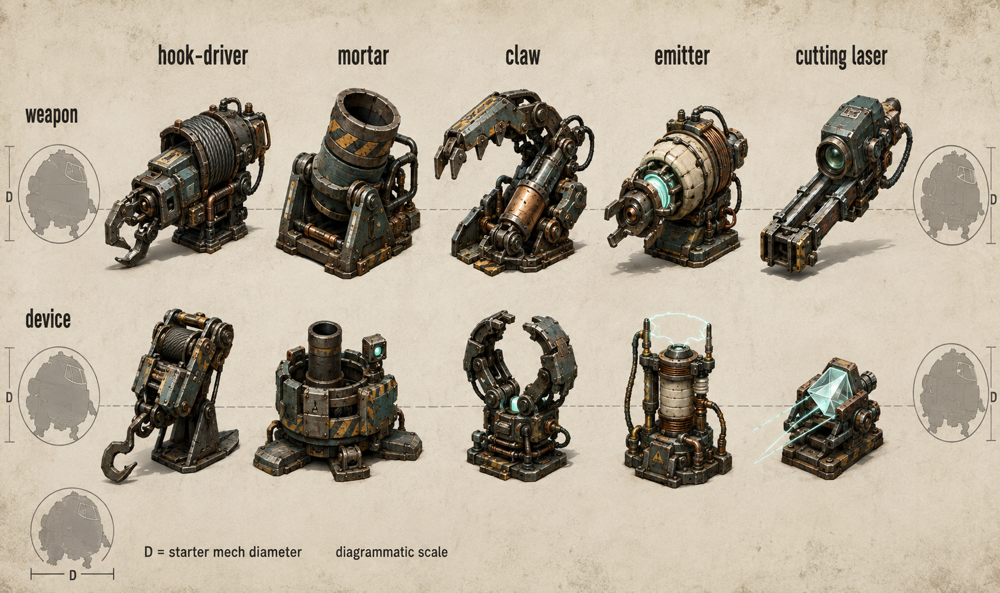

*E01, equipment proposal. Upper row, left to right: hook-driver, mortar, claw, emitter and cutting laser. Lower row: winch anchor, mortar nest, clamping device, discharge post and prism device. Both rows share the D reference for starter-mech diameter. The tools are shown larger than D, providing a conceptual relative-size and material comparison. Mounted dimensions and route clearance remain future design work.*

| Candidate and combat role | Weapon silhouette and aim | Device silhouette and useful interaction |
| --- | --- | --- |
| Sable, displacement and traversal | A compact hook-driver has a broad cable spool behind a narrow biting jaw. The cable path makes a chosen strike and pull understandable. Rubber-bushed mounts and covered mechanisms express quiet construction. | A folding winch anchor plants a small stable foot and exposes its pull line. Its proposed autonomous pulls create openings while Sable swings or redirects the next action. |
| Kest, bombardment and placement | A short mortar sits in an open recoil cradle. Barrel elevation and shell trajectory communicate a placed impact, while lift hardware belongs to the surrounding mech. | A squat mortar nest has a broad base and clear firing mouth. An airborne designation can focus its next proposed volley without making the pilot stop to manage it. |
| Tarn, committed close contact | An articulated claw opens around negative space. Replaceable teeth, pinned knuckles and a strong piston show the sweep, catch and recovery. | A clamping device grips inward around a local threat. Its limited occupied space gives Tarn an opening for a deliberate strike. It does not establish a walking body or unlimited crowd control. |
| Fuse, directed casting and local pressure | An emitter points through a visible working chamber. Ceramic insulation, copper winding and adapted connectors support multiple elements while preserving a dependable aiming direction. | A discharge post expresses the proposed deployable extension of Fuse's short automatic field. Local arcs show where it works. The accepted field fantasy does not lock this particular device. |
| Rivet, precision and controlled corridors | A cutting laser follows a straight alignment rail. Cooling hoses curve around the hard optical line, with rubbed calibration surfaces among the grime. | A prism device stands low and exposes its optics. Its proposed narrow coverage can redirect or split eligible attacks; the final reflection rules remain open. |

The silhouettes should remain recognizable beneath new scrap. Sable needs a readable cable exit, Kest a firing mouth, Tarn a working jaw, Fuse an aiming nozzle and Rivet an optical axis. Mounts can grow around those landmarks. Broad glow or extra pipes cannot substitute for a changed mechanism. Attack previews and damage must use the same committed geometry, including a redirected beam or repeated impact.

### 5.2 The mech builds its advances

Scrap first answers the physical fantasy. Pole pieces draw loose metal toward a visible intake, fragments gather around the body, and the irregular rolling mass grows. Internal sorting and fabrication then explain how recovered material becomes useful construction. The protected cockpit remains legible through both processes.

The art can show steel cut into a brace, copper wound onto a conductor and rubber reused as insulation. Grease stays in bearings; an old painted casing can surround a freshly machined contact. That contrast makes the repair visible.

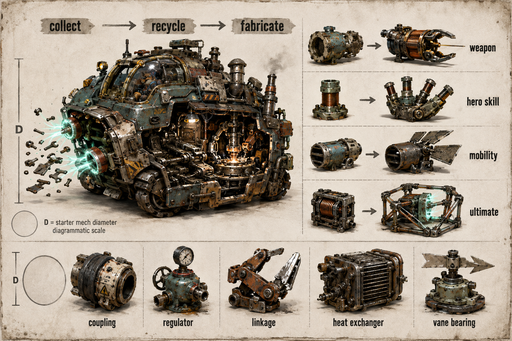

*E02, fabrication and loot proposal. The cutaway shows collect, recycle and fabricate; paired studies show changes to weapon, main hero skill, mobility and ultimate. The lower row compares coupling, regulator, linkage, heat exchanger and vane bearing. The cutaway is enlarged independently; the lower lineup uses one common D reference and baseline. The upper upgrade samples compare mechanisms rather than final mounted dimensions. The pronounced tread supports do not resolve how the irregular core rolls; this is an explanatory construction study.*

The four paired studies suggest how a Fuse-like emitter family could change through construction. A nozzle gains shaped conductor jaws that alter its discharge. A simple field conductor develops separated pole shoes that organize the local effect. A mobility vent gains articulated vanes that explain a different release or aftermath. A high-output coil gains a braced frame that can open for an ultimate. These examples describe visible mechanical changes; they are neither finalized abilities nor consecutive mandatory tiers.

The same principle extends to the other candidates. New cable guides can change Sable's release, a revised cradle can change Kest's firing geometry, a new linkage can change Tarn's claw arc, and an optical assembly can change Rivet's beam route. The player should see the reason for the new behavior before needing to read a stat panel.

The exported alpha uses one character-specific binary tree per pilot, with four successive binary picks, thirty authored nodes and sixteen endpoints. Each run owns one connected path without crosspathing; growth earned through play opens choices at safe grounded moments. World one is capped at depth two; later worlds open depths three and four. Path, Relic and Parts provide distinct build layers. This supersedes the older four-slot-tree progression for the alpha while retaining the original dashboard art as historical concept evidence.

### 5.3 Finds that belong to their area

Rare enemies, events, secret rooms and bosses can supply themed items. A find should carry evidence of its previous job. These proposals describe material identity and possible interactions; they do not prescribe drop tables, final effects or required counters.

| Area | Found module and material story | Proposed build direction |
| --- | --- | --- |
| Yard Commons | An insulated collector coupling has a dusty rubber collar, dented steel flange and a recent bolted repair. | Modify how a compatible collector or deployed mechanism handles a useful connection. Its appeal comes from adaptable field engineering. |
| Spillway Works | A pressure regulator carries chipped petrol enamel, water stains and a replacement gasket. | Shape the release or recovery of a compatible pressure-driven effect, with its valve movement making the change visible. |
| The Iron Orchard | A pruning linkage keeps a rusty carrier but polished contact faces and a fresh cutting insert. | Connect a successful physical contact to a priming or shearing opportunity. The orchard's maintained machinery explains its purpose. |
| Foundry Crown | A repaired heat exchanger combines soot-dark framing with rubbed bright fins. | Alter how compatible high-output hardware sustains or recovers from use. Heat management is a proposed item interaction, not a compulsory new meter. |
| Pale Basin | A vane bearing carries chalky dust, grit seals and asymmetric wear from repeated oscillation. | Change how a compatible device turns or directs its action. Its construction belongs to wind-driven maintenance among pale dunes. |

Regional equipment can suit several characters. A foundry part need not be reserved for Rivet. Cross-class use makes travel productive and keeps engineering cultures from becoming rigid species rules.

### 5.4 Attunement and transformative combinations

Attunement means that an item works with a particular character, another item, or both. Compatibility needs a readable explanation. A linkage might require a physical contact event; a repeated discharge requires an eligible attack to repeat. Shared modifiers can affect compatible player, device and companion actions, but a common color or connector does not prove universal eligibility.

(Superseded prototype evidence, 22 Sep 2026; see TADR-010.) The orchard lightning prototype gives a bounded example. Ground Loop adds lightning chains to body impacts, including rams and landing rebounds. Echo repeats eligible player, conductor and companion attacks once; it cannot repeat an echo. Shear Linkages strengthen body rams and the first equips the existing priming companion. Brace parts improve burst recovery. These are current prototype behaviors, not the future game's complete item system, recipes or class assignments.

The future build can include transformative items that replace movement or attacks, and one main companion assembled through run loot. Its support can prime enemies, buff the pilot or intervene in a clutch moment. Exact component slots and chassis rules remain open. Equipment silhouettes should expose the active modification so a rescue, repeat or changed attack feels caused by the machine the player assembled.

### 5.5 What a discovery changes

| Kind of progress | Meaning during this run | What carries forward |
| --- | --- | --- |
| Acquired item | A found option that can be equipped or set aside. Acquired and equipped are separate states; equipment can be reconfigured between fights. | Permanent discovery or option unlocks may remain, while this run's combat equipment power resets. |
| Selected slot endpoint | The result of following one route in a character's weapon or skill tree. Changing a branch requires a special respec opportunity. | The combat route is rebuilt next run. |
| Fixed secret bonus | A repeatable effect earned by a particular eligible combination of selected slot endpoints. Its reward is fixed, rather than rerolled. | Recipe knowledge can persist; its bonus requires the eligible current-run build again. |
| Permanent unlock | An expanded option, discovery or challenge beyond the completed run. | The option persists without accumulating permanent combat-stat advantage. |

A saved ongoing run preserves its acquired equipment and selected paths at the next level entrance. Loading does not duplicate rewards, refill a spent death save or add another copy of a recipe effect. Reconfiguring items changes the current build; it does not quietly respec a tree. These distinctions let the player enjoy an outrageous combination now and still have a new machine to build next time.

Source basis: [publisher discovery](docs/DISCOVERY.md), [runtime blueprint](docs/RUNTIME-BLUEPRINT.md), [lightning contract](docs/project/INCREMENT-01-lightning-playtest.md), [prototype play guide](docs/LIGHTNING-PLAYGUIDE.md), and [approved art direction](docs/bible/ART-DIRECTION-LOCK.md).

## 6. Core Systems

### The complete loop

SCRAPKEEP asks the player to drive a machine, read a fight and build an increasingly personal answer to it. Enter an open stage, roam its threats, activities, enemy homes and secrets, collect recoverable metal and earned progression, and inspect discoveries. Between fights, reconfigure acquired equipment. Each world has two zones with a Warden each and then a world boss. Clearing the boss carries the build through the fixed sequence Spillway Works, the Dig and the Highdraft; the Mind ends the successful run.

The intended successful run lasts 30 to 45 minutes, about 10 to 15 per world, measured in play across the fixed three-world order. Andrew targets a first victory in three to five attempts. Unlocks, discoveries and cosmetics persist; combat power is rebuilt each run without permanent stat boosts. The orchard remains bounded prototype evidence and does not establish this full run, the alpha tree progression or its durable checkpoint lifecycle.

These systems answer the three pillars together. Joyful physical mastery makes each fight worth playing. Scrap becomes your build connects the wreckage to working changes. A world worth crossing makes route choices and discoveries matter beyond a change of backdrop.

### Movement, camera and active aim

Ordinary movement is always available. The starting weapon and special mobility give the player a useful combat rhythm before any rare drop. Rolling, jumping, rebounds and impacts belong to the core experience. Growth should add physical presence while preserving ordinary route clearance and the pleasure of steering. Mandatory handling penalties or spending body mass to perform routine actions are not accepted rules. A commitment beat is not a handling penalty: a short hold the player starts by acting, such as the slam anchor or the pylon mount (playtest entry 3), is declared by its ability, shown at commitment, ends at a fixed boundary and then returns full control with no stun, slow or recovery debt (TADR-008).

Close third person keeps the mech prominent and the action ahead visible. Camera-relative movement and active aim let the player approach one threat while targeting another. Focused aiming helps line up a deliberate shot without turning every encounter into stationary shooting. Mouse control is demonstrated in the orchard; standalone PC and controller remain the production target, with physical controller feel still requiring play evidence. Control stays skill-based, with quality-of-life help where momentum makes aim hard: the player must be able to see whether a grapple is in reach before committing it, under the honest-preview rule below (playtest entry 3). How much momentum-aware aim assistance that implies remains open (Q-P21, Q-P30).

The orchard implements double jump, descending enemy rebounds and height-aware attacks. A successful rebound restores an air jump in that prototype. Side contact bumps; deliberate rams still damage. These interactions establish useful movement evidence, but their exact tuning is not a universal specification for every future character. (Those orchard sentences are superseded prototype evidence, 22 Sep 2026; the rigid-ball sketches Andrew played in playtest entries 2 and 3 are the current movement evidence, see TADR-006.) Optional transformative items may replace movement or attacks, provided the player can still understand reachable routes and consequences.

The movement loop is positional: read an opening, roll or jump into it, land a chosen action, then use momentum or a rebound to reach the next opening. Level design must test that loop at ordinary maximum growth. A passage that fits the starter but traps a normally developed mech breaks the collection fantasy.

### A committed attack means what it shows

An attack needs readable preparation, a committed danger shape, an achievable response and visible recovery or vulnerability. The working tool explains the threat. A cutting arm threatens its swept path; a beam threatens its actual line; a ground effect threatens its resolved area. Height matters. Jumping a low attack can work, while a taller mechanism can still catch the player.

Simulation resolves attack geometry once. Collision, previews, effects and damage use that result. A camera can see around an obstruction while the weapon cannot fire through it; weapon-origin geometry remains authoritative. The reticle expresses aim, and a placement preview must honestly show a blocked or invalid action. Decoration never grants a hit that the resolved geometry does not support. The same rule governs elements meeting materials: when an element meets a material, such as frost on flood water, the interaction resolves once against the material the committed geometry touched, from one element-and-material table that abilities and stage events share, and any surface it creates, such as ice to stand on, is shared geometry that collision, rendering and damage all read (playtest entry 4; TADR-009). The element pool, the materials each region holds, lava, and every pair that enters production remain open (Q-P13, Q-P24).

For the player, the loop is preview, choose, commit and observe. For the enemy, it is prepare, commit, execute and recover. Dense fights combine these loops without burying the next useful response. Camera shake, dust and sparks can celebrate impact after they preserve the tool, danger area and escape.

This rule also governs the future chaos magician. Its directed weapon and shorter automatic field can produce multiple elements, with occasional miscasts that hurt or inconvenience the pilot. Most casts still do what was intended. A miscast must resolve once and share its result with damage and presentation. Warning timing and disclosure remain design work; an instability meter and an always-random kit are not approved substitutes. The fixed lightning proof does not demonstrate chaos casting.

### Abilities, ultimates and combat rhythm

Low-cooldown abilities keep the player making useful choices while moving. An ability should change position, target selection, geometry or timing often enough to shape ordinary combat. Quick deployment can establish support without a required stationary building screen. The player then returns attention to the fight while that support acts.

Ultimates charge through useful class-specific actions. They reward playing the character well and produce an earned change in play. Their exact triggers, duration and tuning belong to future kit definitions. Idle waiting must not replace the intended contribution. In the lightning prototype, actual multi-target lightning hits generate charge, and its active ultimate changes chain reach and conductor activity. Those are prototype-specific mechanics, not a promise that every character charges or transforms identically.

A strong build can turn a familiar encounter into a spectacular rout. Preserve that reward when the player can trace the result to their actions and equipment. Later challenges can ask for different positioning or counterplay; they do not require flattening every powerful combination. The design test is whether the starting kit already works and the developed kit gives the player new things to do.

### Electromagnetic collection, recycling and growth

Scrap collection connects combat to construction. Collector coils attract loose metal; fragments align and travel toward an intake; recovered material joins the irregular body and enters internal processing. Sorting and fabrication then produce changed armor, weapon parts and skill hardware. The mech is the moving recycler and workshop. An external crafting station is not required to explain its upgrades.

Show both accumulation and fabrication. A broader silhouette records material gathered. A new emitter, linkage, winch or moving assembly explains a mechanical change. If every upgrade only adds random plates, the player loses the relationship between a choice and its behavior. Protected cockpit, recognizable working equipment and practical route clearance survive the increasing clutter.

The loop is fight, attract, gather, process and construct. Progression still follows gameplay accomplishments and milestones. Material recycling expresses how those upgrades are made; it does not authorize replacement collection thresholds, mandatory mass sacrifice, invented prices or permanent-stat grinding. Exact costs and the supply needed to meet milestones remain open. Cache and scrap prices are an open economy question too, not a sketch default: the rising cache prices of the Cable Bench sketch are not adopted (playtest entry 5).

This distinction matters at the opening and closing of a run. A player should see the machine becoming capable through play, and normal successful play should complete its selected paths by the final boss, a pacing target to be measured in open-stage play. Future economy design must support that promise without asking the player to wait or farm an unapproved resource schedule.

### Encounters, waves and enemies

Open stages mix exploration, stage events, enemy spawns, discoveries and occasional minibosses, composed by one event director (TADR-010). Each world has a boss. An ordinary stage does not need one. Stage events such as floods, drains, currents, weather and special events are scoped to areas of a stage, can be unique to one map, announce themselves, then rise and recede; enemy spawns, including a miniboss arriving at a varied location, layer over them, and a wave is one kind of spawn event, not the stage's grammar. Events ebb and flow to create local pressure and release, so the world feels alive and chaotic and the player weaves in and out of that chaos and turns it to advantage (playtest entry 4); stages create completed accomplishments and onward choices; worlds establish a larger landscape, machinery culture and boss test. Which events, weather and terrain consequences each region carries, and their frequency, overlap and intensity, remain open (Q-P24, Q-P38).

Enemies pressure movement and setup through understandable machinery. (Superseded prototype evidence, 22 Sep 2026; see TADR-010.) Snipcart and Spreadleg are identifiable orchard mechanism examples. The implemented Pruner arm supplies evidence for a large articulated threat; it is not a completed proposed Grand Pruner boss. Their exact counts and timing belong to the tested encounter. A future region must earn its own enemy mix against its terrain and player tools.

As a creative encounter proposal, a machine approaching an exposed device could begin a visible dismantling action, giving the player time to interrupt or reposition. Another could protect a frontal approach and invite a flank. These examples ask for spatial decisions without establishing a new named roster or approved AI behavior.

Arrivals should be legible, overlapping commitments should leave usable responses, and recovery should invite action. More enemies can make a developed build feel powerful, but an unreadable crowd is weak evidence of challenge. Overlapping stage events and spawns follow the same rule: layered chaos never relaxes readability. (Superseded prototype evidence, 22 Sep 2026; see TADR-010.) The orchard's dense three-wave arrangement and simultaneous worker commitments are bounded proof, not a universal population cap or full-run balance result.

### Four slots and milestone progression

Alpha amendment, 3 October 2026: every pilot has one character-specific binary tree, with four connected binary picks through depths containing two, four, eight and sixteen nodes. Every nonterminal node has exactly two children, for thirty authored nodes and sixteen endpoints. World one permits depths one and two; the Dig and Highdraft open depths three and four. The slot labels below classify kit actions, not four separately upgraded alpha trees. The older four-tree contract and eight-endpoint dashboard are historical production design.

| Slot | Access | Purpose in the build |
| --- | --- | --- |
| Weapon | Available at run start | Establishes the repeatable aimed action and how the character applies pressure. |
| Main hero skill | Unlocks through play during world one | Deepens the character's distinctive combat interaction. |
| Mobility | Special mobility available at run start | Changes positioning and traversal around always-available ordinary movement. The movement abilities played in playtest entry 3 are candidates for this slot (see Characters). Movement that changes how a pilot moves belongs to that pilot: its own tree, its Shift and parts bound to it. Shared parts may change what a verb does, never how far or fast the ball moves. Optional transformative items keep the exception in Movement, camera and active aim (Andrew, 2026-10-12). |
| Ultimate | Unlocks through play during world one | Converts useful class-specific contributions into a major payoff. |

Growth earned through combat, activities and exploration opens tree offers at safe grounded moments. A successful run reaches its fourth pick by the final boss. Elapsed time never advances a tree, opens an exit or prices an offer (TADR-010). The first two depths belong to world one, and deeper offers wait for their eligible worlds. Exact node effects remain authored content; retries and reloads cannot award another pick for the same growth milestone.

The choice loop is understand a route, select its next step, construct the change and use it. Significant upgrades should alter visible hardware or effects along with behavior. A player comparing two branches needs to understand the action each develops, not decode a list of unexplained percentages.

Changing a selected branch requires a special respec opportunity, such as a stage discovery or event. Finding one creates a consequential chance to redirect a build after discoveries. It does not make branch changes freely available in every pause menu. Scope, frequency, refund behavior and presentation of these opportunities still need design. No respec price is assigned here.

(Superseded prototype evidence, 22 Sep 2026; see TADR-008.) The prototype currently has a primary attack, two combat abilities, mobility and ultimate. That input arrangement must be mapped deliberately into the future four-tree design. A deployment action does not automatically create a fifth progression slot.

### Inventory, equipment and transformations

Acquisition and equipment are separate states. Inventory records what the run has obtained; equipped selections determine which effects currently operate. Between fights, the player can reconfigure acquired items and inspect how the resulting build changes. This permits experimentation with discoveries while preserving the distinct permission required for tree respec.

The loop is inspect a discovery, compare its effects, equip or retain it, then test the changed build in the next fight. The dashboard should explain current effects and compatibility, including what will stop working when an item is removed. Inventory capacity and item replacement rules remain content work; companion assembly has two interchangeable module sockets in the alpha.

Optional transformations can replace attacks or movement. Shared modifiers can affect compatible player, device and companion actions. Compatibility needs explicit content rules; every effect does not automatically apply to every source. Reconfiguration should rebuild the effective result from current selections, so removed equipment stops contributing and repeated swaps do not accumulate accidental bonuses.

(Superseded prototype evidence, 22 Sep 2026; see TADR-010.) Ground Loop and Echo demonstrate interactions in the orchard. Its Echo repeats eligible attacks once under the prototype's defined timing and strength, without recursive repeats. Those named examples show why combining equipment is attractive. They do not define all future stacking rules or final loot recipes.

### Themed loot, attunement and fixed secrets

Rare enemies, events, secret rooms and bosses can award randomly encountered items. The items belong to the world and working culture that produced them. A found mechanism should suggest a prior job and an interesting new use. That relationship makes exploration part of build development and gives the next region a reason to matter.

Attunement expresses compatibility with a character, another item or both. It is a build relationship whose exact rules remain to be written. Avoid treating the word as an established currency, level requirement or upgrade ceremony. The useful question is what changes when this piece joins this particular machine.

Fixed secret bonuses in the alpha arise from eligible current-path and equipped-item combinations. The same eligible combination produces the same effect; surprise comes from discovering the recipe, not rerolling its reward. The older combinations of four selected slot endpoints are superseded for alpha by its one-tree Path, Relic and Parts build. Exact recipes remain authored content.

Discovery can persist as knowledge between runs. The active combat effect still depends on the current run's eligible selections. Respeccing out of that combination removes the derived bonus while retaining its discovery. Reloading or re-equipping cannot stack another copy. Feedback should explain a newly discovered relationship without revealing every undiscovered recipe. Exact disclosure and eligibility remain open content work.

### Devices and one main companion

Devices extend the character's reach through quick autonomous deployment. They should do useful work independently and leave opportunities for deliberate intervention. Position, attack geometry and compatible equipment connect them to the player's decisions. Capacity, lifetime, recall, resource rules and persistence across levels remain open; the prototype's conductor limits are not full-game rules.

One main companion anchors the run's assembled support build. The alpha default is one SPIL-9 hover chassis with two interchangeable sockets holding any two different support-module families: conductive priming, a brief defensive ram brace, and a clutch escape corridor. Run loot supplies the chassis and modules; acquire without auto-equipping and reconfigure at intermission. No new combat key, companion health economy or second companion is added. Compatible effects rebuild from selected components. Body gestures and chirps show availability and recovery.

The desired loop is notice the companion's contribution, exploit the opportunity and learn when its help is available again. A rescue should give the player a recoverable moment. It does not silently grant a death save. Readable animation and effects make support dependable without turning the pilot into a passenger.

The orchard's priming companion demonstrates one contribution and supports intermission reconfiguration. Its automatic acquisition through prototype Shear progression does not decide the future loot-assembly process.

### Runs, regions, exits and saves

A world is a run-region in this Bible. An open stage is one part of that region; where this Bible says "level" for a part of a world, read "stage" (TADR-010). Three worlds in a fixed order make a successful run: Spillway Works, the Dig and the Highdraft. The five illustrated area candidates remain a comparison catalogue for later worlds.

After clearing a stage, the player takes its exit to the next stage. Each world holds two zones and a world boss. Beating the boss carries the build into the next world in the fixed order; there is no random world offer. Procedural technique remains open. Seeded authored encounter assembly and procedural terrain assembly are still candidate approaches.

There is no free retry. A lethal defeat ends the run and sends the player back to world 1 with a fast restart (same pilot, or pick another). A rare earned item can save one death (details to come, DECISIONS 22 Oct). Quit or crash before zone completion replays the same entrance free, preserving stable offers and seed decisions. Transient acquisitions roll back; permanent unlock and discovery transactions commit once. Reload never refills a spent death save or resurrects a terminal run. Beating the Mind completes a successful run and unlocks the remembered cannon for later runs.

Completed levels preserve the build and resolved rewards, with resume at the next entrance. Already offered choices must remain stable. Reloading cannot duplicate completed rewards, refill a spent death save or resurrect a terminal run. Pausing the dashboard is not itself a completed-level checkpoint.

Permanent discoveries, learned recipes, options and challenges survive defeat. The next run rebuilds equipment power, tree progress and active secret bonuses. This preserves learning and future variety without requiring permanent combat-stat grinding.

### HUD, dashboard and settings

The combat HUD answers immediate questions: health, any earned death save, current objective, aim, available actions, cooldowns and ultimate charge. Threat cues should be selective and visible around the action. Collection feedback can acknowledge an intake without turning the center of the screen into a reward ticker.

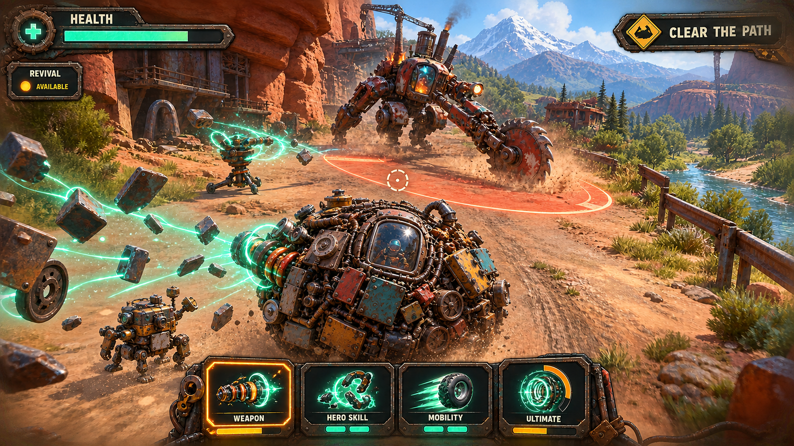

*U01. Combat HUD mockup, creative proposal. The four labeled cells are Weapon, Hero Skill, Mobility and Ultimate. The historical corrected mockup uses one AVAILABLE revival indicator; alpha displays any earned death save instead, alongside an assembled mechanical companion and a strongly irregular rolling scrap core. Layout and anonymous hardware remain proposals.*

The dashboard gives more space to the character, equipment, companion, map and settings. Its states must distinguish locked slot, unavailable upgrade, permitted equipment swap and special tree respec. The comparison below proposes those distinctions. Its map expresses a four-world journey and two destination options without selecting a canonical route. Between the HUD and the dashboard sits a proposed third state, a hold-to-view overlay: while the player holds a control it shows the current objective, what collected scrap does for the build and, during playtests, notes, and it can grow into the dashboard. A pause lets the player get their bearings (playtest entry 5). The overlay follows the AD-08 interface rules; its control, layout and contents remain open (Q-P30).

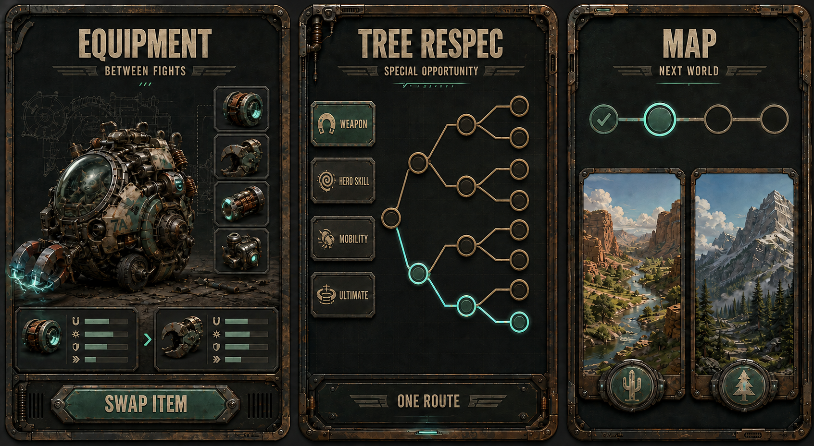

*U02. Dashboard mockups, creative proposal. Equipment is reconfigured between fights; tree respec requires a special opportunity; Map shows a separate destination choice. The historical revision shows the former eight-endpoint tree; the alpha uses four picks and sixteen endpoints, with one connected route selected. Exact node effects and milestone allocation remain open. Comparison bars and anonymous hardware are layout studies.*

Readable workshop instrumentation uses solid dark backing, clear labels and restrained indicators. Grime belongs at the border. Settings include sensitivity, sound, UI scale and impact shake, as demonstrated in the orchard. Keyboard navigation, focus restoration and pointer recapture must avoid accidental casts. Controller mappings need hardware evidence, and final production layouts need testing at actual viewing distances.

### Architecture and implementation handoff

The orchard keeps authoritative combat in `src/orchard/simulation.js`, rendering in `scene.js`, procedural models in `models.js`, and input/UI orchestration in `main.js` (this file map is superseded prototype evidence, 22 Sep 2026, and describes the browser proof only). Damage and telegraphs share committed geometry. Both `/` and `/orchard.html` remain available. The current locked Three.js/Vite stack supports the prototypes. The [accepted engineering ADRs](adr/README.md) define the separate production direction without changing what these proofs currently implement.

Content definitions describe pilots, trees, items, encounters and recipes. Encounter simulation owns immediate actions and outcomes. Run state carries path selections, inventory, fixed world position, companion assembly, earned death save and checkpoint status. Permanent progression stores unlocked options and discoveries. Rendering consumes these facts; it must not reroll loot, offers or committed attacks. Mind and the remembered cannon consume the same four attack-family definitions for geometry, timing, poses and cues.

The approved alpha plan supplies the world order, four-pick tree, six-pilot target, companion assembly default, death-save rule and unfinished-zone replay policy. Implementation still needs authored content and measured tuning, with scenario tests for saves, unlocks, compatibility and one-time rewards. The current authorization remains the light play lane; production migration and the untouched historical engineering sections are separate work.

Source basis: [Publisher discovery](docs/DISCOVERY.md), [runtime blueprint](docs/RUNTIME-BLUEPRINT.md), [requirements](docs/project/REQUIREMENTS.md), [current lightning contract](docs/project/INCREMENT-01-lightning-playtest.md), and [approved art direction](docs/bible/ART-DIRECTION-LOCK.md).

<!-- ART_DIRECTION_VERBATIM_START -->

## 7. Art Direction

### AD-01. Visual identity

SCRAPKEEP is a greasy junkyard adventure in a steam-cyberpunk universe. Pilots drive improvised electromagnetic mechs that pull in loose metal, grow, and recycle scrap into evolving weapons and skills. The core player silhouette remains an irregular rolling mass with a protected, readable cockpit and recognizable equipment. The current cast direction explores expressive animal pilots; an animal-only roster is not locked. Every mech should look assembled, worked on and repeatedly modified. Show welded ingenuity, physical weight and the delight of making discarded machinery do something outrageous.

### AD-02. Palette

Anchor the palette in dusty land, oily metal, worn paint and concentrated electromagnetic light. These swatches are the proposed revision for this gate.

| Color            | Hex       | Primary use                                                      |
| ---------------- | --------- | ---------------------------------------------------------------- |
| Sandstone        | `#c6a274` | Warm terrain, windblown dust and weathered masonry               |
| Iron oxide       | `#9b513a` | Rust, red rock and oxidized steel                                |
| Oil charcoal     | `#242a28` | Grease, tires, dark steel and UI backing                         |
| Weathered petrol | `#365754` | Old enamel, machinery bodies and cool recesses                   |
| Worn bone        | `#d2c5a5` | Faded paint, labels and pale mechanical contrast                 |
| Copper           | `#b77843` | Coils, windings, conductors and repaired plumbing                |
| Safety amber     | `#e5a044` | Industrial markings, hot work and pressure indicators            |
| Field mint       | `#8bf0d3` | The shared electromagnetic collection effect and energized coils |

Regional stone, vegetation, sky and class effects may add local colors. Preserve green valleys, cool mountains and pale dunes instead of tinting every scene orange. Energy accents are concentrated around working devices. Distinguish threats, pickups and scenery through shape, value and motion as well as hue.

### AD-03. Lighting

Use Southwest sun, long canyon shadows, broad open-sky fill and atmospheric distance. Desert light can be hard and bleaching; valley shade green and cool; mountain light crisp and blue. Workshops add welding flashes, amber work lamps and localized coil glow. Give each image one coherent lighting condition. Oil catches small sharp highlights against dusty matte surfaces. Steam and dust reveal movement and depth, while the cockpit, attack and available escape remain readable.

### AD-04. Render style and materials

Use stylized, chunky 3D construction with tactile surfaces and readable silhouettes. Favor mismatched panels, exposed weld beads, dented tanks, bolted repairs, frayed insulation, hose clamps, rubber treads and scavenged industrial parts. Place grease at joints, soot near vents, rust on weathered steel and dust on exposed faces. Include fresh repairs and rubbed metal where hands and moving parts work. Oily patches, cockpit glass and bare contact surfaces can reflect light. The rest stays rough, painted or oxidized. Keep grime substantial but shaped; simplify tiny detail before it obscures the mechanism or pilot. Aim for a battered workshop-built model with convincing material depth.

### AD-05. Steam-cyberpunk technology and recycling

Electromagnetism is the core technology. Show collector coils, magnetic pole pieces, heavy cables and metal fragments aligning or lifting toward an intake. Steam-pressure hardware, piston assemblies, vent stacks, patched electronics, indicator lamps and improvised controls share the same machine. The exact power source is not specified by the aesthetic.

The mech is a moving recycler and fabrication shop. Show the sequence: attract scrap, gather it into the growing body, process it internally, and construct changed armor, weapon parts and skill hardware. Cutaways can reveal intake jaws, sorting paths and a fabrication chamber. Upgrade sheets show meaningful changes to the weapon and three skills: main hero skill, mobility and ultimate. Scrap accumulation and internal construction must both be visible. The art does not assign conversion costs, mandatory mass loss or a new upgrade schedule.

### AD-06. Southwest landscapes

Build fictional regions from Southwest mountains, valleys, deserts and national-park-scale scenery. Use sandstone walls and river corridors, cactus country and rocky washes, forested mountain slopes and exposed summits, and pale sculpted dunes as distinct landscape families. Keep each place's geology, elevation and vegetation coherent. Broad natural landforms remain legible around junkyards, salvage depots, improvised settlements and industrial ruins. Terrain influences where people build and how their machines move. The earlier orchard and foundry ideas are candidates to adapt into this setting, not a mandatory region list or route order.

### AD-07. Civilizations and class expression

Characters and classes come from different parts of the universe. Their engineering traditions should change chassis construction, movement, tools and workshop design. If animal civilizations remain, explore fox stealth through compact mechanisms and muffled machinery; bird lightness and floating movement through open frames and lift hardware; tiger claw attacks through articulated talons, strong foreassemblies and replaceable cutting teeth. These are candidate directions, not approved roster assignments. Give individuals their own personalities within a civilization. All traditions still use electromagnetic salvage and visible internal fabrication.

### AD-08. Composition, scale and interface

Gameplay art uses close third person, with the mech prominent and action ahead visible. Maps, landscape studies, lineups, turnarounds and cutaways use their appropriate labeled views. Show growth within ordinary route clearance and escalate surrounding machines, terrain and battle consequences. Character A/B/C sheets share framing and scale; equipment lineups include a common size reference. Build HUD frames from legible workshop instrumentation: dark panels, clear labels, simple gauges and restrained luminous indicators. Decorative grease and distressed borders stay away from text, reticles and critical states.

### AD-09. Mood words

Greasy. Scrappy. Inventive. Rowdy. Weathered. Adventurous. Awe-filled.

The greasemonkey spirit is practical pride in a machine held together by skill and stubbornness. Humor comes from makeshift engineering, personality and forceful physical reactions. Let intimate workshops and battered little mechs sit beneath enormous skies and mountain walls. The world has beauty, living communities and room for discovery alongside its scrap heaps.

### AD-10. Reference descriptors

Draw from working junkyards, roadside repair shops, magnetic scrap handlers, homebuilt machinery and Southwest landforms. Combine steam-era pressure hardware with hacked electronics and electromagnetic devices. Katamari informs rolling accumulation; Team Fortress 2 and Overwatch inform distinctive class tools and readable action; The Binding of Isaac informs transformative combinations; Gurren Lagann informs escalating battle consequences. Hades informs encounter progression and Bloons informs upgrade-tree structure only. Borrow these relationships while creating original characters, places and machinery.

### AD-11. Never

For an explicitly labeled do/don't teaching pair only, the negative panel may deliberately violate the single visual rule named in its scene request. Every other rule still applies, and the positive panel must comply with the full direction. This exception never applies to ordinary concept art.

- Never clean the world into a pristine toy showroom or replace the accumulated rolling mech with a uniform factory shell.
- Never make collection look like unexplained floating loot. Show magnetic attraction and a credible path into the mech when depicting the collection action.
- Never reduce upgrades to cosmetic attachments alone. Show how recovered material becomes working weapon and skill changes.
- Never hide the pilot, working mechanism or class silhouette beneath scrap noise or uniformly smeared grime.
- Never use decorative gears, boiler pipes or neon as the sole explanation of the technology. Electromagnetic salvage must remain central.
- Never flatten the Southwest into one orange wasteland or scatter the same cactus props across forests, alpine slopes and dunes.
- Never turn every landscape into a scrap heap; preserve its landform, vegetation and natural scale.
- Never let steam, dust, bloom, sparks or distressed UI obscure an attack, its danger area, vital text or an escape route. Combat diagrams show the intended working tool and attack geometry.
- Never assign a species, civilization, class roster or fixed world route by treating an exploratory example as approved canon.
- Never imply unbounded player scale or mandatory transformations that break ordinary route clearance.
- Never copy recognizable franchise characters, costumes, logos or signature buildings, or present concept art as proof of implementation.

<!-- ART_DIRECTION_VERBATIM_END -->

### Applying the approved direction

The following guidance expands the frozen rules above. These teaching scenes are creative proposals for this review edition. They do not select a character chassis, approve a region layout, or establish a finished interface. Each negative panel breaks one named visual rule so the difference can be studied without changing the subject.

### Materials should explain the work

Begin a material pass by asking what touches the part. A hinge pumps grease out around its pin. A boot polishes a step. Hot exhaust darkens the vent mouth and leaves a directional trail. Wind drops dust on the upper faces of a tank; repeated handling exposes brighter metal on its latch. Those marks tell us how the machine operates before the pilot says a word.

Keep painted steel, rubber, copper, glass and oily joints distinct at gameplay distance. Broad rough paint establishes the body. Smaller exposed edges and contact faces catch sharper light. Reserve the darkest grease for useful pockets between readable forms. A fresh welded patch can interrupt old damage and make the owner present in the object. Tiny scratches belong late in the process, after the intake, cockpit and working tool already read.

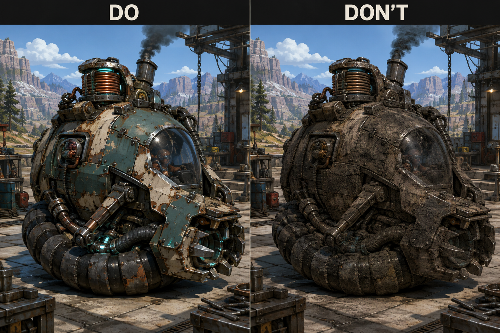

*A01. Teaching proposal, AD-04. DO places wear by material and use. DON'T coats the same mech with uniform dirty shading. The mistake is indiscriminate grime, not dirt itself; the approved world should look substantially worked.*

### Light belongs to a place

Choose the weather, time of day and open-sky color before adding device lights. A cool mountain workshop can carry warm lamps without warming the entire mountain. Canyon walls can bounce red light into shadows while the sky still gives exposed metal a cooler edge. Use atmospheric distance to separate an immense ridge from a small machine, preserving the ridge's shape instead of covering the horizon with effects.

Vegetation is part of regional structure. Draw its broad bands and relationship to rock before placing individual plants. Industrial terraces need believable ground or supports. Roads respond to slope, water and clearance. These decisions make a region recognizable when its machinery is removed. The same rocky crest should remain recognizable when settlement detail is added.

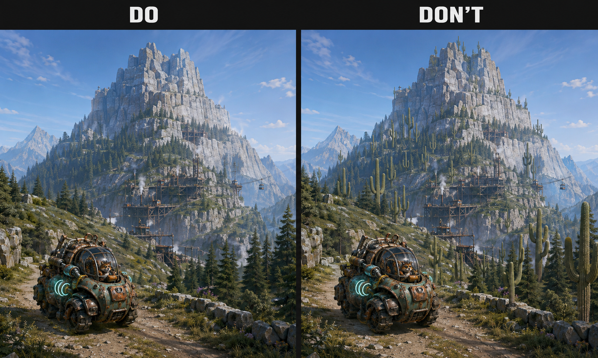

*A02. Teaching proposal, AD-06, using the Foundry Crown candidate. DO keeps cool forested slopes and an exposed rocky summit coherent. DON'T inserts desert cactus across the same mountain. The buildings, light and landform stay comparable so misplaced vegetation is the visible lesson.*

### A silhouette has a job

Start a mech drawing with the rolling mass, the protected cockpit and the tool that tells us how this pilot acts. Leave useful gaps around moving assemblies. Accumulated scrap can make the outline lopsided and increasingly imposing while the cockpit remains findable. Growth must still fit the ordinary paths depicted around it.

For a class sheet, vary construction where it changes behavior. A compact winch needs a readable line exit and a frame capable of taking the pull. A hovering expression needs lift hardware and clear separation from the ground. An articulated claw needs joints, a closing path and replaceable working teeth. Candidate animal expressions inform these mechanisms without turning a species into one compulsory personality.

### Make fabrication visible

A collection illustration needs a beginning and an endpoint. Loose metal aligns toward pole pieces, crosses a visible intake, and joins the mech's working body. A cutaway can then show sorting and internal fabrication. Give the viewer enough intermediate machinery to understand why the upgraded tool differs from its earlier form.

Compare the same weapon or skill assembly before and after construction. Show the changed working component, its feed or connection, and the retained attachment to the chassis. Keep weapon, main hero skill, mobility and ultimate identifiable. Avoid diagrams whose arrows imply a price, required body-mass loss or timed upgrade rule that the systems have not established.

### Preserve the decision inside the spectacle

In a chase view, the player needs to see the attacking tool, its dangerous ground, and somewhere to move. Build that composition before adding steam and sparks. Effects can intensify at the source, trail behind movement and spill into unused screen space. Their brightness should not erase the shape that tells the player what happens next.

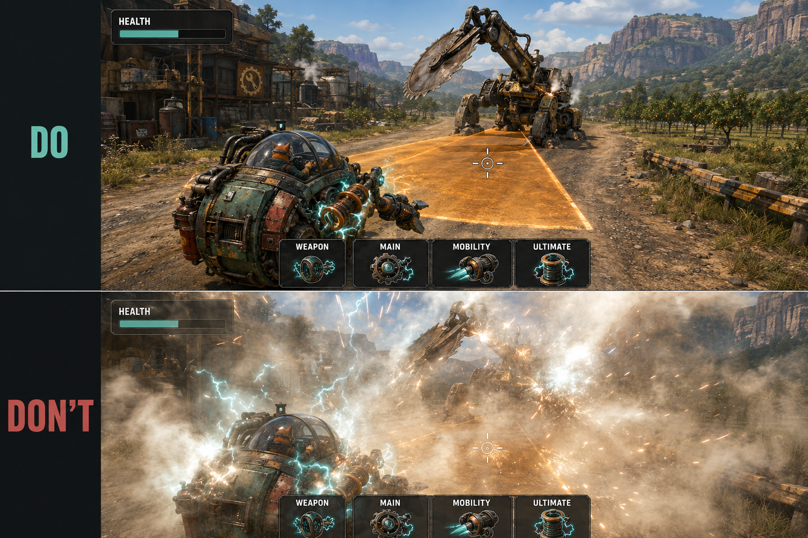

*A03. Diagrammatic combat mockup, AD-08. DO exposes the raised cutter, danger footprint, right-side escape and instrument panels. DON'T blankets the matching attack with effects. The illustrated footprint communicates intended geometry; it does not verify a hitbox or lock the future HUD.*

### Sheets that another artist can use

Use matched views and a shared scale reference for comparisons. Label A/B/C directions plainly and keep lighting consistent enough to judge construction. Separate a beauty view from any necessary cutaway or motion sequence. A useful sheet answers where the cockpit is, what moves, how scrap enters, and which feature identifies the role. Include the image ID and proposal status in its caption. If a generated detail contradicts the written rule, flag the detail for review; illustration does not silently amend the design.

## 8. Audio & Feel

### The machine should sound made by someone

Scrapkeep should sound like an ingenious machine working hard under an enormous sky. Rubber grips grit; a loose panel answers a landing; copper coils wake before metal lifts. The pilot can hear what their build is doing. An earned ultimate can turn the yard into a percussion instrument.

This section proposes the production target. Existing browser work provides synthesized WebAudio proof: the baseline has oscillator-based event sounds and a simple musical pattern, while the orchard has its own event-tone implementation. These establish a starting vocabulary, not a finished score, mix or tested feel. Keep development on existing free local tools and synthesized sound; broader sound production needs its own approved scope.

### Music direction

Build an original instrumental score around a dry, physical rhythm section: muted bass, brushed and struck drums, plucked strings, short electric-string slides and percussion made from believable workshop objects. Restrained synthesized pulses give energized machinery a musical relative. Uneven resonances suggest hands at work. Melody carries curiosity and stubborn confidence. No composer imitation, borrowed tune or lyrical reference is required.

Use shared musical material in several arrangements. Exploration leaves space between phrases. Rising pressure adds rhythmic subdivision and bass movement; sustained combat brings fuller percussion and a stronger melodic answer. A powerful build earns an additional energetic layer, not an indefinitely rising master volume. Boss phases can reorganize the rhythm; attack cues remain immediate.

Resolve arrangement changes at phrase boundaries when play allows. Danger must never wait for a beat. After a clear, release the busiest layers and let the region's actual ambience return before the next reward flourish. Avoid a restart sting whenever one leftover enemy appears. Judge transition timing in play. Stage events borrow these pressure layers as they rise and recede, a short stinger can announce an event before it becomes dangerous, and weather carries its own ambience layer in each region.

Regional variations do not select a run route:

| Region | Musical and environmental character |
| --- | --- |
| Yard Commons | Dry plucked figures, springy bass and small metal taps. Wind, distant repairs and settlement activity keep the desert inhabited. |
| Spillway Works | Longer ringing notes and interlocking rhythms. Pump strokes, water underneath platforms and canyon reflections give the arrangement breathing room. |
| The Iron Orchard | Supple repeating string figures and woody percussion. Irrigation ticks and machine cycles sit among leaves and sheltered valley air. |
| Foundry Crown | Low struck metal and broader phrases over spare percussion. Cableway creaks, furnace work and exposed mountain wind distinguish distance from danger. |
| Pale Basin | Widely spaced notes, brushed textures and thin sustained tones. Wind passing buried housings lets the white dunes remain open and strange. |

### Sound palette and audible information

The following palette is a creative proposal. Start with the working object before adding electrical treatment. Combat meanings remain consistent across regions.

| Action or source | Proposed cue and meaning |
| --- | --- |
| Magnetic attraction | A restrained coil hum gathers tension; washers chatter, align and strike the intake. Group a stream of small pickups into a flutter, with a heavier clunk for a substantial piece. Reserve field sounds for working magnetic hardware. |
| Recycling and fabrication | Rollers bite, sorting parts click, a press closes and a latch seats. The final mechanical lock confirms a changed weapon or skill. Collection and construction need different endings; neither sound invents a price or upgrade trigger. |
| Rolling, jumping and rebounds | Rubber, rough metal and terrain contact vary with the visible surface. Suspension compression grounds a jump or landing; a rebound has a sharper spring return. Growth adds body resonance without suggesting sluggish controls. |
| Weapons and class identity | Sable's compact winches use muffled tension and a decisive catch. Kest's lift machinery breathes beneath mortar recoil. Tarn's articulated claws build through tooth engagement and cutting contact. Fuse's unstable electrical pitches distinguish directed casts, automatic field activity and harmful miscasts. Rivet's alignment ticks resolve into a controlled beam tone. These remain candidate identities. |
| Enemies and telegraphs | Give threats preparation, commitment and release cues. Orchard cutters suggest teeth and closing joints; a Pruner arm suggests a large linkage taking load. Preparation helps locate danger, while shape and motion explain its exact area. Machinery ambience must not duplicate these warnings. |
| UI and build choices | Short switch clicks and latch tones confirm navigation or a committed selection. A denied action uses one dry interruption, not a damage alarm. Keep route selection, an equipment swap and an available respec audibly distinguishable without requiring sound to understand them. |
| Death save | Loss of machine rhythm gives way to a relay catch, renewed coil pulse and motor recovery. The earned item's save needs a different resolution from terminal defeat. A companion rescue cue must not promise a death save. |
| Discovery | Quiet local detail draws attention before acquisition. A compact, original musical phrase can mark a meaningful secret or new option; ordinary scrap should not spend that same sense of occasion. |

### Movement, impacts and combat rhythm

Joyful physical mastery includes the return to control. This proposed timing grammar links sound to action; it does not claim implemented camera behavior.

| Physical action | Cue, camera, impact and recovery |
| --- | --- |
| Bank and rebound | Contact chatter tightens with the turn; compression precedes a spring snap. Keep the route and aim stable. Let the shell respond to impact, then settle promptly enough to read the next choice. |
| Fire or strike | Preparation identifies the active tool. Put the sharp attack at actual contact, with body weight beneath it. A brief local recoil can sell force; reset motion and a quieter mechanical tail explain when the tool is ready again. |
| Deploy a device | A release click follows the player's command; a landing clunk and startup cue confirm placement. Keep camera ownership with the moving pilot. Avoid a cinematic pause. |
| Resolve an ultimate | Build anticipation around the player's earned action, then give its main consequence room in the mix. Concentrate camera response on that consequence and clear it quickly. Ongoing threats and the escape route remain readable through the tail. |

### Spectacle that leaves room to play

Prioritize imminent threats and player damage, then the player's meaningful action, then build reactions and background detail. Reduce repeated pickup, companion and secondary-hit layers when these collide. Preserve the initiating strike and the largest consequence of a chain reaction so the player can follow why the machine erupted.

Reserve the deepest weight, broadest musical arrangement and most pronounced physical response for events that earn them. Constant fizz, bass and camera kicks spend that contrast too early. Vary repeated mechanical details, cap overlapping tails and let recovery restore space. Strong builds may sound outrageous; they still need a next beat the player can hear.

Propose separate music and effects controls, reduced camera motion and a restrained dynamic-range option. Pair important audible warnings with visible information. Future review should compare the starting kit, a dense ordinary fight and an exceptional build through a long session, including quiet playback and sound disabled. This Bible includes no listening, controller or fatigue tests.

### Audio and motion concept sheet

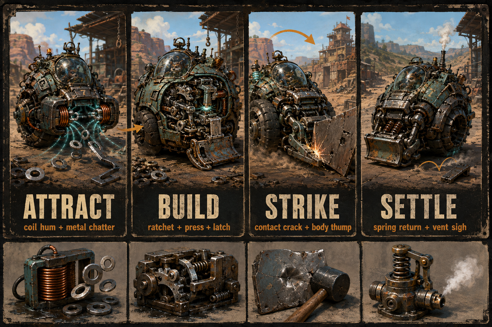

*F01. Annotated audio-and-motion concept proposal. ATTRACT pairs coil hum with metal chatter; BUILD pairs ratchet, press and latch; STRIKE pairs contact crack with body thump; SETTLE pairs spring return with vent sigh. The bottom strip shows an electromagnet and washers, a ratchet assembly, a steel plate and rubber mallet, and a pressure-release valve. The staged cutaway proposes construction; it is not engineering proof, a recording or tested feel.*

Source basis: [Publisher discovery](docs/DISCOVERY.md), [runtime audio direction](docs/RUNTIME-BLUEPRINT.md#8-audio-and-character-expression), [asset provenance](docs/project/ASSETS.md), and [approved art direction](docs/bible/ART-DIRECTION-LOCK.md).

## 9. Glossary

Use these spellings across writing, art and content definitions. Each named identity has one entry; shortened forms and prototype aliases stay in that entry. Candidate means creative proposal for this edition. Prototype means a bounded existing example, with future adaptation still open. Reference means an influence or production term, never an inhabitant of the fictional world. Tables are alphabetized by the displayed canonical name.

### Illustrated identity key

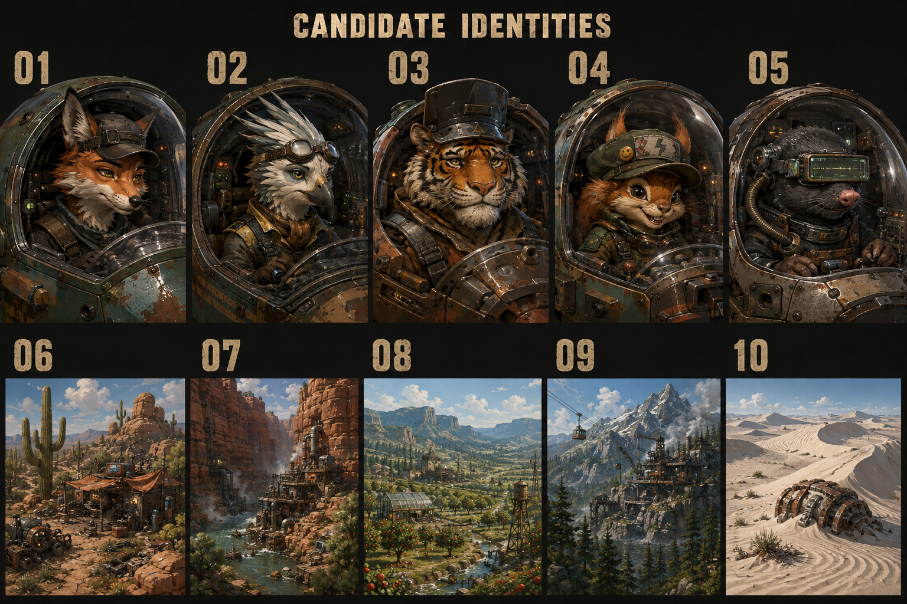

*G01. Illustrated reference proposal. Portrait keys: 01 Sable, 02 Kest, 03 Tarn, 04 Fuse, 05 Rivet. Landscape keys: 06 Yard Commons, 07 Spillway Works, 08 The Iron Orchard, 09 Foundry Crown, 10 Pale Basin. The rows are independent lists. Their columns assign neither home regions nor route order. Cropped cockpit portraits establish identity without selecting any A/B/C mech direction. The sheet's detailed fur and close cockpit treatment remain illustrative, not final character models.*

### Game, people, cultures and places

| Canonical name | Status | Definition |
| --- | --- | --- |
| Admiral Brindle | Candidate character | Small badger leading the Furnace Fleet. His requisition decisions damage local work; a final-boss role is unchosen. Brindle is the shortened form. |
| Foundry Crown | Candidate region | Forested mountain slopes rising to exposed ridges, with supported metalworking terraces, furnaces and cableways. No mandatory route position. |
| Furnace Fleet | Candidate organization | Mobile antagonist organization that requisitions useful machines and redirects electromagnetic salvage toward its own growing maintenance needs. Fleet is the shortened form. |
| Fuse | Candidate pilot | Squirrel itinerant apprentice whose directed elemental casting and short automatic field sometimes miscast with real harm or inconvenience. Final elements and failure rules remain open. |
| Highdraft Roosts | Candidate culture | Engineering tradition of open frames, tensioned loads and lift hardware, informing Kest. It sets neither bird temperament nor a mandatory home biome. |
| Kest | Candidate pilot | Observant bird operating a light hovering mortar expression around an enclosed rolling salvage core. Unrestricted flight is not established. |
| Moss | Candidate supporting character | Workshop keeper who makes maintenance social through practical familiarity with the pilots. Supporting appearance and species remain open. |
| Pale Basin | Candidate region | Fictional white mineral dunes, buried machinery and wind-driven maintenance under wide skies. The pale ground is dry sand, with no finale assignment. |
| Redjaw Workshops | Candidate culture | Engineering tradition of strong foreassemblies, pinned joints and replaceable cutting teeth, informing Tarn without making all tigers brawlers. |
| Rivet | Candidate pilot | Precise mole machinist with useful cyborg instrumentation, cutting optics and controlled beam geometry. Earlier foundry associations do not require a home region. |
| Sable | Candidate pilot | Observant fox from the Switchback Enclaves, expressing stealth and grapple traversal through compact quiet mechanisms. |
| SCRAPKEEP | Established project identity | Solo-first action roguelite about rolling electromagnetic salvage mechs, internal fabrication and earned build escalation across inhabited Southwest-inspired regions. Scrapkeep is a prose casing variant. |
| Spillway Works | Candidate region | Sandstone canyon and green river corridor shaped by reclaimed pumps, water infrastructure and suspended service paths. Spillway is the shortened form. |
| Switchback Enclaves | Candidate culture | Engineering tradition of compact winches, recoverable anchors, accessible repairs and noise control, informing Sable. Enclaves is the shortened form. |
| Tarn | Candidate pilot | Calm tiger repairer whose articulated claws and forceful close movement express the Redjaw Workshops' construction practice. |
| The Iron Orchard | Candidate full region; existing encounter basis | Cultivated upland valley with irrigation, patched greenhouses and maintained machinery. Iron Orchard and orchard shorten the name; the orchard prototype is only its bounded encounter proof. |
| Yard Commons | Candidate region | Living Sonoran foothills and rocky washes supporting scrapyard settlement and field repairs. It is not automatically the starting world. |

### Named mechanisms and equipment

| Canonical name | Status | Definition |
| --- | --- | --- |
| Brace Shoe | Prototype equipment example | Older bracing-equipment name retained in the region catalogue. The current prototype calls its recovery/protection pickups Brace, Braces or Brace parts. No final item name is selected. |
| Echo | Prototype item | Repeats eligible player, conductor and companion attacks once, including compatible Ground Loop lightning. Repeats cannot recurse. Lowercase echo also means ordinary acoustic or action recurrence; it does not always name this item. |
| Grand Pruner | Candidate boss | Proposed complete orchard boss developed around pruning machinery. It is distinct from the implemented Pruner arm and has no demonstrated full-boss encounter here. |
| Ground Loop | Prototype item | Adds lightning chains to body impacts, including rams and landing rebounds. It illustrates a compatible modifier, not a universal movement rule. |
| Pruner arm | Implemented encounter mechanism | Large articulated orchard cutting threat with committed attack geometry. Its existence does not complete the Grand Pruner proposal. |
| Shear Buddy | Prototype companion | Existing shearing helper whose attacks prime targets. Also called the priming companion or Shear companion. Its automatic prototype acquisition does not define future loot assembly. |
| Shear Linkage | Prototype equipment example | Pickup that strengthens body rams; the first equips the prototype companion. Shear Linkages, Shear and Shear parts refer to this family. |
| Snipcart | Prototype enemy mechanism | Orchard machine whose inward-closing jaws provide a recognizable cutting threat. |
| Spreadleg | Prototype enemy mechanism | Orchard machine whose outward-moving feet create a different committed danger shape. |

### External references and technical names

These definitions record how this Bible uses a reference. They grant no permission to copy its characters, signature objects or visual identity. The real landscapes supply ingredients for fictional geography.

| Name | Use in this Bible |
| --- | --- |
| AI | Artificial intelligence; enemy decision behavior in the systems discussion. Proposed behavior is not implemented evidence. |
| Andrew | Publisher and owner of the outstanding creative and scope decisions. |
| Bloons | Reference for upgrade-tree structure only. |
| Codex | Agent application used to produce this document and its local artifacts. |
| gpt-6-astra | Codex execution model named in the production record, not a game technology choice. |
| Great Basin National Park | Landscape reference, shortened to Great Basin, for ecological bands across mountain elevations. |
| Gurren Lagann | Reference for escalating battle consequences while ordinary player routes remain usable. |
| Hades | Reference for encounter progression. |
| HUD | Heads-up display; immediate combat information arranged around the visible action. |
| Katamari | Reference for rolling accumulation. |
| National Park Service | Primary source organization for the landscape pages cited in Appendix B. |
| Overwatch | Reference for distinctive class tools and readable action. |
| PC | Personal computer; the standalone production target, with controller support. Browser proofs do not select its engine. |
| Saguaro National Park | Landscape reference, shortened to Saguaro, for living Sonoran vegetation and terrain variation. |
| SHA-256 | Hash method identifying the exact approved Art Direction text in the production record. |
| Sonoran | Real desert-region reference for Yard Commons' living cactus country, rocky washes and foothills. |
| Southwest | Real landscape reference for the fictional mountains, valleys, deserts and broad natural scale; no literal connecting geography is asserted. |
| Team Fortress 2 | Reference for distinctive class tools and readable action. |
| The Binding of Isaac | Reference for transformative equipment combinations. |
| Three.js | Rendering library in the existing browser prototypes, not a chosen standalone production engine. |
| Tularosa Basin | Real basin named in the White Sands source context; it does not locate Pale Basin on a real map. |
| UI | User interface, including combat instrumentation, dashboard, navigation and settings. |
| Vite | Tool in the current locked browser-prototype stack; no production-engine decision follows from its use. |
| WebAudio | Browser sound technology used for existing synthesized event sounds and musical proof. It does not supply the proposed finished score or mix. |
| White Sands National Park | Landscape reference, shortened to White Sands, for white gypsum dunes and their value contrast. |
| Zion National Park | Landscape reference, shortened to Zion, for sandstone cliffs, river-cut canyon routes and valley form. |

### Common system terms

| Term | Shared meaning |
| --- | --- |
| A world worth crossing | Pillar requiring distinct landforms, inhabited places, local engineering and discoveries worth traveling for. |
| Attunement | Compatibility between an item and a character, another item, or both. Exact eligibility remains open. |
| Endpoint | One possible terminal outcome of a pilot's alpha tree. Four binary picks pass through two, four, eight and sixteen nodes, yielding sixteen endpoints. A run selects one connected path without crosspathing. |
| Fixed secret bonus | Repeatable result of an eligible endpoint combination. Knowledge may persist; its active effect requires the current run's eligible build. |
| Joyful physical mastery | Pillar requiring satisfying movement, active aim, understandable threats and a useful starting kit. |
| Respec | A branch change permitted through a special opportunity. Ordinary between-fight equipment reconfiguration is separate. |
| Scrap becomes your build | Pillar connecting electromagnetic accumulation and internal fabrication to visibly changed working equipment and earned combinations. |
| World | Run-region containing open stages and a boss. Three worlds in a fixed order form a successful run; the other catalogue candidates stay out of it. A stage is one bounded 3D space on momentum terrain, entered, roamed and left through an exit; it replaces the earlier compact encounter level. |
| Death save | A rare earned item that saves one death (details to come, DECISIONS 22 Oct). Without it, a death ends the run and restarts at world 1; companion rescue does not silently grant one. |

Definitions follow the corresponding sections above. Prototype aliases are reconciled against the [lightning play guide](docs/LIGHTNING-PLAYGUIDE.md) and [character planning](docs/CHARACTER-BIBLE.md); external reference boundaries follow the approved Art Direction and Appendix B.

## Appendix A: Image prompts and provenance

Every submitted prompt below contains the approved Art Direction verbatim. Concept images are proposals or labeled explanatory studies. The body displays the selected attempt for each image. Original attempts remain here beside each correction. Each audit-flagged asset received one automatic correction; U02 then received a separate revision explicitly requested by Andrew to show recursive binary branching. That owner-directed revision is recorded as attempt 3. Captions and the cohesion report identify limitations; no image establishes a working game system.

| Image / attempt | Section | Image file | Full prompt |
| --- | --- | --- | --- |
| P01 / 1 | 1 | [Open image](docs/bible/images/P01-v1.png) | [Prompt file](docs/bible/prompts/P01-v1.txt) |
| W01 / 1 | 2 | [Open image](docs/bible/images/W01-v1.png) | [Prompt file](docs/bible/prompts/W01-v1.txt) |
| W02 / 1 | 2 | [Open image](docs/bible/images/W02-v1.png) | [Prompt file](docs/bible/prompts/W02-v1.txt) |
| W03 / 1 | 2 | [Open image](docs/bible/images/W03-v1.png) | [Prompt file](docs/bible/prompts/W03-v1.txt) |
| W04 / 1 | 2 | [Open image](docs/bible/images/W04-v1.png) | [Prompt file](docs/bible/prompts/W04-v1.txt) |
| M00 / 1 | 3 | [Open image](docs/bible/images/M00-v1.png) | [Prompt file](docs/bible/prompts/M00-v1.txt) |
| M01 / 1 | 3 | [Open image](docs/bible/images/M01-v1.png) | [Prompt file](docs/bible/prompts/M01-v1.txt) |
| M02 / 1 | 3 | [Open image](docs/bible/images/M02-v1.png) | [Prompt file](docs/bible/prompts/M02-v1.txt) |
| M03 / 1 | 3 | [Open image](docs/bible/images/M03-v1.png) | [Prompt file](docs/bible/prompts/M03-v1.txt) |
| M04 / 1 | 3 | [Open image](docs/bible/images/M04-v1.png) | [Prompt file](docs/bible/prompts/M04-v1.txt) |
| M04 / 2 | 3 | [Open image](docs/bible/images/M04-v2.png) | [Prompt file](docs/bible/prompts/M04-v2.txt) |
| M05 / 1 | 3 | [Open image](docs/bible/images/M05-v1.png) | [Prompt file](docs/bible/prompts/M05-v1.txt) |
| C01 / 1 | 4 | [Open image](docs/bible/images/C01-v1.png) | [Prompt file](docs/bible/prompts/C01-v1.txt) |
| C02 / 1 | 4 | [Open image](docs/bible/images/C02-v1.png) | [Prompt file](docs/bible/prompts/C02-v1.txt) |
| C03 / 1 | 4 | [Open image](docs/bible/images/C03-v1.png) | [Prompt file](docs/bible/prompts/C03-v1.txt) |
| C03 / 2 | 4 | [Open image](docs/bible/images/C03-v2.png) | [Prompt file](docs/bible/prompts/C03-v2.txt) |
| C04 / 1 | 4 | [Open image](docs/bible/images/C04-v1.png) | [Prompt file](docs/bible/prompts/C04-v1.txt) |
| C05 / 1 | 4 | [Open image](docs/bible/images/C05-v1.png) | [Prompt file](docs/bible/prompts/C05-v1.txt) |
| E01 / 1 | 5 | [Open image](docs/bible/images/E01-v1.png) | [Prompt file](docs/bible/prompts/E01-v1.txt) |
| E02 / 1 | 5 | [Open image](docs/bible/images/E02-v1.png) | [Prompt file](docs/bible/prompts/E02-v1.txt) |
| U01 / 1 | 6 | [Open image](docs/bible/images/U01-v1.png) | [Prompt file](docs/bible/prompts/U01-v1.txt) |
| U01 / 2 | 6 | [Open image](docs/bible/images/U01-v2.png) | [Prompt file](docs/bible/prompts/U01-v2.txt) |
| U02 / 1 | 6 | [Open image](docs/bible/images/U02-v1.png) | [Prompt file](docs/bible/prompts/U02-v1.txt) |
| U02 / 2 | 6 | [Open image](docs/bible/images/U02-v2.png) | [Prompt file](docs/bible/prompts/U02-v2.txt) |
| U02 / 3 | 6 | [Open image](docs/bible/images/U02-v3.png) | [Prompt file](docs/bible/prompts/U02-v3.txt) |
| A01 / 1 | 7 | [Open image](docs/bible/images/A01-v1.png) | [Prompt file](docs/bible/prompts/A01-v1.txt) |
| A02 / 1 | 7 | [Open image](docs/bible/images/A02-v1.png) | [Prompt file](docs/bible/prompts/A02-v1.txt) |
| A03 / 1 | 7 | [Open image](docs/bible/images/A03-v1.png) | [Prompt file](docs/bible/prompts/A03-v1.txt) |
| F01 / 1 | 8 | [Open image](docs/bible/images/F01-v1.png) | [Prompt file](docs/bible/prompts/F01-v1.txt) |
| G01 / 1 | 9 | [Open image](docs/bible/images/G01-v1.png) | [Prompt file](docs/bible/prompts/G01-v1.txt) |

The complete submitted prompt texts live in [docs/bible/prompts/](docs/bible/prompts/) and are no longer inlined in this document.

## Appendix B: Sources and approval record

### Approval and precedence

Andrew requested the nine-section Art & Game Bible, a cohesion audit and a decisions list, with no build work. He then corrected the initial art draft toward junkyard and greasemonkey steam-cyberpunk, electromagnetic scrap attraction, internal recycling into weapon and three-skill upgrades, civilizations with distinct engineering traditions, and Southwest mountains, valleys, deserts and national parks. He approved the revised gate with "proceed, looks great now" on 6 September 2026.

The Art Direction between the marked boundaries in Section 7 is that approved text, preserved byte for byte. The phrase "proposed revision for this gate" inside it is historical wording in the approved block, not an outstanding palette approval. Its SHA-256 is `0f694b904454716669d844e833973852c51a6ec48c719918797b06a7841322c7`. Every submitted image prompt includes the same block. The [lock file](docs/bible/ART-DIRECTION-LOCK.md) is the generation copy; Section 7 remains the reader's reference.

The latest publisher direction and approved block take precedence over older clean-ivory art assumptions, matte-only restrictions and earlier species-to-class assignments. The remaining established run and slot-tree decisions continue to apply. New names, civilization details and adapted region fiction in this edition are labeled creative proposals.

### Planning sources

During the image review, Andrew explicitly requested nodes that fork into two upgrades, with each node forking into two again. Combined with the established eight endpoints, the accepted shape is one root → two → four → eight, with one connected lineage selected. U02 attempt 3 records this owner-directed revision after its automatic audit correction. The [revision record](docs/bible/production/owner-revisions.json) preserves the instruction and aligned documents. The frozen Art Direction did not change.

| Source | Contribution and limits |
| --- | --- |
| [Publisher discovery](docs/DISCOVERY.md) | Accepted rolling and caster identity, four slot trees, progression, loot, revival and reference boundaries. The latest art and animal-cast correction is recorded above. Its original four-world, 60–75 minute run is now three worlds and 30 to 45 minutes (2 Oct ruling). |
| [Decision register](docs/project/DECISION-REGISTER.md) | Accepted notebook rulings and unresolved lifecycle/content details. Old palette questions are superseded for this Bible by the approved revision. |
| [Character planning](docs/CHARACTER-BIBLE.md) | Earlier candidate characters, the chaos novice, supporting relationships and Furnace Fleet fiction. This is a proposal source, not a final roster. |
| [World and environment kits](docs/WORLD-ENVIRONMENTS.md) | Occupational machinery and candidate regions adapted into the Southwest setting. The former fixed campaign ladder is not adopted. |
| [Level design](docs/LEVEL-DESIGN.md) | Route readability and terrain ideas. Its compact encounter structure is superseded by open stages (TADR-010). Historical dimensions and worked stages remain examples. |
| [Runtime blueprint](docs/RUNTIME-BLUEPRINT.md) | Content, encounter, run and permanent-profile responsibilities; system invariants and unresolved implementation details. |
| [Requirements](docs/project/REQUIREMENTS.md) | Distinguishes accepted future direction from the implemented proofs. |
| [Selected orchard study](docs/CONCEPT-STUDY-03.md) | Shared enemy-family mechanisms and the separation between promising concept art and resolved motion/geometry. |
| [Current lightning contract](docs/project/INCREMENT-01-lightning-playtest.md) | Prototype controls, geometry ownership and bounded equipment examples. Its exact kit and caps are not universal class rules. |
| [Project desk](docs/project/README.md) and [CONTRIBUTING](CONTRIBUTING.md) | Existing project ownership, source conventions and verification boundaries. |

### Landscape references

The following primary National Park Service pages were checked during the style-gate revision. They support natural ingredients. Fictional settlements, lighting keys and gameplay applications are this edition's creative interpretation.

- [Zion geology](https://www.nps.gov/zion/learn/nature/geology.htm) describes layered cliffs, river-cut sandstone canyons and a flat-bottomed valley. These inform large rock planes and canyon routes.
- [Saguaro plants](https://www.nps.gov/sagu/learn/nature/plants.htm) describes diverse drought-adapted Sonoran vegetation and variation across terrain. This informs a living desert with distinct plant silhouettes.
- [Great Basin flora](https://www.nps.gov/grba/learn/nature/great-basin-flora.htm) describes sagebrush, woodland, conifer, subalpine and alpine communities across elevation. This informs the mountain region's ecological bands.
- [White Sands geology](https://www.nps.gov/whsa/geology.htm) describes white gypsum dunes in the Tularosa Basin. This informs the pale basin's terrain and value contrast.

These references do not assign real park names to the fictional map or establish a literal geography connecting the regions. No remote photograph was incorporated into a generated asset.

### Production and evidence

Nine section workers use separate detached local worktrees, all on `gpt-6-astra` with high reasoning effort. The coordinator owns the shared content inventory, serial admission, exact prompt preservation and final document. The [production brief](docs/bible/production/SECTION-BRIEF.md) records that shared inventory; the [source snapshot](docs/bible/production/source-snapshot.json) records the planning files used.

All new concept art uses the built-in image generator. Appendix A preserves the full submitted prompts and project-local images. Concept art does not supply production meshes, rigs, hitboxes, audio recordings or game-feel evidence. The cohesion report records the method, individual findings, the four automatic corrections, Andrew's separate U02 revision and remaining concept limitations. The decisions list records unresolved design choices rather than silently resolving them through an image. The [final source snapshot](docs/bible/production/source-snapshot-final.json) records files after reference-pointer and binary-tree alignment; the original snapshot remains preserved.
