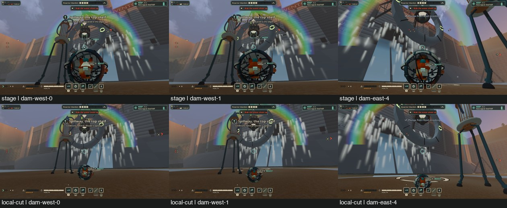
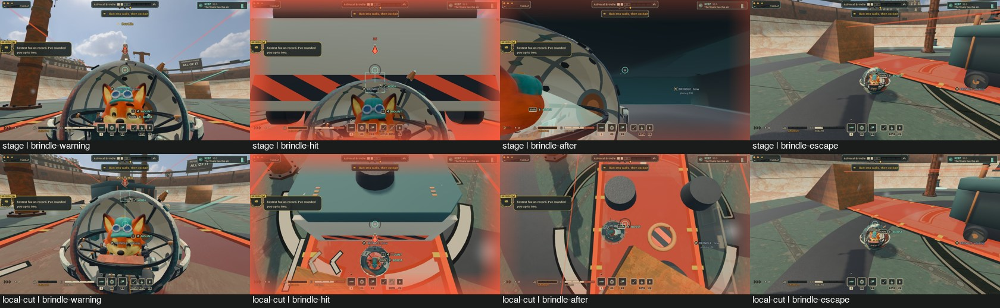
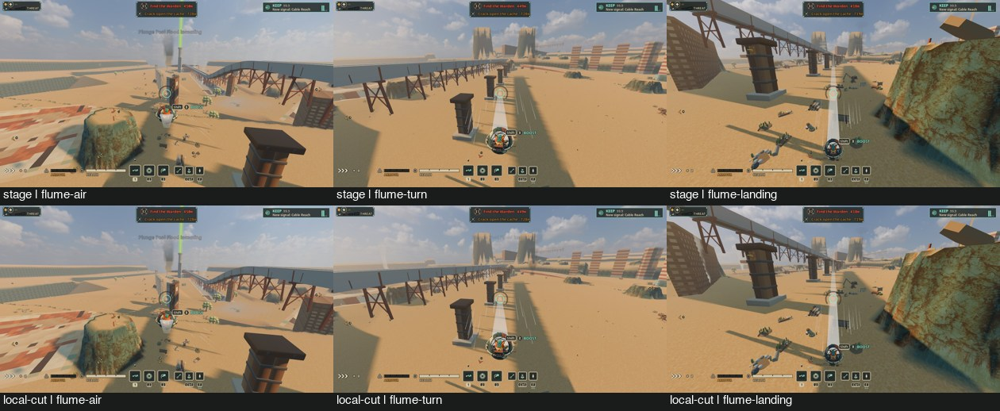

# The floor stays visible at the dam and under Brindle

At the water sheet the chase camera pitches its arm above the floor while the rider looks up at the reactor. Near Brindle the camera can rise above the bow. When a charge carries the outer hull through the ball, only the parts over the rider become translucent during the existing shove. Their camera boxes return as the rider clears them.

The upper row of each strip is stage `bf8056479`. The lower row runs this change. Both use Godot 4.7.2 on the Apple M5 Max, Forward+ Metal, 1280 × 720, High, a fixed 90 Hz step and a separate save folder. The two dam approaches use the position and look from the [original audit](https://github.com/bananahana720/scrapkeep/pull/1124). In the moving fixture the rider starts three metres back, then rolls toward each recorded position.



On the west approach the spring arm reached 3.34 m before the change and 8.44 m after it. On the east approach it reached 3.29 m and 8.19 m. The straight probe on the east tile met a normal with Y = 0.99937. The old probe treated it as floor and never lifted. The changed view leaves the white water-sheet perimeter and both sides of the ball in view. The full reactor ring still exceeds the top edge at the steeper east angle.



Brindle lays his normal committed lane. The first charge hits, the second misses the sidestep. At impact the stage arm stopped on the bowl at 2.02 m. The high view reached 7.50 m. At 0.30 s after impact the stage reached 1.15 m under the hull and the changed view reached 8.46 m. The two playthroughs agree on the ball position at both samples. The right and left sides of the lane are visible around the nose at contact. During the shove the ball crosses toward the left edge. The cool floor beyond it remains in view. A pitch-only trial still put the lens inside both the hull and its fittings box after impact.



The open flume arm reached 9.74 m in the air, 10.19 m at reversal and 11.95 m on landing on both builds. The rolls use the same inputs. The camera tests cover an overhead roof, a brief pillar pass, an ordinary enemy, mounted aim, reduced motion and the camera returning to its normal view.

[Stage measurements and oriented boxes](stage.json) · [Changed measurements and oriented boxes](candidate.json) · [Matched capture fixture](contact_capture.gd)

To reproduce, import the checkout with `node scripts/import-stamp.mjs import`. On the Mac, run the following from the repo root with `GODOT_BIN` set to the Godot 4.7.2 executable. On the Gate PC use its scratch launcher. For the baseline place the same capture fixture outside the imported stage project and pass that path to `--script`.

```sh
capture=$(mktemp -d "$PWD/artifacts/local/contact-XXXXXX")
mkdir -p "$capture/home"
env HOME="$capture/home" "$GODOT_BIN" --path sketches/core-loop --audio-driver Dummy \
  --resolution 1280x720 --fixed-fps 90 --disable-vsync \
  --script "$PWD/artifacts/visual-audit-w44/camera-contact/contact_capture.gd" -- \
  --out="$capture" --only=lobber --models=tripo --ball-look=cutaway --profile=sitting --preset=high
```

The fixture uses the existing danger-mark capture scene's custom encounter hook, selected with `--only=lobber`. It spawns the real Warden on the dam and keeps incidental packs out of the comparison. It enables normal charge damage and the sideways shove in the bowl. These staged encounters establish the view and geometry at the recorded moments. The original seed-1 film also reproduced the 3.26 m floor contact at the west dam approach. That second played run won without taking a charge. The standing rider in the matched fixture supplies the direct-hit comparison.
