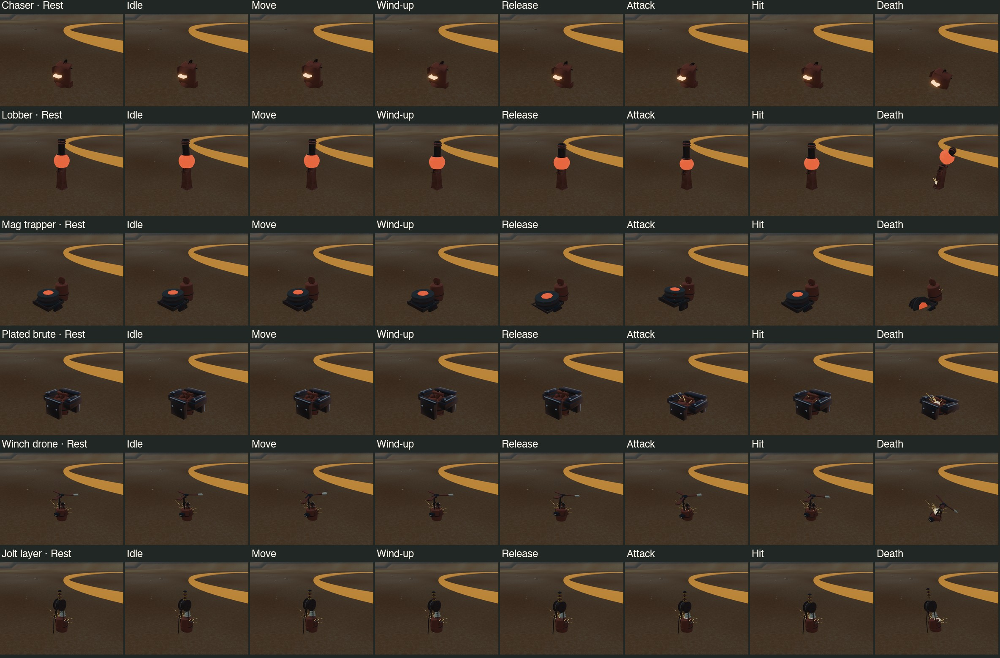
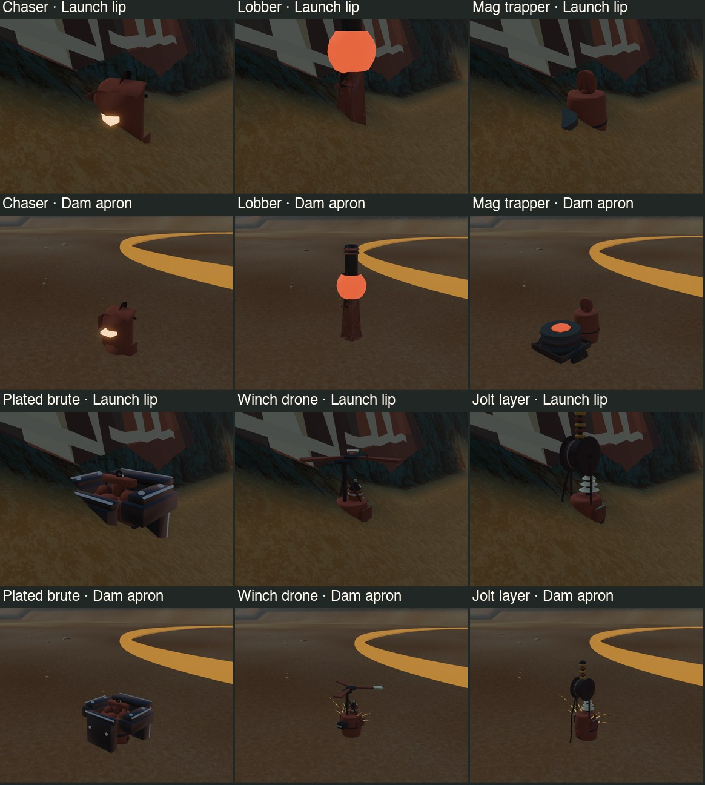

# Spillway crew pose gallery

The stock capture now poses the six machines on the dam apron when it loads the Spillway park. All 48 tiles show the full camera frame. Compare the lobber's barrel and base, the mag trapper's disc and the brute's front plate against the launch lip. The winch drone's suspended body and the jolt layer's side rod also clear the foreground slope.





## How to reproduce the gallery

With Godot 4.7.2 and an imported sketch, run the following from the repository root in a graphical macOS session. Set `GODOT_BIN` to the Godot executable. The display runner uses a private game home.

```sh
node --input-type=module <<'JS'
import { runWindowed } from "./scripts/gate/display-run.mjs";
const result = await runWindowed({
  script: "res://tools/enemy_clip_capture.gd",
  engineArgs: ["--audio-driver", "Dummy", "--fixed-fps", "60", "--resolution", "640x480"],
  args: ["--out=" + process.cwd() + "/artifacts/local/park-poses", "--table=park",
    "--profile=sitting", "--models=tripo", "--ball-look=cutaway", "--preset=high"]
});
console.log(result.output);
process.exitCode = result.exit ?? 1;
JS
```

Godot 4.7.2 on macOS rendered the gallery with Metal Forward+ at source commit `527be9de6`. Its manifest matches the launch-lip capture on `bf8056479` for all six machines, eight pose labels, sample times and 640 × 480 frames. Across those 48 frames the largest per-image mean absolute RGB difference from the disposable apron reference was 0.37 on the 0–255 scale. A separate default-table run kept the chaser at the original angle and distance across all eight poses (largest mean difference 0.03 against the default-table reference).

Both captures exited 0 and wrote their manifests. Godot reported renderer cleanup errors on exit, as it did during the original audit. These frames sample the clip library from a paused three-quarter view. The running encounter adds scripted movement, wind-up, projectiles and the chase camera.
