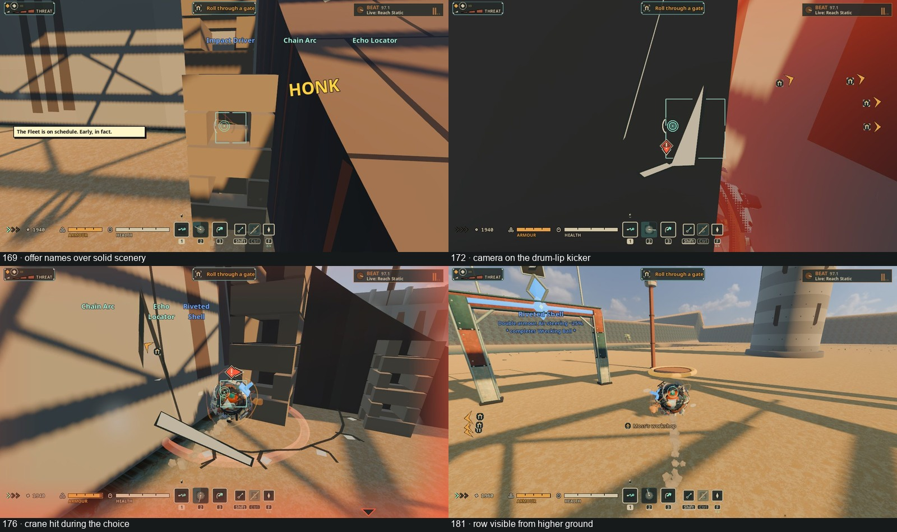
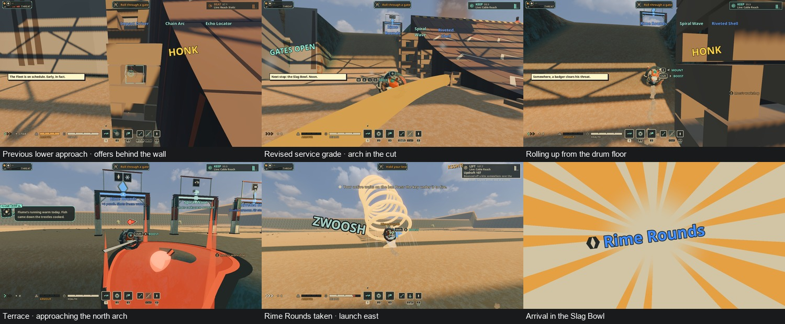
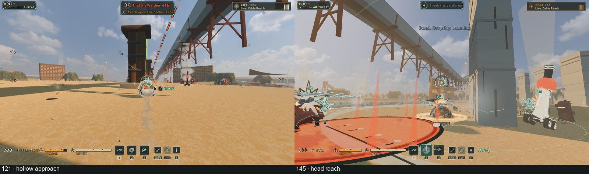
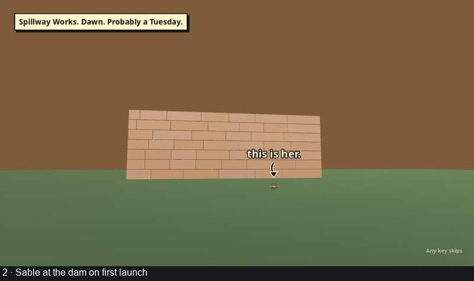
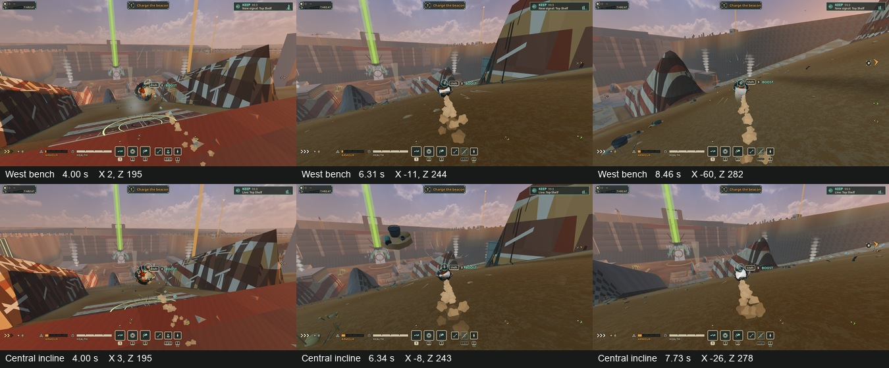

# Spillway design handoff follow-up, 17 November 2026

The combined ride exposed three visual problems. Steel and terrain hide the reward arches from the drum floor, two elevated reaches have feet hanging in the air, and Sable appears below a bare wall in her opening shot.

The [current World 1 work list](../../BACKLOG.md#world-1-work-assigned-on-17-november) links the resulting repairs and the outstanding player or platform checks.

## What was checked

The team compared all 13 briefs and their source images against the five design candidates, the five gameplay candidates used in the combined ride, and the wave board. The eleven PRs in that handoff had seven conversation comments before this follow-up. The recorded independent verdicts were in those conversations. The review also inspected all twelve neighboring merged PRs on this stage. Across PRs 1107–1129 the inline review endpoints returned zero comments. A closing read also inspected issues, reviews and inline discussions on PRs 1130–1139. Sable’s fresh-profile drives passed 13 steps on High and 15 on Low. They reported renderer cleanup diagnostics at shutdown. The trestle review’s separate freestanding towers became W1-129. [Original briefs and images](https://github.com/bananahana720/scrapkeep/tree/f5c187b9d8eba702336fac765559d5cf2db873d9/project-guide/handoff/shared/world1/visual-audit-w44) · [Previous handoff and test receipts](https://github.com/bananahana720/scrapkeep/blob/4b60105aa67e5137a39aab1d4e0c28390f0ebe5e/project-guide/handoff/shared/world1/visual-audit-w44/HANDOFF.md) · [Widened wave decision](https://github.com/bananahana720/scrapkeep/issues/1106#issuecomment-6953059241)

All 237 sampled frames of the combined seed-1 Sable ride were inspected, from first launch through the last two sampled victory frames. The ride crossed both rewards and won at 413.88 s. The film covers menu/build states, effects, handovers and boss phases. Frames are sampled, so the gaps between them, later victory behavior, Linux hardware and human readability remain outside this read. [Played source](https://github.com/bananahana720/scrapkeep/tree/e5ec6cff0704ca441f2f9f5c646e6f49dcefff28) · [Frame-by-frame state](https://github.com/bananahana720/scrapkeep/blob/4b60105aa67e5137a39aab1d4e0c28390f0ebe5e/artifacts/visual-audit-w44/evidence/combined-film.ndjson)

## The flume reward approach

Frames 0168–0180 put the camera and ball below the Drum's lip. A Godot 4.7.2 static reconstruction used each recorded position, all three authored slot centres at crossbar height, and the stage's real collision. All 78 rays to these three slots hit the kicker or terrain tile 6_7. All six rays cleared from frame 0181 on the higher ground. The historical four-offer row shifts the crossbars to Z459, 473, 487 and 501. A second reconstruction used those positions from the runtime four-offer layout. Before the fix all 104 lower sightlines were blocked. With the service grade all 26 to the north arch were clear, 14 of 26 to the next arch were clear, and all eight terrace controls remained clear. [Four-offer baseline and candidate](four-offer-sightlines.csv) The HUD projection and arch selection checks in PR 1126 still pass. A rider needs a visible way out and a physical arch to steer toward. [Sightline readings](gate-sightlines.csv) · [Sign and pickup checks](https://github.com/bananahana720/scrapkeep/pull/1126)

The same rogue crane hit the rider at 198.04 s, before the gates opened at 285.03 s, and again at 291.45 s. The attack ID and commit time were absent from the film. Park event announcements observe a 20 s calm interval. An already spawned enemy can act during gate choice. A headless comparison placed the same rider at the filmed contact coordinates and staged the crane’s 24-damage gate drop. Its 6 m ring committed on tick 154 and landed on tick 348 at 90 Hz. The stopped rider took one hit. Holding forward 12 ticks after commitment climbed the service grade and cleared the ring by 12 m at impact. This establishes a rolling escape for that attack. The historical film lacks the ID needed to identify its attack conclusively. [Paired crane reads](crane-gate.txt) [Event scheduling](https://github.com/bananahana720/scrapkeep/blob/e5ec6cff0704ca441f2f9f5c646e6f49dcefff28/sketches/core-loop/src/world/event_director.gd#L386) · [Playable flow states](https://github.com/bananahana720/scrapkeep/blob/e5ec6cff0704ca441f2f9f5c646e6f49dcefff28/sketches/core-loop/src/core/flow.gd#L186)

The revised service grade keeps the reward row and eastward launch in place. An early cut exposed the arch but failed the heavy-ball approach. Shortening the grade restored the level run-in. The final High keyboard drive climbed from the drum through a three-offer row and took Rime Rounds. Its last picture was taken 0.06 s into boss state with the stamp still covering the view. Two headless Low input drives continued through the end of the swipe. Each crossed the first arch from the floor, received Spare Cell, and reached an unfrozen rider in the bowl after the cover cleared. One offered three parts and one offered four, including an active. In separate matched runs, steering left and right from the same uncovered position put the rider 4.50 m apart after half a second for each offer count. [Reads after uncovering](bowl-input.txt) · [Separate rider view of the uncovered bowl](https://github.com/bananahana720/scrapkeep/blob/ae3852c3e682d93c665186461be531225be92de6/artifacts/spillway-routes-w44/bowl-approach.jpg) The old terrain and opaque liner both failed the new checks. [Service grade candidate and tests](https://github.com/bananahana720/scrapkeep/pull/1134)

The service grade changes the authored park schedule input. Seed 0 preserved its whole-run hash and failed the old schedule pin. The Gate has the [20 Mac schedule measurements](flume-schedules.txt) for this candidate. On the [private combined playback](https://github.com/bananahana720/scrapkeep/commit/6c8b3b1b9), all 20 Mac schedules changed and all 20 whole-run values still matched. After recording the Mac schedules, the ordinary seed-0 tier test passed all 177 checks, including both pins. The Gate can reuse those Mac pins if it stacks the same park rows. Linux needs its own measurements.

## Two elevated reaches and Sable's first shot

Frames 0121 and 0145 look up from the lower route. The repeated steel frames stop in open sky at two separate reaches. The authored deck height is fixed and the modeled support extends only about 6 m below it. The repaired spans seat 148 exposed steel feet across three reaches and keep all 71 checked passages open for the rider. The revised mesh also supplies the footings’ collision. [Rider-height before and after, and physics checks](https://github.com/bananahana720/scrapkeep/pull/1133) [Flume sites](https://github.com/bananahana720/scrapkeep/blob/e5ec6cff0704ca441f2f9f5c646e6f49dcefff28/sketches/core-loop/src/world/park/park_flume.json#L51)

The title storyboard calls for a low view over water with tiny Sable on the dam crest at dawn. Frame 0002 places her below the wall with no crest under her. The replacement postcard seats tiny Sable on the authored crest with the waterline below her and preserves the arrow and the two-bar opening. [High and Low comparisons](https://github.com/bananahana720/scrapkeep/pull/1132) [Pilot storyboards](../../sketches/core-loop/design-v3/TITLE-INTROS.md)

## The separate grapple towers

Reviewing the repaired spans exposed a second issue at the freestanding grapple towers. The striped timber bents and grey pylons are authored assets. The issue is where their wide, flat bases meet a cut bank. In the running flume, four corners per tower were sampled just inside the drawn base. On all seven tested towers, rays against the visible mesh and its collision agreed. Some ground corners under weir bents 3 and 34 were 18.00 m and 24.02 m below the soles. Bluff pylons 9 and 21 had 8.00 m gaps. Pylon 19 reached 6.04 m. The same asset at bluff 11 touched at all four corners. On the uphill side of weir 3, the terrain rose 22 m above the base. W1-129 gives each of the five hanging tower ends a tapered concrete footing inside its own footprint. Thickening the entire foundation blocked both tested underpasses. The small footing kept the stock clearance on both and the original grapple face at all five towers. The seated control needed no foundation. [Matched views of all five, plus the seated control](https://github.com/bananahana720/scrapkeep/blob/582e798936a1033c912ac69a2d4f3d4b37890cdb/artifacts/visual-followup-w44/grapple-tower-footings.jpg) [28 corner measurements](anchor-feet.csv) · [Full before and after views on the pier candidate](https://github.com/bananahana720/scrapkeep/pull/1133)

## The reinforcement mark at two distances

Both older riding comparisons still showed the hollow mark. A separate render on the combined source froze the dam yard's authored warning and viewed the same mesh instance at 24 m and 150 m. At 720p its projected height was 57.6 px with the centre open and 21.7 px with the tips joined, on both High and Low. The crops preserve original pixel size. This checks the actual shape change. The original moving controls cover the warning alongside the shell and landing perimeter. [Existing riding controls](https://github.com/bananahana720/scrapkeep/blob/4b60105aa67e5137a39aab1d4e0c28390f0ebe5e/artifacts/visual-audit-w44/images/shell-and-landing.jpg)

## The last shared approach and the landing

On the dam, the west and central riders pass XZ (2,195) and (3,195) at 4.00 s. At 6.31/6.34 s they are still within 4 m of each other before their lines separate around the Eye. The worn ground, dam face, beacon and edge of the bank are visible at this choice. The west line reaches the workbench and the central line stays closer to the beacon. These six frames come from the same two complete PR 1129 rides. [Full paths and overhead](https://github.com/bananahana720/scrapkeep/tree/ae3852c3e682d93c665186461be531225be92de6/artifacts/spillway-routes-w44)

On the earlier ten-candidate combined source `e5ec6cff`, two 19 m/s riders started at the same ground-level XZ (−295,−245), before Butte Gap. The normal movement controller steered one onto the hollow intake and along the deck at Y46 m, through 11/11 waypoints to the forecourt at Y25 m. It steered the other along the lateral canal and through the wasteway to the drum, 10/10 waypoints. The pictures show a shared approach and where the routes lead. They do not establish whether an unprompted rider sees both payoffs before turning. Both took the fork without a reset, jump, teleport or forced elevation after entry. The seeded return from a deliberately placed upper-deck start remains a separate spill test. [Measured paths, coordinates and settings](route-measurements.json)

The matched hook take used the original timber, the same release tick and the same lens on High and Low. Both register first ground contact at tick 231, XYZ (−164.22,29.35,−119.28), at 3.45 horizontal m/s. The bright ball outline stays visible in flight. At touchdown the timber shadow passes under the ball, so the frames establish the actual contact and the source of the visual ambiguity. Landing-height perception and spontaneous fork discovery remain for the sitting. [Release and contact samples](route-measurements.json)

## The pilot and the deployed magnet

The stock pause Build preview showed the placeholder pilot. Simply fitting the worn pilot left held plates across the face. The first cutaway cleared the opening, but its framing put the estimated SPOOL label box 5.06 px above the viewport in the 24-panel fixture. The revised preview faces the worn pilot almost head-on at 175° with a 41.5° field of view. In both tested outfits all estimated tag boxes clear the opening frame by at least 2.76 px and the single overlapping pair matches the stock count. Direct held-panel overlap with the sampled pilot falls to zero. The pilot silhouette covers about 6% fewer samples than in the first cutaway. The viewport and tag size settings stay the same.

Of 40 opening fixtures, 15 had an estimated clipped tag, down from 20 in stock. Five individual openings had more overlapping pairs, while the total across the 40 remained 20. Across 2,880 rotation samples, 1,616 views had an estimated edge crossing, down from 1,867. The aggregate overlapping-pair count stayed at 1,572. Some overlap and edge crossings persist as the shell turns. High and Low checks covered pause, resume, paint, outfit and 0, 4 and 24 panels. The shaded comparisons reproduce the opening and materials in background Blender. Godot’s final lighting, glyphs and GPU cost still need a drawn view. [Exact before and after with both pilots](https://github.com/bananahana720/scrapkeep/blob/015370445e636e78fe6cc2adc5451471a51f111c/artifacts/visual-followup-w44/pilot-shell-preview-revision.jpg) · [Preview implementation and tests](https://github.com/bananahana720/scrapkeep/pull/1136)

The mag trapper used to hoist a disc and lose it at release. Raising the deployed disc left daylight under it, suggesting the rider had to jump. The first seated disc was 0.20 m high. An independent review spotted that the warning paint covered its casing. A 0.30 m casing kept its underside seated and showed its rim and centre through the reconstructed paint at both sites. The 0.35 m trial added height without improving the read. At the powerhouse and the flume bench, the same 16 m/s approach caught the light ball and let the grown ball pass. All 36 sampled positions, velocities and hold states matched the control. Six other worksite rows retain their existing tool or placement. The isolated probes timed the attacks. The final Blender comparison includes all three exported warning layers, their shipped opacity and their pull toward the lens. Godot’s blend in moving combat remains a drawn-game check. [Worksite decisions and comparisons](https://github.com/bananahana720/scrapkeep/pull/1137)

## The Fleet at the sluices

A lilac Fleet clerk records the leaf reaching the end of its stroke at each World 1 sluice. The oxide cuff ties the clerk to the Fleet. The desk, stamp and reading pose give the crew a job without a prompt or an interaction. The first trial placed the desk too far away. A canopy increased its silhouette but made it read as a shelter. The retained desk leaves the worker visible. An actual chase-camera check found a blocked line on the flume, so that desk moved again. The final camera-to-head and camera-to-ledger rays clear on both stages at 43.85 m and 55.65 m respectively. The stamp travels 0.165 m and reads best on a close pass.

The clerk shelters during nearby combat and Warden or boss fights, stays still with reduced motion, and follows the game’s existing ambient-dressing setting on Low. The sluice keeps its normal working cycle. The nearest measured enemy home is more than 100 m away on each map. A controlled nearby enemy and telegraph checked how the clerk leaves the hostile read clear. [Fleet clerk candidate](https://github.com/bananahana720/scrapkeep/pull/1138) · [Studio comparisons and actual stage checks](https://github.com/bananahana720/scrapkeep/tree/360a57a1b5ccb5ed9c3fd1d5c16f5d53e7c21591/artifacts/visual-followup-w44/fleet-tally)

## Combined headless ride and launch model

The final playback combines the original ten design and gameplay candidates with the crew gallery, postcard, trestle feet, reward grade, basin boundary, worn pilot, deployed disc, Fleet clerks and grapple tower footings. The flume heightfield and navigation graph were rebuilt from the combined map. A fresh seed-1 Sable run crossed both stages and won. The watchdog recorded 16 changes of the HUD objective ID and zero stuck, hung, wedged or fallen alerts. Headless Godot executed the real flow and physics. Its 113.72 s runner clock measures this configuration. The disposable sitting profile suppressed saves. Missing source music stems selected the synth fallback, and the dummy renderer reported outstanding resources on shutdown. [Run receipt](headless-sitting.txt) · [Exact combined game source](https://github.com/bananahana720/scrapkeep/tree/568ebe86a0186e34a8a938c77e658e7599af4a90)

TLC explored all 1,472 reachable states of the store-enabled run-flow configuration, bounded to two runs and two stages under the assumption that a stage outlasts its entry swipe. The missing-Warden mutation broke the eventual-opening property. The double-end mutation broke the single-ending invariant. This model covers launch and interruption order. Profile earnings, timing and what the player sees have different checks. The first grader run flagged an old source-sync reference. The covered source diff contained only the camera subject and reduced water motion. After confirming the modeled transition functions and their writers were unchanged, the comparison was recorded and the grader passed. [Model result](run-flow-model.json) · [Coverage comparison](https://github.com/bananahana720/scrapkeep/commit/19d5f2defd0d6e4abea2b0f142cd5e78aebba5cc)

## Turning after a boss commits

The five World 1 attacks ran against the production attack geometry and a scripted rider at 14 m/s. At each of 20 seeded starting lines per attack, the rider held straight until halfway through the tell, then turned inward or outward at 2.4 rad/s. Positions, headings and attack origins matched across sides. A 90° turn offered at least one escape on all 100 lines. At 60° both directions still took the miniboss slam on all 20 lines. At 30° both directions also took Brindle’s charge on nine lines. A player cannot count on a shallow correction once the lane has committed. The geometry supports keeping the current pressure and carrying the distinct brace cue and rider-view judgment to the boss owner. [Results for each attack and direction](half-tell-turns.csv) · [Replay on the combined source](half-tell-turns.gd)

## The full basin and the moving rider

With the gate fix and the proposed World 1 hazard rules together, the headless basin fixture ran the real event director and water handler at 90 Hz. A test ball entered 0.022 s after the pool filled. Staying still cost two scrap after 3.01 s. Circling the same basin at 16 m/s cost zero. The submerged enemy registered 31 sweeps in each run. TLC separately checked whether a storm seeks a stalled rider, gives enough warning and strikes enemies in its committed area. It explored 45,981 states and all five deliberately broken versions failed. This model covers one rider and one enemy with a shortened storm and rest period. The basin measurements come from the runtime fixtures. [Hazard model](hazard-model.json) · [Water boundary fix and tests](https://github.com/bananahana720/scrapkeep/pull/1135)

## Remaining limits of the previous handoff

- The dam and Brindle camera comparisons included matched contacts and escape space. The dam route runs reached 12/12 and 9/9 waypoints. The flume six-waypoint spill proves a return from the elevated route. The new common-start runs above establish access to the deck and canal.
- The yard and one flume corridor support keeping stock encounter seats and the experimental flanker opt-in. They leave the other named crew worksites, director double-back and moving versus stalled hazard reads open. W1-126 owns these in their actual surroundings. The repaired [48-pose crew camera](https://github.com/bananahana720/scrapkeep/pull/1130) supplies repeatable reference views for the encounter owner.
- The geometry survey found 6,878 dam and 74 flume points without nearby drawn geometry at 0.4 m, zero at 1.5 m, and visible rock in all six tested hoodoo grazes. File an individual collision repair when a traced contact identifies one. The two parked Sable trade bodies keep their existing W1-23 status. The six-model render check and the build-preview census each have narrower coverage than a visual pass through the whole game. [Model census](https://github.com/bananahana720/scrapkeep/pull/1117)
- The scoped sign checks, the camera contacts and the flood's in-play fix stand. Full-ride hitches, hostile arrivals, reel pressure, visible currents in the remaining basins, a late boss turning escape and hazard fairness still have individual owners on the [work list](../../BACKLOG.md#world-1-work-assigned-on-17-november). The full Linux grade and the sitting remain with the Gate.

## Independent review

GPT-6.2 Astra at high effort reviewed the ride as a whole and independently reviewed the individual changes. The ride review corrected the four-offer sightlines, the reward-stamp caption and the claim about when steering returns. It treated fork discovery and reading enemy intent in a moving pack as open player questions. The component review reran the physical, state and asset checks on the named candidates. It caught the disc under its own warning paint, and the shaded cockpit review caught the possible label clipping. GPT-6.2 Sol at high effort built the art and level trials. The final combined import and eight focused suites finished successfully. The flume reward fixture selected Rivet and logged two skipped fin controls. The shell recipe fuses the copper fins to Core and their existing clip needs separate parts for the ultimate peak. W1-130 assigns the model and peak pose to Rivet’s original art and animation owners. The full seed-1 ride used Sable. On the revised pause PR all 83 fast tests passed after an audio test crashed during teardown and passed two isolated reruns. [Combined test results and skips](combined-checks.json) The original five handoff PRs retain their own independent review receipts. [Original 13 outcomes and review receipts](https://github.com/bananahana720/scrapkeep/blob/scratch/w44-design-evidence/project-guide/handoff/shared/world1/visual-audit-w44/HANDOFF.md)

| Change | Independent result |
| --- | --- |
| [Crew pose gallery](https://github.com/bananahana720/scrapkeep/pull/1130) | 134/134 clip checks. Six machines across eight poses. The default-table control retains its framing. |
| [Sable’s opening](https://github.com/bananahana720/scrapkeep/pull/1132) | 115/115 intro checks. The next shot restores the ordinary scale and camera environment. |
| [Trestle feet](https://github.com/bananahana720/scrapkeep/pull/1133) | 21/21 checks. All 148 exposed soles seated and all 71 measured spans clear. |
| [Reward approach](https://github.com/bananahana720/scrapkeep/pull/1134) | 25/25. The new north gate cleared the runtime four-offer probes at every visual detail level. |
| [Basin timing](https://github.com/bananahana720/scrapkeep/pull/1135) | The 359-tick held control and the two live ticks after completion distinguished the fix from the original failure. |
| [Worn pilot](https://github.com/bananahana720/scrapkeep/pull/1136) | Revised opening passed 93/93 HUD checks. Held plates clear both pilots and the estimated edge margin improves to 2.76 px on the reported fixture. |
| [Mag trapper](https://github.com/bananahana720/scrapkeep/pull/1137) | Revised casing passed 25/25. The disc stayed seated for all 271 live frames and all 36 movement samples matched. |
| [Fleet clerk](https://github.com/bananahana720/scrapkeep/pull/1138) | 140/140 machine checks and 14/14 stage checks. Head and bench cleared both real cameras. |
| [Grapple tower ends](https://github.com/bananahana720/scrapkeep/pull/1139) | 55/55 both alone and with repaired trestles. Both lower crossings retained their stock clearance. |

## Related stage reviews

| Owner | Remaining findings and existing record |
| --- | --- |
| Map and bands | The map grader explicitly lists the two pictures, tagged cover, silhouette and snag checks and its modifier-variety caveat. Brindle pressure and the novice/strong-build rows still need real bands. The 60-max-hull fixture landed. Two stage-1 notes in one run still need a grader regression. [Map](https://github.com/bananahana720/scrapkeep/pull/1111) · [Band receipts](https://github.com/bananahana720/scrapkeep/pull/1107) · [Pressure rows](https://github.com/bananahana720/scrapkeep/pull/1118) · [Hit-free dam follow-up](https://github.com/bananahana720/scrapkeep/pull/1121) |
| Sound | The recipes for the 28 stand-ins landed. Remaining notes cover the pin's measured level, warning audibility at distance, two mix lists, class IDs repeated in five places, a peak meter up to 0.6 dB low, the Fleet brass tail and a shifted-key stinger that can still bake on demand. The level row needs the missing stems and the listening sheet needs ears. [Original level receipt](https://github.com/bananahana720/scrapkeep/pull/1110) · [Recipe fixes and notes](https://github.com/bananahana720/scrapkeep/pull/1112) |
| Player feel | The quiet runs passed, six core-feel tests still carry flake entries, launch speed lacks its own done-read row, and contact snapshots omit hit-stop and assist. Duplicate, carried, missing and eight-contact lists, a mutation against the real contact dispatch and loaded-gate timing remain on the producer. [Contact-order receipt](https://github.com/bananahana720/scrapkeep/pull/1113) |
| Performance and packaging | Warm packed Mac p99 passed while 8–10 frames exceeded 33 ms. Bundle music, a windowed human launch and Gatekeeper on another Mac were unverified. The timing hold covers shared test slots. It leaves gate/nightly/export/band jobs, PID reuse/namespaces and some isolated race probes to the gate owner. [Packed Mac](https://github.com/bananahana720/scrapkeep/pull/1109) · [Timing hold](https://github.com/bananahana720/scrapkeep/pull/1114) |
| Save and reward verification | W1-117 repaired the two forward routes. W1-121 tracks the historical unpaid unlock decision. Two actual processes, future/stale/slow locks, version or clock skew, per-reward backfill saves and double announcements remain scoped to that owner. These checks address persistence, while W1-122 addresses steering into an arch. [Original model](https://github.com/bananahana720/scrapkeep/pull/1108) · [Fix and retained limits](https://github.com/bananahana720/scrapkeep/pull/1115) |
