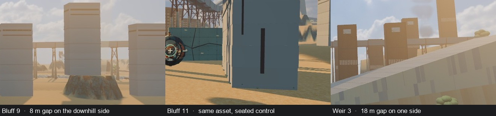
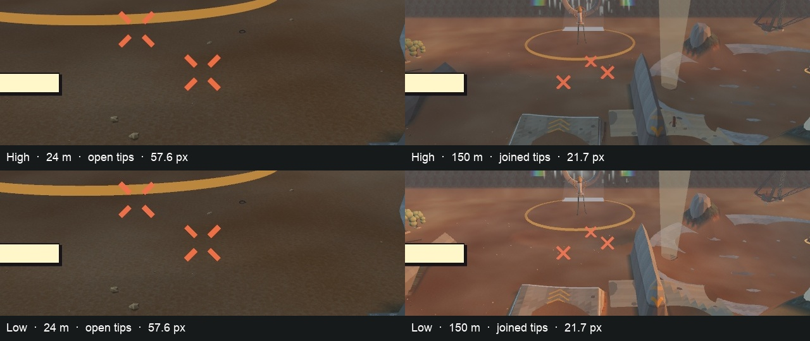
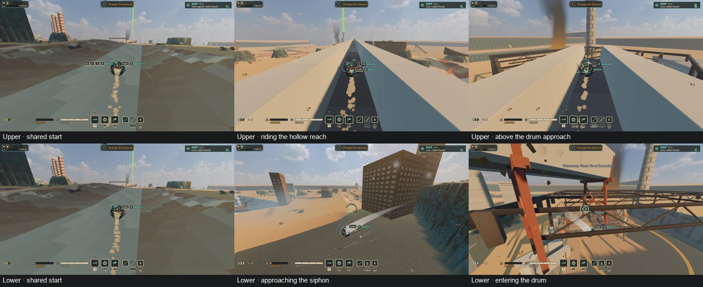
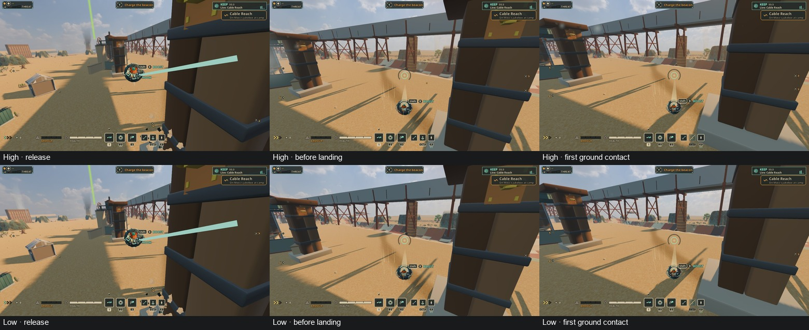

# Spillway design handoff follow-up, 17 November 2026

The combined ride exposed three visual problems. Steel and terrain hide the reward arches from the drum floor, two elevated reaches have feet hanging in the air, and Sable appears below a bare wall in her opening shot. The [World 1 work list](../../BACKLOG.md#world-1-work-assigned-on-17-november) gives each an owner and an in-game acceptance check.

## What was checked

The team compared all 13 briefs and their source images against the five design candidates, the five gameplay candidates used in the combined ride, and the wave board. The eleven PRs in that handoff had seven conversation comments before this follow-up. The recorded independent verdicts were in those conversations. The review also inspected all twelve neighboring merged PRs on this stage. Across PRs 1107–1129 the inline review endpoints returned zero comments. [Original briefs and images](https://github.com/bananahana720/scrapkeep/tree/f5c187b9d8eba702336fac765559d5cf2db873d9/project-guide/handoff/shared/world1/visual-audit-w44) · [Previous handoff and test receipts](https://github.com/bananahana720/scrapkeep/blob/4b60105aa67e5137a39aab1d4e0c28390f0ebe5e/project-guide/handoff/shared/world1/visual-audit-w44/HANDOFF.md) · [Widened wave decision](https://github.com/bananahana720/scrapkeep/issues/1106#issuecomment-6953059241)

All 237 sampled frames of the combined seed-1 Sable ride were inspected, from first launch through the first victory frame. The ride crossed both rewards and won at 413.88 s. The film covers menu/build states, effects, handovers and boss phases. Frames are sampled, so the gaps between them, later victory behavior, Linux hardware and human readability remain outside this read. [Played source](https://github.com/bananahana720/scrapkeep/tree/e5ec6cff0704ca441f2f9f5c646e6f49dcefff28) · [Frame-by-frame state](https://github.com/bananahana720/scrapkeep/blob/4b60105aa67e5137a39aab1d4e0c28390f0ebe5e/artifacts/visual-audit-w44/evidence/combined-film.ndjson)

## The flume reward approach

Frames 0168–0180 put the camera and ball below the Drum's lip. A Godot 4.7.2 static reconstruction used each recorded position, all three authored slot centres at crossbar height, and the stage's real collision. All 78 rays hit the kicker or terrain tile 6_7. All six rays cleared from frame 0181 on the higher ground. The HUD projection and arch selection checks in PR 1126 still pass. A rider needs a visible way out and a physical arch to steer toward. [Sightline readings](gate-sightlines.csv) · [Sign and pickup checks](https://github.com/bananahana720/scrapkeep/pull/1126)

The same rogue crane hit the rider at 198.04 s, before the gates opened at 285.03 s, and again at 291.45 s. The attack ID and commit time were absent from the film. Park event announcements observe a 20 s calm interval. An already spawned enemy can act during gate choice. Trace its tell and the rider's escape from the lower route before changing enemy behavior. [Event scheduling](https://github.com/bananahana720/scrapkeep/blob/e5ec6cff0704ca441f2f9f5c646e6f49dcefff28/sketches/core-loop/src/world/event_director.gd#L386) · [Playable flow states](https://github.com/bananahana720/scrapkeep/blob/e5ec6cff0704ca441f2f9f5c646e6f49dcefff28/sketches/core-loop/src/core/flow.gd#L186)

The revised service grade keeps the reward row and eastward launch in place. An early cut exposed the arch but failed the heavy-ball approach. Shortening the grade restored the level run-in. The final High keyboard drive climbed out of the drum, crossed the arch, took Rime Rounds and entered the bowl. The old terrain and opaque liner both failed the new checks. [Service grade candidate and tests](https://github.com/bananahana720/scrapkeep/pull/1134)

## Two elevated reaches and Sable's first shot

Frames 0121 and 0145 look up from the lower route. The repeated steel frames stop in open sky at two separate reaches. The authored deck height is fixed and the modeled support extends only about 6 m below it. Check the ground beneath each foot, the lower route clearance and the detail switch before accepting replacement supports. [Flume sites](https://github.com/bananahana720/scrapkeep/blob/e5ec6cff0704ca441f2f9f5c646e6f49dcefff28/sketches/core-loop/src/world/park/park_flume.json#L51)

The title storyboard calls for a low view over water with tiny Sable on the dam crest at dawn. Frame 0002 places her below the wall with no crest under her. Keep the scale joke, arrow and two-bar opening. [Pilot storyboards](../../sketches/core-loop/design-v3/TITLE-INTROS.md)

## The separate grapple towers

Reviewing the repaired spans exposed a second issue at the freestanding grapple towers. The striped timber bents and grey pylons are authored assets. The issue is where their wide, flat bases meet a cut bank. In the running flume, four corners per tower were sampled just inside the drawn base. On all seven tested towers, rays against the visible mesh and its collision agreed. Some ground corners under weir bents 3 and 34 were 18.00 m and 24.02 m below the soles. Bluff pylons 9 and 21 had 8.00 m gaps. Pylon 19 reached 6.04 m. The same asset at bluff 11 touched at all four corners. On the uphill side of weir 3, the terrain rose 22 m above the base. W1-129 gives the footing change to level art and preserves the already-working grapple face and line clearance. [28 corner measurements](anchor-feet.csv) · [Full before and after views on the pier candidate](https://github.com/bananahana720/scrapkeep/pull/1133)

## The reinforcement mark at two distances

Both older riding comparisons still showed the hollow mark. A separate render on the combined source froze the dam yard's authored warning and viewed the same mesh instance at 24 m and 150 m. At 720p its projected height was 57.6 px with the centre open and 21.7 px with the tips joined, on both High and Low. The crops preserve original pixel size. This checks the actual shape change. The original moving controls cover the warning alongside the shell and landing perimeter. [Existing riding controls](https://github.com/bananahana720/scrapkeep/blob/4b60105aa67e5137a39aab1d4e0c28390f0ebe5e/artifacts/visual-audit-w44/images/shell-and-landing.jpg)

## The last shared approach and the landing

On the dam, the west and central riders pass XZ (2,195) and (3,195) at 4.00 s. At 6.31/6.34 s they are still within 4 m of each other before their lines separate around the Eye. The worn ground, dam face, beacon and edge of the bank are visible at this choice. The west line reaches the workbench and the central line stays closer to the beacon. These six frames come from the same two complete PR 1129 rides. [Full paths and overhead](https://github.com/bananahana720/scrapkeep/tree/ae3852c3e682d93c665186461be531225be92de6/artifacts/spillway-routes-w44)

On the combined source, two 19 m/s riders started at the same ground-level XZ (−295,−245), before Butte Gap. The normal movement controller steered one onto the hollow intake and along the deck at Y46 m, through 11/11 waypoints to the forecourt at Y25 m. It steered the other along the lateral canal and through the wasteway to the drum, 10/10 waypoints. Both took the fork without a reset, jump, teleport or forced elevation after entry. The seeded return from a deliberately placed upper-deck start remains a separate spill test. [Measured paths, coordinates and settings](route-measurements.json)

The matched hook take used the original timber, the same release tick and the same lens on High and Low. Both register first ground contact at tick 231, XYZ (−164.22,29.35,−119.28), at 3.45 horizontal m/s. The bright ball outline stays visible in flight. At touchdown the timber shadow passes under the ball, so the frames establish the actual contact and the source of the visual ambiguity. Landing-height perception and spontaneous fork discovery remain for the sitting. [Release and contact samples](route-measurements.json)

## Combined headless ride and launch model

The playback combines the earlier ten design and gameplay candidates with the crew camera, Sable postcard, trestle feet and the flume service grade. The flume's heightfield and navigation graph were rebuilt from the combined authored map. A fresh headless Sable skipper run on seed 1 crossed both stages and won, with 17 objectives and zero stuck, hung, wedged or fallen alerts. Headless Godot executes the real flow and physics with a dummy renderer. The recorded 87.76 seconds is runner time under this configuration and does not compare with the drawn run. [Headless receipt](headless-sitting.txt) · [Combined game source](https://github.com/bananahana720/scrapkeep/tree/cef512431058ec5d73548241047bd2f1e519c08e)

TLC explored all 1,472 reachable states of the current run-flow model. The missing-Warden and double-end mutations both broke their expected invariants. The first grader run flagged an old source-sync reference. The covered source diff contained only the camera subject and reduced water motion. After confirming the modeled transition functions and their writers were unchanged, the comparison was recorded and the grader passed. [Model result](run-flow-model.json) · [Coverage comparison](https://github.com/bananahana720/scrapkeep/commit/19d5f2defd0d6e4abea2b0f142cd5e78aebba5cc)

## Remaining limits of the previous handoff

- The dam and Brindle camera comparisons included matched contacts and escape space. The dam route runs reached 12/12 and 9/9 waypoints. The flume six-waypoint spill proves a return from the elevated route. The new common-start runs above establish access to the deck and canal.
- The yard and one flume corridor support keeping stock encounter seats and the experimental flanker opt-in. They leave the other named crew worksites, director double-back and moving versus stalled hazard reads open. W1-126 owns these in their actual surroundings. The repaired [48-pose crew camera](https://github.com/bananahana720/scrapkeep/pull/1130) supplies repeatable reference views for the encounter owner.
- The geometry survey found 6,878 dam and 74 flume points without nearby drawn geometry at 0.4 m, zero at 1.5 m, and visible rock in all six tested hoodoo grazes. File an individual collision repair when a traced contact identifies one. The two parked Sable trade bodies keep their existing W1-23 status. The six-model render check and the build-preview census each have narrower coverage than a visual pass through the whole game. [Model census](https://github.com/bananahana720/scrapkeep/pull/1117)
- The scoped sign checks, the camera contacts and the flood's in-play fix stand. Full-ride hitches, hostile arrivals, reel pressure, visible currents in the remaining basins, a late turning escape and hazard fairness still have individual owners on the [work list](../../BACKLOG.md#world-1-work-assigned-on-17-november). The full Linux grade and the sitting remain with the Gate.

## Related stage reviews

| Owner | Remaining findings and existing record |
| --- | --- |
| Map and bands | The map grader explicitly lists the two pictures, tagged cover, silhouette and snag checks and its modifier-variety caveat. Brindle pressure and the novice/strong-build rows still need real bands. The 60-max-hull fixture landed. Two stage-1 notes in one run still need a grader regression. [Map](https://github.com/bananahana720/scrapkeep/pull/1111) · [Band receipts](https://github.com/bananahana720/scrapkeep/pull/1107) · [Pressure rows](https://github.com/bananahana720/scrapkeep/pull/1118) · [Hit-free dam follow-up](https://github.com/bananahana720/scrapkeep/pull/1121) |
| Sound | The recipes for the 28 stand-ins landed. Remaining notes cover the pin's measured level, warning audibility at distance, two mix lists, class IDs repeated in five places, a peak meter up to 0.6 dB low, the Fleet brass tail and a shifted-key stinger that can still bake on demand. The level row needs the missing stems and the listening sheet needs ears. [Original level receipt](https://github.com/bananahana720/scrapkeep/pull/1110) · [Recipe fixes and notes](https://github.com/bananahana720/scrapkeep/pull/1112) |
| Player feel | The quiet runs passed, six core-feel tests still carry flake entries, launch speed lacks its own done-read row, and contact snapshots omit hit-stop and assist. Duplicate, carried, missing and eight-contact lists, a mutation against the real contact dispatch and loaded-gate timing remain on the producer. [Contact-order receipt](https://github.com/bananahana720/scrapkeep/pull/1113) |
| Performance and packaging | Warm packed Mac p99 passed while 8–10 frames exceeded 33 ms. Bundle music, a windowed human launch and Gatekeeper on another Mac were unverified. The timing hold covers shared test slots. It leaves gate/nightly/export/band jobs, PID reuse/namespaces and some isolated race probes to the gate owner. [Packed Mac](https://github.com/bananahana720/scrapkeep/pull/1109) · [Timing hold](https://github.com/bananahana720/scrapkeep/pull/1114) |
| Save and reward verification | W1-117 repaired the two forward routes. W1-121 tracks the historical unpaid unlock decision. Two actual processes, future/stale/slow locks, version or clock skew, per-reward backfill saves and double announcements remain scoped to that owner. These checks address persistence, while W1-122 addresses steering into an arch. [Original model](https://github.com/bananahana720/scrapkeep/pull/1108) · [Fix and retained limits](https://github.com/bananahana720/scrapkeep/pull/1115) |
