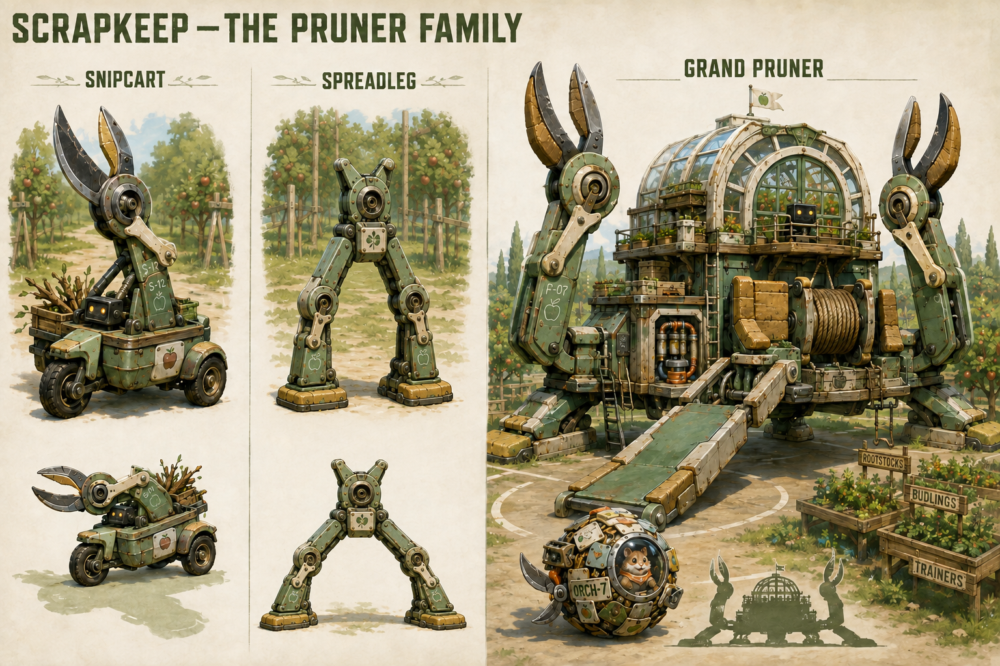
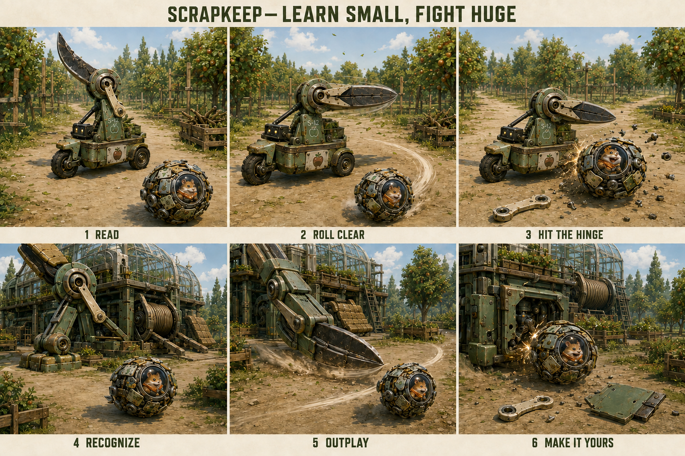

# Orchard family and combat concept study

5 September 2026. Two visual studies for the [enemy taxonomy](ENEMY-TAXONOMY.md), developed alongside the [orchard encounter proposal](ORCHARD-ENCOUNTER-STUDY.md).

The strongest result is the repeated pruning mechanism: a little worker and a giant greenhouse share the same circular fork joint, cutting tool and cream linkage. Orchard care gives them a reason to look and move that way. A successful counter can leave behind a part the player already understands.

## Selected family direction

The selected revision is [05-pruner-family-study-v2.png](art/05-pruner-family-study-v2.png). The [first version](art/05-pruner-family-study.png) remains as the iteration record.

The sheet visibly connects Snipcart and Grand Pruner through curved shears, large circular pivots and cream links. Spreadleg's broad padded shoes give it a different working end. The revision removes its distracting raised upper arms, leaving the compact upper fork and two legs as the primary silhouette.

Apple trees, nursery trays, twig cargo, service markings, replacement panels and padded contacts make the orchard legible as a maintained workplace. The player is an irregular scrap ball with the animal visibly inside a protected cockpit. Enemy faces are control boxes; no animal operator is shown on these machines.

**Remaining visual limits:** Snipcart's small lower pose is not a fully closed cut. The boss's reel and padded fixtures are visible, but a continuous binding band to the selected arm is not clearly traceable. The plumbing bay does not yet explain an irrigation attack. The boss composition is a compressed design view; it does not establish a scale ratio or traversable ramp.

These limits matter for the next articulated study. The image selects a promising construction language, not a finished rig or complete boss schematic.

## Selected combat storyboard

The selected revision is [06-orchard-combat-storyboard-v2.png](art/06-orchard-combat-storyboard-v2.png). The [first version](art/06-orchard-combat-storyboard.png) remains for comparison.

The top row proposes reading Snipcart, rolling clear of its cut, then banking into a local housing to loosen a cream linkage. The bottom row transfers preparation, committed reach and recovery to a much larger tool. It depicts one exchange with the boss, not its complete defeat.

The first generated storyboard changed the small cart into a large grounded arm in panel 3 and did not close the blades clearly in panel 2. A targeted revision restores the small cart and wheels across the top row and gives panels 2 and 3 a closed overlapping blade shape. This correction keeps the intended small-to-large comparison coherent.

**Remaining visual limits:** the chosen view is a side/front presentation that exposes the hamster's face, rather than the proposed close chase camera. The revision also narrowed the preparation wedge in panel 1, weakening the intended open-to-closed contrast. Panel 3 does not show a complete retraction back to the cart. The boss band path is still not obvious, and a side-on sequence does not establish a safe rolling trajectory. The linkage lies loose beside the player; the image does not show a proven collection or companion-fitting action. Frame-to-frame scale, joint paths and physical contacts remain approximate.

The storyboard communicates the proposed exchange and the player's character. Use the written pose table and a later articulated greybox to resolve those limits. Do not infer camera approval, attack timing, immunity frames or collectible collision behavior from it.

## Method and exact prompts

All four images were made with the built-in image generation tool, already authorized for concept development. No external reference photo was copied into an asset. The first family sheet used a new text prompt; subsequent images used our generated art as a local design reference. Originals remain in the generated-image output directory, with project copies preserved under `docs/art/`.

| Output | Input/reference role | Exact prompt |
| --- | --- | --- |
| Family v1 | New original concept sheet; text only | [05-pruner-family-v1.txt](art-prompts/05-pruner-family-v1.txt) |
| Family v2, selected | Family v1 as edit target; remove extra upper limbs in both Spreadleg poses | [05-pruner-family-v2.txt](art-prompts/05-pruner-family-v2.txt) |
| Storyboard v1 | Family v1 as design-language and character reference; new composition | [06-orchard-storyboard-v1.txt](art-prompts/06-orchard-storyboard-v1.txt) |
| Storyboard v2, selected | Storyboard v1 as edit target; preserve Snipcart identity and closed-cut continuity | [06-orchard-storyboard-v2.txt](art-prompts/06-orchard-storyboard-v2.txt) |

The built-in generator is not an open-source tool. The earlier free-tool production candidates remain in [DISCOVERY.md](DISCOVERY.md): a future model, joint setup and animation workflow would use separately authored assets and be verified in the chosen runtime. No model, rig, animation clip or game import was created in this pass.

## Team review

The orchard designer supplied a six-beat encounter; the motion designer supplied four poses and identified Spreadleg's bracing contradiction. The coordinator kept decorative scrap outside the proposed dependable collision envelope and prevented the optional early center crossing from becoming a mandatory route. The independent reviewer identified the missing visible band relationship and ambiguous irrigation mechanism in the first sheet; the written encounter resolves the band relationship and excludes irrigation from this first exchange.

The integrated encounter received no blocking finding in the bounded paper review. That supports proceeding to a small prototype decision; it does not establish fun, balance, visual recognition or mechanical accuracy. [Team record](ORCHARD-VISUAL-SWARM.md).

The final independent image check confirmed the removed Spreadleg arms and restored Snipcart cart/closure continuity, and identified the narrowed preparation wedge. All four 1536 × 1024 project images matched their generated-source copies by SHA-256. The coordinator checked 49 local links across the new and touched project documents; none were missing. These are file and visual checks, not runtime tests.
