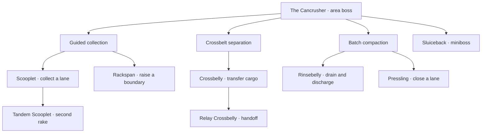
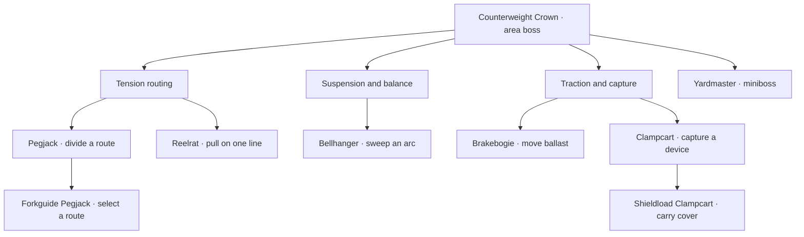
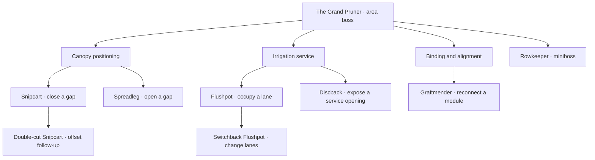

# Scrapkeep enemy families

5 September 2026. Proposed boss-derived taxonomies, grounded in non-game reference research. This extends [CONFLICT-AND-COMBAT.md](CONFLICT-AND-COMBAT.md). The [swarm record](ENEMY-TAXONOMY-SWARM.md) tracks research and review. No gameplay implementation or build goal is set.

## What the hierarchy means

The boss is the complete working system. Its smaller relatives specialize in parts of that system. A branch inherits **anatomy, an action rhythm and a counterplay principle**; its descendants change the spatial problem. This is a fictional design taxonomy, not a biological classification or a claim that smaller machines literally grow into bosses.

Read each tree from the boss outward to understand the design. Encounter progression usually teaches in the opposite direction: meet a specialized worker, recognize a related variation, confront a miniboss combining two jobs, then face the whole plant or machine. A veteran is a modification of an existing enemy; it is not automatically a new species or a higher health bar.

The three working roots are The Cancrusher in the spillway, Counterweight Crown in the foundry, and the Grand Pruner in the walking orchard. Sluiceback remains a miniboss. The existing game's Cancrusher, Glassjaw and Old Ironroot labels are preserved in its files. The foundry and orchard roots here are proposed developments of area roles, not silent game-content renames.

## PM rules for admitting a branch

1. Identify the boss subsystem and the physical trait the descendant inherits.
2. Describe what the machine does before the player arrives. Its job must explain its location.
3. Show what the player recognizes from the earlier relative, and the one new decision this branch introduces.
4. Make windup, commitment and recovery physically readable. Shape, movement and sound must work alongside color.
5. Give important protection at least two answers through baseline rolling and ordinary aimed attacks. Class powers and loot improve those answers.
6. Tie salvage to the mechanism that produced it. A winch, filter or graft spool should change play in a recognizable way.
7. Make the environment support the work: intake, access, transport, storage and maintenance all need a place.
8. Record the real observation separately from the game exaggeration. A believable mechanism is not permission to claim a scientifically accurate machine.

Ordinary contact still supports Katamari-like bumping. Damage belongs to a readable attack or exposed dangerous working part. Collected body parts remain earned; enemies contest loose salvage and visibly recoverable devices. No family requires a particular class, element or companion drop.

## 1. Spillway family: The Cancrusher

The boss is a mobile salvage plant spanning service channels. Its anatomy makes the area's work visible: guided rakes lift debris, a crossbelt separates ferrous cargo, and a braced press compacts it. Its descendants retain a recognizable working axis and a return stroke.

**Family rule:** establish an axis, move material along it, expose the mechanism during return or unloading. The player learns when to cross a working lane and when to follow a load instead of chasing its carrier. Sluiceback combines guided collection with braced compression; it is a composite relative, not the next growth stage of every worker.

| Type and inherited anatomy | Job, tell and new decision | Common counters | Wear and salvage proposals |
| --- | --- | --- | --- |
| **Scooplet**, short chain rake on a bucket tricycle | Collects escaped material between drains. Teeth lower, chain tightens, then it commits to a floor lane before lifting to unload. Chase it or intercept its dropped cargo. | Ram the unprotected side; shoot the basket latch during unloading. | Bright tooth contact edges, mud behind the basket. **Rake Comb** widens collection along the forward rolling path. |
| **Rackspan**, comb crossbar between tall chain guides | Lifts refuse onto a conveyor. The comb descends, then one shoulder tilts before the load rises and dumps. Choose a side before the moving boundary closes. | Use a connected side route and ram the guide housing; shoot its reachable drive cover. | Lower bars show a tide line; tracks are rubbed clean. **Guide Roller** makes a bumper's outgoing shove direction more predictable. |
| **Crossbelly**, transverse cleated belt beneath a low separator frame | Sorts a mixed salvage stream. Cargo visibly travels toward the discharge edge. Choose between disabling the carrier and reaching its destination. | Ram its exposed cassette mounting; shoot the reachable mounting latch. Drive damage can stop transfer without defeating it. | Belt-edge fraying and chips at the discharge corner. **Crossbelt Catcher** redirects loose salvage toward a companion's collection route. |
| **Rinsebelly**, perforated trough with a water-level slit, short compacting screw and braced outlet | Fills, agitates and drains, then the screw compresses wet material into a slow rolling plug. Approach during drainage or clear the outlet lane and intercept the compressed bundle. | Ram the side screw housing during drainage; shoot its drive cover from outside the outlet path. | Sediment rings follow the fill level; the outlet lip is rubbed bright. **Drain Basket** helps a companion catch pickups displaced by a shove. |
| **Pressling**, open chamber with paired cheeks, side guides and ram | Feet plant and loading cheeks stop before a short straight compression stroke. Leave the closing space and approach across its axis during retraction. | Ram a side guide during retraction; damage its reachable guide cover with ordinary attacks. | Dented chamber, straight rail wear. **Press Shoe** improves a deliberate collision's shove. |

**Veteran branches.** Tandem Scooplet carries a second rake on a visible trailing chain. Its separately signaled stroke makes crossing behind the first rake a decision; the same side and latch counters remain. Relay Crossbelly adds a receiving cradle and visibly hands cargo to another carrier. Disabling the sender or breaking the receiver's cradle interrupts the transfer. Without a receiver it uses normal discharge. These add sequence and destination choices, not hidden tracking or a durability tier.

**Miniboss synthesis.** Sluiceback adds press-like side braces and a rake carriage behind its shovel nose. It braces, lowers, charges, then skids and retracts. Cross the committed lane and ram its flank, or break a reachable hinge with ordinary attacks. A plate stays removed; its Valve Wheel reward turns post-impact braking into a later sideways shove. A second charge needs another visible preparation.

**Boss synthesis.** The Cancrusher sequences the rake's lane, the crossbelt's destination and the press's closing axis. Reachable housings take ordinary damage; flank rams during familiar recovery work too. Breaking a subsystem permanently removes its contribution and leaves useful material or geometry. General body damage also progresses the encounter. A proposed **Sorting Heart** bundles a short trail of freshly loosened parts into a collectible mass.

### Real reference and fictional adaptation

| Directly inspected source | Limited real observation | Our adaptation |
| --- | --- | --- |
| [HUBER TrashMax](https://www.huber-se.com/products/detail/huber-coarse-screen-trashmax/) | Chain-driven rakes run in lateral guides and carry material upward to discharge; most medium-contact parts are stainless steel. | Guided strokes give Scooplet and Rackspan recognizable anatomy and approach timing. A mobile combat rake is fictional. |
| [Bunting overband magnets](https://buntingmagnetics.com/product/magnetic-separation/overband-magnets) | Overband separators remove ferrous material from conveyed streams. Permanent versions use a cleaning belt and need no electricity for their magnetic field. | Crossbelly creates a traceable sideways cargo route. Breaking its mount drops the loaded cassette as a collectible lump; stopping its belt does not magically switch off a permanent magnet. |
| [HUBER WAP SL brochure, page 2](https://www.huber-se.com/fileadmin/user_upload/huber-technology/brochures/03-screenings/brochure-wap-sl-en.pdf) | A batch fills, washes, drains, then discharges while compacting and dewatering. | Rinsebelly exposes its state through water and moving parts. A forceful combat discharge is exaggerated. |
| [HSM HL 1615](https://eu.hsm.eu/en/compressing/products/horizontal-balers/hsm_hl_1615_6219134) | The stationary baler has guided pressing and loading flaps and can process rigid cans and light metal barrels. | Pressling uses guided compression and a readable loading posture. Its mobility and combat behavior are inventions. |
| [US Bureau of Reclamation, record 4424](https://data.usbr.gov/catalog/4424) | The research record addresses concrete erosion and cavitation damage in spillways and stilling basins. | Patched concrete gives the region a maintenance history. It does not imply that a surface mark predicts an imminent collapse. |

**Working environment.** Follow an upstream debris pocket to the screen, raised conveyor, drained sorting apron and vehicle loading ramp. Bypass gutters and maintenance ramps explain side routes. A stopped collector leaves a pile ahead of it; a broken rack releases loose salvage toward a catch pocket; clearing a gutter can reveal a local rolling shortcut. The exact flow and water-level effects are authored game proposals, not hydraulic simulation.

## 2. Foundry family: Counterweight Crown

The boss coordinates tension, suspension and travel. Its relatives share visible load paths, substantial supports and a take-up/commit/reset rhythm. A moving counterweight is an action cue; its changing position explains the machine's threatened space.

**Family rule:** take up slack or shift ballast, commit a load to a visible path, then unload or reset. The branches differ in whether the player reads a line, an arc or a traveling obstacle. Yardmaster combines travel and suspension sequentially.

| Type and inherited anatomy | Job, tell and new decision | Common counters | Wear and salvage proposals |
| --- | --- | --- | --- |
| **Pegjack**, pin-driver carrying a guide wheel | Installs guides beside cart routes. Feet spread, then a low cable lifts and tensions along a marked strip. Cross early or choose another route. | Bump a foot before anchoring; shoot the exposed guide latch afterward to drop the cable. | Scraped foot undersides and a battered pin collar. **Guide Wheel** redirects a compatible device push along its chosen exit line. |
| **Reelrat**, winch drum on broad skids | Returns rejected castings to a skip. A slow snare establishes a line, the drum stops paying out, then braces and pulls once. Evade the cast or release the attached load. | Roll across the cast before closure; shoot an oversized exposed coupling to release its target. | Cable rub near the fairlead, grease in recesses. **Return Reel** gathers loose salvage along the player's post-ram exit path. |
| **Bellhanger**, A-frame with a low cradle and rear weight | Transfers cooled rejects. Rear weight moves, cradle rises and its shadow describes the coming arc. Go around the sweep or force an early unload. | Ram the planted frame after the swing; shoot a reachable tilt latch during preparation. | Bright abrasion on the cradle bottom, sheltered soot. **Swing Yoke** adds a lateral scrap sweep to a turning impact. |
| **Brakebogie**, low rail carriage with mismatched ballast plates | Services the Crown's storage sidings. Plates shift, a route flag moves, the brake releases, then it travels to the next stop. Intercept a bend or clear the running line. | Ram its side at the bend; shoot the reachable stack latch to drop a plate and reduce its shove. | Wheel contact wear and replacements with different paint histories. **Ballast Skate** strengthens a deliberate lateral bump after an impact. |
| **Clampcart**, hinged jaws around a loading cradle | Rotates cooled plates into dispatch racks. It marks one deployed device, closes with sequential knocks, tilts and retreats. Intercept the capture or pursue the carrier. | Ram its side during closure or retreat; shoot the hinge release. | Parallel bite scars and oily sheltered hinges. **Hinged Grip** lets a companion briefly hold a displaced enemy for a follow-up bump. |

**Veteran branches.** Forkguide Pegjack adds a second visible guide path and selects one before tensioning. Only one becomes dangerous at a time; planting and guide-release counters remain. Shieldload Clampcart carries a long plate across its front, then rotates it upright to make room for a capture. That transition exposes its side. Flank during rotation or damage one jaw to drop the plate as collectible cover.

**Miniboss synthesis.** Yardmaster is a bogie beneath a short lifting frame. It travels to a marked stop with Brakebogie's cues, brakes, then prepares Bellhanger's sweep. The player can bait the swing and ram the stationary carriage, or shoot its accessible latch to dump the load. Removed ballast shortens later sweeps and remains a bank surface. **Travel Yoke** could let a firm landing shift a nearby deployed device a short distance along the player's aim.

**Boss synthesis.** Crown's guides explain the cable routes; its slack-to-tension motion announces hammer preparation; moving weights and shadows explain the threatened space. Curved sidings and braking establish carriage openings, and hinged attachments establish reachable releases. Its stop-and-switch reverses the approach using an already learned cue. The hardest attack does not need every descendant attacking alongside it. The prior Counterweight Heart reward remains a candidate.

### Real reference and fictional adaptation

| Directly inspected source | Limited real observation | Our adaptation |
| --- | --- | --- |
| [Liebherr derrick and counterweight systems](https://www.liebherr.com/en-ie/mobile-and-crawler-cranes/crawler-cranes/lr-crawler-cranes/technology/derrick-and-counterweight-5332184) | Counterweight radius affects capacity; ballast systems support movement, with load and ballast needing an appropriate relationship. | Weight position explains reach and attack preparation. Visible secondary restraints allow the fictional boss to reduce its reach after damage rather than continue with an unexplained unchanged load. |
| [Konecranes RopeQ](https://marketing.konecranes.com/acton/media/35190/konecranes-ropeq-wire-rope-inspection) | Rope defects can be internal and invisible to an ordinary visual inspection. | Add inspection bays and replacement reels. A combat weak coupling is intentionally oversized and readable, not a claim that real fatigue is always visible. |
| [Historic England, Forges and Foundries](https://historicengland.org.uk/content/docs/education/explorer/teachers-kit-forges-and-foundries-pdf/) | Foundries remelted material, used patterns and sand moulds, and broke out hardened castings to make goods and machinery. | Give the arena a receiving-to-dispatch material circuit and recognizable town objects among the salvage. |
| [Railway Technical Research Institute](https://www.rtri.or.jp/rd/seika/2018/2-13.html) | The article distinguishes wheel-flange wear on curves and flange lubrication from tread adhesion. | Concentrate carriage wear and service access around bends; the exact placement and combat openings are proposals. |
| [Columbus McKinnon hinged plate clamps](https://www.columbusmckinnon.ie/ni/products/product-range/load-hoisting-tackle/plate-clamps/camlok-cy-hinged-vertical-plate-clamps/) | Hinged clamps can change plate orientation; paired arrangements handle longer plates. | Clampcart uses the same plate as cargo, protection and recoverable material, with a visible rotation between jobs. |

**Working environment.** Connect scrap receiving, casting, sand breakout and cooled-part dispatch, with rejects returning to receiving. A tall central lifting aisle and broad ground-level service crossings organize combat. Curved sidings create interception opportunities. Replaced wheelsets, rope reels, swept sand and chalked maintenance marks show where crews stop and work. These specific traces and routes are art-direction proposals, not a recreation of a named facility.

## 3. Orchard family: The Grand Pruner

The orchard remains a cultivated place worth protecting. The Fleet has redirected its maintenance machines through bolted control overrides. Living trees explain the work; manufactured tools explain combat. The family shares padded contact surfaces, replaceable slats, forked joints, hose couplings and visible service access.

**Family rule:** position a tool, brace or connect, perform one committed operation, then release for servicing. The canopy branch closes or opens a space; irrigation changes which lane is useful; binding creates an interruption priority. Rowkeeper combines canopy positioning and irrigation while retaining an ordinary escape route.

| Type and inherited anatomy | Job, tell and new decision | Common counters | Wear and salvage proposals |
| --- | --- | --- | --- |
| **Snipcart**, low cart with a forked elbow and bypass-shear jaws | Sorts cut twigs. Jaws spread and elbow straightens before a short fixed closing arc, then the tool retracts. Choose inside-hinge or outside-flank approach after the cut. | Roll outside the arc and ram the retracted housing; shoot the exposed hinge. | Polished edges, wood dust in the hinge, a replaced guard. **Shear Linkage** gives a companion a short sweep. |
| **Spreadleg**, inverted-Y frame with padded shoes | Adjusts branch supports. Shoes point outward and ratchets chatter before its feet spread across ground arcs. Cross the center before bracing or remain outside the feet. | Ram a leg before the brace locks; shoot its exposed ankle from outside the wide stance. | Compressed padding and handwritten height marks. **Adjustable Brace** helps a planted companion resist displacement. |
| **Flushpot**, hose-coupled tank with a low outlet | Services row-end flushing points. Coupling, valve flag and a dribble show a fixed lane before discharge. Cross early or approach from behind. | Ram before coupling completes; circle the fixed flow and attack the rear coupling. | Waterline stains, grit in an inspection window, patched sleeves. **Diverter Valve** gives a device a directional shove. |
| **Discback**, filter-ring stack on a squat carriage | Services the head station. Its stack rises and drain turns before a frontal flush separates the rings. Flank the compressed protection or exploit its service opening. | Ram the unshielded carriage side; shoot the spindle while rings separate. Ordinary damage also wears down protection. | Mineral streaks, grit in grooves, one clean replacement ring. **Ring Plates** supply directional device armor with an opening while operating. |
| **Graftmender**, narrow workbench with padded alignment hands and binding reel | Tends labeled nursery grafts; in combat it aligns manufactured sockets and attaches an exposed lead to an uncollected ordinary enemy module. Collect first or interrupt reconnection. | Shoot the lead; ram the workbench out of alignment. | Tape fragments, wax smears, repaired pads. **Alignment Reel** offers companion repair or deployment utility. |

**Veteran branches.** Double-cut Snipcart has a second visible linkage and a distinct ratchet cue before an offset follow-up. The player reads whether the tool has folded completely before ramming; familiar hinge counters remain. Switchback Flushpot has two distinct mouths. A second flag movement announces the next lane after the first flow dwindles. Its rear approach and pre-coupling interruption remain available.

**Miniboss synthesis.** Rowkeeper spans a service aisle with a spreading assembly and a flushing assembly. It teaches spreading first and adds a separately announced discharge. Its middle escape must fit the largest normal ball, and the two working footprints must leave that exit valid. Break the exposed brace after its spread or flank the fixed flow and shoot the coupling. Broken subsystems stay disabled, and the folded gantry becomes a bank. **Service Yoke** gives a deployed device a planted directional brace.

**Boss synthesis.** Familiar fork alignment becomes a terrace-scale pruning sweep, with an exposed retracted housing. Braces explain the arm's support; removing one changes a route. Familiar flags, valve motion and separated filter rings explain irrigation lanes and service openings. The binding branch appears on the boss itself: paired alignment hands seat an intact pruning arm in a support cradle, then a large spool draws a temporary bracing band tight. The winding identifies the next committed arm. A ram or ordinary attack on the reachable spool latch can interrupt this preparation; the band never grants whole-boss immunity or reconstructs a removed arm. This is Graftmender's align-and-bind operation applied to a load-bearing tool, not biological healing.

Ground routes reach every required assembly. Broken pruning structures remain ramps and are never repaired back into a mandatory attack. An optional Graftmender escort can reconnect an ordinary uncollected module, but cannot reverse the boss's structural progress. The existing Graft Spool reward remains an exploratory option.

### Real reference and fictional adaptation

| Primary source inspected | Limited real observation | Our adaptation |
| --- | --- | --- |
| [University of Minnesota: pruning and training apple trees](https://extension.umn.edu/garden-and-home/yard-and-garden/gardening-in-minnesota/pruning-and-training-apple-trees) | Pruning removes branches at collars; training can use spreaders to adjust flexible branches. | The same fork-and-elbow anatomy produces opposing close-gap and open-gap enemies. Combat scale and motions are fictional. |
| [Netafim maintenance handbook, printed pages 18–24](https://www.netafim.com/es-ec/bynder/9CBBB64A-0F4C-40FF-833E7A24BF9926F2-drip-irrigation-system-maintenance-handbook.pdf) | Filters and lines require flushing. Disc-filter rings compress for filtration and separate during flushing; arrays can flush sequentially. | Discback's protection and opening come from a real service state. Heavy combat shoves are exaggerated; ordinary drip emitters do not launch mechs. |
| [University of Minnesota: growing apples](https://extension.umn.edu/garden-and-home/yard-and-garden/gardening-in-minnesota/growing-apples) | Crowding creates shade; some dwarfing rootstocks need support; broad nonabrasive ties avoid bark damage. | Broad rows, supported trees and padded equipment show a maintained orchard, while ordinary ground routes support every class. |
| [Penn State: bench grafting](https://extension.psu.edu/fruit-tree-propagation-bench-grafting) | Its indexed transcript describes cambial alignment and binding that holds a graft and limits drying. Direct page opening failed during this pass. | Graftmender aligns and binds manufactured sockets. This is a mechanical metaphor, not instantaneous biological healing. |

**Working environment.** Nursery benches and a binding workshop surround the seedhouse. Broad cultivated rows end in turning aprons and flushing points. The filter head station has a service bay; cuttings trays and spare supports occupy the working edges. Variety labels, wide ties, swept aprons and flourishing trees show continuing care. Fleet overrides explain why equipment now threatens the player. The trees themselves need not become evil or disposable.

## Relationship to earlier concepts

| Earlier concept | Proposed taxonomy treatment |
| --- | --- |
| Scooplet | Retained, with a visible guided rake replacing the less specific smooth scoop. |
| Pegjack | Its former temporary rails become cable guides in the foundry proposal. The two versions remain alternatives until selected; it does not silently gain both sets of behavior. |
| Spoolmender | Graftmender is the orchard-specific refinement of the earlier repair role. These are not two separately committed roster entries. |
| Clampcart | Retained in the foundry, with a grounded gripping/plate-rotation mechanism. |
| Plowback | Retained as an earlier escort alternative; not counted among this pass's fifteen regular designs. Its broad plow silhouette can inform a later variant only if that variant has a distinct job. |
| Bellows Skimmer / Bellows Maw | Parked as a possible ventilation family. Adding suction to the spillway would introduce a fourth mechanism without strengthening its collection/sorting/compaction relationship. |
| Kiln Strider | Remains an alternative large-harvester concept, not a fourth mandatory area boss. |
| Cancrusher / Glassjaw / Old Ironroot in the playable demo | No files or runtime labels changed. The proposed three roots here require later reconciliation with the produced campaign. |

## Grounded appearance and behavior

The Canadian Conservation Institute distinguishes adherent iron patinas from active corrosion, and describes different corrosion appearances for copper alloys and plated metals. The implication for our art direction is a material-specific palette: steel, copper and enamel should not all receive the same orange surface. Corrosion is also not a reliable gameplay indicator of instant structural failure. [CCI: recognizing active corrosion](https://www.canada.ca/en/conservation-institute/services/conservation-preservation-publications/canadian-conservation-institute-notes/recognizing-active-corrosion.html).

The National Park Service describes connected waterworks at Harpers Ferry alongside surviving gears, leather belts, conveyor buckets, culverts, headraces and turbine pits. Our proposed environments should likewise reveal connected work rather than isolated machinery placed as scenery. The reference supplies historical infrastructure; the fantasy layouts remain our invention. [NPS: waterpower at Harpers Ferry](https://home.nps.gov/hafe/learn/historyculture/waterpower-at-harpers-ferry.htm).

| Design layer | Proposed visible evidence | What it gives the player |
| --- | --- | --- |
| Material | Distinguishable painted steel, bare working edges, copper fittings, hoses, wood and living vegetation | Parts remain recognizable when detached and added to the ball |
| Motion | Slack becoming taut, braces planting, a tool opening, a return stroke | Anticipation and recovery can be understood through movement |
| Wear | Abrasion follows contact; deposits follow water; replacement parts interrupt the old finish | A history of use and clues to how the mechanism moves |
| Maintenance | Reachable inspection covers, a matching spare beside a workbench, a recent patch or replaced hose | A place occupied and cared for by particular crews |
| Sound | A repeated mechanical cadence tied to the action, interrupted when a part breaks | The family can be recognized when its body is partly obscured |
| Scale | Repeated fittings, service paths and smaller relatives near the boss | Large battles retain familiar physical reference points |

These art directions are proposals, not field observations from a simulated world. Keep the animals expressive and the rolling absurd. Ground the causes while exaggerating silhouettes, timing and consequences for play.

## Encounter learning and world connections

| Family | Early encounter | Later variation | Miniboss combines | Boss payoff |
| --- | --- | --- | --- | --- |
| Spillway | Scooplet reveals a guided collection stroke and traceable cargo | Rinsebelly adds a processing interval; Relay Crossbelly changes the cargo destination | Sluiceback combines lane commitment and braced recovery | Cancrusher turns the complete intake-to-press stream into a large encounter the player already partly understands |
| Foundry | Brakebogie teaches announced travel and an interception bend | Bellhanger changes the path from a line to an arc; Shieldload Clampcart makes load orientation matter | Yardmaster travels, stops, then swings | Crown uses familiar cable, weight and carriage cues to move enormous machinery |
| Orchard | Snipcart teaches positioning, cutting and release | Discback changes protection through a service cycle; Switchback Flushpot adds a separately previewed lane | Rowkeeper combines spreading and flushing while preserving a ground exit | Grand Pruner expands the same tools across terraces, with the binding reel revealing the next arm to commit |

Enemy variety also comes from where work is happening. An empty carrier returning to a station need not behave like a loaded one: use cargo posture to announce the difference, rather than silently changing speed or tracking. Loaded versus unloaded behavior is a future variant idea, not another counted species. A transit encounter can ask the player to intercept material; a defense encounter can ask the player to stop that same material reaching a machine. No global economy simulation is required to make those local consequences visible.

Keep miniboss synthesis selective. Yardmaster need not deploy all five foundry workers, and Rowkeeper need not overlap every orchard operation. A demanding displacement attack must leave a readable route that the other current threats do not immediately invalidate. Strong builds may dismantle a subsystem before its full pattern plays out.

## PM decisions and evidence limits

This pass proposes **15 ordinary designs, six veteran modifications, three minibosses and three area-boss roots**. These are 27 configurations to compare, not a production quantity or a content promise. The family tables and trees agree on the names and counts.

The independent review identified three specificity gaps, all addressed here: Rinsebelly now visibly compacts its output; Grand Pruner itself carries the binding-and-alignment mechanism; and the old-to-new concept table records revisions and alternate names. The coordinator also corrected permanent-magnet failure behavior and prohibited repair from reversing removed boss structures.

Research workers inspected fourteen non-game references across the families, including one indexed Penn State transcript whose page did not open directly. The coordinator added two conservation/industrial-landscape references. No reference media was copied into game assets. All factual summaries are cited locally to their supporting source; materials, attack cues, enemy behaviors and salvage effects are marked as fictional adaptations.

Paper review supports the organization and explicit counterplay, not fun, balance, physical accuracy or a functioning enemy AI. No gameplay code, controls, current campaign names, meshes or animation clips were changed.

**Recommended next design study:** draw the same fork-and-brace assembly on Snipcart, Spreadleg and Grand Pruner, then storyboard their shared position/brace/operate/release rhythm. Compare whether a viewer can recognize the family and infer the different threat before reading a label. This tests the link between taxonomy, appearance and mechanics that Andrew requested. A later playable test can use one ordinary relative and its miniboss; no session goal is set here.

**Follow-up completed:** the [orchard visual study](CONCEPT-STUDY-03.md) now includes the family sheet, a revised combat storyboard and explicit visual limitations. The [encounter study](ORCHARD-ENCOUNTER-STUDY.md) specifies inward jaws versus outward feet, pose intent, collision-clearance hypotheses and a first boss exchange. Spreadleg's central support steadies while its legs remain articulated; a player never needs to fit beneath it. These refinements remain proposals pending a playable test.
