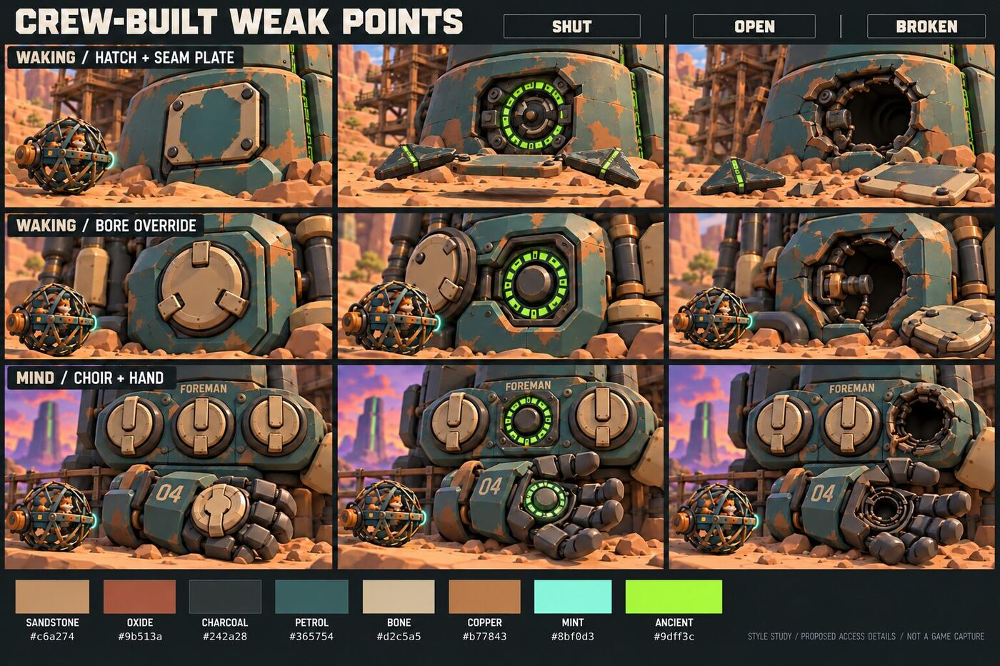
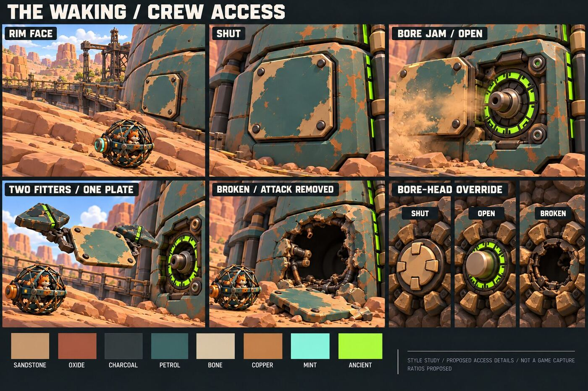
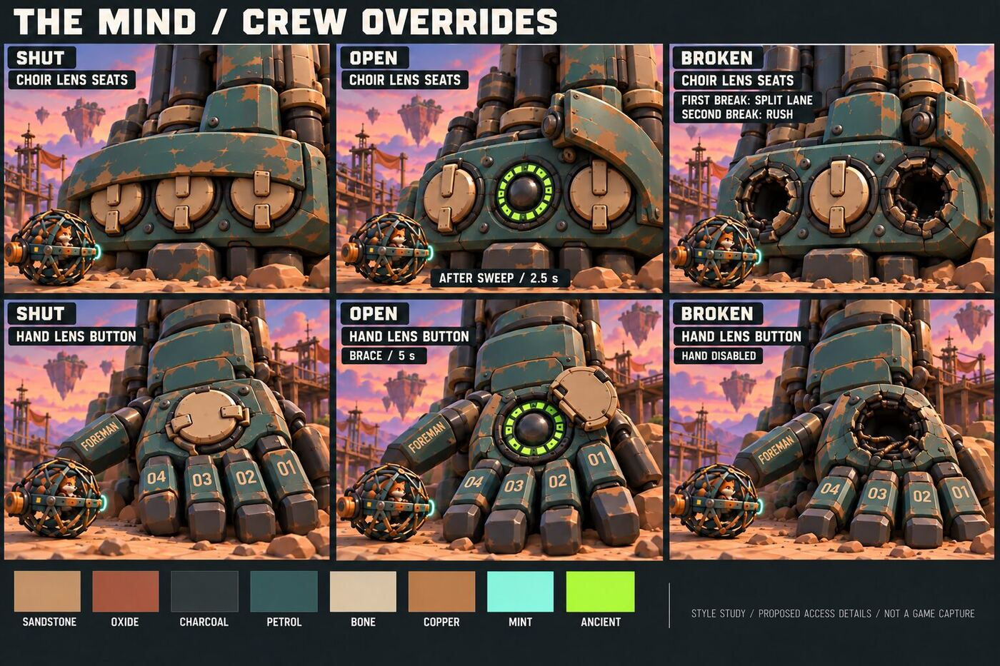
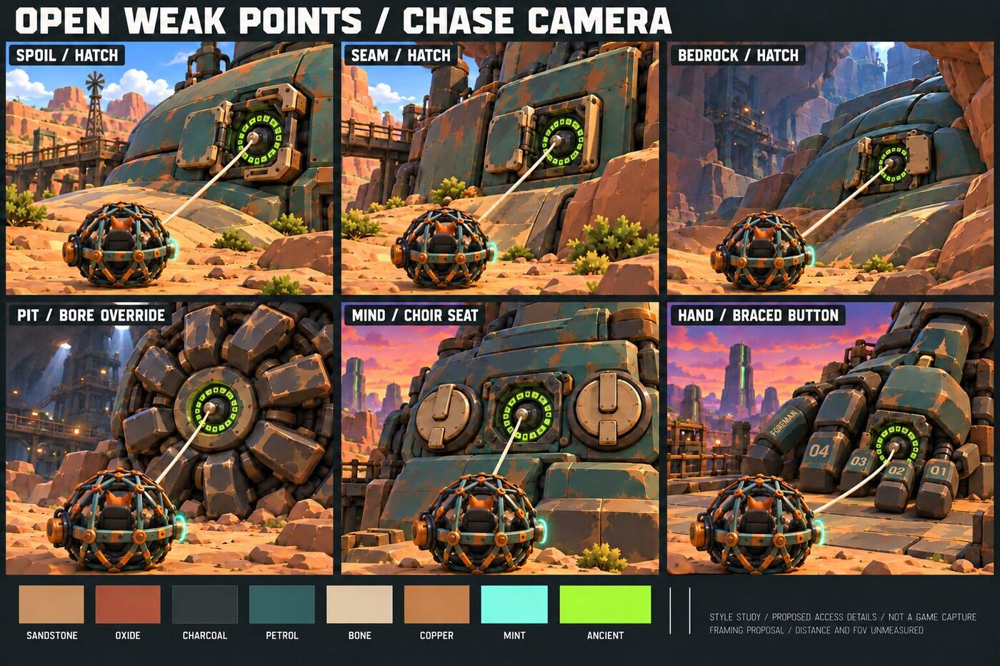

# Boss weak points

Reference boards. Concept only: they settle no mechanics, scale or collision.

## boss_weak_points-maintenance-moodboard

- **Why it exists:** U4 needs one shared visual family before Modeling, Effects and Animation build it. The maintenance function makes an opening believable, while missing hardware shows that a break has changed the fight.
- **Open question:** Does the shared clipped-corner cover and circular seat read as practical maintenance access? Exact dimensions and cover construction remain proposals. The first mood-board row is an ensemble, not a specification for drone damage states.

## boss_weak_points-waking-reference

- **Why it exists:** the Waking is a buried excavator whose decks were serviced by its crew. A jam exposes the access point; the returning swarm-remnant crew tries to close it. Breaking the hatch removes that floor's attack family. Breaking the bore override ends the pit's three-lane spray.
- **Open question:** Is the service-cover construction convincing on the existing floor body? Which existing tell opens the pit override? U4 does not specify that tell, so the sheet shows states without assigning a trigger. Bank clearance and socket scale require runtime measurement.

## boss_weak_points-mind-reference

- **Why it exists:** the foreman's crew once used these controls to stop machinery. The Mind covered them, but its own motion exposes them. The art carries U4's exact consequences: first choir-seat break removes split_lane, second removes rush, and a broken hand button disables that hand and lowers HAND_CAP by one.
- **Open question:** Does the hand lens read as an old crew-stop control while retaining the Mind's identity? What does the third choir-seat break remove? U4 leaves that consequence unspecified. The parked sweep silhouette and lens-cover construction are proposals for the existing mechanism.

## boss_weak_points-readability-reference

- **Why it exists:** U4 explicitly asks Systems to frame the weak point and anchor together. The research warns that the camera can undermine a moving-boss fight. The sheet tests that visual relationship before implementation.
- **Open question:** Does this amount of target emphasis feel useful at fight distance? Systems still needs to measure each socket against the actual chase camera and pilot ball. This reference approves no target enlargement, camera control or collision change.
