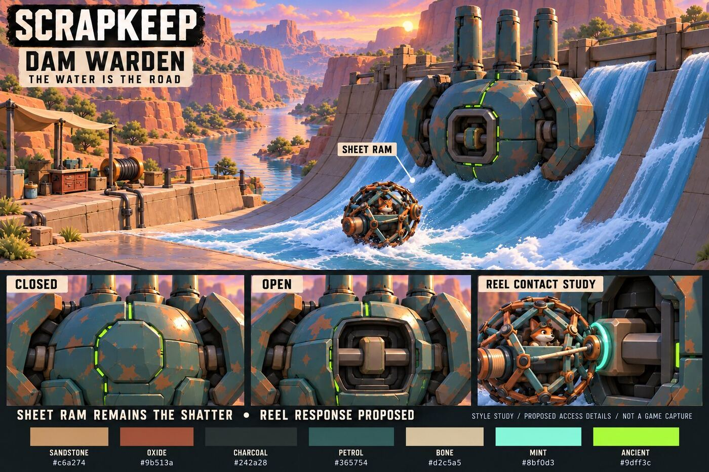
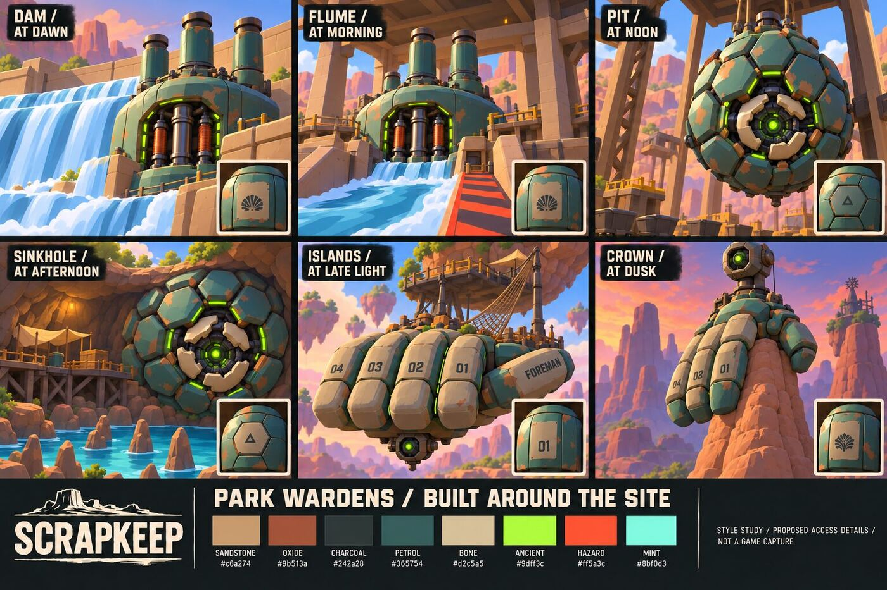
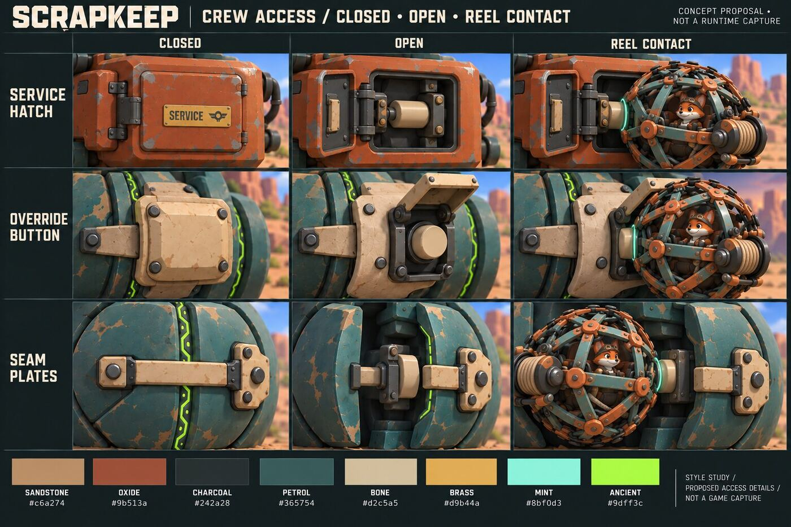
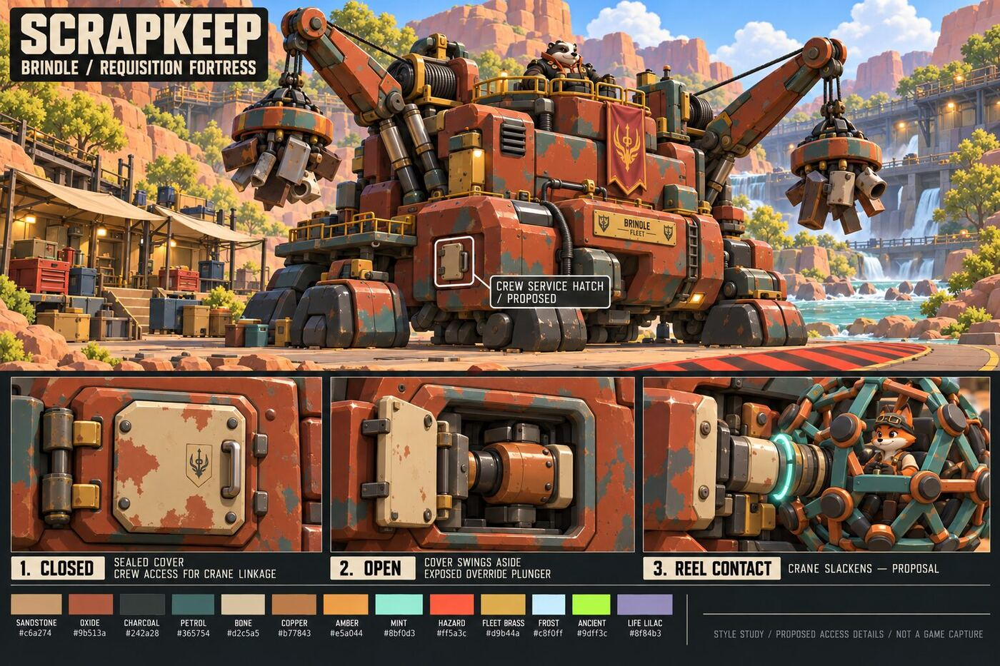
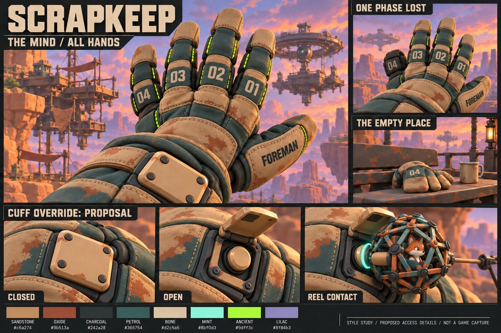
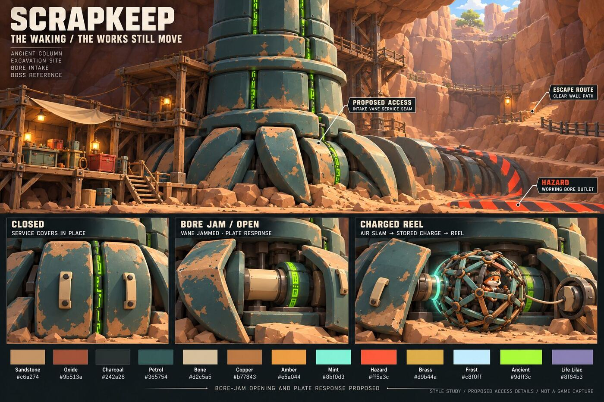
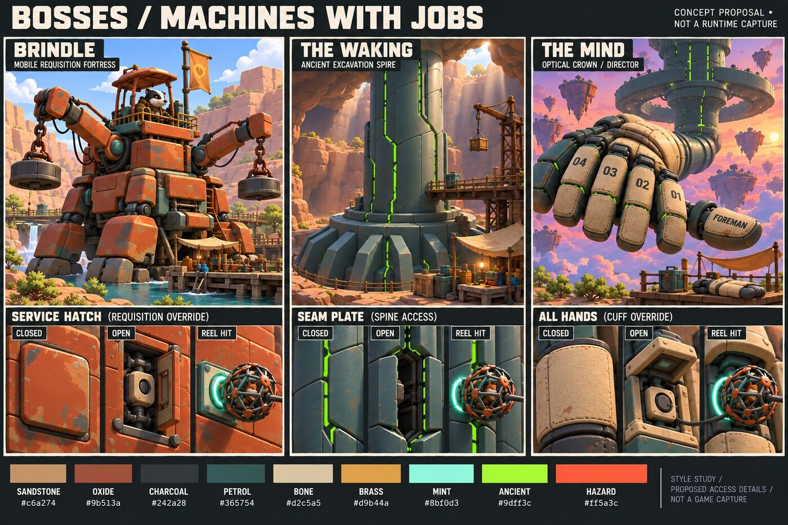

# Bosses and Wardens

Reference boards. Concept only: they settle no mechanics, scale or collision.

## bosses-park-warden-dam

- **Why it exists:** Show the crew-built access idea in the most constrained park fight while preserving the water-sheet ram.
- **Why it should work:** The reactor clamps to the curved dam beneath gates. A maintenance catwalk follows the canyon shelf, with fresh seals and a cleared workbench outside the ride. The sheet climbs to the open core; a separate reel-contact detail demonstrates surface response but does not claim an alternate shatter route.
- **Open question:** May a reel hit contribute posture at the dam while the sheet ram alone shatters? Default shown: reel contact is a study only; the sheet ram retains the finish.

## bosses-park-wardens-moodboard

- **Why it exists:** Wardens belong to the terrain and local work. Water cooling explains reactor placement, vertical hauling explains the hive, and holding/rigging explains the hands.
- **Why it should work:** A squat three-stack reactor, a hex-cell hive and an articulated glove remain different silhouettes. In each panel, a small closed-state inset contrasts with an open service mechanism on the main figure. A quiet maintenance vignette sits clear of the approach and warning. Dam water stays a ride, not an orange danger fill.
- **Open question:** Who fitted the access panels on the reactor and hive: the original human crew or later maintainers? Default shown: unbranded service additions, with no invented faction mark.

## bosses-weak-points-moodboard

- **Why it exists:** Give an artist a shared physical vocabulary for the new crew-built weak points. A hit must land at the mechanism, not anywhere on a staggered body.
- **Why it should work:** The hatch swings clear of a recessed contact pad. The button's guard lifts before its plunger can move. The paired seam plates separate into visible negative space. The contact panels retain the whole target, taut cable and compact mint impact ring. An armoured seam includes a separate small air-slam-to-charge annotation before the charged reel; the regular hatch uses an ordinary reel.
- **Open question:** Should exposed weak points remain usable by other valid impacts, or require a particular verb? Default proposal: show the reel's advantage without declaring other attacks invalid.

## bosses-world-boss-brindle

- **Why it exists:** His requisition machinery should look built to be serviced, and its defeat should visibly interrupt that work.
- **Why it should work:** Twin cranes and heavy cables dominate the silhouette. A brass ownership tag stays distinct from the charcoal-keylined HAZARD sweep. The side hatch opens onto an override linkage, with rubbed handles and a repair patch that explain crew use. Reel contact pushes the linkage and lets one crane go slack, a proposed consequence.
- **Open question:** Which Brindle attack should this hatch interrupt? Default shown: the adjacent requisition crane.

## bosses-world-boss-mind

- **Why it exists:** The crew's absence explains the body. The player fights work that continues after the workers are gone.
- **Why it should work:** Worn canvas, pale leather palms, stitched ridges and green split seams separate glove from cast structure. Finger backs read 04, 03, 02, 01 from little to index; the opposed thumb reads FOREMAN. One dark curled finger makes phase loss readable without text. A cuff access guard exposes the override plunger, with a local reel contact ring.
- **Open question:** Is the cuff the right place for the crew override, or should it sit beside the tracking lens? Default shown: cuff, so it does not turn a finger number into a target.

## bosses-world-boss-waking

- **Why it exists:** The Waking needs its own Dig identity and an opening caused by its machinery, following the bore/breach direction.
- **Why it should work:** Nested collars and intake vanes retain the shipped recipe's basic identity. A separate crew service bridge and patched collar explain maintenance around the old body. A jammed vane exposes the paired seam plates. Compact debris falls beside the contact path, leaving the bore lane and escape visible.
- **Open question:** Should a bore jam open the service seam, or should the opening follow a floor breach? Default shown: bore jam, proposed rather than implemented.

## bosses-world-bosses-moodboard

- **Why it exists:** Establish the three boss identities before close-up interaction design. The sequence follows Spillway, Dig and Highdraft, and ties each vulnerable mechanism to its former job.
- **Why it should work:** Brindle reads as a squat crane fortress in oxide/brass. The Waking reads as a vertical cast column in excavated rock. The Mind reads through an optical crown and a large gloved hand against open dusk sky. Inset states expose a physical opening without covering the silhouette. Setting detail stays at the edges.
- **Open question:** Should the Mind's existing optical crown remain its main body with the hand as its worker, or should the final boss become one complete hand? Default shown: retain the crown and the hand together.
