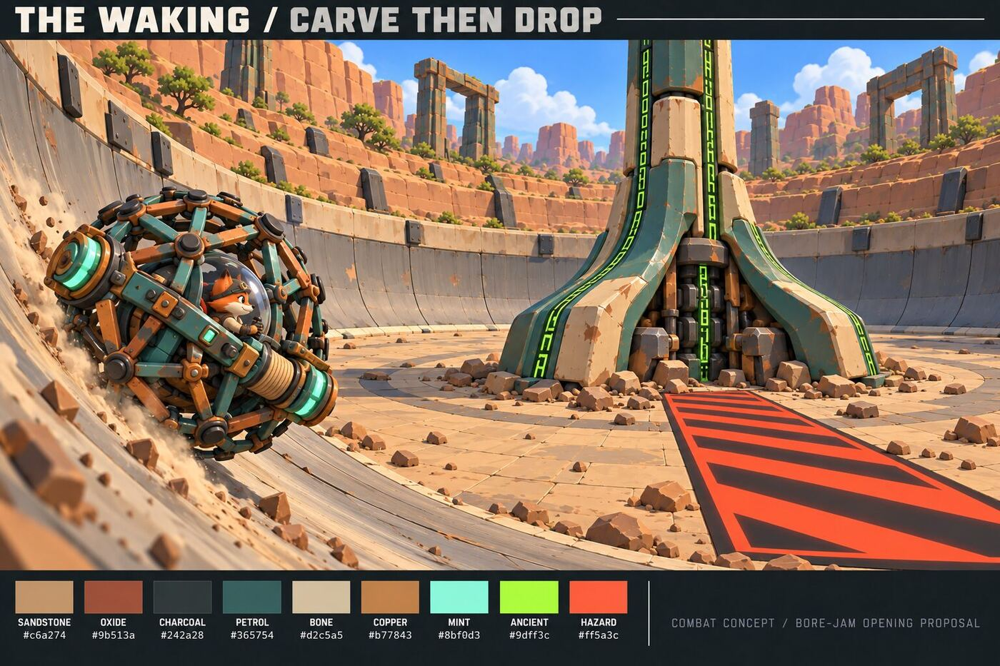
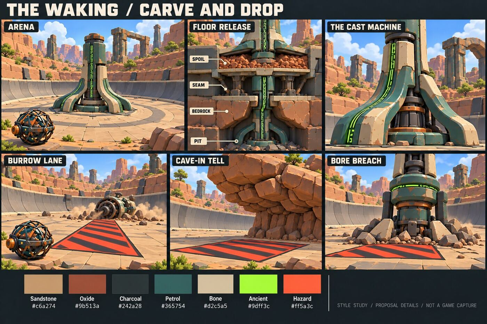
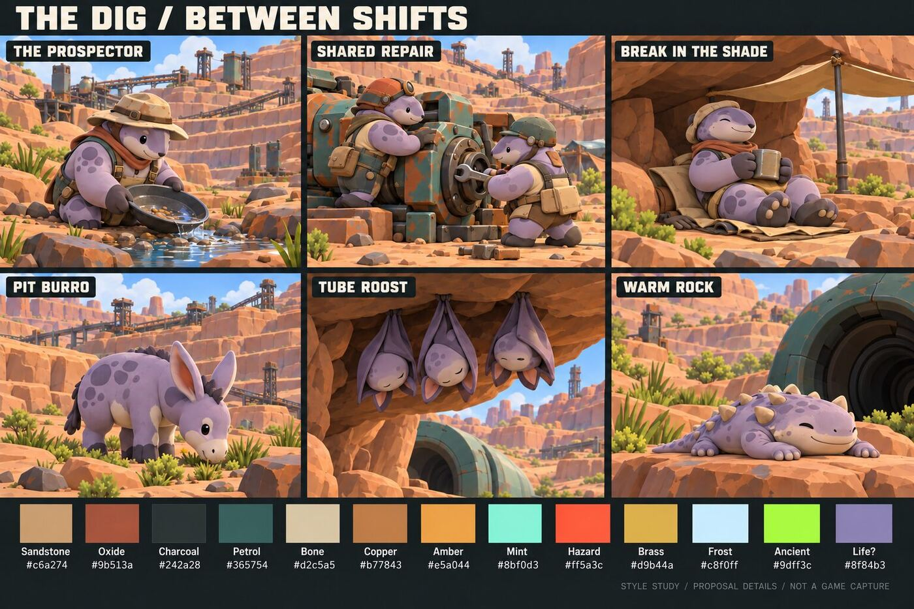
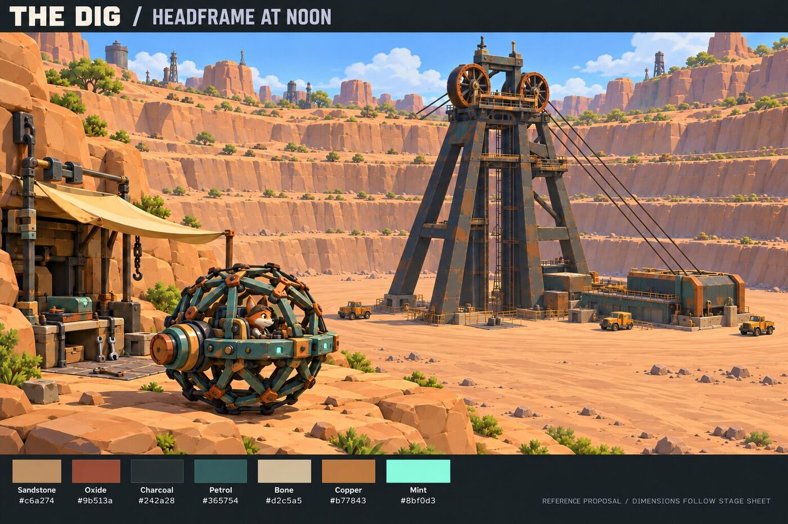
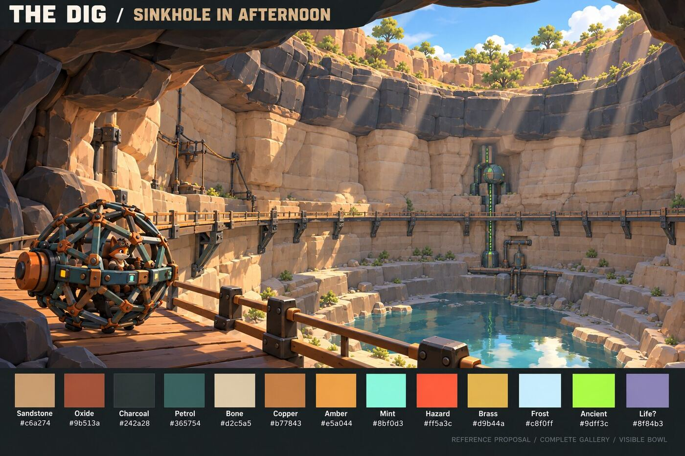
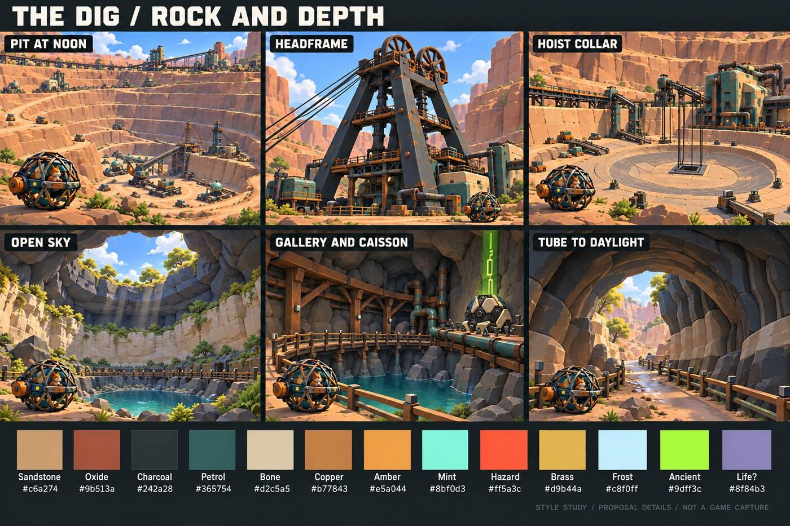
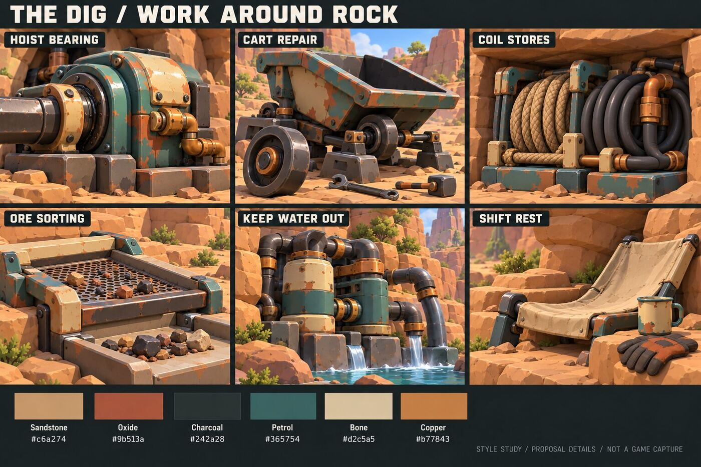

# Dig parks

Reference boards. Concept only: they settle no mechanics, scale or collision.

## dig-arena-waking-carve-drop

- **Why it exists:** Show the immediate decision: stay above the floor attack, see the bore mechanism jam, and choose a drop. Reel/dunk setup is a composition proposal, not a claim of new implemented weak points.
- **Why it should work:** Attacking tool, striped footprint and clear bank are visible together. Green patterned seams identify the ancient machine; the pilot's restrained mint marks belong to the collection field. Dust stays outside the warning. A cleared former service shelf implies miners without placing ambient people in combat.

## dig-arena-waking-moodboard

- **Why it exists:** The Waking completes the Dig's carve-and-drop lesson. The player reads a floor attack, rides the bank, then drops into an opening.
- **Why it should work:** The 36 m radius arena remains broad around the central cast mechanism. Threat samples have charcoal keylines, HAZARD fill and sharp striped geometry; green occurs only in patterned ancient seams. An escape bank remains visible in each attack panel. No crew or critters appear during combat. The section explains the three floors without pretending all are simultaneously visible in play.

## dig-crew-moodboard

- **Why it exists:** Show mining habits through work, shelter, water and shared tools. Ambient life gives the inhabited state requested by D:205 without introducing combatants.
- **Why it should work:** Soft round bodies, low-contrast lilac clothing and relaxed poses differ from armed machinery. No targeting brackets, hostile stripes, glowing eyes or loot halos. Work sites sit outside routes and combat. The bat panel is a roster proposal, not proof of sinkhole placement.

## dig-landmark-headframe-noon

- **Why it exists:** Establish the main navigation silhouette and make the hoist's former mining job legible beside its present Warden role.
- **Why it should work:** Five bench faces frame the solid A-legs and twin sheaves. The 120 m headframe rises above the 100 m pit. The 40 m tipple and clear shaft path express function. Quiet service clutter stays off the approach. No ancient beacon on the headframe.

## dig-landmark-sinkhole-afternoon

- **Why it exists:** Deliver the dark-to-sky reveal and show the miners adapting to a natural collapse and water table.
- **Why it should work:** Basalt cap, pale limestone, full ring and bowl separate by material and value. The 250 m opening and 120 m depth dominate tiny mining structures. The wall is the readable fast line; the floor stays open. A narrow patterned ancient-green column marks the brood, never the path or water.

## dig-landmarks-moodboard

- **Why it exists:** Teach where to go through the skyline and landform, and show how working infrastructure becomes a rolling playground.
- **Why it should work:** Headframe reads as an A with two wheels against noon sky, without a beam. Sinkhole gives an afternoon sky opening, complete gallery and visible depth; only the brood's ancient column glows green. Carving band stays continuous and empty. Geology fills more of the sheet than scrap.

## dig-props-moodboard

- **Why it exists:** The player should recognize a community that moved rock, lifted loads and kept water out. Small comforts beside maintained mechanisms express B:76,97-109,139 and D:205.
- **Why it should work:** Low, asymmetrical clusters in recesses leave the rolling corridor empty. Worn bone, petrol, timber and sandstone dominate; copper is a small functional fitting. No glowing lamps, floating scrap, cache-shaped containers or decorative grapple cables. Shared ordinary worker silhouette gives relative scale only.
