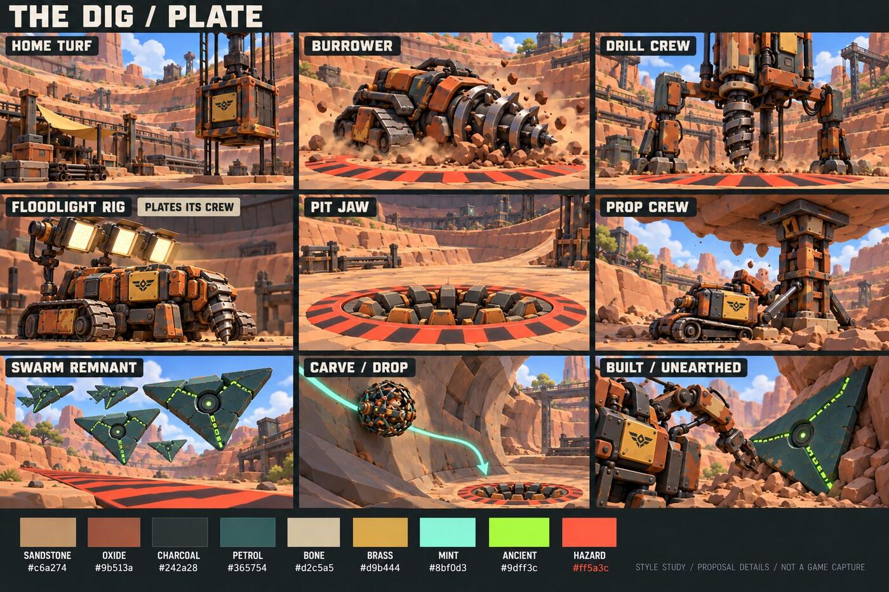
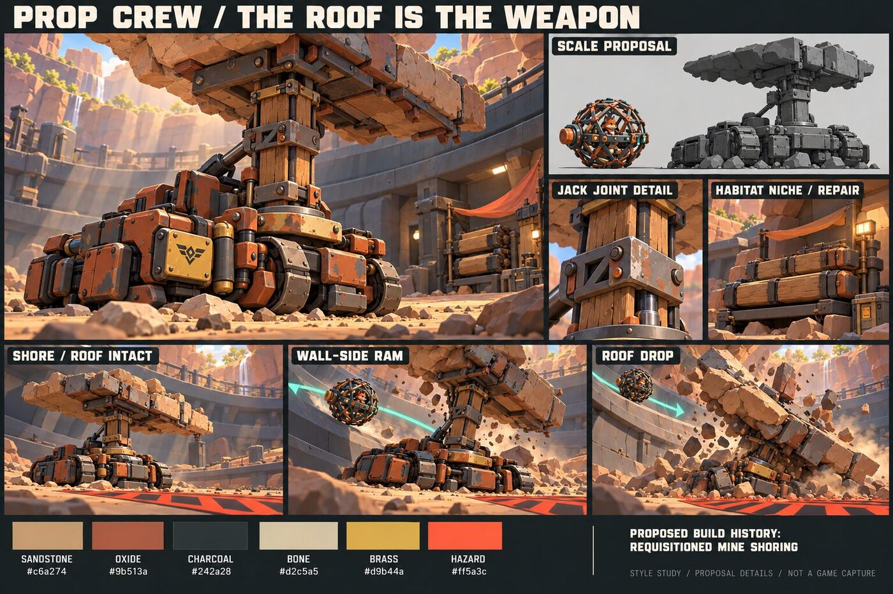
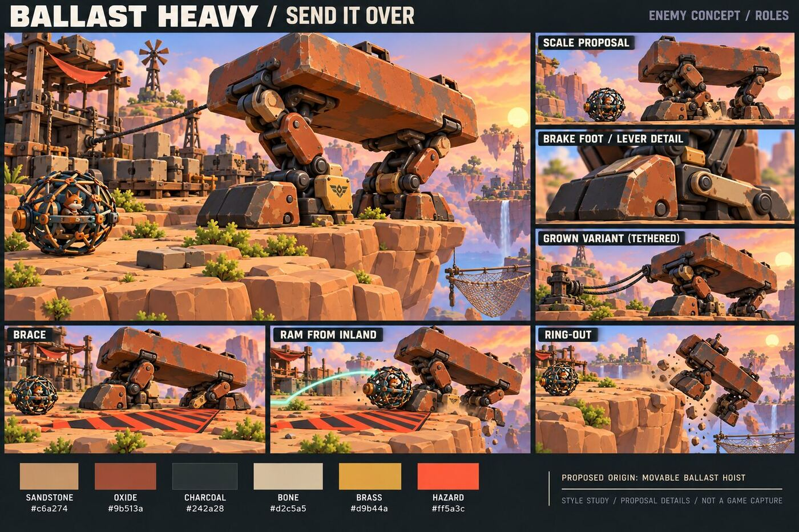
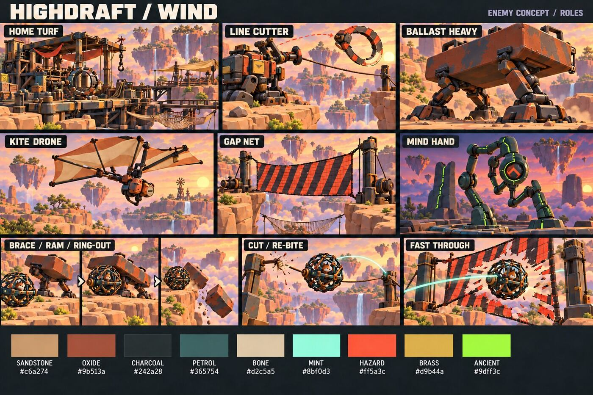
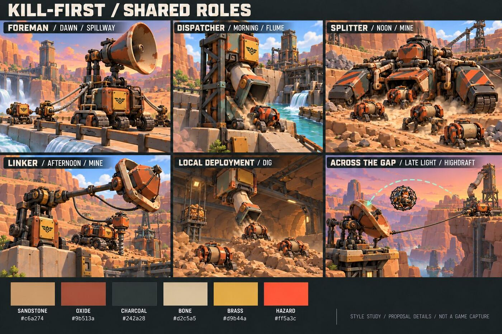
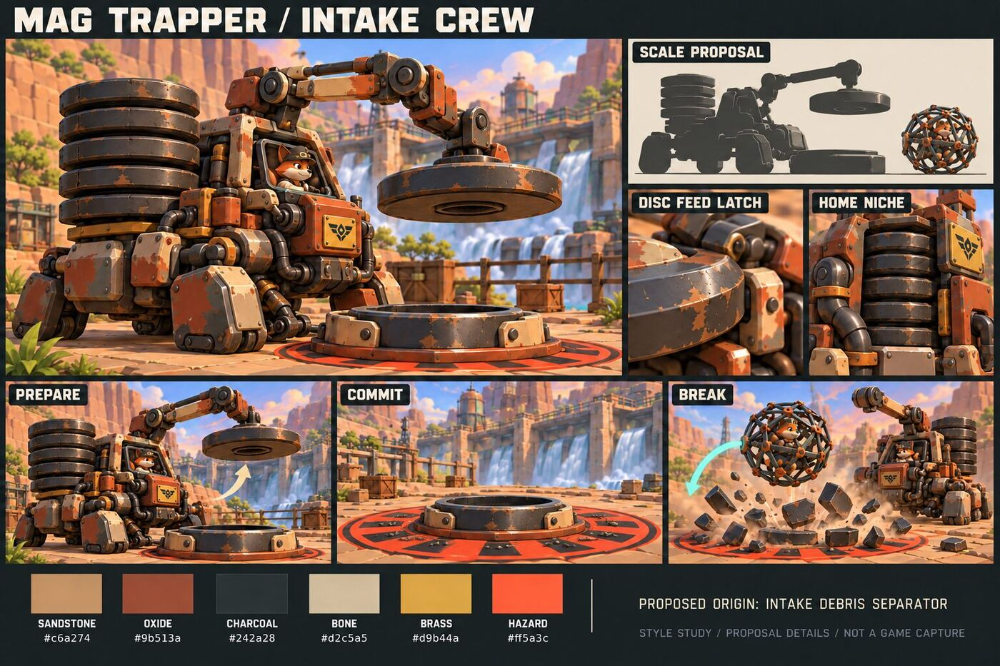
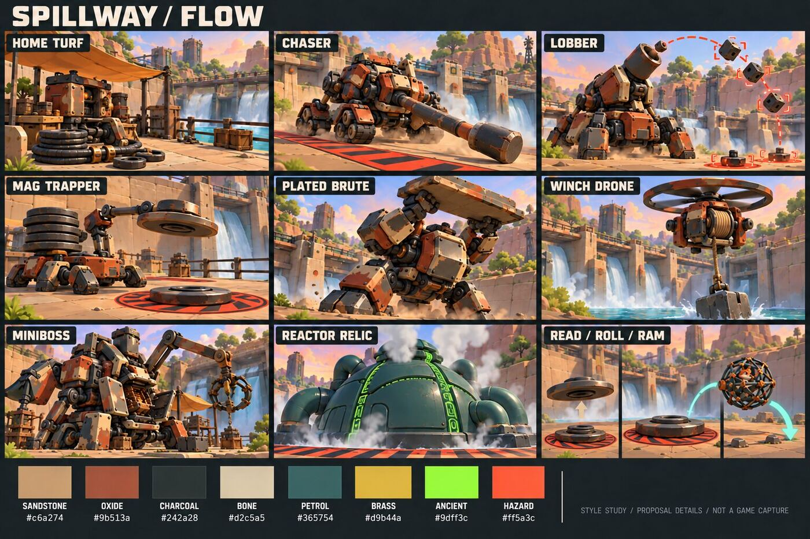

# Enemies

Reference boards. Concept only: they settle no mechanics, scale or collision.

## enemies-dig-moodboard

- **Why it exists:** Make carving the safe lane and dropping onto floor threats understandable before the first hit.
- **Why it should work:** The low burrow nose, vertical bore, opening lamp ring, flush toothed jaw and tall shoring prop have different outlines. Warnings stay on the floor and never falsely cover a safe bank or wall.
- **Open question:** Should the proposed mining conversion history be retained? The research questions the wall-safe loop; these images preserve the accepted rule pending your decision.

## enemies-dig-prop-crew-reference

- **Why it exists:** Show a target that turns its own shoring into the player’s weapon when rammed from the safe wall side.
- **Why it should work:** A tall load-bearing prop is visibly connected to a cracked overhead canopy. The threatened floor, curved wall, supported pack and safe approach fit in one image.
- **Open question:** Does the ram-able shoring read as an intentional tactical target? The exact conversion from mining support to combat unit remains proposed.

## enemies-highdraft-ballast-heavy-reference

- **Why it exists:** Make the interruptible brace and the inland-to-edge ram the obvious answer to a near-unkillable heavy.
- **Why it should work:** The overhead slab, brake feet, inland cable stake and open cliff establish mass and direction without a health-bar explanation. The enemy tips outward while the player stays on the island.
- **Open question:** Does the movable ballast-hoist origin read clearly? The rear-cable layout is a proposal illustrating the existing grown-pilot rule.

## enemies-highdraft-moodboard

- **Why it exists:** Show that the air, the line and the island edge change the fight. A ballast heavy invites a ring-out, not sustained damage.
- **Why it should work:** Spinning cutter ring, overhead slab, spread kite and two rim posts remain distinct. The net warning is a vertical plane. The island edge, player approach and heavy stance remain visible together.
- **Open question:** Do the proposed mooring-tool origins separate this crew enough from Spillway equipment? Should the net-weavers remain visibly separate from the Fleet deployment crew?

## enemies-specials-moodboard

- **Why it exists:** Make the reason to cross a fight and remove its support unit visible. Keep shared roles while showing how each world houses and deploys them.
- **Why it should work:** Horn mast, downward tube, three budding hulls and sideways dish boom provide four distinct silhouettes. Support connections are physical cables, separate from hostile attack warnings.
- **Open question:** Are these shared specials with local deployment acceptable under the unique-per-world rule, or should their future mechanics also diverge? Current canon retains the shared roles.

## enemies-spillway-mag-trapper-reference

- **Why it exists:** Explain how a stack of pit discs becomes a readable magnetic hold and why a rolling pilot chooses jump, smash or grapple escape.
- **Why it should work:** Stacked discs dominate the silhouette. The held disc, launcher mouth and floor disc stay distinct. Water wear is localized and the ground warning stays outside steam.
- **Open question:** Is the proposed intake-debris separator origin convincing, or should this be purpose-built Fleet anti-ball hardware?

## enemies-spillway-moodboard

- **Why it exists:** Introduce roll, ram and grapple responses through water-service machines whose working tools explain the threat.
- **Why it should work:** Low lance, raised mortar, stacked discs, lifted slab and suspended drum separate the Fleet silhouettes. The seamless reactor stays a different material era. Dawn water-side shade offsets oxide bodies and the common striped warnings.
- **Open question:** Do the proposed water-service origins make the Fleet feel like it commandeered a working place? Which silhouettes need more personality?
