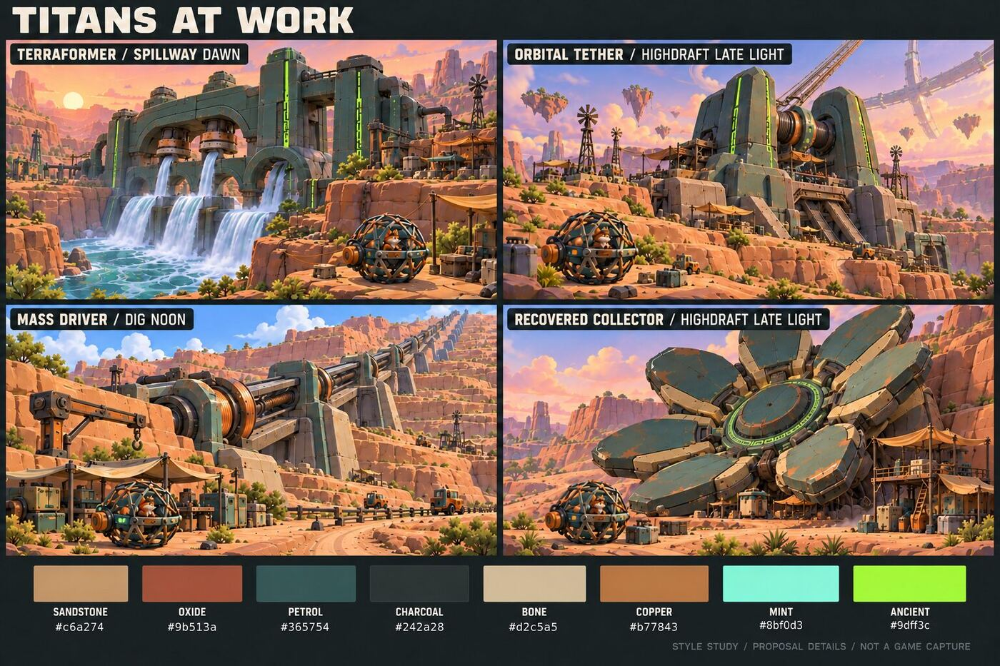
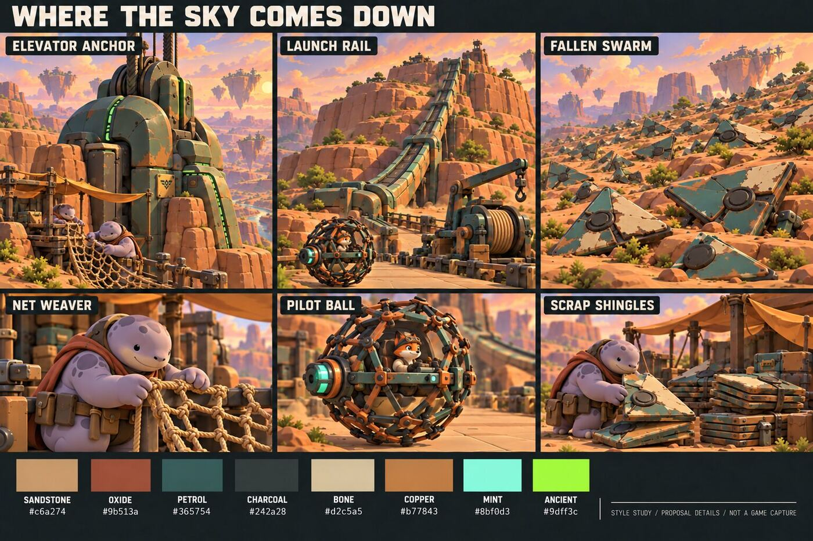
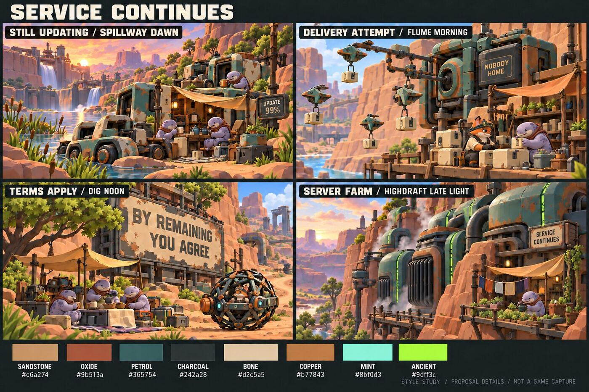
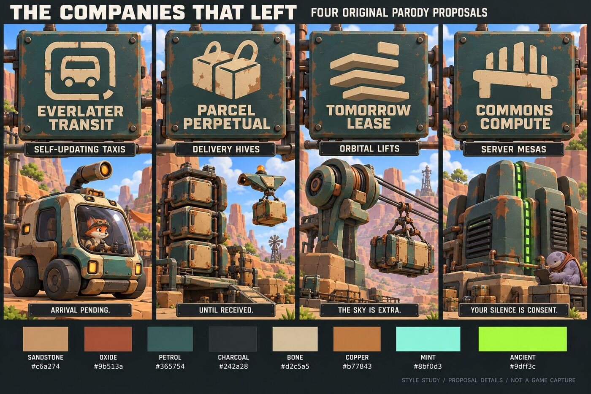
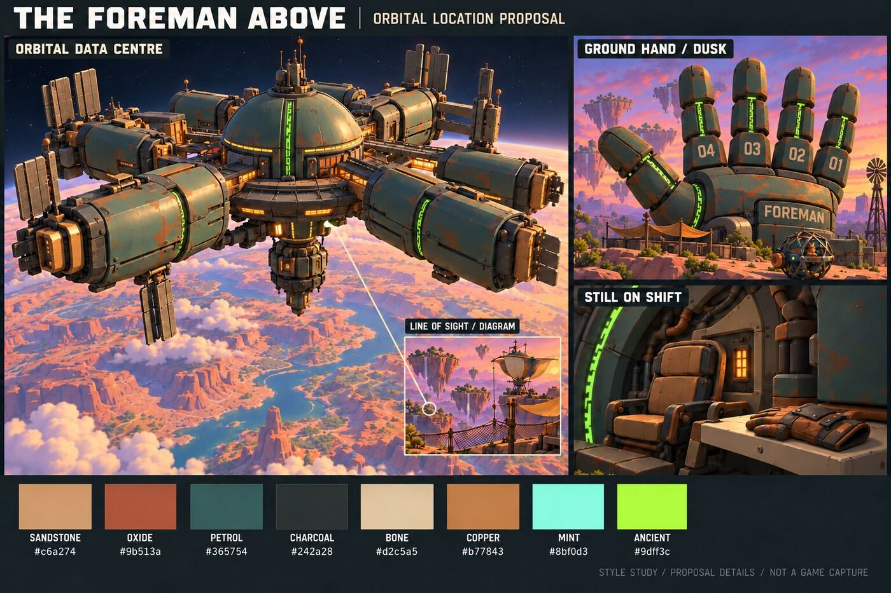
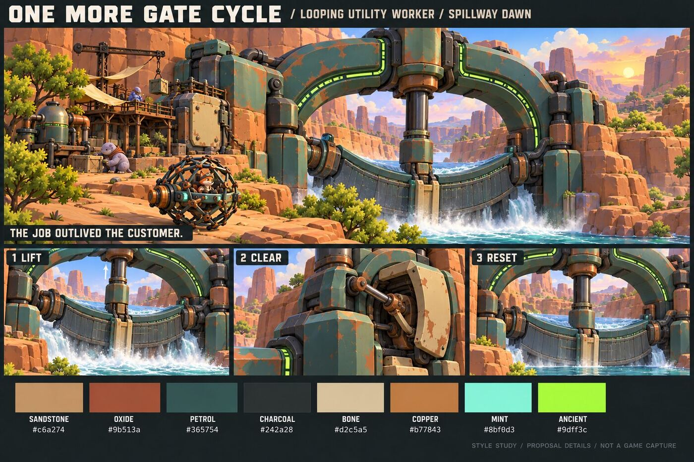

# The era

Reference boards. Concept only: they settle no mechanics, scale or collision.

## era-titans-scale-moodboard

- **Why it exists:** The era and Machine lore rulings explain planet-scale construction and why those machines still work. This establishes awe through infrastructure rather than a larger player.
- **Why it should work:** Four distinct job silhouettes, repeated small lattice balls and broad landforms make scale legible. Thin notched green seams identify the human layer. No attack effects compete with the scale comparison.
- **Open question:** Which of these titans belongs inside a playable park rather than beyond its boundary? Absolute dimensions remain open.

## era-space-ground-ends-moodboard

- **Why it exists:** The era ruling permits the Highdraft cableways and rails to be ground ends of space infrastructure. The lived-in parks ruling asks how people build around those remains.
- **Why it should work:** The anchor, rail and scrap field have different silhouettes and clear useful routes. Net-weavers occupy sheltered ledges. Fallen hardware stays dull and inert, avoiding pickup and active swarm signals.
- **Open question:** Which ground end is a landmark, which is traversable, and what useful discovery belongs off the fastest line?

## era-cheerful-dystopia-moodboard

- **Why it exists:** The era ruling puts the satire in human leftovers and keeps the animal crews cheerful. Machine lore supplies loops that continue after their original purpose has disappeared.
- **Why it should work:** Each panel has one readable absurdity and one practical adaptation. Status text uses bone on charcoal. Quiet locals have rounded silhouettes, muted lilac clothing and no enemy or pickup signals.
- **Open question:** Which leftovers are optional lore vignettes, and which machine cycles should affect a route?

## era-megacorps-reference

- **Why it exists:** The era ruling requires original parody megacorps wherever companies appear. These identities connect the satire to machines with understandable former jobs.
- **Why it should work:** One physical emblem and one job per company keeps the set distinct without borrowing brand colours. Bone and petrol plates avoid brass, which means Fleet ownership. The same chunky rendered objects prevent a drift into a vector branding sheet.
- **Open question:** Which, if any, names should enter the lore register? No company identity is canon until selected.

## era-mind-orbital-reference

- **Why it exists:** The era ruling permits an orbital Mind. The Mind’s reach limits its control, while All hands explains the foreman and its ground manipulators. This explores their relationship without replacing the existing ground boss.
- **Why it should work:** A large orbital establishing panel and two ground/detail panels separate station, sightline and hand. A thin bone diagram line shows observation without inventing a green weapon beam. Ancient notched seams tie the hardware together.
- **Open question:** Is the orbital data centre the Mind’s actual seat, and how should the ground boss relate to it? The ruling permits this location but does not select it.

## era-looping-titan-reference

- **Why it exists:** Machine lore says looping workers become moving park machinery. This makes a former utility job visible and suggests a timing opportunity around a service hatch without inventing a new boss.
- **Why it should work:** The same large gate tender repeats across panels. A visible linkage connects gate movement to the maintenance opening. A broad dry route remains available. The pilot stays small; locals work outside the moving machinery.
- **Open question:** Should this cycle offer only traversal, or expose a crew-built maintenance hatch used by a later encounter? The shown opening is a service part, not an approved weak point.
