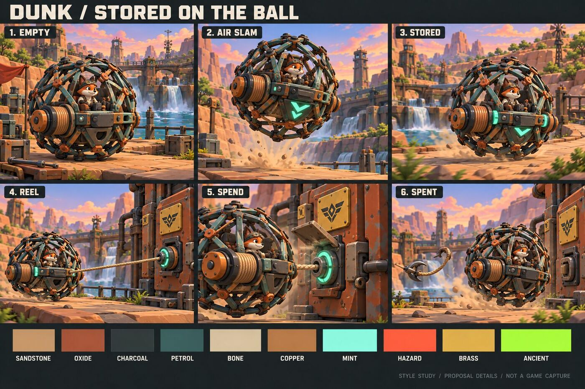
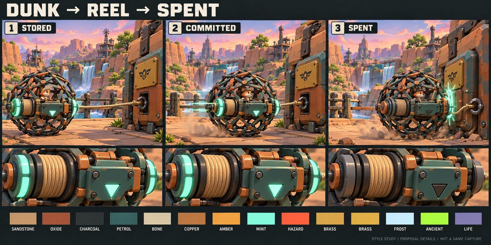
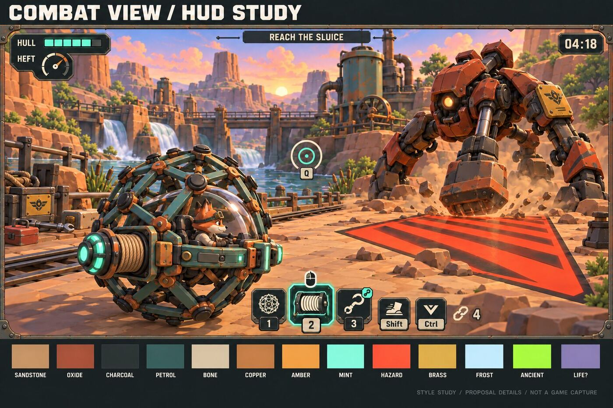
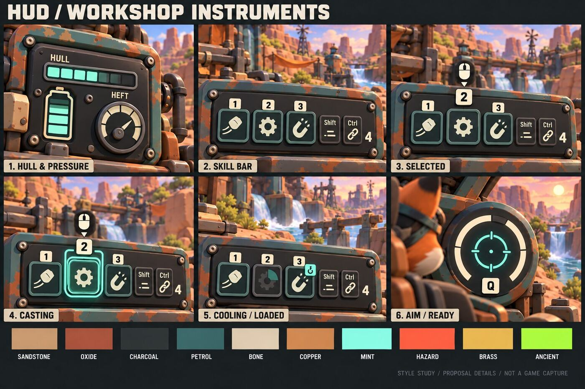
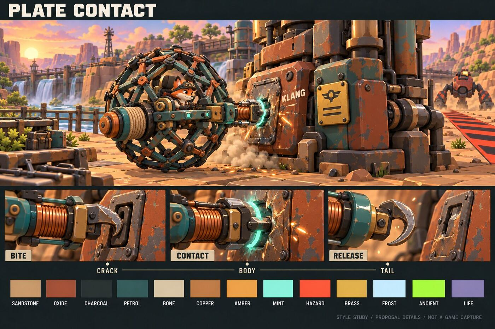
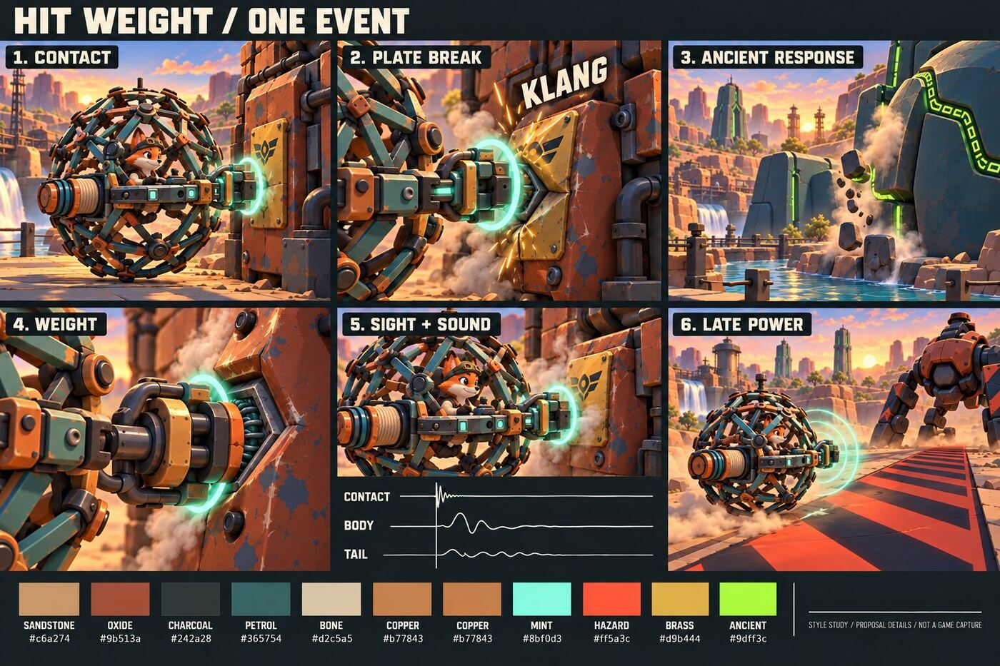
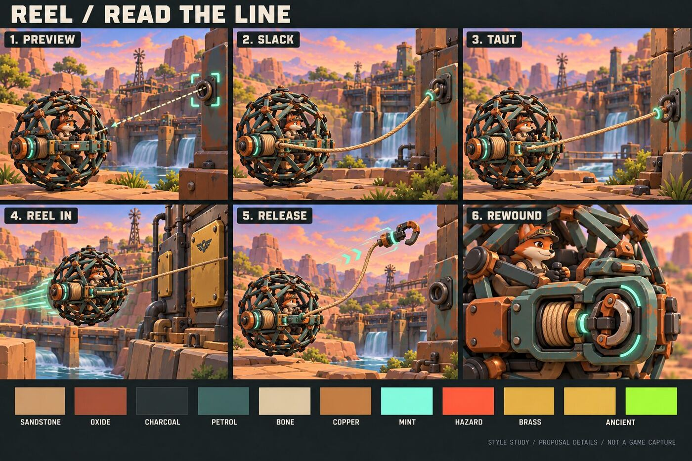
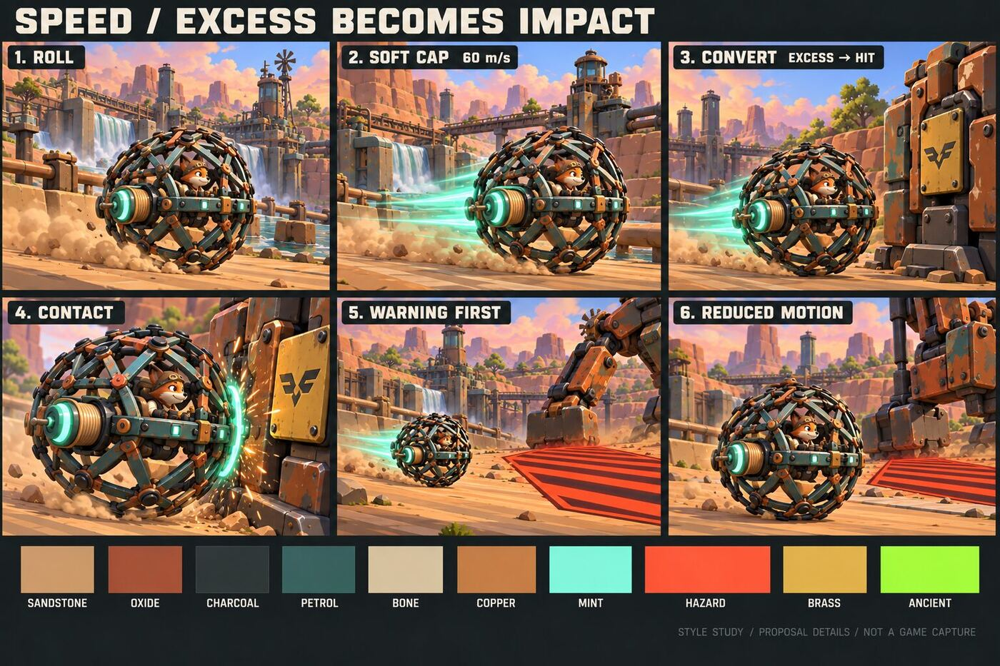
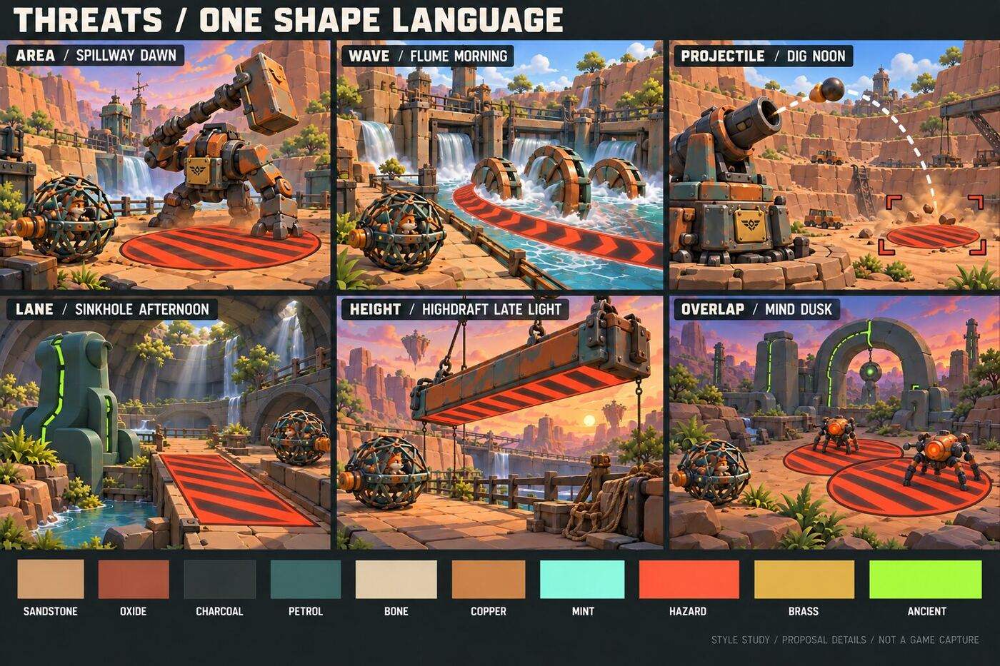

# Effects and UI

Reference boards. Concept only: they settle no mechanics, scale or collision.

## fx_ui-dunk-moodboard

- **Why it exists:** The supplied direction describes air slam storing charge for the next reel impact.
- **Why it should work:** Charge sits on working coil hardware, with a compact downward chevron as a proposed redundant cue; the cockpit and lattice stay visible and the glow clears after spending.
- **Open question:** Does the hardware-local glow plus downward chevron distinguish stored dunk from Sable's ordinary field and the Q ultimate?

## fx_ui-dunk-reel-contact-reference

- **Why it exists:** Tests whether the proposed charge treatment explains the supplied combo without a second ultimate meter.
- **Why it should work:** Fixed camera and ball scale isolate state changes; the physical reel path and hatch remain visible; glow disappears after contact.
- **Open question:** Does the spent frame make it obvious that the next reel no longer carries dunk charge?

## fx_ui-hud-combat-reference

- **Why it exists:** Shows the revised skill bar, ultimate and grapple indicators sharing a playable view.
- **Why it should work:** Large clear central route; three slots plus smaller chips below; selection and active state differ; no F slot, minimap or new currency invented.
- **Open question:** Does the pale outer Q arc stay distinct from the mint grapple state during a busy fight?

## fx_ui-hud-moodboard

- **Why it exists:** The player needs to see what left click will do, what is cooling and when Q is ready without losing the route.
- **Why it should work:** Workshop frames keep roughness on borders; clean bone glyphs on charcoal, a moving mouse glyph for selection and a separate active double-frame carry different facts.
- **Open question:** Is the distinction between selected, actively casting and loaded line clear at a glance?

## fx_ui-impact-contact-reference

- **Why it exists:** Makes weight come from material response and the shared event, while keeping the next threat legible.
- **Why it should work:** The hook, plate displacement, mint contact cue and steam tail form a single causal event; any comic word sits off the footprint.
- **Open question:** Does the plate deflection carry enough weight before adding hit-stop or camera response?

## fx_ui-impact-moodboard

- **Why it exists:** Every action must have paired sight and sound; heavier builds show stronger presence without larger bursts.
- **Why it should work:** One dominant contact cue, local mechanical deformation, distinct material tails, stable framing and unobscured danger edges.
- **Open question:** Which material response needs the strongest listening test: Fleet plate, ancient shell or player hull?

## fx_ui-reel-moodboard

- **Why it exists:** The grapple must explain attachment, tension, approach and release while preserving momentum.
- **Why it should work:** Dashed preview differs from solid physical cable; anchor brackets, visible winch and taut/slack silhouette carry state without relying on glow.
- **Open question:** Should stored dunk add a small mark at the hook, or remain visible only on the ball?

## fx_ui-speed-moodboard

- **Why it exists:** The ruling converts speed above 60 m/s into hit damage and a blazing trail.
- **Why it should work:** A short rearward class-colour trail advertises excess energy while the forward route stays clear. Reduced motion retains a proposed still status mark.
- **Open question:** When reduced motion hides speed lines, should the cap state use a steady rear-coil cue or a HUD mark?

## fx_ui-telegraphs-moodboard

- **Why it exists:** Players must read the tool, danger geometry and available response before harm.
- **Why it should work:** Hazard stripes, sharp geometry and dark keylines reinforce colour; height rails and far caps show extent; separate overlapping edges preserve escape.
- **Open question:** Which attack should become the first moving-footage test of edge, height and escape readability?
