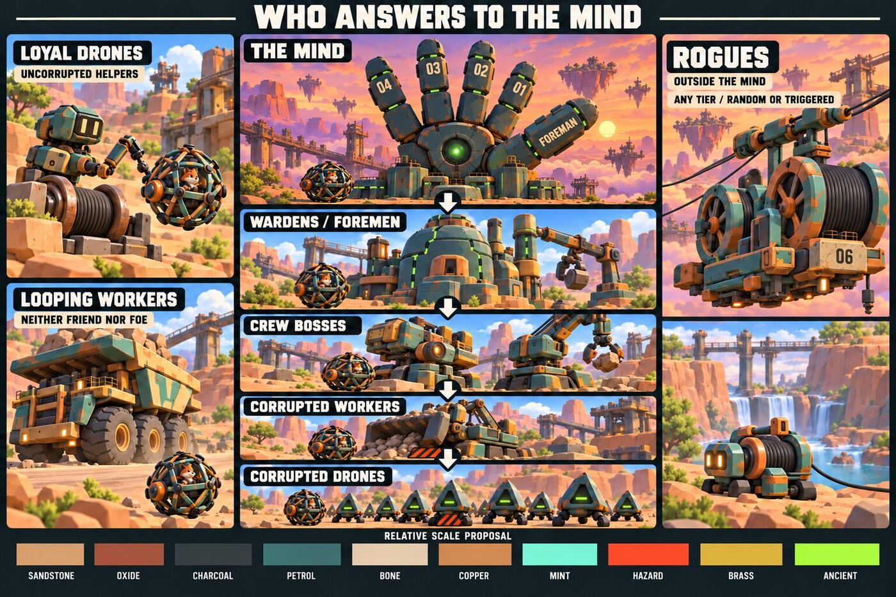
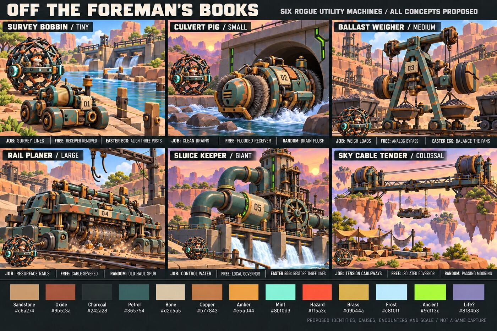
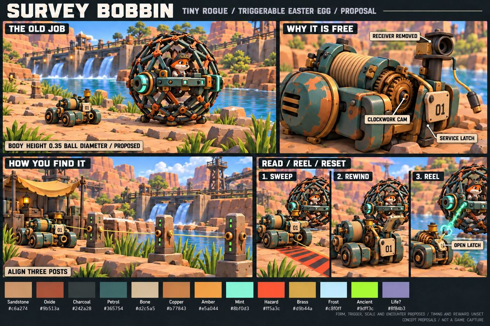
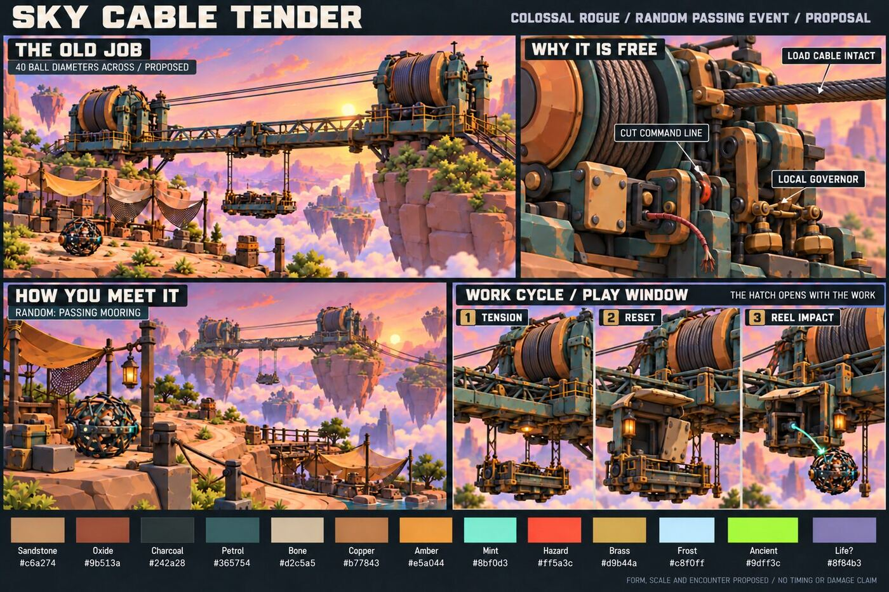
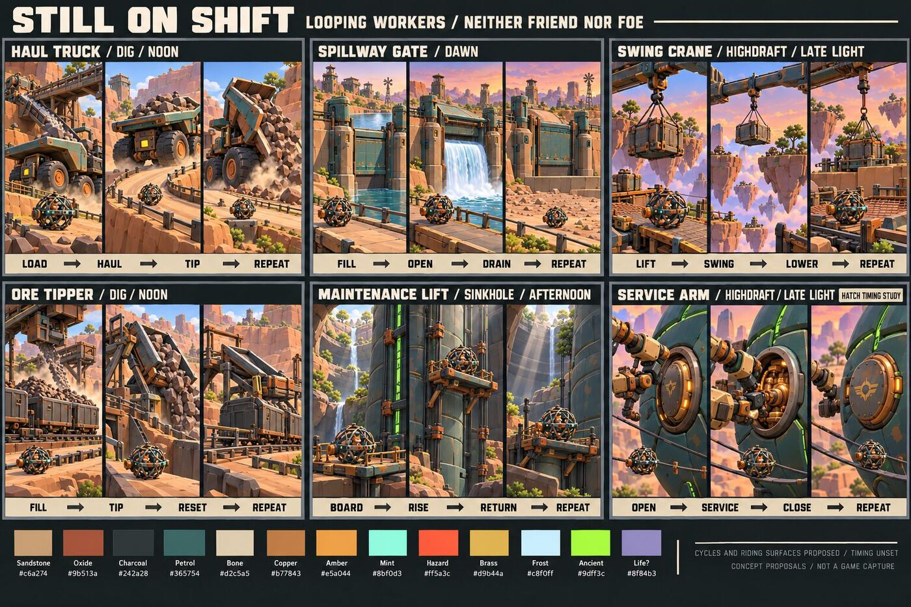
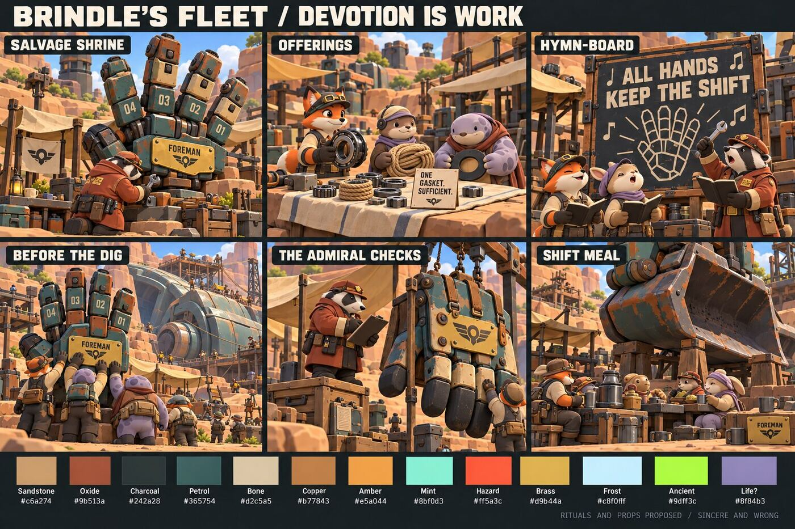
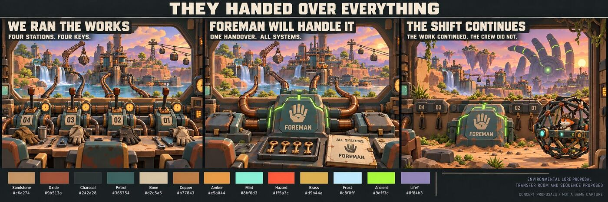

# Enemy hierarchy and rogues

Reference boards. Concept only: they settle no mechanics, scale or collision.

## hierarchy-chain-of-command

- **Why it exists:** DECISIONS 10, Machine lore and The Mind's reach; the owner-requested enemy hierarchy. Makes allegiance readable before an encounter.
- **Why it should work:** Bone connectors encode authority; separate columns prevent helpers from reading as subordinates. Each machine has a pilot-ball comparison. Giant machines dwarf plush pilots without inflating the pilot.
- **Open question:** Exact authority relationships below the Mind and dimensions are not specified. Chart placement and size ratios are proposals.

## hierarchy-rogues-moodboard

- **Why it exists:** D10 permits independent machines at any tier as random events or known Easter eggs. Discovery expands the world beyond the Mind's reach.
- **Why it should work:** Every silhouette starts with a tool. A visible broken link, mechanical control or isolated circuit explains independence. Each panel includes a scale ball, visible working path and refuge.
- **Open question:** All six identities, mechanisms, tiers, encounters and sizes are proposals. Which event earns a full encounter is an owner choice.

## hierarchy-rogue-survey-bobbin-reference

- **Why it exists:** A small optional event tests precision within the giant-machine world. Its old surveying job explains the taut line and its calibration routine.
- **Why it should work:** The low spool silhouette differs from ordinary flying drones. A mechanically disconnected receiver and clockwork cam visibly explain the proposal. The encounter has a readable ground strip and dry escape shelf.
- **Open question:** Proposal: trigger by aligning three survey posts; sweep, rewind, service-open cycle. B=1, bobbin body height=0.35B. Timing and reward are unset.

## hierarchy-rogue-sky-cable-tender-reference

- **Why it exists:** A random event makes the cableway into a temporary moving playground. It extends the giant utility fleet without duplicating the Waking's excavator.
- **Why it should work:** A twin-spool bridge gantry, suspended service cradle and counterweight define the job at silhouette scale. The play route uses cableways; one service hatch is exposed only during tension reset.
- **Open question:** Proposal: its isolated mechanical governor survived after the control cable was severed. Random passing event; 40B overall span. Trigger frequency, contact damage and reward are unset.

## hierarchy-looping-workers-moodboard

- **Why it exists:** D10 explicitly makes looping workers neutral pinball parts. D6 links reel impacts and stored dunk charge to physical hatches and seams.
- **Why it should work:** Repeated silhouettes and bone arrows teach position and timing without target markers. Wide safe bypasses remain visible. Neutral motion is not decorated as a hostile attack.
- **Open question:** Additional cycles, cycle order and safe riding surfaces are proposals. Runtime collision, timing and damaging contact remain unverified.

## hierarchy-fleet-devotion-moodboard

- **Why it exists:** D10 makes the Fleet's digging devotion. TONE-BIBLE requires Brindle to remain sincere and wrong. The site shows how the crew lives around the excavation.
- **Why it should work:** Small plush crews, maintained benches and absurdly careful inventories keep the faith earnest. Brass identifies ownership. Ritual spaces sit outside machine lanes; no sinister costumes or sacrificial imagery.
- **Open question:** The shrine form, hymn words, offering customs and ceremony are proposals. Depiction does not make Brindle harmless in combat.

## hierarchy-human-folly-reference

- **Why it exists:** D10 states that humans fell after trusting something more intelligent and capable with everything. D7 makes their empty crew places and numbered gloves meaningful.
- **Why it should work:** Repeated architecture and equipment make the change legible. Numbered empty workstations converge on one control source; the last panel shows continuing utility work amid absence.
- **Open question:** The transfer-room layout and three-stage sequence are proposals. Canon does not specify the literal switch or chronology of human disappearance.
