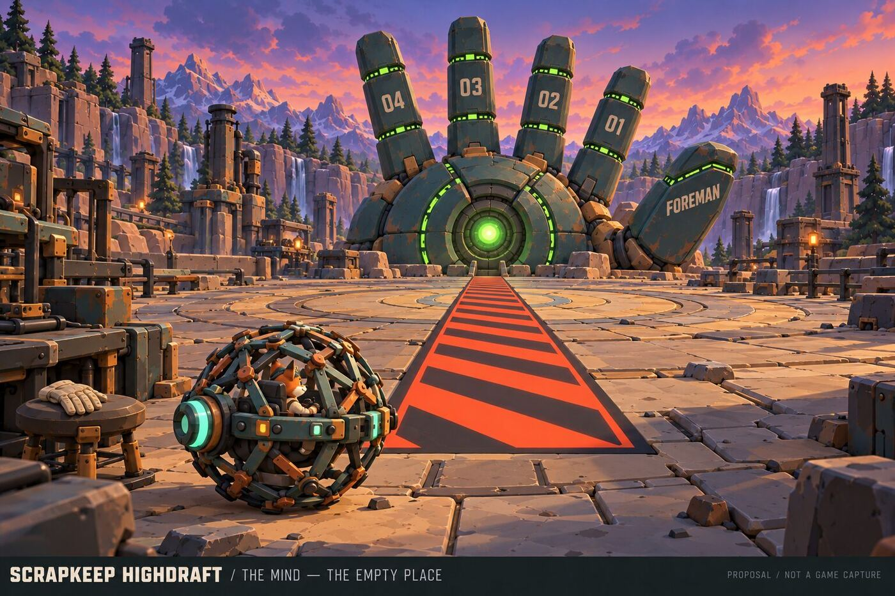
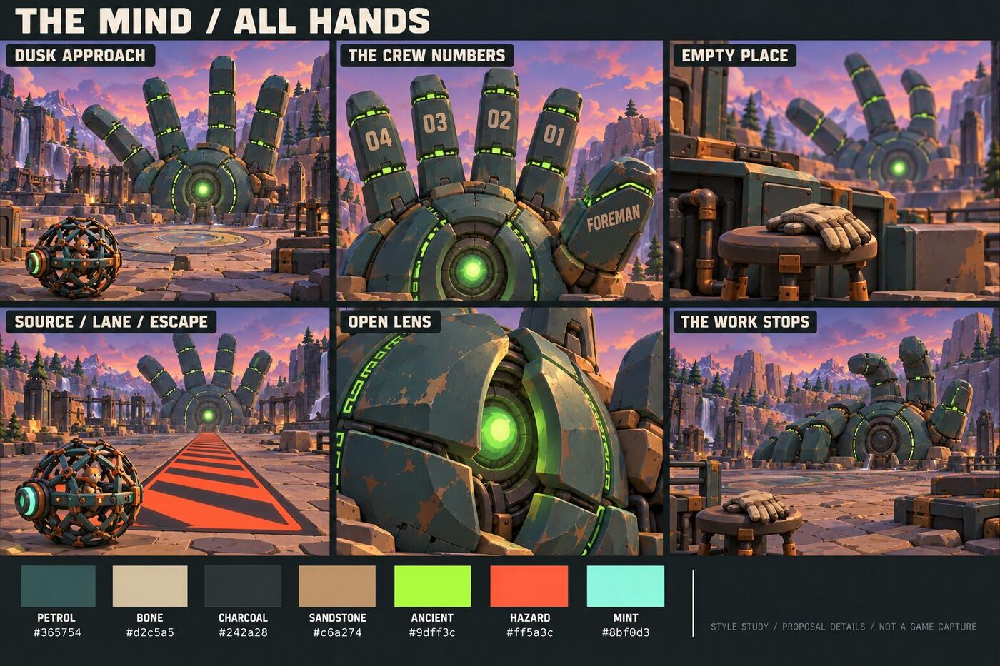
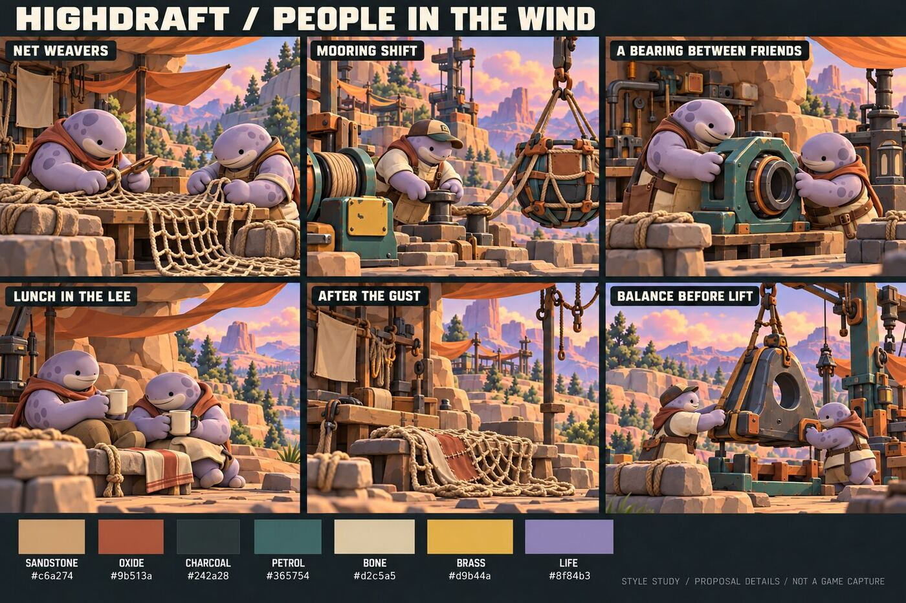
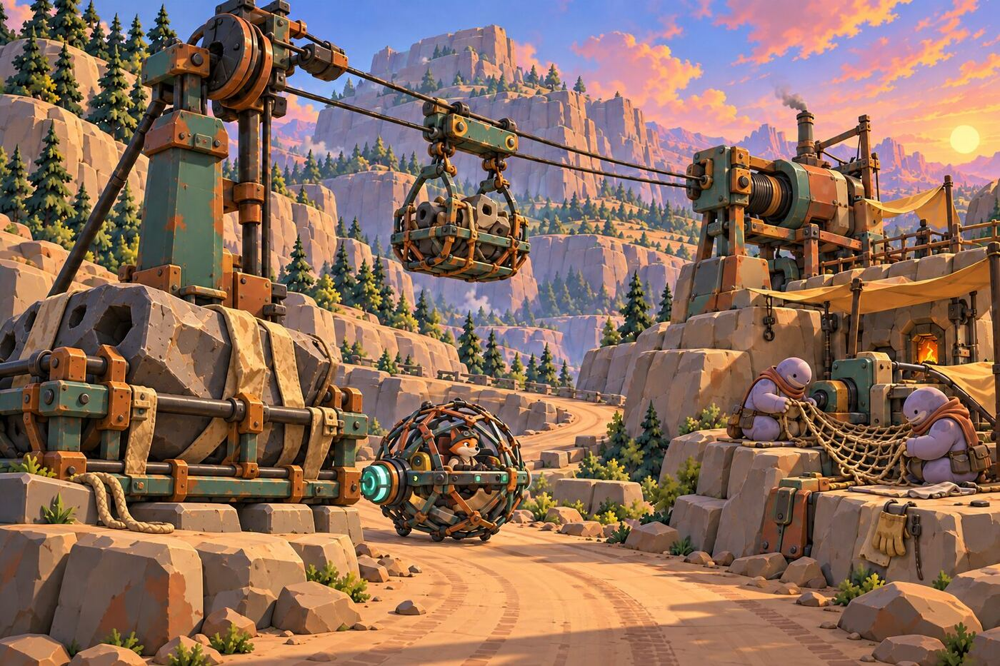
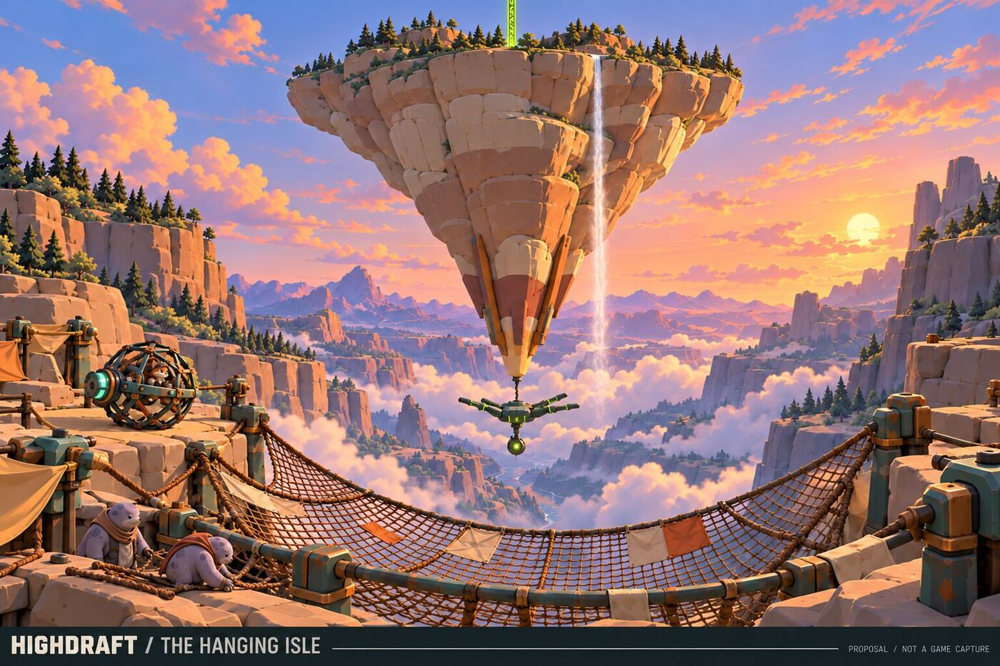
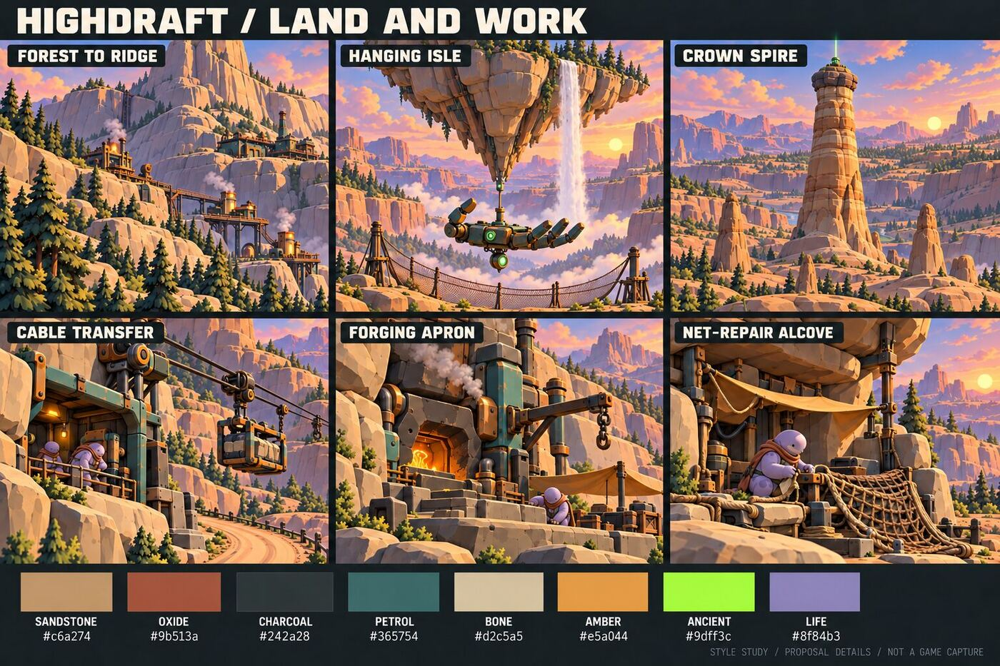
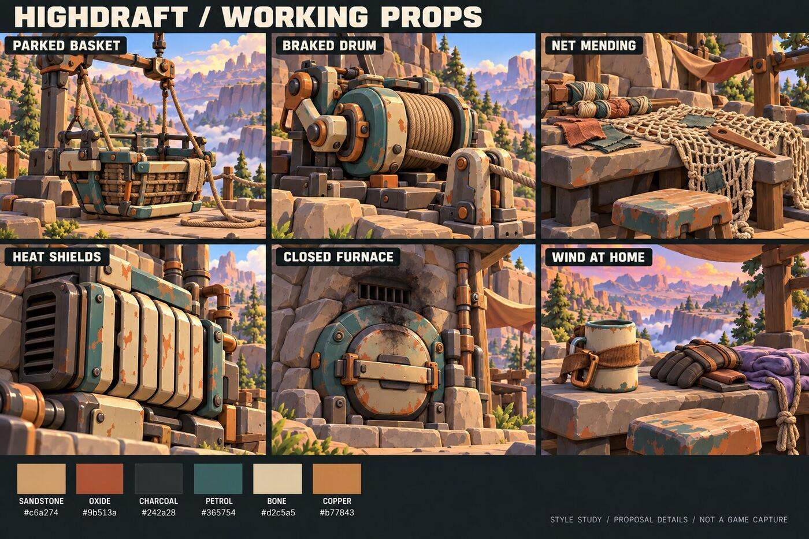

# Highdraft parks

Reference boards. Concept only: they settle no mechanics, scale or collision.

## highdraft-arena-mind-dusk

- **Why it exists:** Join the final fight's readable action to the Mind continuing its absent crew's work (`DECISIONS:179,195`; `BIBLE:44,54-59,661-663`; `COMPS:61-64`).
- **Why it should work:** Large cool masses hold the silhouette. Patterned green seams show ancient machinery; coral stripes and dark edges alone show danger. The glove stays quiet and off the play floor. Boss, footprint and exit remain visible together. Exact scale, hand construction, lens placement and attack footprint are proposals, not a screenshot or validated hitbox.
- **Open question:** Does the empty crew place read at this distance without taking attention away from the next attack?

## highdraft-arena-moodboard

- **Why it exists:** Carry the approved "All hands" story into an arena whose working past is visible. Preserve the source, danger and response in a reel/dunk composition (`DECISIONS:179,195`; `BIBLE:54-59,489-497`; `VISUAL:114-128`).
- **Why it should work:** Dull ancient cast metal contrasts with bolted repairs and bone cloth. Numbered finger plates and an empty glove communicate absent workers without enemy-like ambient people. A clear central floor keeps the hand, proposed exposed lens and escape visible. One striped coral lane demonstrates hierarchy. It is not a claim about actual Mind attack geometry (`PURPOSE:28-42`; `COMPS:61-64`).
- **Open question:** Does an abandoned forge apron with an empty crew place fit the Mind's final arena, or should its former workplace be more overtly a control room?

## highdraft-crew-moodboard

- **Why it exists:** Make the named net-weavers and Fleet mooring crew visible through ordinary work. Shared tasks express relationships without lore exposition (`DECISIONS:192,205`; `BIBLE:127-139`).
- **Why it should work:** Smooth rounded crew silhouettes, matte lilac clothing and relaxed task poses separate harmless workers from armed Fleet units. Small tools stay at a bench; slack net bundles differ from the enemy netcaster's two-mast combat silhouette (`VISUAL:51,459-466`). Clusters occupy sheltered alcoves, not riding lines. The exact anatomy, dress and neutral portrayal of off-duty Fleet workers are proposals, not a new faction system.
- **Open question:** Should off-duty Fleet mooring workers appear harmless alongside net-weavers, or should the art show their vacant equipment instead?

## highdraft-landmark-cableway-terrace

- **Why it exists:** Make cable baskets and metalworking terraces useful parts of daily mountain life, then give the player a readable passage through them (`BIBLE:107,134,239-247`; `DECISIONS:205`).
- **Why it should work:** The ground line occupies the foreground, the suspended load sits overhead, and repair activity clusters in the lee of rock. Cool mountains and pines dominate; heat is a tiny distant accent. Wear marks load contact and handling. The exact transport mechanism, clearance and terrace layout are proposals requiring a later measured model (`BIBLE:697-711`).
- **Open question:** Keep the working transport basket visible above the road, or place the active transport line farther behind the terrace?

## highdraft-landmark-hanging-isle

- **Why it exists:** Make the selected moving landmark and its local caretakers comprehensible from the approach (`DECISIONS:185,187,192`; `LANDMARKS:204-226`).
- **Why it should work:** Open sky separates the pointed tip, tether, hand and hanging lens. Small work alcoves at the bowl edge establish scale and net maintenance without obscuring the encounter. The ancient beam and seam pattern belong only to the landmark and mechanism. Surrounding grey mountains are a proposal; landmark banding remains recognizable.
- **Open question:** Is the connection between lowered hand and moving island clear enough, or should the tether receive a dedicated close-up before modeling?

## highdraft-landmarks-moodboard

- **Why it exists:** Give both parks a recognizable landscape and explain the society's altitude work while retaining landmark orientation (`BIBLE:74-80,231-247`; `LANDMARKS:204-226,238-260`; `DECISIONS:185-205`).
- **Why it should work:** The inverted mountain and narrow upright spire have distinct silhouettes. Tiny shops sit on broad supported benches. A lowered hand and tether keep the island tip legible. Clear switchbacks remain available below working cables. Small furnace light leaves grey mountain, forest and sky dominant. Grey-mountain integration and exact placements are proposals.
- **Open question:** Does the proposed grey mountain setting around retained sandstone landmarks give the right Foundry Crown / Highdraft balance?

## highdraft-props-moodboard

- **Why it exists:** Establish the repair and transport work that makes an exposed settlement credible. Objects explain how awkward salvage moves uphill and how people stop wind taking tools and belongings (`BIBLE:107-109,119,134,239-247`; `DECISIONS:192,205`).
- **Why it should work:** Slack lines, parked baskets, low benches and recessed machinery stay distinct from anchors, enemy tools and pickups. Broad material differences and contact wear explain use without small-detail noise. Props remain matte; the furnace is closed. All exact constructions, ratios and household details are proposals (`BIBLE:645,697-703`; `DRESSING:42-52`).
- **Open question:** Keep wind-secured mug loops and clipped gloves as local domestic motifs, or choose another everyday habit?
