# Movement

Reference boards for how the pilot ball looks in every movement situation. They illustrate [MOTION-SPEC](../MOTION-SPEC.md), and the spec wins wherever a board disagrees. Concept only: they settle no tuning number, clearance or collision.

Every sheet carries a status chip:

- **TODAY** is how the game behaves now.
- **WITH FIX** is the behaviour after a fix row in the spec.
- **PROPOSAL** is not in the game and needs an owner call before anyone builds it.

The outline stays radius 1.0 at every heft class (DECISIONS section 9, 22 Oct). No board shows an opened husk.

The rig the boards share:

- The lattice tumbles about the roll axis.
- The pod stays level and yaws to the heading.
- The weapon carrier yaws to the aim.
- The rope leaves the collar fairlead, not the ball's centre.

Each caption below corrects something the image shows. Read the caption with the sheet.

## movement-overview

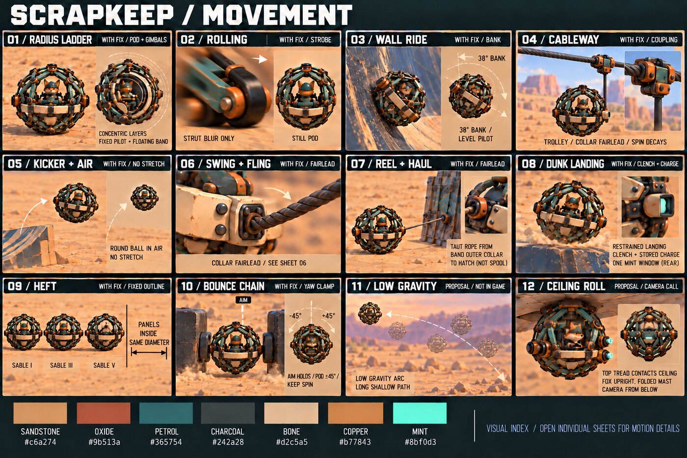

- **What it is:** a twelve-tile index of the situations below.
- **Caption:** thumbnails only. The cable hanger leaves the collar fairlead. The pod's yaw clamp is 45 degrees either side of the camera, not the aim. Open the sheets for detail.

## movement-radius-ladder

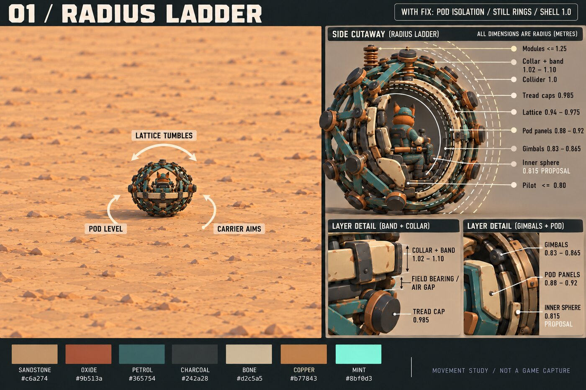

- **What it is:** the nested radii (caps 0.985, collider 1.0, bands and modules) and the three motions.
- **Chip:** WITH FIX: POD ISOLATION / STILL RINGS / SHELL 1.0.
- **Caption:** the arrows are schematic. The lattice tumbles about the roll axis. The pod and the carrier both yaw: the pod to the heading, the carrier to the aim.
- **Open question:** keep the optional inner sphere at radius 0.815? Default: keep it as a proposal, unbuilt, until the playtest.

## movement-rolling

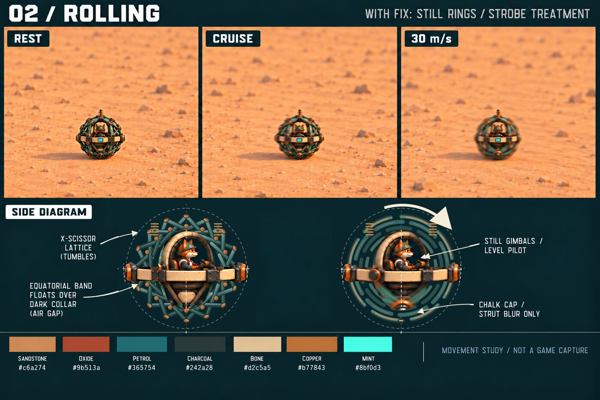

- **What it is:** rest, cruise and 30 m/s from the rear chase, plus side diagrams.
- **Chip:** WITH FIX: STILL RINGS / STROBE TREATMENT.
- **Note:** the side cages are flat schematics on a circle template, so the ball reads as a true sphere with no stretch. Whether the strobe treatment works is decided by the one-second runtime strip at 30 m/s, not by this sheet.

## movement-wall-ride

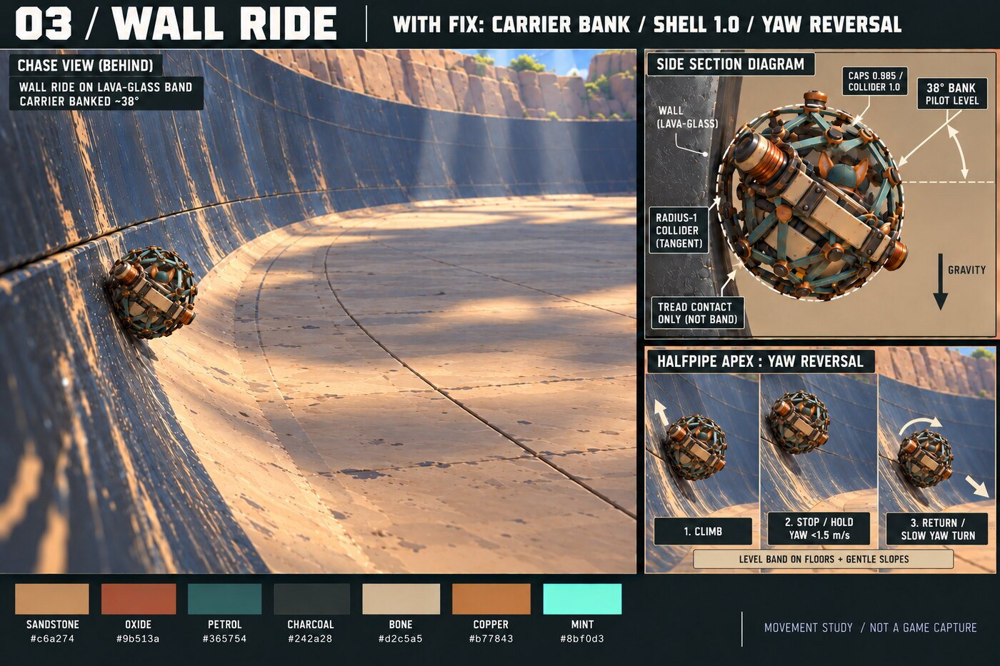

- **What it is:** contact with the sinkhole's glazed-band wall, the carrier's 38-degree bank, and a halfpipe apex: climb, stop and return.
- **Chip:** WITH FIX: CARRIER BANK / SHELL 1.0 / YAW REVERSAL.
- **Caption:** the pod's yaw hold below 1.5 m/s is labelled, not drawn. The band stays level on floors and gentle slopes.

## movement-cableway

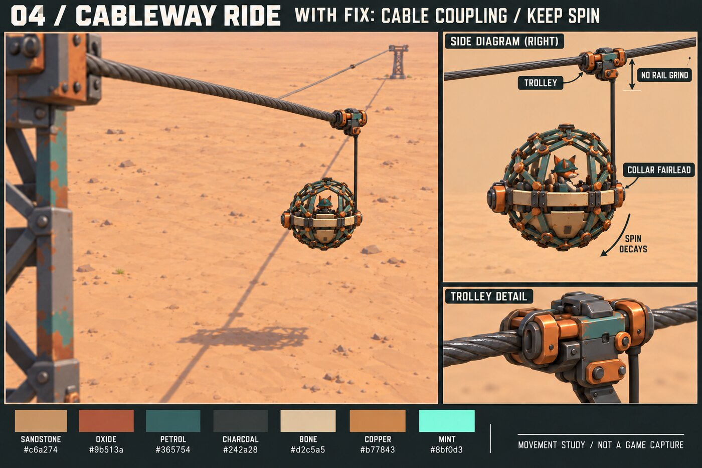

- **What it is:** the ball hanging below a cable, with the trolley and the collar fairlead.
- **Chip:** WITH FIX: CABLE COUPLING / KEEP SPIN.
- **Caption:** hanger length and cable clearance are unmeasured. "No rail grind" is a scope note, not a dimension. Systems measures the hanging clearance before adopting the coupling.

## movement-kicker-air

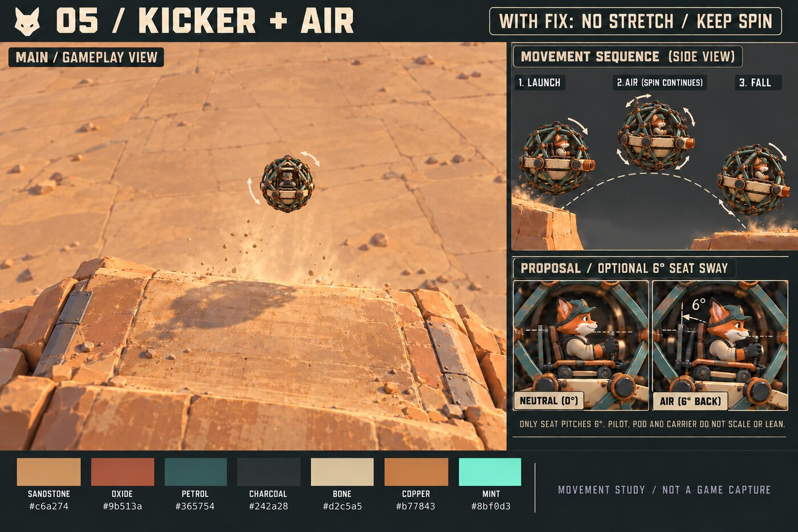

- **What it is:** launch, air and fall from a kicker, with no stretch.
- **Chip:** WITH FIX: NO STRETCH / KEEP SPIN. Seat sway is a PROPOSAL.
- **Caption:** the main view's camera is steeper than the 17-degree chase rule. Use the sheet for motion, not framing.
- **Open question:** a six-degree seat sway, or a fully steady seat? Default: steady seat, with sway as an extra.

## movement-swing-fling

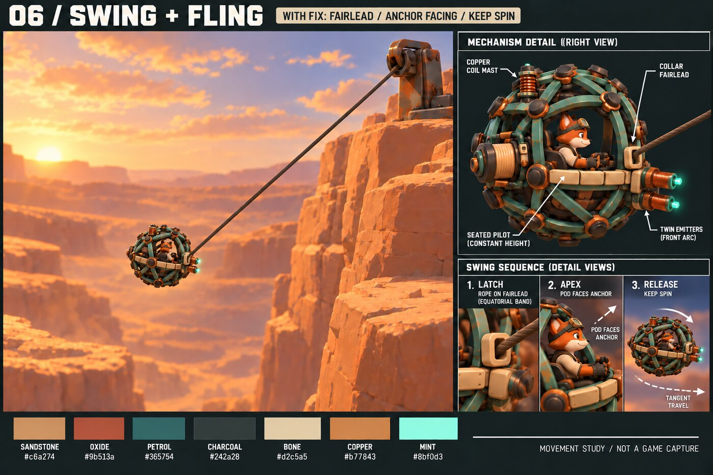

- **What it is:** a swing toward a high anchor: latch, apex and release.
- **Chip:** WITH FIX: FAIRLEAD / ANCHOR FACING / KEEP SPIN.
- **Caption:** the main view is a side view, not the rear chase.

## movement-reel-haul

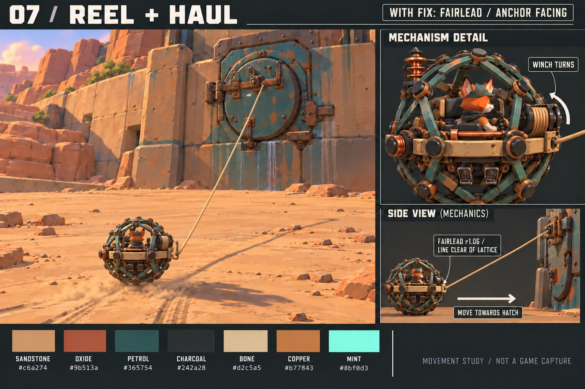

- **What it is:** a reel into a riveted service hatch, with the turning winch.
- **Chip:** WITH FIX: FAIRLEAD / ANCHOR FACING.
- **Caption:** the line is taut from the collar fairlead and has no hook. The chase view's slack line and hook are do-not-copy. The hatch is one example of a maintenance weak point; it sets no boss placement.

## movement-dunk-landing

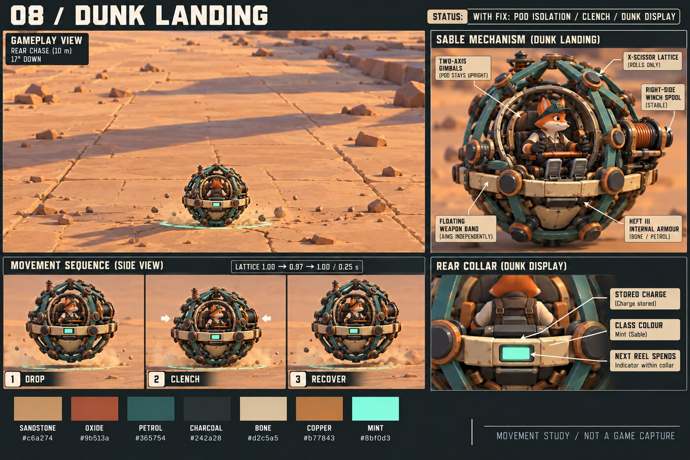

- **What it is:** touchdown, a drop-clench-recover strip, and the stored charge shown in a window on the rear collar.
- **Chip:** WITH FIX: POD ISOLATION / CLENCH / DUNK DISPLAY.
- **Caption:** the clench is uniform and radial, in the lattice only. The sequence is drawn from the rear. The rear collar is the illustrated display option, and the seat-back DecalPlate is the spec's other option.

## movement-heft-growth

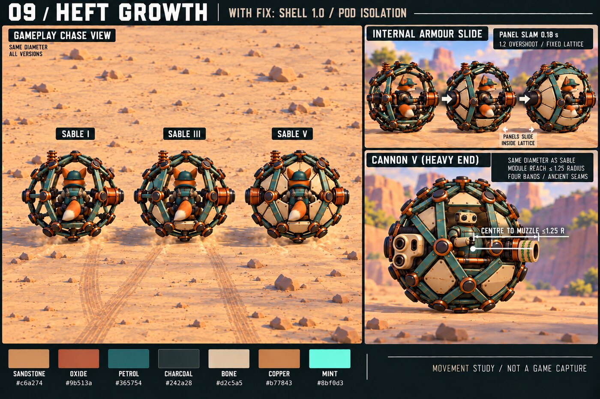

- **What it is:** Sable I, III and V at one scale, plus Cannon V.
- **Chip:** WITH FIX: SHELL 1.0 / POD ISOLATION.
- **How heft shows:** the outline never grows. Heft shows as panels slamming into the pod gaps inside the lattice, thicker caps, heavy modules capped at 1.25 R, and accretion chunks.

## movement-bounce-chain

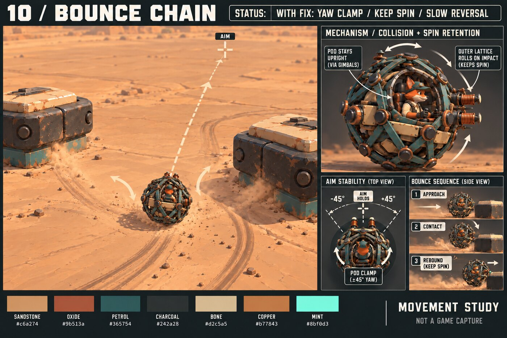

- **What it is:** a bumper route, a steady aim, the pod's yaw limit and a rebound strip.
- **Chip:** WITH FIX: YAW CLAMP / KEEP SPIN / SLOW REVERSAL.
- **Caption:** the pod's yaw is clamped to within 45 degrees of the camera's yaw, not the aim. The pod is driven level; the rings do not hold it.

## movement-low-gravity

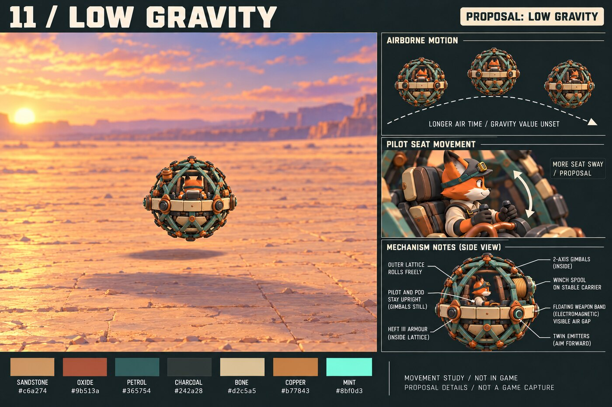

- **What it is:** long airborne travel over a plain floor.
- **Chip:** PROPOSAL: LOW GRAVITY, NOT IN GAME.
- **Caption:** the band end caps at 3 and 9 o'clock are bearing caps. The twin emitters point forward only.
- **Open question:** does low gravity belong in the game? Default: no, not for the alpha.

## movement-ceiling-roll

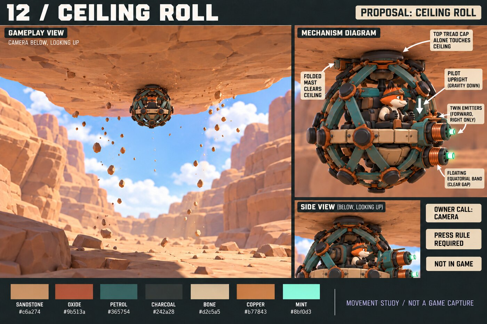

- **What it is:** the ball in contact with a ceiling, seen from below, with folded top hardware and an upright pilot.
- **Chip:** PROPOSAL: CEILING ROLL, NOT IN GAME. The camera is an owner call, and it needs a press rule.
- **Caption:** the debris is illustrative only. The emitter glow should be mint #8bf0d3.
- **Open question:** a world-up camera looking up from below, or a camera that rolls with the surface? Default: not for the alpha. If it comes back, start with world-up.

## How these were made

The boards were generated with Codex image generation from the four [style boards](../style/) and three pilot boards, then reviewed against MOTION-SPEC and the fixed-outline ruling by an independent Opus reviewer. Five boards were redrawn once and rolling twice. The prompts, review notes and rejected versions stay in the coordinator's scratch folder; the review findings are summarized in the captions above.
