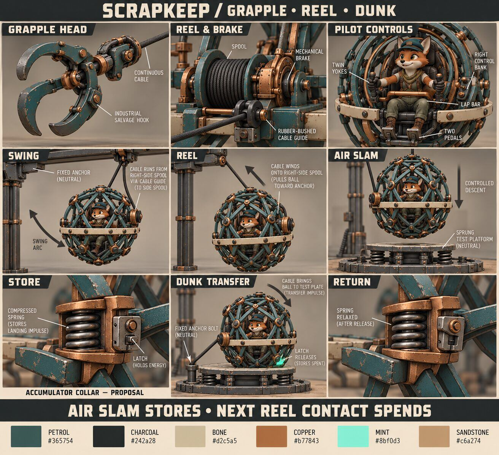
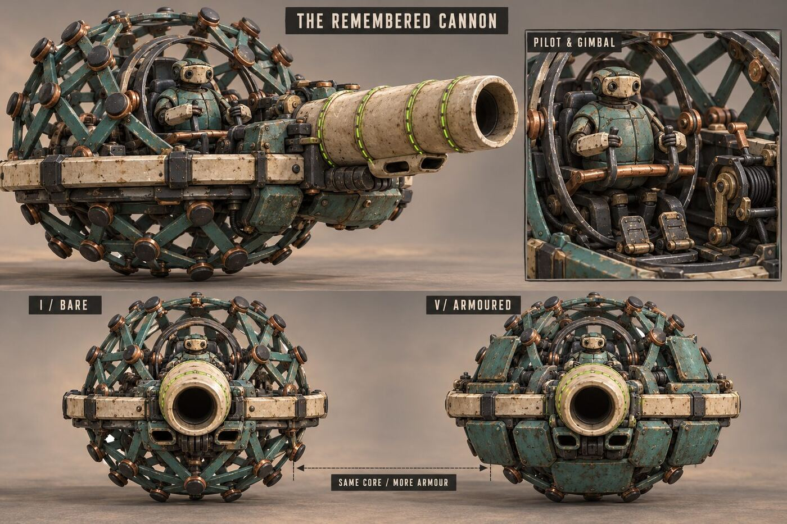
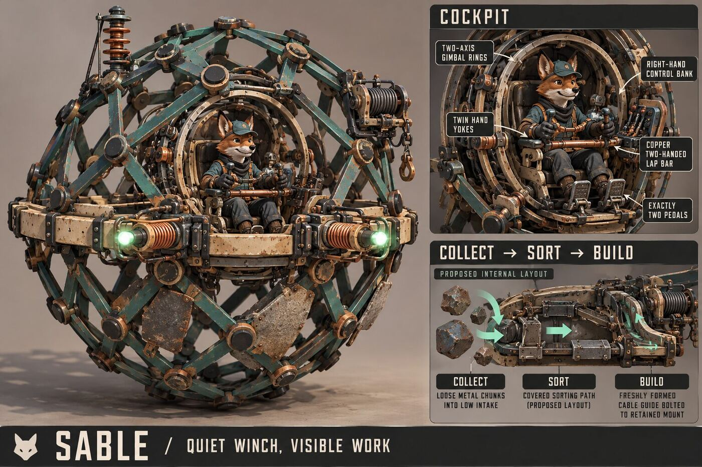

# Pilots

Reference boards. Concept only: they settle no mechanics, scale or collision.

## pilots-balls-heft-moodboard

- **Why it exists:** Scrap must visibly become armour and useful hardware without hiding the pilot or inflating the collision sphere.
- **Why it should work:** The core diameter and ground baseline stay fixed. Added lower and side panels and heavier modules show accumulation. The sight gaps, weapon-ring clearance and defining silhouette remain visible.
- **Open question:** Does the same-size core feel meaningfully heavier through panel density and modules alone? This still does not validate rolling clearance or sight gaps in motion.

## pilots-cockpits-roster-moodboard

- **Why it exists:** The growing machine needs a recognizable person and controls that explain each kit. This serves character selection and the visible-pilot rule.
- **Why it should work:** Matched framing exposes the head silhouette, hands and control bank. Seat value separates each head. Smooth faces and bevelled hardware follow the latest ruling.
- **Open question:** Do these seated identities preserve the intended cast? The approved lineup image is absent, so fine costume and face details are interpretations, not replacements.

## pilots-hardware-grapple-reel-dunk-moodboard

- **Why it exists:** The core play moment is swing, reel, air slam, stored dunk charge and the next reel impact. The hardware should explain that chain before effects celebrate it.
- **Why it should work:** A continuous cable has a clear origin, guide, spool and attachment. Mechanism closeups precede the action sequence. One mint signal marks Sable's action; charcoal edges preserve the action and route.
- **Open question:** Should stored dunk charge appear as a mechanically latched collar? The accumulator collar, hook jaw construction and cross-pilot reel packaging are proposals. The research flags unsettled weight-mode and weak-point behavior; the art does not settle them.

## pilots-reference-cannon-heft-study

- **Why it exists:** The cannon mirrors the Mind while remaining visibly player-owned. Its cast carapace provides the strongest comparison between bare lattice and accumulated heft.
- **Why it should work:** The muzzle-headed robot stays distinct from the main barrel. Four barrel bands and dashed green seams carry the ancient family read. The shell gains panels while its diameter and protected sight gaps remain stable.
- **Open question:** Does the small muzzle-headed pilot read separately from the main gun? Dotted green seams need a later game-camera check. This image does not choose a permanent name.

## pilots-reference-sable-salvage-cockpit

- **Why it exists:** Sable starts the fresh-player ladder. The image should connect a readable fox, a functional grapple and visible internal fabrication.
- **Why it should work:** A single high mast and side winch preserve identity. Metal travels to a real intake. The cutaway shows sorting and a newly fabricated guide while keeping the head and weapon ring clear.
- **Open question:** Does this preserve Sable's compact, quiet-machine character? The intake layout and newly fabricated cable guide are proposed construction details, not a selected upgrade.

## pilots-reference-tally-ledger-controls

- **Why it exists:** Tally's mechanical card programming must read as fitted machinery. Ear and drum silhouettes distinguish her without borrowing hostile brass or ambient-life lilac signals.
- **Why it should work:** Two ears and two drums form four circles on a square. Three tabs express the selected slot; cream pressure windows are physical shutters, and the card exit is the sole light.
- **Open question:** Does the fourth capped drum window stay legible as unavailable? Exact mulberry enamel matching awaits the absent approved image; the proposed tint must stay non-emissive and distinct from ambient life.
