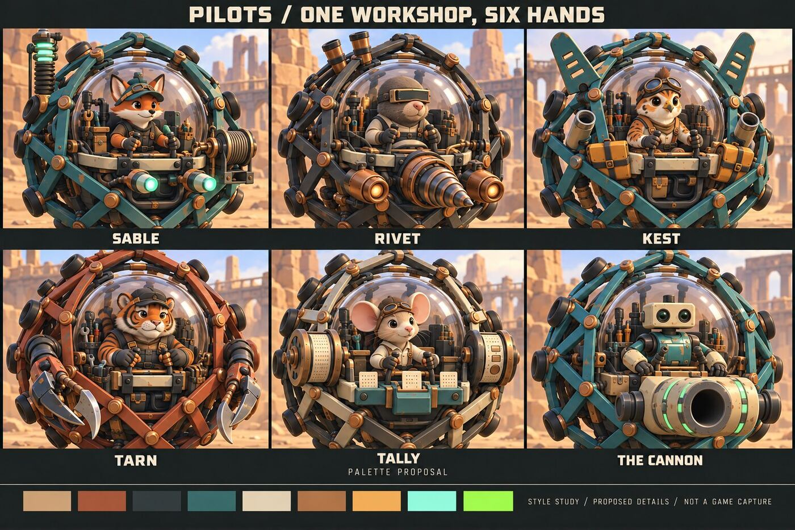
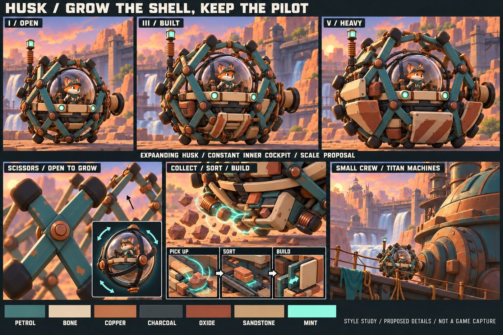
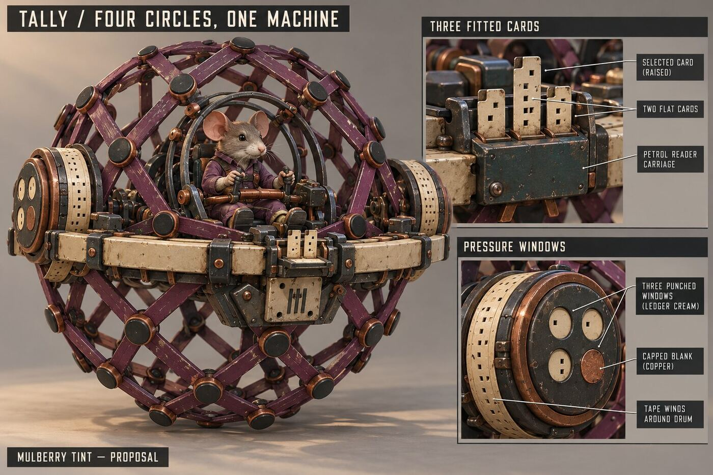
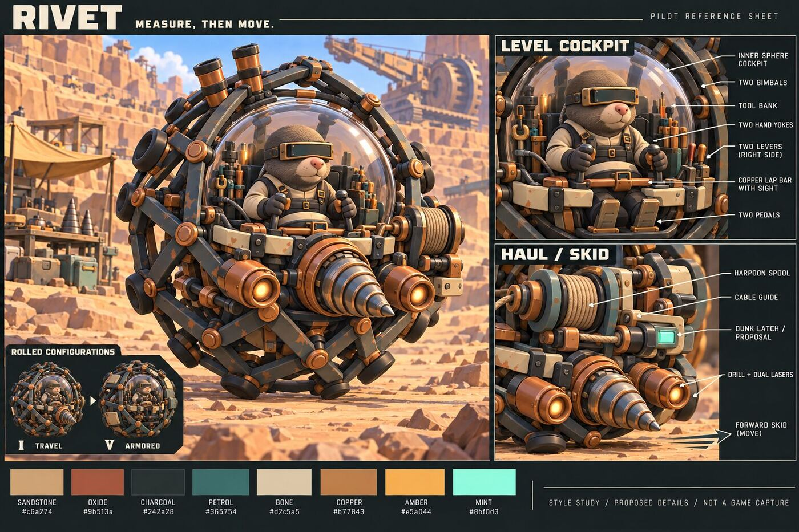
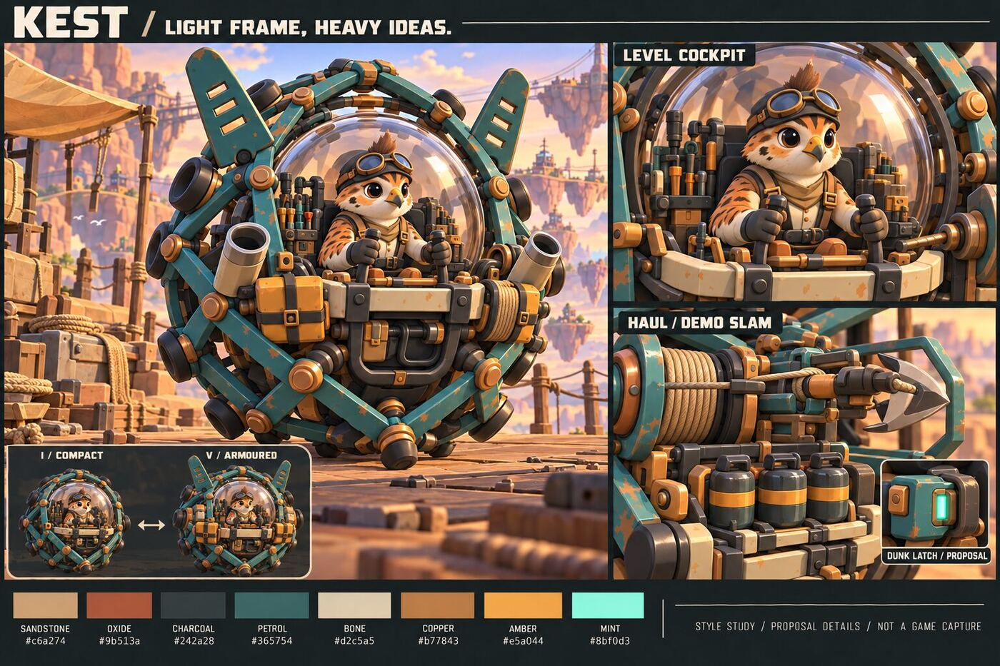
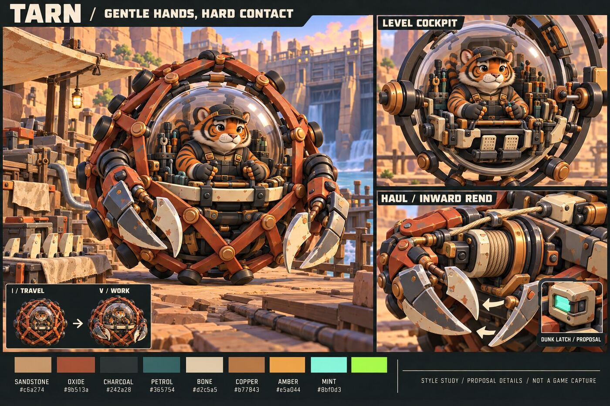

# Pilots

Reference boards. Concept only: they settle no mechanics, scale or collision.

## pilots-cockpits-roster-moodboard

- **Why it exists:** The growing machine needs a recognizable person and controls that explain each kit. This serves character selection and the visible-pilot rule.
- **Why it should work:** Matched framing exposes the head silhouette, hands and control bank. Seat value separates each head. Smooth faces and bevelled hardware follow the latest ruling.
- **Open question:** Does the labelled neutral Tally palette proposal preserve her identity well enough beside the kept mulberry design? The kept file remains unchanged. Fine new faces and clothing for Rivet, Kest and Tarn remain proposals.

## pilots-balls-heft-moodboard

- **Why it exists:** Scrap must visibly become armour and useful hardware without hiding the pilot or inflating the collision sphere.
- **Why it should work:** The core diameter and ground baseline stay fixed. Added lower and side panels and heavier modules show accumulation. The sight gaps, weapon-ring clearance and defining silhouette remain visible.
- **Open question:** No new growth ratio is proposed. Does the visible opening lattice plus lower/side armour communicate heft clearly? The illustration cannot settle collision size or route clearance.

## pilots-hardware-grapple-reel-dunk-moodboard

- **Why it exists:** The core play moment is swing, reel, air slam, stored dunk charge and the next reel impact. The hardware should explain that chain before effects celebrate it.
- **Why it should work:** A continuous cable has a clear origin, guide, spool and attachment. Mechanism closeups precede the action sequence. One mint signal marks Sable's action; charcoal edges preserve the action and route.
- **Open question:** Should stored dunk charge use the proposed mechanical latch and small mint window? Harpoon-jaw construction and individual reel packaging also remain proposals.

## pilots-reference-sable-salvage-cockpit

- **Why it exists:** Sable starts the fresh-player ladder. The image should connect a readable fox, a functional grapple and visible internal fabrication.
- **Why it should work:** A single high mast and side winch preserve identity. Metal travels to a real intake. The cutaway shows sorting and a newly fabricated guide while keeping the head and weapon ring clear.
- **Open question:** None for the kept design. The newly required clear inner sphere is developed in the new roster and heft sheets; sealing and maintenance access remain open construction details.

## pilots-reference-tally-ledger-controls

- **Why it exists:** Tally's mechanical card programming must read as fitted machinery. Ear and drum silhouettes distinguish her without borrowing hostile brass or ambient-life lilac signals.
- **Why it should work:** Two ears and two drums form four circles on a square. Three tabs express the selected slot; cream pressure windows are physical shutters, and the card exit is the sole light.
- **Open question:** None for the kept design. Its mulberry-versus-palette conflict is recorded under the roster proposal; no repaint was made to this file.

## pilots-reference-cannon-heft-study

- **Why it exists:** The cannon mirrors the Mind while remaining visibly player-owned. Its cast carapace provides the strongest comparison between bare lattice and accumulated heft.
- **Why it should work:** The muzzle-headed robot stays distinct from the main barrel. Four barrel bands and dashed green seams carry the ancient family read. The shell gains panels while its diameter and protected sight gaps remain stable.
- **Open question:** None for the kept character or layout. The current owner direction retains the friendly two-eyed robot. The expanding-husk interpretation belongs to new art, not a rewrite of this sheet.

## pilots-reference-rivet-precision-cockpit

- **Why it exists:** Make the precise mole and forward-moving slam legible.
- **Why it should work:** A blunt head and visor sit above the drill. Two short stacks and a low forward skid silhouette distinguish him without extra glow. A large hero view and two closeups share the accepted chunky, smooth rendering and broad wear. The inner sphere and pilot stay readable.
- **Open question:** Does this interpretation preserve Rivet's identity alongside the three kept pilots? Exact new face and costume details remain proposals.

## pilots-reference-kest-glide-demolition

- **Why it exists:** Connect the kestrel's light frame to gliding, charge placement and the three-charge demo slam.
- **Why it should work:** A centered crest and V silhouette separate Kest from Sable's single mast. Amber horizontal bands count payloads without hostile striping. A large hero view and two closeups share the accepted chunky, smooth rendering and broad wear. The inner sphere and pilot stay readable.
- **Open question:** Does this interpretation preserve Kest's identity alongside the three kept pilots? Exact new face and costume details remain proposals.

## pilots-reference-tarn-claw-recovery

- **Why it exists:** Explain the tiger's calm identity, inward pull and rend slam through load-bearing hardware.
- **Why it should work:** Large lower claws remain visible at all heft states. Oxide enamel and copper pins separate structures, with broad wear at teeth and joints. A large hero view and two closeups share the accepted chunky, smooth rendering and broad wear. The inner sphere and pilot stay readable.
- **Open question:** Does this interpretation preserve Tarn's identity alongside the three kept pilots? Exact new face and costume details remain proposals.
