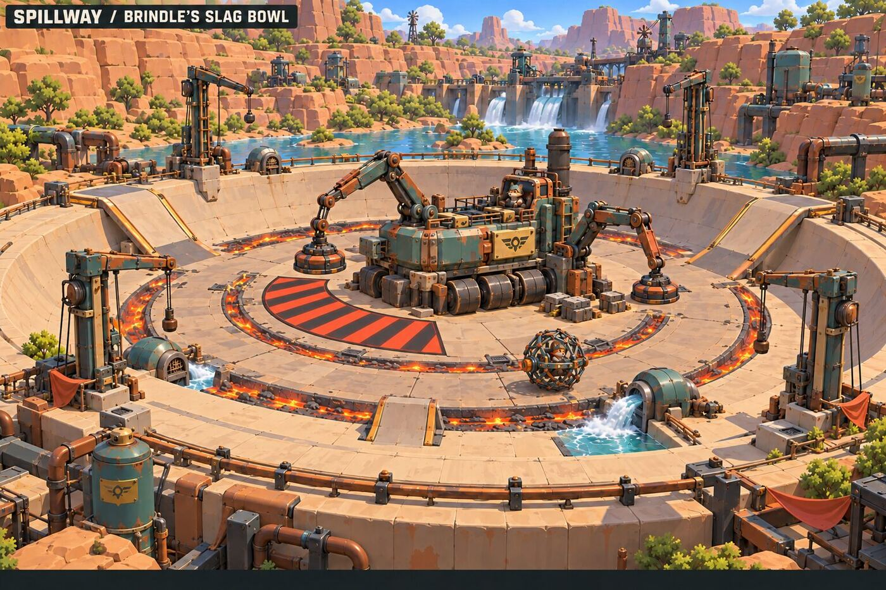
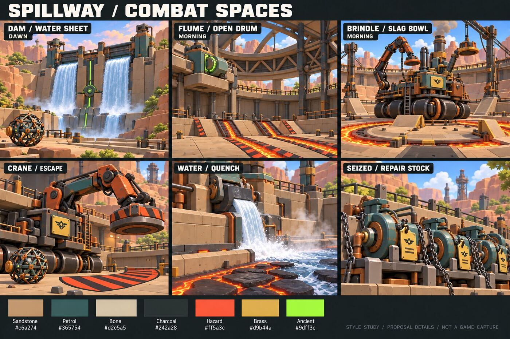
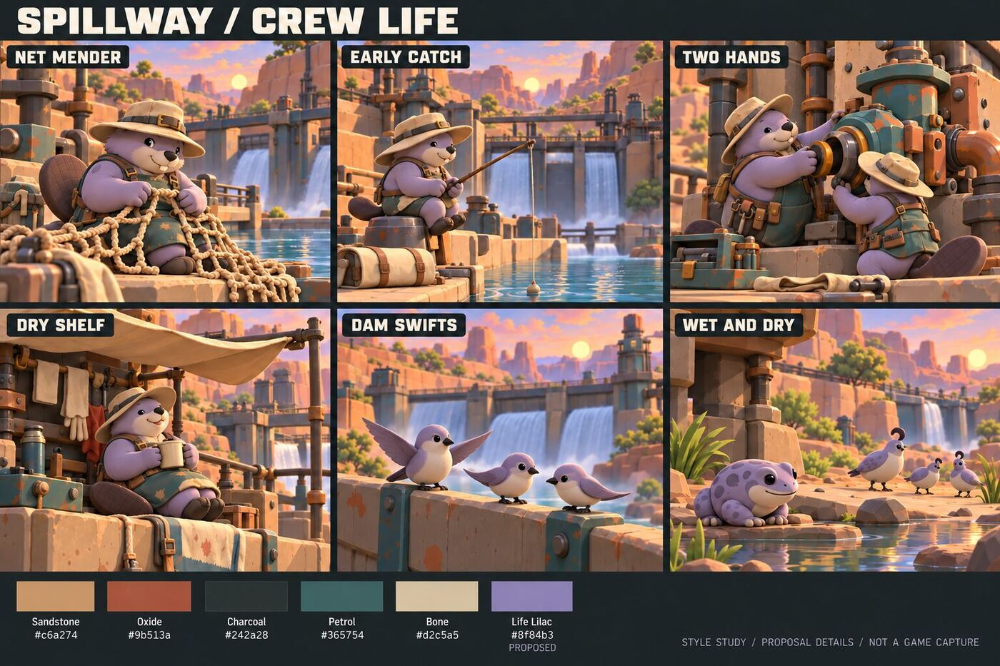
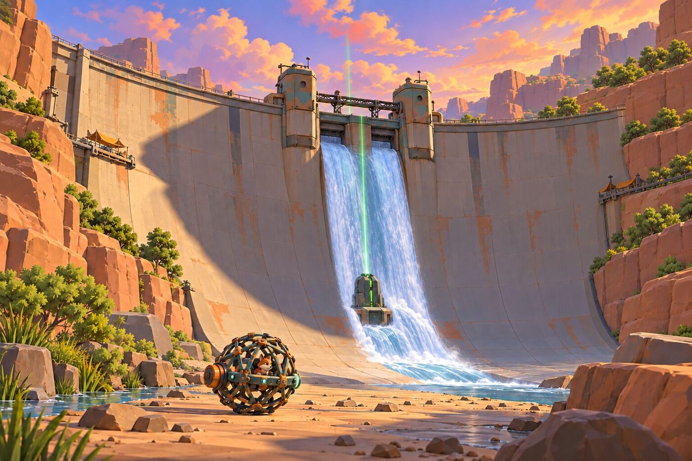
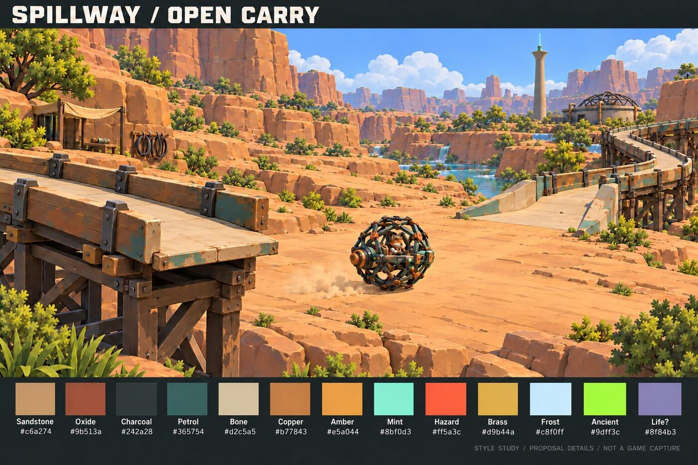
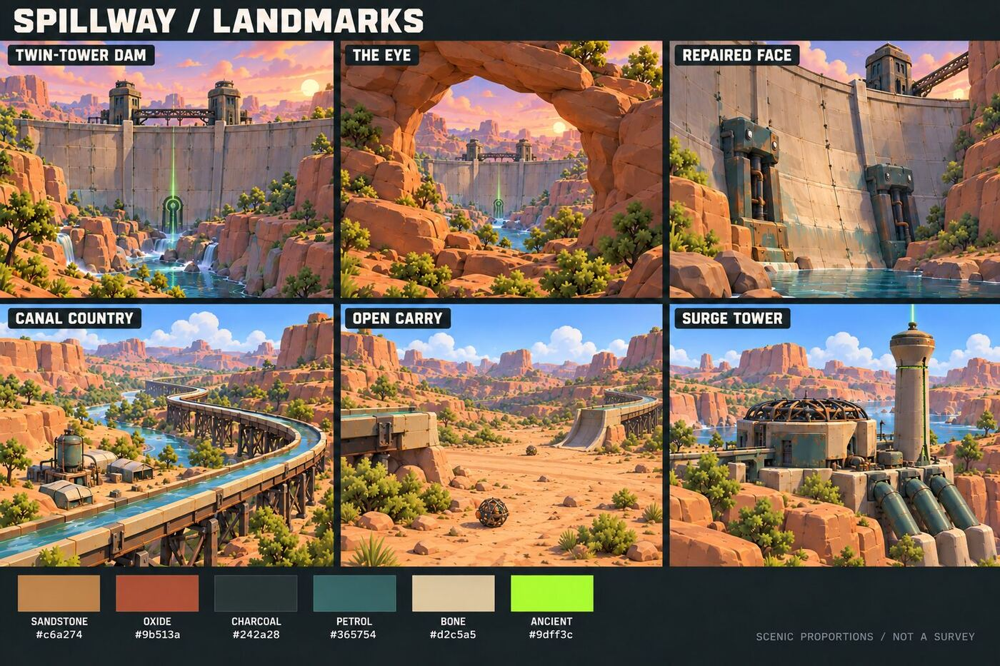
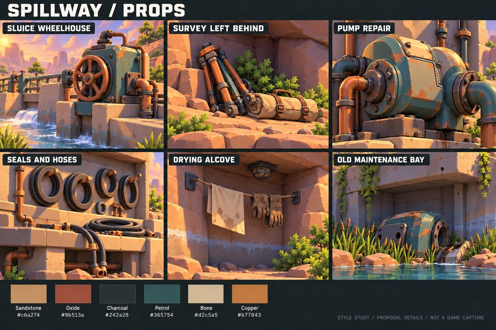

# Spillway parks

Reference boards. Concept only: they settle no mechanics, scale or collision.

## spillway-combat-brindle-bowl

- **Why it exists:** World 1 ends against an operator who takes the waterworks' repair reserve. Water and steel connect his arena to the region; his Fleet machine makes the conflict visible.
- **Why it should work:** The approximately 124 m arena, 44 m flat-floor radius and 60 m bank radius come from code. The illustration uses these as composition guidance, not exact drafting. Petrol, oxide and brass belong to the fortress; HAZARD belongs to the attack. Keep the foreground bank open and the attack source visible. Morning light is a proposal continuous with the flume; exact boss-arena time is not specified in the supplied ruling.

## spillway-combat-moodboard

- **Why it exists:** Distinguish the two park Wardens from the world boss, while connecting each threat to machinery with a local job. Keep the attacking tool, danger footprint and escape visible.
- **Why it should work:** Hostile footprints use coral HAZARD with charcoal keylines and diagonal stripes. Brass tags identify Brindle's ownership, never the danger fill. The dam's sheet is visibly water. The drum's source channel explains its slag. The bowl's bank stays clear; industrial dressing sits outside the fighting space. No ambient animals appear during fights.

## spillway-crews-moodboard

- **Why it exists:** Give the place recognizable inhabitants with work and small comforts. Water, shade and safe dry shelves explain where they spend time.
- **Why it should work:** Smooth pear-shaped beavers with wide hats and flat tails have relaxed poses. Proposed muted life-lilac accents remain non-emissive. No weapons, targeting brackets, reward diamonds, or hostile stripes. Quiet scenes are separate from combat; ambient life disappears during boss and Warden fights.

## spillway-landmarks-dam-face

- **Why it exists:** The stage's destination becomes a rideable machine. Its waterworks history remains visible beside the Warden encounter.
- **Why it should work:** The authored 320 m crest and approximately 120 m face dominate; two towers make the skyline recognizable. The reactor sits 22 m above the toe. Water mineral bands and concrete repair joints carry detail outside the open approach. In this active encounter, the service shelves show traces of residents but no live locals.

## spillway-landmarks-flume-carry

- **Why it exists:** Explain the flume's momentum test and preserve the specific ruling that the carry stays open.
- **Why it should work:** The route reads through silhouette and ground continuity. The roughly 90 m carry comes from the ruling; the image has no bridge or implied midair road. Crew shelter and repair material sit beyond the travel line. Warm stone, pale concrete, timber trestles, green water edges and cool morning shadows distinguish the terrain from its infrastructure.

## spillway-landmarks-moodboard

- **Why it exists:** Orient the player through the descent and make each park's destination distinct. The dam is a pale horizontal bar; the flume ends at a slender tower and a round drum.
- **Why it should work:** Natural sandstone remains larger than settlement detail. Green banks stay green. Dawn light belongs to the dam, morning to the flume. Uranium-green light belongs only to the ancient landmark beacon and patterned ancient seams. The butte gap has open ground and no bridge.

## spillway-props-moodboard

- **Why it exists:** Show how a waterworks society lives beside water and maintains concrete infrastructure. Fresh repairs and domestic traces give the next quiet stretch a purpose beyond passing through it.
- **Why it should work:** Cluster detail in sheltered recesses; leave travel surfaces broad and quiet. Petrol enamel, bone canvas, sandstone concrete and local green plants distinguish materials. Ambient props have no emission, hazard stripes, cache silhouettes, taut cables, or fake ride surfaces. Relative sizes follow ordinary working relationships; no new metre dimensions are asserted.
