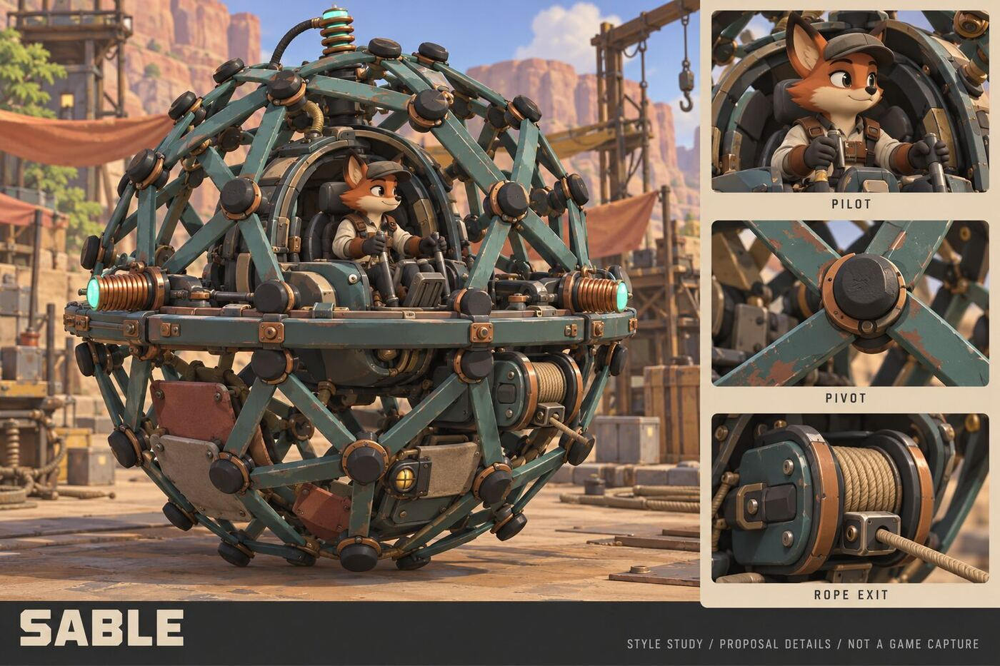
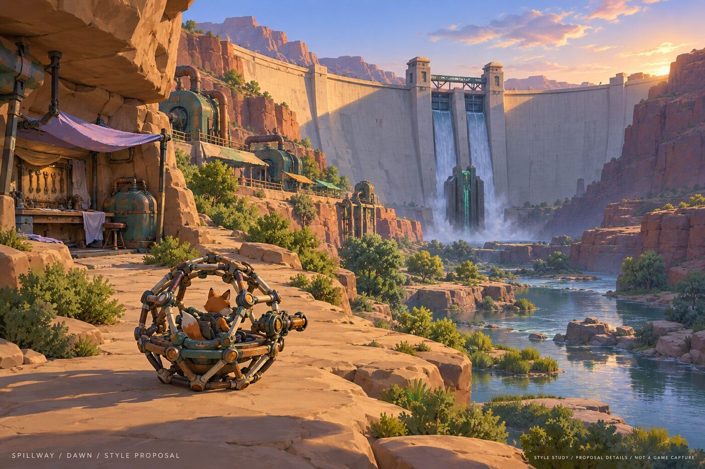
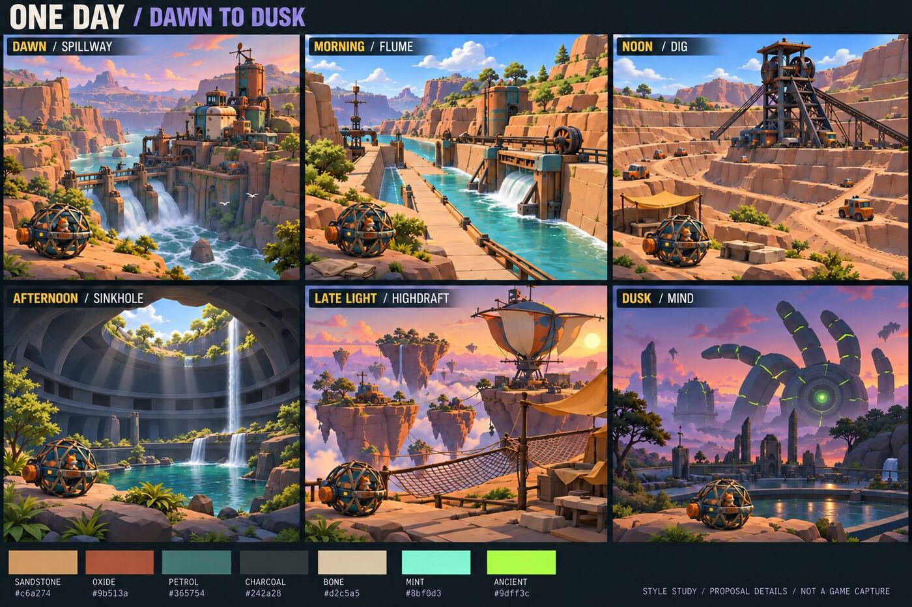
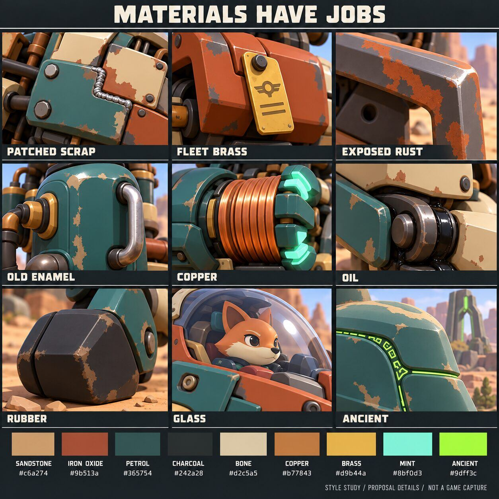
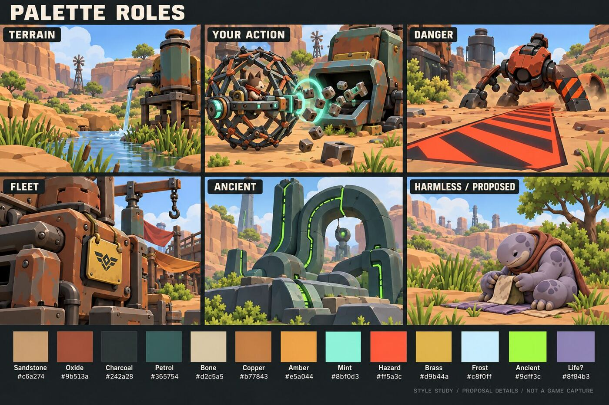
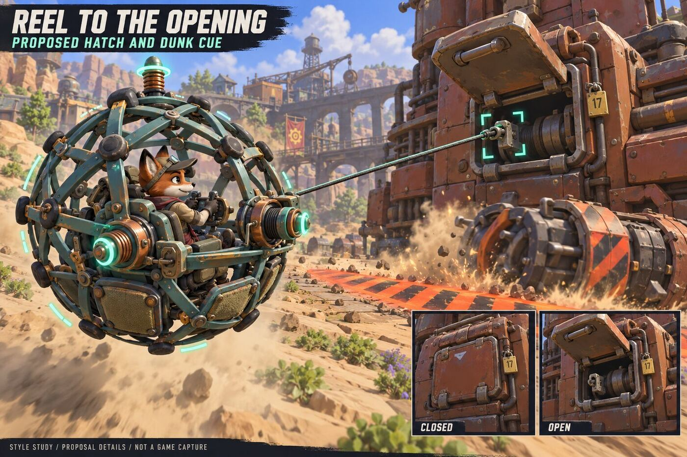
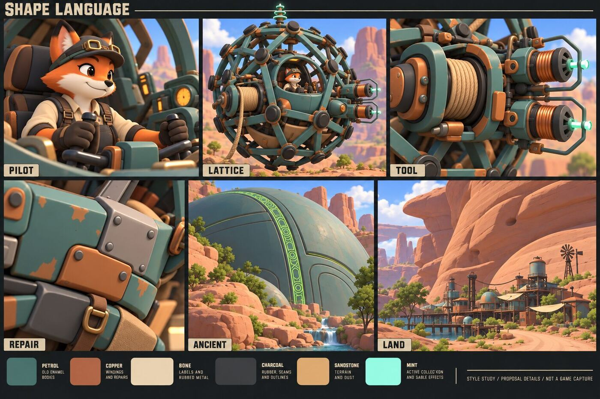
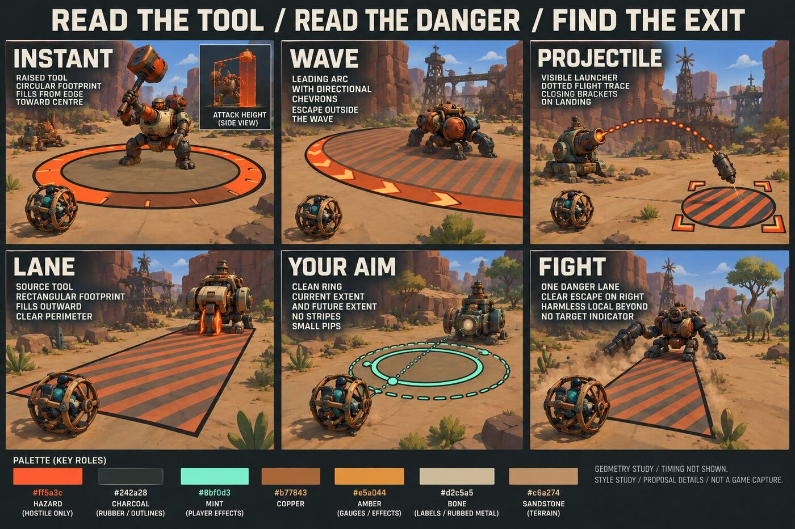

# Overall style

Reference boards. Concept only: they settle no mechanics, scale or collision.

## style-character-sable-reference

- **Why it exists:** Still review: central pilot, open scissor lattice, level ring and three mechanism callouts are visible. Scissor topology, clearances and carrier motion are not mechanically verified. Small background lamps and fine wear are incidental reference details, not dressing instructions.
- **Open question:** Does Sable retain her engineer identity with this smoother face and broader bevel treatment? Face proportions and wear placement are proposals; exact lattice topology needs modelling.

## style-landmark-spillway-dawn-reference

- **Why it exists:** CORRECTION DRAFT. The ancient structure is too mint/turquoise and lacks the intended tall uranium beacon. The bench also has an unintended warm lamp; the proposed seated local did not render. A targeted correction for all three was blocked by authentication. Use for dawn, dam silhouette and water-settlement composition only.
- **Open question:** Does the settlement feel maintained and inhabited at this detail density? Exact placement, route clearance and landmark dimensions are not measured in this perspective.

## style-lighting-moodboard

- **Why it exists:** Still review: six ordered panels and palette strip present. Unrequested travellers, robot dogs and sinkhole lamps were removed. The flume panel is a light study, not evidence of the approved 90 m carry geometry. The distant Mind silhouette is a scale/light placeholder, not a new boss design.
- **Open question:** Is the proposed intermediate light progression right? Dawn and dusk are ruled; exact sun angles, exposure and colour grading remain open.

## style-materials-moodboard

- **Why it exists:** Still review: nine panels and palette strip present. Use broad wear shapes, not every generated chip. Warm fittings in the old-enamel panel must be copper/steel in production, not additional Fleet brass.
- **Open question:** Is the broad wear treatment strong enough to feel worked on without slipping back into noisy grit? Roughness values are not specified by this board.

## style-palette-moodboard

- **Why it exists:** Still review: six panels and thirteen labelled swatches present. Walking pilot, glowing enemy eye and ambient lamp were corrected. The collection path reads between an external salvage container and the mech; its exact intake construction needs the focused/mechanical reference. The harmless species is a proposal, not a roster addition.
- **Open question:** Keep the proposed muted life-lilac treatment for harmless locals? The image cannot certify exact swatch pixels or colour-vision accessibility.

## style-setpiece-reel-dunk-reference

- **Why it exists:** CORRECTION DRAFT. The hatch and two state insets read, but dust/sparks encroach on the danger lane, its dark perimeter is weak, and the cable emergence overlaps the emitter rather than showing an unambiguous spool fairlead. The corrective edit was blocked. Use for action composition and proposed contact concept only, never as approved telegraph geometry.
- **Open question:** Does this hatch clearly read as the reel contact? Hatch design, exact dunk cue, exposure logic and dimensions are proposals, with no new damage rule implied.

## style-shape-moodboard

- **Why it exists:** Still review: six panels and palette strip present. Broad wear replaces the rejected photoreal finish. Small panel dimensions and lattice topology are illustrative.
- **Open question:** Does this degree of rounding retain enough mechanical bite? Exact bevel radii and pilot proportions remain proposals.

## style-telegraphs-moodboard

- **Why it exists:** CORRECTION DRAFT. The second pass improved keylines and removed misleading mint escape arrows, but accidentally removed the instant-area diagonal stripes. The final repair was blocked by image-tool authentication. Do not copy the unstriped annulus. Wave wake opacity is illustrative, not measured at the specified 15%. The sharp hostile treatment, height band and player/hostile separation still need a runtime pass.
- **Open question:** Are the stripes and boundaries readable at a glance? These are illustrative shapes; exact hit geometry, timing and reduced-flash behaviour need runtime verification.
