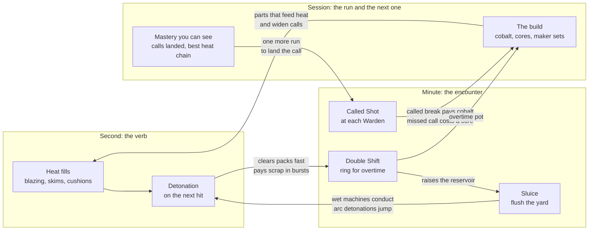

# Loops you can't put down

**Status: design proposal, 11 Nov 2026. Nothing here is built or authorised.** Written for Andrew's design session "make Scrapkeep impossible to put down". Winning ideas go to the systems audit's Feature fit pass and the bible amendment process as proposals; this page changes no code, ruling or bible text. Every call I made where the bible is open is logged as an assumption in [Assumptions I made](#assumptions-i-made), and the calls that are Andrew's are at the end in [Decisions for Andrew](#decisions-for-andrew).

**The short answer.** The game already has a great 10 seconds (roll, ram, line, dunk, smash). What it lacks is a reason to stay in the danger instead of kiting round it, and a payoff that carries one great moment into the next. The number-one proposal is **Heat**: one number on the shell that fills when you ride fast and skim attacks, detonates on your next hit, and makes every hit you take hurt more while it is high. The smallest prototype is the dam yard with a launch flag, and it answers one question in five minutes: does Heat make a player choose to stay hot?

## What I treated as the bible

There is a [BIBLE.md](../../BIBLE.md); I read its sections 1 (Pillars and Fantasy), 6 (Core Systems) and 8 (Audio and Feel). Where it is older than the alpha, I read the newer word from [DECISIONS.md](../../project-guide/handoff/DECISIONS.md) (rulings, newest wins), the [Story map](../../sketches/core-loop/design-v3/STORY-MAP.md) and the [Tone bible](../../sketches/core-loop/design-v3/TONE-BIBLE.md). The lines every idea below is held to:

- Pillar 1, joyful physical mastery: "The player should want to move before a reward tells them to." (BIBLE section 1)
- Pillar 2, scrap becomes your build: "Collecting scrap should feel like taking possession of the fight." (BIBLE section 1)
- Pillar 3, a world worth crossing: "Local tools grow out of irrigation, salvage, transport and repair." (BIBLE section 1)
- No handling tax: "Mandatory handling penalties or spending body mass to perform routine actions are not accepted rules." A commitment beat returns "full control with no stun, slow or recovery debt." (BIBLE section 6, TADR-008)
- Honest geometry: "Simulation resolves attack geometry once. Collision, previews, effects and damage use that result." (BIBLE section 6)
- Spectacle priority: "Prioritize imminent threats and player damage, then the player's meaningful action, then build reactions and background detail." "Danger must never wait for a beat." (BIBLE section 8)
- The pinball machine with a pendulum: grapple for everyone, reel-in closes gaps, a dunk stores damage for reel impacts on weak points. (DECISIONS section 6, 21 Oct)
- Overpowered pays; chaos you can learn; discovery and collecting are the long-term pull. (DECISIONS, Direction)
- Ruling cu, harder and never easier: "rolling through a pack and kiting round it are the fun and stay free", health regenerates only while the ball rolls at cruise or above, and "95% or more of hull damage and every killing hit come from a hazard the bot had seen for 0.6 s."
- Hitting on the beat pays in sound only. (Story map, "The score", R)
- The keeper's gamble: "Nobody makes you." It always shows its price first. (ruling ci)
- The theme: trusting a smarter machine takes away fear, failure and experiment, "so the game is built to give those three back." (Story map section 1)
- Tone: "Mean it, then wink." A 2-frame zoom-punch on impact; never shake the camera during input-critical play. (Tone bible)

## What is playable today (world 1, stage/alpha-w37)

I skimmed the code to anchor every idea in a system that exists. The numbers are the code's start values on stage/alpha-w37 995f3dd2.

| Verb or system       | What it does now                                                                                                                            | Where                                                         |
| -------------------- | ------------------------------------------------------------------------------------------------------------------------------------------- | ------------------------------------------------------------- |
| Roll and speed tiers | Cruise 14 m/s; tiers walk, cruise, fast (1.15 x cruise), blazing (1.9 x cruise, about 26.6 m/s); past 60 m/s speed becomes hit damage       | `src/movement/speed_tier.gd`, `tuning.gd`                     |
| Boost and bank       | Boost impulse 11, cooldown 1.1 s (floor 0.15 s); a landing at 0.9 x cruise banks a 1.25 x burst                                             | `tuning.gd`                                                   |
| Ram and bowl         | A ram throws enemies up to about 36 m; hit-stop 22 to 58 ms                                                                                 | `src/presentation/juice.gd`                                   |
| Harpoon line         | Everyone's mobility: swing, fling, reel; bite stop 40 ms                                                                                    | `src/movement/harpoon.gd`, `augments.gd`                      |
| Hook chain           | Airborne bites: enemy +1, surface pivot +0; smash pays 1 + 0.3 per link, capped at combo 6 (x2.5); dry fire costs 0.6 s                     | `src/combat/chain.gd`                                         |
| Dunk                 | An air slam stores its damage for 3 s; the next reel impact spends it                                                                       | `src/combat/dunk.gd`                                          |
| Near-miss read       | Publishes `near_miss` when the ball was inside a committed threat and left before it landed; pays the ultimate at most 0.05 points a second | `src/combat/near_miss.gd`, `src/core/ultimate_meter.gd`       |
| Scrap and growth     | The mint field pulls scrap; scrap is size and temporary armour (5 scrap per absorbed HP)                                                    | `src/build/scrap_field.gd`, `accretion.gd`                    |
| Wardens              | Posture break; weak points opened by reel impacts; cobalt guaranteed on the gate pair                                                       | `src/combat/warden*.gd`, `boss_posture.gd`, `reward_gates.gd` |
| Yards                | A Spillway yard locks, runs its waves, and pays one panel at its centre when broken                                                         | `src/world/stage_locks.gd`, `lock_rows.gd`                    |
| Floods               | Stage basins fill and push; the Spillway foams                                                                                              | `src/world/flood.gd`, `events/natural.gd`                     |
| Habits               | The Mind reads your most-used verb this run (half-life 45 s) and braces against it; resets every run                                        | `src/combat/habits.gd`                                        |
| Trade spots          | Keeper's gamble (stake hull or a curse) and the foreman's kindness (cores or cogs)                                                          | `src/world/events/stage_modifier.gd`                          |
| Run end              | A comic page of real run moments, kept in the camp scrapbook                                                                                | `src/core/run_moments.gd`, `scrapbook_store.gd`               |
| Music                | 172 BPM roaming, 129 in a fight; the chain's bites climb a pentatonic ladder                                                                | `SOUND-STORY.md`, `HOOK-CHAIN.md`                             |
| Controller rumble    | **None.** No `start_joy_vibration` call anywhere in `src/`                                                                                  |                                                               |

---

## Stage 1: The heartbeat

### The best 10 seconds today

The dam yard, the Reactor Warden awake at the foot of the spillway, two lobbers on the ledges and a chaser in the lane. Pad layout assumed: left stick roll, right stick aim, A jump, B slam (in the air), X boost, right trigger fires the line, left trigger reels.

| Time          | My hands                                                                             | My eyes                                                                                                                                                          | My ears                                                                                                           |
| ------------- | ------------------------------------------------------------------------------------ | ---------------------------------------------------------------------------------------------------------------------------------------------------------------- | ----------------------------------------------------------------------------------------------------------------- |
| 0.0 s         | Left stick pinned forward down the dam face.                                         | The ball is at fast tier; the seams glow warm. Two lobber rings bloom orange on the floor ahead. The danger mark over the ball is empty: I am in neither.        | The 129 BPM fight groove; rubber on wet concrete; the chaser's motor rising.                                      |
| 1.0 s         | I land off a lip and tap X on the landing.                                           | The landing bank fires: the ball surges to 1.25 x, then the boost takes it to blazing. The wear trail turns white behind me.                                     | Suspension thunk, then the boost's whoosh. The drums double.                                                      |
| 2.0 s         | I hold the line straight at the chaser.                                              | Contact. The frame holds for about 40 ms; the chaser flips and sails 30 m into the far wall. A drawn word, KLANG, stamps in ink. Scrap bursts into mint squares. | A metal crack exactly on contact, a body thump under it, then the scrap's rising ladder as the field pulls it in. |
| 3.0 s         | A off the rebound; right trigger on the first lobber.                                | The line bites. A 40 ms bite stop. The lobber's shell is mid-air behind me.                                                                                      | The bite note, the root of the ladder.                                                                            |
| 3.6 s         | Release, flick the stick, right trigger at the wall post, then at the second lobber. | Pivot, then link: a combo counter appears beside the ability bar at 2, digits pulsing with the beat. The bite collar on the line gains a ring.                   | Two more rungs up the ladder.                                                                                     |
| 5.0 s         | B in the air.                                                                        | The dunk stores: the coil brightens in my pilot's colour.                                                                                                        | A held note that does not resolve.                                                                                |
| 5.8 s         | Left trigger on the Warden's exposed core.                                           | The reel hauls me in at speed. Impact: the knock and the shake scale with combo 3 (x1.6) and the dunk spends on the core. The posture bar loses a third.         | The held note resolves on the hit. The ladder falls to the root.                                                  |
| 7.0 s         | Land; roll.                                                                          | A lobber ring lands where I was 0.3 s ago.                                                                                                                       | Its thud.                                                                                                         |
| 8.0 to 10.0 s | Stick forward, scanning.                                                             | Scrap flutters into the intake; a grey panel bolts onto the shell. Regen ticks because I am rolling at cruise.                                                   | Bolt-gun tick; the groove carries on.                                                                             |

### What is missing before I would replay those 10 seconds a thousand times

1. **The peak does not carry.** The combo dies on touchdown at 7.0 s and the dunk expires in 3 s. Nothing I earned at 5.8 s makes 8.0 s more dangerous or more exciting. The 10 seconds end; they do not lead anywhere.
2. **The near miss at 7.0 s is wasted.** The game knows I was inside that ring and left it (`near_miss` fires), and pays me a sliver of ultimate under a 0.05 points-a-second cap. On screen and in my ears, nothing happens. Being half a second from terrible is the best feeling in the game and it is silent.
3. **Speed is only good.** Blazing has no cost: regen is tied to speed, the soft cap turns excess into damage, and a wall at 26 m/s is a rebound. So "stay fast" is not a decision; it is the correct answer. Momentum is a resource only in one direction.
4. **My hands get nothing.** No rumble on a 36 m throw, on a dunk resolve, or on a hit taken. Half the high-octane signal is missing.
5. **The scrap after is passive.** The best 2 seconds of the pull (scrap streaming in) are while I am doing nothing. They should be while I am doing something risky.
6. **There is no visible ceiling.** The combo caps at 6 and the counter only shows from 2. I cannot see the next level of play above me in the moment.

Everything in Stages 2 to 5 is aimed at one of these six.

---

## Stage 2: Twelve loops

Each idea names its lens and steals one structure. **WILD** marks the ones I would not tone down.

### Second to second: the verb

#### 1. Redline (lens: momentum)

**Pitch.** Riding at blazing heats the shell; a full shell detonates on your next hit, and a hot shell takes bigger hits.

- **Decision it forces.** Every second at blazing: hold the heat for the detonation, or bleed it off before the next lobber ring lands on a hot shell.
- **Feedback.** Screen: the shell's seams climb mint, amber, white; at full heat the outline shimmers. Sound: an engine whine that steps up the pentatonic ladder at each quarter. Controller: a light right-motor buzz that grows with heat. Time: on the detonation frame, a 60 ms hit-stop and a 2-frame zoom punch.
- **Greed.** The detonation is a 7 m blast that pays scrap from everything it touches. The longer I ride it, the more is in front of me to blow up.
- **Bite back.** While the shell is hot, hits on me land at 1.5 x. A head-on wall at redline is a wipeout: heat gone, and a third of my carried scrap sprays out to be grabbed back within 6 s.
- **Steal.** Burnout 3: Takedown, where dangerous driving fills the boost bar and a crash takes it. Change: here the heat is the payload, not fuel, it discharges through contact, and the crash spills your armour as scrap you can win back.

#### 2. Pickpocket (lens: near miss)

**Pitch.** Skim a committed attack at speed and your shell steals it: the next thing you hit takes that attack's damage family.

- **Decision it forces.** Roll around the arc field, or through its edge to steal arc for the plated target behind it.
- **Feedback.** Screen: a streak of sparks along the side of the ball that passed the threat, and the shell's rim takes the attack's colour. Sound: a cymbal scrape panned to that side. Controller: a 60 ms sharp tap on the right motor. Time: none; a dodge is never interrupted.
- **Greed.** Weak targets take 150%. The skims that pay most are the closest ones.
- **Bite back.** The skim window is the hit's own geometry (`near_miss` reads `contains()`, the same test damage reads). A skim 0.1 s late is a full hit. And it only counts at cruise or above, so standing still in a ring and leaving at the last moment pays nothing (ruling cu: pressure on the stall, never on the roll).
- **Steal.** Touhou's graze, where bullets that pass close score. Change: the graze pays into your next hit, not a score, and it copies the attack, so the enemy's moves become your ammunition.

#### 3. Cushions (lens: expression)

**Pitch.** Every wall rebound on the way into a hit adds to it, like a three-cushion shot in pool.

- **Decision it forces.** Ram the lobber straight, or go off two walls for x2 and arrive from the side it is not facing.
- **Feedback.** Screen: each cushion leaves a white ring on the wall and a small tick mark on the ball's trail. Sound: each cushion a rung up a ladder of cue-ball clacks. Controller: a click on the left motor per cushion. Time: the hit at the end gets the ram's normal hit-stop, scaled.
- **Greed.** Up to x3. The Foreman's cast walls are perfect cushions; keeper patches soak a rebound, so the map's makers tell you where the shots are.
- **Bite back.** The count drops if 0.6 s passes without a cushion or a hit. Every cushion is a turn you do not control fully, near lobber rings and silt boils.
- **Steal.** Peggle's one shot, many bounces, multiplier. Change: you are the ball, in real time, and the table is the Foreman's own architecture.

### Minute to minute: the encounter

#### 4. Double Shift (lens: greed)

**Pitch.** When a yard breaks, a keeper's bell lights by the clamp: ram it to call overtime for a bigger pot, or reel the pot down now.

- **Decision it forces.** Cash out or ring again, up to three times, with the next wave already arriving while the last one is still dying.
- **Feedback.** Screen: the pot is a cargo net of scrap and parts hung from the clamp crane; it visibly swells per ring. The bell's sign shows the price in chalk: "one more crew, one elite". Sound: each ring adds a layer of the keeper band; the Fleet's brass answers with an overtime whistle. Controller: a heavy left-motor clang on the ring. Time: none at the ring; full ram hit-stop on the bell.
- **Greed.** Ring 1 adds a panel, ring 2 a cobalt card, ring 3 a core and a cobalt card.
- **Bite back.** Each overtime wave adds one elite with an affix. There is no free retry: dying here ends the run.
- **Steal.** Risk of Rain 2's Shrine of the Mountain (accept a harder boss for double loot). Change: the bell is in the arena, rung with your body mid-fight, the waves overlap, and cashing out is a line shot at a crane hook.

#### 5. Audit (lens: snowball and reversal)

**Pitch.** Kill fast enough and the Foreman sends an auditor braced against your favourite verb; beat it and its brace becomes your loot.

- **Decision it forces.** Keep doing the thing that works, or switch verbs before the audit arrives braced for it.
- **Feedback.** Screen: a memo card ("Quick sync.") and the auditor's lens showing your habit's icon (`habits.gd` already drives this for the Mind's hands). Sound: the Foreman's notification chime, then a straight sine. Controller: two short even pulses, exactly on the grid. Time: none.
- **Greed.** The brace plate drops as a mint part that makes your favourite verb stronger.
- **Bite back.** The auditor hardens your best verb; the director stacks a pack with it.
- **Steal.** GTA's wanted stars. Change: the response reads your habit, not your crime count, and its armour is your next upgrade.

#### 6. Sluice (lens: discovery and momentum)

**Pitch.** Ram the sluice wheel on the dam and a flood runs down the spillway, carrying everything, you included.

- **Decision it forces.** When to open it: with the pack in the lane, with you in it or out of it.
- **Feedback.** Screen: a 4 s warning with the Fleet's whistle and the water line climbing the dam face, then the sheet runs. Sound: pump strokes, then the wash. Controller: a long low rumble while you ride the crest. Time: none.
- **Greed.** The crest carries at 1.4 x cruise for free; lobber shells fizzle in water; wet machines conduct, so one arc hit jumps to every wet machine within 8 m. The last rule is never explained: the player finds it.
- **Bite back.** The flood carries you toward the silt boils at the foot, and washes uncollected scrap downstream.
- **Steal.** Breath of the Wild's chemistry (water conducts electricity, found by players). Change: the water is a ride, and you open it mid-fight with a ram.

### Session to session: the reason I come back

#### 7. Almost (lens: near miss, across runs)

**Pitch.** The run-end comic page gains one panel for the thing you nearly did.

- **Decision it forces.** None in the moment; it shapes the next run's intent.
- **Feedback.** A panel in the crew's dry voice: "Brindle had 3 left. Moss is not counting." Sound: one sax note held a bar too long.
- **Greed.** You can see exactly how close you were.
- **Bite back.** None.
- **Steal.** Isaac Repentance's death certificate. Change: it shows your closest success, not your killer.

#### 8. Collision Codex (lens: discovery)

**Pitch.** Twenty hidden verb collisions (dunk into a flood, a skim into a cushion) sit as blanks on the shift board; each one found adds a new item to the pools.

- **Decision it forces.** Try the weird thing this run.
- **Feedback.** An ink stamp on the board and a codex card with the two causes drawn.
- **Greed.** Each find widens every future run.
- **Bite back.** None beyond the attempt.
- **Steal.** Spelunky's journal. Change: entries are collisions you perform, and each one adds content, not power.

#### 9. Promoted (lens: snowball and reversal) **WILD**

**Pitch.** The machine that killed you is promoted, turns up in world 1 of your next run carrying your best item from the dead run, and uses it on you.

- **Decision it forces.** Hunt it for the item, or skip it.
- **Feedback.** Its intro card: "PROMOTED. Thank you for your contributions." Your item hangs off it in your own colour. Sound: your motif, one note wrong.
- **Greed.** Beat it and the item starts this run with you.
- **Bite back.** It fights with your best item.
- **Steal.** Shadow of Mordor's Nemesis system. Change: only one, it carries your item, and the Foreman promotes it as a corporate joke.

### Links: one second that changes the whole session

#### 10. Called Shot (lens: expression and greed)

**Pitch.** At a Warden's engage, hold reel on it for 0.5 s to call your finisher; break it that way and the gate pays more, miss and you lose its bonus core.

- **Decision it forces.** Which finisher can I land on this Warden with this build, and do I trust myself to?
- **Feedback.** Screen: the called stamp (DUNK, CHAIN or BOWL) inks onto the Warden's plate and stays there. Sound: a drum roll you can walk away from. Controller: a single firm tap at the call. Time: at a called break, the full 60 ms stop plus a 2-frame zoom punch and the stamp slamming CALLED.
- **Greed.** Both gate cards cobalt and your pilot's motif played as a two-bar solo.
- **Bite back.** A missed call costs the Warden's bonus core, which would have raised the gate offers.
- **Steal.** Calling your pocket in eight-ball pool. Change: the call is a build choice too, because the reward shapes the rest of the run.

#### 11. Scar Tissue (lens: near miss)

**Pitch.** Every time you climb back from under 10% hull to full, the shell keeps a welded scar: more damage, less maximum hull, for the rest of the run.

- **Decision it forces.** How low dare I go?
- **Feedback.** A visible weld seam per scar; the band adds a lick.
- **Greed.** +8% damage per scar.
- **Bite back.** -4% maximum hull per scar.
- **Steal.** Sifu's ageing, inverted: you mark the body for surviving, not for dying.

#### 12. Stamp It HIRED (lens: discovery and snowball) **WILD**

**Pitch.** Land a dunk-reel on a Warden's weak point inside the 0.5 s of its posture break and you stamp it HIRED instead of breaking it: it joins your crew for the run and does its old job on your side.

- **Decision it forces.** Take the cobalt now, or hire the machine.
- **Feedback.** The HIRED stamp in ink, the Warden's lens turns from the Foreman's colour to keeper patches, and its tune joins the band in your key. Controller: a long double pulse.
- **Greed.** A Reactor Warden that waters your lane and turns its hazards into your terrain.
- **Bite back.** You forgo the cobalt card. It takes SPIL-9's place, because the bible allows one companion.
- **Steal.** Pokémon's weaken, then catch. Change: the catch is one precise physical shot, and it is the game's ending (the Mind stamped HIRED) given to you in world 1.

### Lens coverage

| Lens                  | Ideas                                   |
| --------------------- | --------------------------------------- |
| Momentum              | Redline, Sluice                         |
| Greed                 | Double Shift, Called Shot               |
| Expression            | Cushions, Called Shot                   |
| Near miss             | Pickpocket, Scar Tissue, Almost         |
| Snowball and reversal | Audit, Promoted, Stamp It HIRED         |
| Discovery             | Sluice, Collision Codex, Stamp It HIRED |

---

## Stage 3: Four fusions

### Fusion A: Heat (Redline + Pickpocket)

- **Shared variable.** Heat, 0 to 100, on the shell.
- **The one rule.** Speed and skims fill Heat; at 100 your next hit detonates in the last stolen damage family; above 50, everything that hits you lands at 1.5 x.
- **30 seconds of play.** I roll into the dam yard at cruise; the shell is mint. I boost down the face and hit blazing: the whine climbs a rung, and again. A lobber ring blooms across my lane. I could swing wide. I go through its edge instead and out the far side 0.2 s before it lands: sparks rake the left side, the scrape pans left, the right grip taps. The seams jump to amber. Heat 60. Now I am the thing that takes 1.5 x. The second lobber is already lobbing. I hold blazing, cut under the arc field round the chaser, skim it, and the rim of the ball turns electric blue. The whine hits its top rung and the shell goes white; the pad hums in my right hand. Every frame now is a decision: the Warden's core is 40 m away, a chaser is 10 m away, and the wall on my left is a wipeout if I clip it head-on. I go for the chaser. Contact: the frame holds 60 ms, the camera punches two frames, a white ring snaps out to 7 m and every machine inside it takes arc. The plated lobber on the ledge was weak to arc. It drops. Scrap from four bodies streams in at once while I am still moving. The seams are mint again. I am at cruise, hull 40%, regen ticking, and the Warden's sheet is coming down the dam. I go back up to blazing.

### Fusion B: Reservoir (Double Shift + Sluice)

- **Shared variable.** The water level behind the dam.
- **The one rule.** Every overtime ring raises the reservoir a notch; ramming the sluice empties it onto the yard, longer and faster for every notch.
- **30 seconds of play.** The yard's last crew breaks. The bell lights; the net on the crane holds one panel. I ram the bell. The overtime whistle blows, the water line on the dam face climbs a notch, and an elite lobber drops in with a shielded affix while two crew are still alive. I ring again on my way past. Two notches. The net now holds a cobalt card. I am at 50% hull with six machines in the yard and an elite I cannot crack from here. The sluice wheel is on the dam's lip. I line up, reel up the face, and ram the wheel. The whistle runs its 4 s; the water line flashes. I could cash the pot now with one line at the crane hook. Instead I roll up the far bank. The sheet comes down: two notches is a 5 s flood at 1.4 x cruise. It takes four machines into the silt at the foot. The elite stays on its feet, soaked. I fire an arc active into it and the arc jumps through every wet machine within 8 m. The yard is empty. I bite the crane hook, reel, and the net drops at my feet: panel, cobalt card, core. The scrap I left in the lane is halfway down the flume.

### Fusion C: The File (Audit + Promoted)

- **Shared variable.** The Foreman's record of your habits.
- **The one rule.** The auditor you failed to beat this run is the machine promoted against you next run.
- **30 seconds of play.** My chain kills come fast; a memo card slides in: "Quick sync." An auditor arrives with a chain-link icon on its lens. My bites skid off its plate. I panic, take a lobber hit, and the run ends at Brindle. Next run, at the dam, an intro card freezes the frame: "PROMOTED." The auditor is back, with my cobalt Ram Plow bolted to its front.

### Fusion D: Headcount (Stamp It HIRED + Audit)

- **Shared variable.** The Foreman's headcount.
- **The one rule.** Every machine you hire is one the Foreman must replace: audits come sooner and meaner, and every auditor can itself be hired.
- **30 seconds of play.** I stamp the dam Warden HIRED; its spillway sheet now runs ahead of me as a road. Twenty seconds later the first audit lands, braced against dunks. I bowl through it instead, then catch its break with a dunk-reel: HIRED again, but the companion slot is full, so it clocks out with a salute and leaves a part.

---

## Stage 4: The harsh playtester

Scored 1 to 5. **Read**: can I tell what is happening within 3 seconds? **Decide**: a real decision every few seconds? **Depth**: room to improve for 50 hours? **Pillar**: does it serve one? **Cheap**: how little new it needs on today's systems?

| Idea                  | Read | Decide | Depth | Pillar | Cheap | Total  | Verdict                                |
| --------------------- | ---- | ------ | ----- | ------ | ----- | ------ | -------------------------------------- |
| A. Heat (fusion)      | 4    | 5      | 5     | 5      | 3     | **22** | Keep, number 1                         |
| 1. Redline            | 4    | 4      | 4     | 5      | 4     | 21     | Keep, lives inside Heat                |
| 3. Cushions           | 4    | 3      | 5     | 5      | 4     | 21     | Keep, becomes Heat's third source      |
| 4. Double Shift       | 5    | 5      | 3     | 4      | 4     | 21     | Keep, lives inside Reservoir           |
| 10. Called Shot       | 4    | 4      | 4     | 4      | 4     | 20     | Keep, number 3                         |
| B. Reservoir (fusion) | 4    | 5      | 4     | 5      | 2     | 20     | Keep, number 2                         |
| 6. Sluice             | 4    | 4      | 3     | 5      | 3     | 19     | Keep, lives inside Reservoir           |
| 12. Stamp It HIRED    | 4    | 4      | 4     | 5      | 2     | 19     | Keep as WILD, parked behind a decision |
| 2. Pickpocket         | 3    | 4      | 4     | 4      | 3     | 18     | Killed alone; survives inside Heat     |
| 11. Scar Tissue       | 4    | 3      | 3     | 4      | 4     | 18     | Killed                                 |
| D. Headcount          | 3    | 4      | 4     | 5      | 1     | 17     | Killed                                 |
| 5. Audit              | 3    | 3      | 3     | 4      | 3     | 16     | Killed                                 |
| 7. Almost             | 5    | 1      | 2     | 3      | 5     | 16     | Killed                                 |
| 8. Collision Codex    | 3    | 2      | 4     | 5      | 2     | 16     | Killed                                 |
| 9. Promoted           | 4    | 3      | 3     | 4      | 2     | 16     | Killed                                 |
| C. The File           | 3    | 3      | 3     | 4      | 2     | 15     | Killed                                 |

### Why each one died

- **Pickpocket.** Alone it is a dodge bonus you cannot see paying until the next hit; inside Heat its steal has a place to land.
- **Scar Tissue.** Rewards sitting at low hull, and with regen only at cruise, the best play becomes taking deliberate hits, which is a chore, not a thrill.
- **Headcount.** Two unbuilt systems stacked; the payoff is a full companion slot telling you no.
- **Audit.** The answer arrives on a kill-rate threshold the player cannot see coming, so it reads as a punishment for playing well, against "overpowered pays".
- **Almost.** No decision in play; it is a nice panel, not a loop. (Worth building as polish later; it is cheap.)
- **Collision Codex.** A checklist of blanks pulls by completion, which is a chore; discovery should stay a surprise, as the bible's fixed-secret rule already does.
- **Promoted.** It is a corpse run: the pull is getting back what you lost, which is the fear-of-loss kind of pull the brief cuts. It also carries power between runs, against "combat power is rebuilt each run", and cross-run memory, against "the Mind learns within a run only".
- **The File.** Inherits Audit's unreadable trigger and Promoted's corpse run.

### The chores, timers, grind and fear-of-missing-out cut

Collision Codex (completion checklist) and Promoted (loss recovery) fail this cut as well as the score. Nothing surviving uses a daily seed, a real-time timer, a currency to farm or a limited-time offer. Heat's cook-off (below) is a 4 s fuse inside a fight, a pressure on a choice the player made, not a clock on their life.

### What the cut leaves

No session-scale idea survived. That is the honest result: Scrapkeep's session pull already comes from discovery and collecting that exist (maker sets, the codex, first-win secrets, the shift board, six pilots), and every new session idea I wrote added a chore or a corpse run. The links carry the session instead: Called Shot turns one second at each Warden into the shape of the build, and Heat and Reservoir give each run a ceiling you can see above you. The diagram below shows how.

---

## How the three time scales feed each other

Read it left to right: a second of Heat makes a yard faster to clear, which makes ringing the bell worth it; the flood makes the next detonation bigger; Called Shot and the pot turn the minute into the build; the build feeds Heat back, and what you nearly landed is why you start the next run.

---

## Stage 5: Land it

### Spec 1: Heat

**Rules**

1. The shell holds Heat, 0 to 100. It starts each stage at 0.
2. Heat fills from three sources: seconds spent at blazing tier, skims (a `near_miss` while the ball rolls at cruise or above), and cushions (a wall rebound at fast tier or above within 0.6 s of a hit or another cushion).
3. Below fast tier, Heat drains. At fast tier, it holds. At blazing, it fills.
4. At 50 or above the shell is **hot**: every hit on the ball lands at 1.5 x.
5. At 100 the shell is **redline**: the next ram, stomp, slam or reel impact detonates. The blast resolves once as a sphere; its damage, its ring on screen and its knock all read the one shape. Heat returns to 0.
6. The blast takes the damage family of the last attack skimmed this heat cycle (arc, frost, kinetic or special), so `damage_families.gd` weak and resisted apply as for any hit.
7. A redline shell that hits nothing within 4 s cooks off: it detonates at half damage where it is and takes 10% of maximum hull from the ball. A kettle whistle rises over the last 2 s.
8. A head-on wall contact while hot is a **wipeout**: Heat returns to 0, a third of carried scrap sprays out as pickups that last 6 s. No stun, no slow, no lost control.
9. Heat never changes speed, steering or collision size (BIBLE: no handling tax).

**Tunable numbers (start values)**

| Name                       | Start                                     | Why this value                                                     |
| -------------------------- | ----------------------------------------- | ------------------------------------------------------------------ |
| `HEAT_MAX`                 | 100                                       |                                                                    |
| `FILL_BLAZING_PER_S`       | 12                                        | About 8 s of pure blazing to redline; one dam face is roughly that |
| `FILL_SKIM`                | 25                                        | Four skims alone reach redline                                     |
| `FILL_CUSHION`             | 10                                        | Cushions are a garnish, not a road                                 |
| `DRAIN_PER_S` (below fast) | 20                                        | Five seconds of kiting at cruise empties it                        |
| `HOT_AT`                   | 50                                        |                                                                    |
| `HOT_DAMAGE_TAKEN`         | 1.5                                       | Danger doubles feel at 1.5 because the player knows why            |
| `BLAST_RADIUS_M`           | 7                                         | Two ball lengths past a ram's throw                                |
| `BLAST_DAMAGE`             | 2.0 x the triggering contact's own damage | Scales with the build, so overpowered pays                         |
| `BLAST_KNOCK_M`            | 18                                        | Half a bowling throw                                               |
| `COOK_OFF_S`               | 4                                         |                                                                    |
| `COOK_OFF_SELF_HULL`       | 0.10 of max                               |                                                                    |
| `HEAD_ON_DEG`              | 30 (velocity against the wall normal)     | Glancing banks are cushions, head-on is a crash                    |
| `WIPEOUT_SCRAP_SHARE`      | 0.33                                      |                                                                    |
| `WIPEOUT_PICKUP_LIFE_S`    | 6                                         |                                                                    |
| `SKIM_MIN_TIER`            | cruise                                    | Ruling cu: no pay for the stall                                    |

**Feedback per event**

| Event                 | Visual                                                                             | Audio                                                                       | Haptic (Godot `Input.start_joy_vibration`, weak/strong motor) | Time                                                                      |
| --------------------- | ---------------------------------------------------------------------------------- | --------------------------------------------------------------------------- | ------------------------------------------------------------- | ------------------------------------------------------------------------- |
| Heat rises a quarter  | Seams step mint, pale amber, amber, white (no meter; colour carries it, ruling cx) | Engine whine steps a rung on the live key's pentatonic                      | Weak motor continuous at 0.05 + 0.002 x Heat                  | None                                                                      |
| Skim                  | Spark streak on the passing side; rim takes the attack's family colour             | Cymbal scrape panned to that side                                           | Weak 0.6 for 60 ms                                            | None, so the dodge is never broken                                        |
| Cushion               | White ring on the wall; tick on the trail                                          | Cue-ball clack, a rung up per cushion                                       | Strong 0.3 for 40 ms                                          | None                                                                      |
| Hot (crosses 50)      | Heat shimmer around the outline                                                    | The band's hi-hats open                                                     | One short double pulse                                        | None                                                                      |
| Redline (reaches 100) | Shell white; drawn word over the ball: FWOOSH                                      | A sax squeal on the next beat, plus an immediate click                      | Weak 0.25 steady                                              | None                                                                      |
| Detonation            | White ring at the true 7 m; KA-THOOM in ink; family colour in the debris           | Sub drop and full kit hit at contact; the band answers on the next downbeat | Strong 1.0 for 180 ms, decaying                               | 60 ms hit-stop (the existing `SPINE_CAP_MS` cap) and a 2-frame zoom punch |
| Hit taken while hot   | The damage number is bigger and amber, no "x1.5" label                             | A harsher version of the hit sound                                          | Strong 0.8 for 120 ms                                         | Normal hit-stop, never longer                                             |
| Cook-off warning      | Shell flickers red-white for the last 2 s                                          | Kettle whistle rising                                                       | Weak pulses speeding up                                       | None                                                                      |
| Wipeout               | Scrap sprays in a fan; KRANG                                                       | A clonk and a deflating vent sigh                                           | Both motors 0.8 for 250 ms                                    | 40 ms stop                                                                |

**Failure state.** The design fails if players treat Heat as weather: they never aim for redline, or the hot damage reads as random. In play the player's failure is a death while hot, which must always be traceable to a skim they chose or a ring they stayed in.

**How it escalates across a session**

- Dam: blazing and skims only. Learn the gauge.
- Flume: cushions join; the flume's walls make the first three-cushion lines.
- Brindle: his armour spills (ruling aw); a detonation strips a plate.
- Tree and items: Heat nodes in each pilot's tree at depth 2 (for example, Sable's launch fills 15 Heat); mint "Heat Sink" (drain halved), cobalt "Afterburner" (a detonation leaves a 3 s burning trail). Later worlds: the Highdraft's gusts carry you at blazing; the Mind's hands read Heat as a habit and answer with coolant fields, the counter you then learn to skim.

**Systems it touches.** `speed_tier.gd` (tier read), `near_miss.gd` (skim source; it already publishes the threat), `contact.gd` (head-on angle), `damage_door.gd` (taken multiplier; blast), `damage_families.gd`, `scrap_field.gd` and `accretion.gd` (wipeout spill), `juice.gd` (stops within the 60 ms cap), `wear_trail.gd` (trail colour), `event_kinds.gd` (new events), `habits.gd` (a "heat" habit later). New: one pure module `src/combat/heat.gd`, owned by the player like `chain.gd` and `dunk.gd`, with one call in (`heat.add(source)`) and signals out, so the shell, the sound and the pad read one record.

### Spec 2: Reservoir

**Rules**

1. Only Spillway yards with a dam (the dam yard first) carry it.
2. When the yard's last ordinary wave breaks, its panel pays as today (ruling af), and a keeper's bell lights beside the clamp. Its chalk sign shows the price before anything happens: "One more crew. One elite. Nobody makes you." (ruling ci)
3. A ram at 0.85 x cruise or more rings the bell (the cracked-face bar, `Activities.RAM_MIN_PER_CRUISE`). Each ring calls one overtime wave from the yard's lock rows plus one elite with one affix, raises the reservoir a notch and grows the pot. Three rings at most. The bell can be rung while a wave is alive.
4. The pot hangs from the clamp crane. A line bite on the crane hook followed by a reel drops it: the pot pays and no more overtime comes (any live wave stays).
5. The sluice wheel on the dam's lip is a hand-sized weak point. A reel impact on it opens the sluice: a 4 s warning, then a flood down the dam axis using the stage's flood (`flood.gd`), sized by the notches.
6. Machines in the flood are wet for 8 s. An arc hit on a wet machine jumps to every wet machine within 8 m, once per hit. Shells landing in water do no damage.
7. The flood carries the ball and loose scrap too.

**Tunable numbers (start values)**

| Name                    | Start                                                                      |
| ----------------------- | -------------------------------------------------------------------------- |
| `MAX_RINGS`             | 3                                                                          |
| Pot by rings            | 1: +1 panel; 2: +1 cobalt card; 3: +1 core and +1 cobalt card (cumulative) |
| Overtime wave           | the yard's last lock row, plus 1 elite, 1 affix                            |
| `SLUICE_WARN_S`         | 4                                                                          |
| Flood length by notches | 0: 2 s; 1: 3 s; 2: 5 s; 3: 7 s                                             |
| `FLOOD_CARRY`           | 1.4 x cruise                                                               |
| `WET_S`                 | 8                                                                          |
| `ARC_JUMP_M`            | 8                                                                          |

**Feedback per event**

| Event          | Visual                                                                | Audio                                                                 | Haptic                            | Time                    |
| -------------- | --------------------------------------------------------------------- | --------------------------------------------------------------------- | --------------------------------- | ----------------------- |
| Bell lights    | Lamp on the bell post; chalk sign                                     | A keeper's drum roll you can walk away from                           | None                              | None                    |
| Ring           | Bell swings; pot net swells; water line on the dam face rises a notch | Bell clang, then the Fleet's overtime whistle; a new band layer joins | Strong 0.9 for 150 ms             | Ram's normal stop       |
| Elite arrives  | Its affix shape over its tool                                         | Brass stab                                                            | Weak double pulse                 | None                    |
| Sluice warning | Water line flashes; foam at the lip                                   | Pump strokes speeding up, whistle                                     | Weak rising                       | None                    |
| Flood          | The foam sheet runs                                                   | Wash; the band drops to bass and drums                                | Long low strong 0.4 while carried | None                    |
| Arc jump       | A visible arc between every wet machine                               | A crackle that climbs a rung per machine                              | Weak tap per jump                 | 20 ms stop on the first |
| Cash out       | Net drops and bursts                                                  | Till bell, then the band resolves                                     | Strong 1.0 for 200 ms             | 60 ms stop              |

**Failure state.** The run ends if the ball dies in overtime (no free retry). The design fails if players never ring (the pot reads as not worth it) or always ring three times (the risk is not real).

**How it escalates across a session.** Dam: bell and sluice. Flume: bell only, and the flume's own current is the release. Brindle: no bell; his arena is the anthem. Later worlds swap the release for their theme: a cave-in in the Dig, a gust in the Highdraft.

**Systems it touches.** `stage_locks.gd` and `lock_rows.gd` (overtime waves), `build.gd` `yard_cleared` (pot pays), `reward_gates.gd` (cobalt cards), `elite_affixes.gd`, `flood.gd` and `flood_cycle.gd`, `events/natural.gd`, `elements.gd` and `element_field.gd` (the wet-and-arc pair goes in the one element-and-material table, TADR-009), `harpoon.gd` (hook bite), `stage_modifier.gd` (the gamble's sign voice).

### Spec 3: Called Shot

**Rules**

1. While a Warden's posture bar is first shown, for 4 s, holding reel with no line out while aiming at the Warden cycles three stamps over it every 0.5 s: DUNK, CHAIN, BOWL. Releasing calls the one showing.
2. DUNK is met when the break comes from a reel impact that spends a dunk. CHAIN is met when it comes from a smash at combo 4 or more. BOWL is met when it comes from a ram at blazing or from a thrown machine.
3. A met call: both gate cards are cobalt (the cobalt floor already guarantees one) and the bonus core is kept.
4. A missed call: the bonus core is lost. The cobalt floor stays.
5. No call: today's game, unchanged.

**Tunable numbers (start values):** call window 4 s; cycle 0.5 s; CHAIN threshold combo 4; BOWL threshold blazing; reward 2 cobalt cards; cost 1 bonus core.

**Feedback per event**

| Event               | Visual                                           | Audio                                               | Haptic                | Time                              |
| ------------------- | ------------------------------------------------ | --------------------------------------------------- | --------------------- | --------------------------------- |
| Call window open    | The three stamps' outlines over the Warden       | A drum roll                                         | None                  | None                              |
| Call made           | The stamp inks onto the Warden's plate and stays | Ink thump on the beat after (sound only)            | Strong 0.5 for 80 ms  | None                              |
| Called break met    | CALLED slams over the stamp                      | The pilot's motif as a two-bar solo over the anthem | Strong 1.0 for 250 ms | 60 ms stop and 2-frame zoom punch |
| Called break missed | The stamp cracks and falls                       | One dry interruption, no alarm                      | None                  | None                              |

**Failure state.** The design fails if players always call the same verb (one answer) or never call (no confidence to bet). In play, a missed call is a lost core, never a lost run.

**How it escalates across a session.** World 1: one call per Warden. Bosses: one call per phase; all phases met on Brindle opens a camp stamp. Later: two-verb calls in order. The shift board shows calls met per pilot, so the ceiling is visible.

**Systems it touches.** `warden.gd` and `boss_posture.gd` (the break and its cause), `dunk.gd`, `chain.gd`, `damage_door.gd` (cause of the breaking hit), `reward_gates.gd`, `run_moments.gd` (a comic panel for a called break), `shift_board.gd`.

### Why these three, and what was left on the table

Heat is first on score and answers five of Stage 1's six gaps. Cushions tied at 21 but folds into Heat as its third source. Double Shift and Sluice live inside Reservoir. Called Shot takes the third slot as the best link. Stamp It HIRED is the strongest idea that did not make it, because it needs a companion-rule decision first.

---

## The prototype: does Heat make you stay hot?

**The one question.** With Heat on, does a player choose to stay at blazing and roll through attacks, instead of kiting at cruise?

**Playable in under 5 minutes.** Launch straight into the dam yard with a flag (`--heat`, alongside today's `--hotwire-tread`-style flags), default pilot, today's build.

**Build only this**

1. `src/combat/heat.gd`: the pure state, rules 1 to 5 and 7 of Spec 1, with the start numbers.
2. Two sources: blazing seconds and skims (from `near_miss` at cruise or above). No cushions, no stolen families (the blast is kinetic), no wipeout spill.
3. The damage-taken multiplier at 50 and the detonation at 100, through the existing damage door and the slam's area hit.
4. Feedback: the shell's seam colour, one engine whine pitch, the detonation's ring and stop, and two rumble calls (rise and blast). No new art or menu.
5. Log to the run log: seconds at blazing, skims, detonations, cook-offs, hits taken while hot, death cause.

**How to read it.** Andrew plays two 5-minute dam yard runs, one with the flag and one without, same pilot and seed. The bots run the same pair over 24 seeds for the numbers.

**Kill it if** any one of these holds:

- Time at blazing rises by less than 50% with the flag (24-seed median), or
- the player lands fewer than 1 detonation a minute, or
- Andrew cannot name one moment where he chose to stay hot, or
- any death while hot is one he cannot explain from what he saw.

If it survives, the next step is cushions and stolen families, then the Feature fit pass.

---

## Assumptions I made

Each one is a call Andrew can overturn in one line.

1. Pad layout for the moment-by-moment writing: left stick roll, right stick aim, A jump, B slam, X boost, right trigger line, left trigger reel. The bindings file owns the real layout.
2. Time effects stay inside the existing 60 ms hit-stop cap (`juice.gd` `SPINE_CAP_MS`); bigger moments use the Tone bible's 2-frame zoom punch, not slow motion, because the bible says danger never waits.
3. Rumble is new (none exists today) and uses Godot's built-in vibration; values are start values for a PC pad check.
4. Heat is a presentation of risk through colour, sound and the pad, not a HUD bar (ruling cx).
5. The blast scales with the triggering hit's damage, so strong builds detonate harder (overpowered pays).
6. "Hot" raises damage taken, never slows or steers the ball (BIBLE handling rule; ruling cu keeps rolling free).
7. Skims count only at cruise or above, to keep ruling cu's "pressure on the stall".
8. Overtime is an optional extra on top of "yard pays once" (ruling af), not a change to it.
9. A missed called shot costs the bonus core, never the cobalt floor.
10. The music rule stands: no idea here pays damage for hitting on the beat; beat-locked moments are sound only.
11. The brief's "BIBLE.md (Pillars, Core Systems, Audio and Feel)" maps to BIBLE sections 1, 6 and 8; I treated the Story map and DECISIONS as newer words where they differ.

---

## Decisions for Andrew

**Answered by Andrew, 11 Nov 2026 18:42Z:** "I like all the recommendations, and I would want to try to fit everything before the sitting if possible ... test where we need to, and not have to like have things be stalled because of ... long wall clock ... test sessions, UAT." So decisions 2 to 5 take the recommended option, and decision 1 changes: Heat, Reservoir and Called Shot are built before the world 1 sitting, with focused tests only and no separate play-test step per feature (the sitting is the play test). Stamp It HIRED stays parked, as recommended.

| #   | Decision                                 | Answer                                                                |
| --- | ---------------------------------------- | --------------------------------------------------------------------- |
| 1   | When to build Heat (and the other two)   | Before the sitting, if it fits (changed from the recommended "after") |
| 2   | Hits on a hot shell                      | 1.5 x                                                                 |
| 3   | Overtime pays on top of "yard pays once" | Yes, as an optional keeper's gamble                                   |
| 4   | A missed Called Shot costs               | The bonus core; the cobalt floor stays                                |
| 5   | Stamp It HIRED                           | Parked until after the alpha                                          |

How this changes the prototype: the Heat "kill it if" line is read from the 24-seed bot pair and from Andrew's own play at the sitting, not from a separate five-minute session before it. The bot half of the kill line (time at blazing up 50% or more; at least one detonation a minute) is checked when the Heat PR lands.

---

## As built (prototypes on PR 763, 11 Nov 2026)

All three are off by default, each behind its own launch flag, so a flag-off run plays the base game. Turn them on with `--heat=on`, `--overtime=on` and `--called-shot=on` (`--heat=watch` counts Heat without playing it).

| Loop        | Where it lives                                                                         | Focused test                |
| ----------- | -------------------------------------------------------------------------------------- | --------------------------- |
| Heat        | `src/combat/redline.gd`, owned by the player; damage taken at `run_state.damage()`     | `tests/redline_test.gd`     |
| Reservoir   | `src/world/overtime.gd`, owned by `stage_locks.gd`; pays through `build.overtime_paid` | `tests/overtime_test.gd`    |
| Called Shot | `src/build/called_shot.gd`, owned by `build.gd`; settled at the gate roll              | `tests/called_shot_test.gd` |

Where the build differs from the spec above, each as a one-line call Andrew can overturn:

1. Heat is named Redline in code, because "heat" already names overdrive's rim.
2. A cook-off at rest still blasts, at a floor of cruise speed, so its ring is never empty.
3. Reservoir runs on the dam yard only (the only lock row with an `overtime` block). Its bell, pot and sluice wheel are code-built shapes with no collider: a ram is a touch at the yard's ram speed. Art and colliders come after the sitting.
4. Overtime waves are the yard's last wave plus one plated brute; the pot pays a panel at one ring, a rare part more at two, and a rare part and a core more at three.
5. The sluice sheet runs downhill on the apron (+z) and carries the ball toward 1.4 x cruise; the arc jump strikes each soaked machine within 8 m once, at 60% of the hit.
6. The call input is holding haul (Ctrl, pad X) with no line out, looking at the Warden on the ground plane; holding haul also brakes, which is the price of calling.
7. A missed call burns one of the stage's bonus cores; with none held it costs nothing more. A met call lifts both gate cards off the common rung.
8. Called Shot's stamp is an inked word over the Warden; drum, ink and CALLED reuse existing sounds until the sound lane scores them.
9. Pad rumble calls Godot directly with reduced motion respected; it moves to `juice.gd`'s rumble rows once the systems audit's pass C lands.
