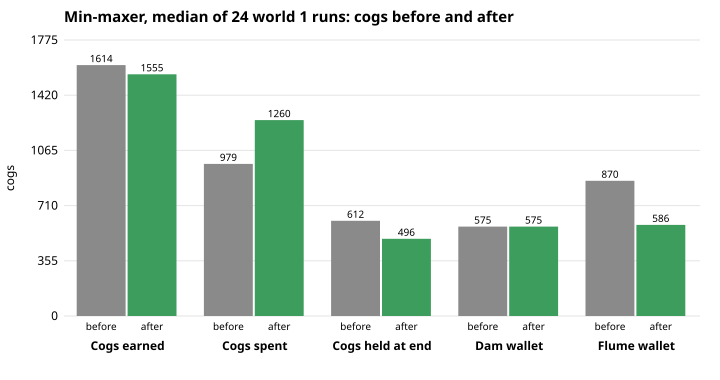
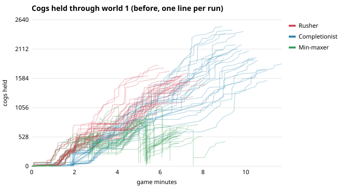
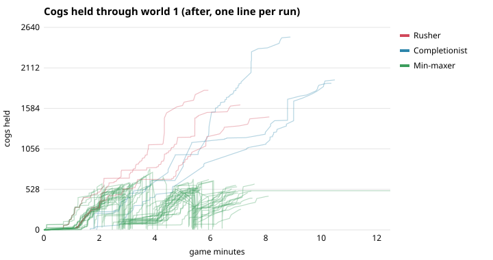

# Economy balance (pass B, world 1)

**What changed.** Moss's shelf now asks a choice at both world 1 visits. Before, a player who bought everything emptied the dam shelf in 24 of 24 runs and still kept half their cogs. With the new prices and Moss's scale on, the flume shelf is bought out in 5 of 23 runs, against 12 of 24 before. Emptying the dam shelf now takes the whole wallet plus part of the ball: a median of 350 mass sold at the scale. Selling mass is a real stake: 2 of 24 min-maxer runs did not clear world 1, against 0 of 24 before. The new numbers live in [values.patch](values.patch). They change `COG_PRICES` in `fabricators.gd` and `START_COGS` in `start_picks.gd`, and they go into PR 768 (Marked hull and Moss's scale), which holds `fabricators.gd`. This page's pull request carries the sim and the evidence, with no game change.

**Words used here.**
- The rusher is the skipper bot: the main route, no side spots.
- The completionist is the completionist bot: side spots first.
- The min-maxer is the new policy in [econ_ledger.gd](../../../sketches/core-loop/tools/sysaudit/econ_ledger.gd). It takes the skipper's route, takes the start pick (a core or a part, never the cogs), takes every upgrade-tree offer, and boards Moss's bay at each stage. There it buys the hook if it is unlocked, buys the shelf from the dearest part down, takes one reroll and buys again, then buys charge cells. When a buy is out of reach and the scale is on, it sells mass until the buy is affordable or the ball has dropped below the heft class it boarded with.
- A "buy-out" is a visit that leaves nothing on the shelf.
- "Heft class" is the ball's weight class. It sets max hull, the hook's lock and the crowd size.

Read at `stage/alpha-w37` with PR 765 merged (before arm, `87784f5a`), and at PR 768 plus the candidate values (after arm, `5fec469f` on `scratch/sysaudit-econ-after`). Scope: world 1, meaning the dam, the flume and Brindle, on the park table.

## Before and after

```
                 BEFORE (24 runs each)                          AFTER (min-maxer, 24 runs, scale on)
 Rusher         earn 1,559 ─► spend 0 ─► hold 1,559               unchanged (no shop visit; 3 replays identical)
 Completionist  earn 2,012 ─► spend 0 ─► hold 2,012               unchanged (no shop visit; 3 replays identical)
 Min-maxer      earn 1,614 ─► spend 979 ─► hold 612               earn 1,555 + scale ─► spend 1,260 ─► hold 496
                dam shelf bought out 24/24, 48% of wallet          dam 19/24 (wallet + a median 350 mass sold)
                flume shelf bought out 12/24                        flume 5/23, 2 parts left on the shelf
                19 parts, 24/24 clear world 1                       16 parts, 22/24 clear world 1
```






Per-type medians and ranges are in [evidence/before-summary.json](evidence/before-summary.json) and [evidence/after-summary.json](evidence/after-summary.json), and every run is in the matching `*-runs.json`.

## Every source and sink, per resource

The rates are per game minute, pooled over all 24 runs of each type in the before arm, in the order rusher / completionist / min-maxer. The 10-hour column carries the same rates to 10 game hours: 24 world 1 runs per type is 2.8, 3.9 and 2.7 game hours, so the work is never stalled on a 10-hour wall-clock run (Andrew, 11 Nov 18:42Z; ruling db).

| Resource | Sources (code) | Sinks (code) | Rate per game minute | Carried to 10 game hours |
| --- | --- | --- | --- | --- |
| Scrap | Ground trail pieces, 1 each (`scrap_field.gd`); kill drops; activity pay (`activities.gd` `_pay_scrap`); event scrap (`world.gd`); discovery burst 20 x stage (`flow.gd` `BURST_PER_STAGE`); Brindle's piles (`boss.gd`); blood shrine at 0.5 per hull paid (`stake_devices.gd`) | Not spent since cogs took over as money. Lost as armour on hits (`run_state.gd` `SCRAP_PER_HP` 10), stolen by Brindle's crane, and sold at Moss's scale (PR 768) | 223 / 208 / 231 collected | 134k / 125k / 139k |
| Mass | 1 per scrap piece; each panel counts as 6 for heft (`panels.gd` `PANEL_MASS`); a part adds 0.2 heft (`run_state.gd` `HEFT_PER_PART`) | Crane theft; Moss's scale (PR 768) | Ends at 430-1,593 / 492-1,979 / 947-1,565 (before) | n/a (it sets the heft class, it is not spent) |
| Cogs | 1 per scrap unit from kills, activities, events and Brindle; discovery bursts; start pick (15); hot-wire recycle; sell-back at 50% | Moss's shelf, hook, reroll and charge cells (`shop.gd`, `COG_PRICES`); trade chest cogs price (`stake_devices.gd`); fabricator hoops, but park maps lay none | Earned 223 / 206 / 235. Kill and boss gears 144 / 94 / 150; discovery bursts 52 / 42 / 56; activities 3 / 52 / 3. Spent 0 / 0 / 143 | Earned 134k / 123k / 141k; spent 0 / 0 / 86k |
| Cores | Event milestones, ambush altar, bet crates, vault, start pick (`run_state.gd` `add_core`) | A better next gate offer (passive), the healing ward (1 to 3), bet crates. Wiped at every stage entry (`run_state.gd` `enter_stage`) | 0 / 0 / 0.085 gained, and all of it wiped | 0 / 0 / 51 gained, 51 wiped |
| Hull | Base plus growth per heft class; regen of 6 per second after 5 s with no hit (`run_state.gd` `REGEN_*`); hull tiles; the healing ward | Hits after armour; trade chest and blood shrine payments (`HEALTH_SHARES` 25, 50 and 75%) | Lost 2.0 / 2.3 / 1.7 (after armour; 10.5 / 11.6 / 12.7 before armour); regen and heals 8.1 / 6.7 / 10.4 | Hull lost 1,215 / 1,398 / 1,032 |
| Panels | Kill drops (world 1: 32% chance, 6% pity per dry kill; elite, rib and jackpot multipliers; `panels.gd` `DROP_BY_WORLD`); 3 rib caches a stage | None (kept for the run) | 1.38 / 0.94 / 1.52 | 829 / 564 / 911 |
| Parts | Reward gates (2 a run), Brindle (1), activities (camp, surge, ambush, bounty, cache), Moss, trade chests, start pick | Sell-back at Moss | 0.43 / 0.58 / 2.69. The shop supplies 1.94 of the min-maxer's 2.69 | 258 / 350 / 1,615 |
| Relics | Cracked caches (`cracked_cache.gd`) | None | 0 / 0 / 0 (no bot cracks a cache on these routes) | 0 |
| Tree picks | One per new heft class at safe moments, plus the first bay visit of the world (`world.gd` `_open_pick`); world 1 caps the tree at depth 2 | None | 0 / 0 / 0.29 (2 a run; the rusher and completionist leave offers untaken) | 0 / 0 / 175 |
| Meta unlocks | Run ends, firsts, discoveries (profile, codex, cosmetics) | None in a run | Out of scope: no stats, no run currency | n/a |

## Flags

| Flag | Before | After | Verdict |
| --- | --- | --- | --- |
| Inflation: the shelf asks no choice | Dam shelf bought out in 24 of 24 visits with 48% of the wallet; flume 12 of 24 | Dam 19 of 24, but only by selling a median 350 mass; with the scale off (a cloud check of 8 runs at `af3e49df`, not kept as evidence) 4 of 8, with 96% of the wallet spent. Flume 5 of 23 | Fixed by the price change |
| Hoarding | Rusher holds 1,559 cogs and the completionist 2,012, with 0 spent; the min-maxer holds 612 | Rusher and completionist unchanged; the min-maxer holds 496 | Two causes, neither a price problem. (1) Neither bot policy boards Moss, so their zero spend is a bot gap. (2) Moss's bay is the only cog sink on the main route, and the cogs a run earns after the flume visit (the flume gate and Brindle, a median of 400 to 600) have no shop in world 1. They carry into world 2, which is out of this pass's scope |
| Dead currency: cores | 0 cores for the rusher and the completionist; the min-maxer's one start-pick core is wiped at the next stage entry in 24 of 24 runs | Same | Andrew approved "Carry a core" on 11 Nov 19:08Z (Bible change request 5); it is built in the thread "Build marked hull and resource sinks" |
| Dead option: the start pick's cogs | 15 cogs against a 576-cog wallet at the first shop | 60 cogs against the same wallet, about one and a half tier-1 parts at the new prices | Still the weakest of the three options; logged as an assumption Andrew can overturn: make it a number that matters and leave the option list alone |
| Dead sink: fabricator hoops | Park maps lay no `scrap_lines`, so no hoop stands in world 1 (ruling cd: "no hoops") | Same | By ruling; no change |
| A strategy winning over 60% | Every type clears world 1 in at least 23 of 24 runs | Min-maxer 22 of 24 | Win rate is not a balance sensor here: world 1 bots almost never lose. Of the losses, after minmax 2882 died with 40 mass left after selling down, and 2860 stalled at Brindle (a bot fault seen before). No type dominates on time: the min-maxer (6.9 min) and the rusher (7.0 min) match, and the completionist (9.8 min) buys 2 to 3 more parts with its detours |
| Power the bots cannot see | The min-maxer ends with 19 parts against the rusher's 3, yet Brindle falls in 83.6 s against 84.1 s, with the same hull lost | Same | The bots do not use what a part does, and Brindle's phases run on a clock. No bot run here measures power; it measures flow. A power read needs a lab arm that plays a part's verb |

## The value changes

All of them are in [values.patch](values.patch), which applies cleanly on PR 768 at `d5f30a04` and at `e672da1d`. The coordinator passes it to that PR's writer.

| Value | Before | After | Why |
| --- | --- | --- | --- |
| `COG_PRICES.part_base` | 10 | 40 | The dam shelf costs about 1.3 times the dam wallet, so a player picks |
| `COG_PRICES.part_growth` (per part held) | 1.15 | 1.06 | At 1.15 the flume prices ran away with parts held; 1.06 keeps both visits in the same range: modelled wallet over buy-out of 0.78 at the dam and 0.73 at the flume |
| `COG_PRICES.reroll_base` | 12 | 30 | A reroll costs about a tier-1 part, not a rounding error |
| `COG_PRICES.cell_base` | 20 | 40 | Charge cells stay below a part, so they are a cheap top-up |
| `COG_PRICES.weigh_lump` (Moss's scale) | 25 (placeholder) | 50 | 7 presses a visit, not 14 |
| `COG_PRICES.mass_per_cog` (Moss's scale) | 4.0 (placeholder) | 2.0 | A sale pays half what the scrap paid on the way in. A flume part (about 100 cogs) costs about 200 mass, a quarter of the ball. Measured: a median of 350 mass sold a run, 2 runs lost after selling down |
| `start_picks.gd` `START_COGS` | 15 | 60 | One and a half tier-1 parts at the new `part_base` |

Not measured, sent as a recommendation only, because no bot visits a trade chest:
- **`HEALTH_SHARES` with Marked hull on:** 0.15, 0.30 and 0.45 in place of 0.25, 0.50 and 0.75. At 75%, a marked tier-3 trade leaves 25% of max hull until the next Warden. A world 1 stage costs a median 30 to 60 hull before armour, so that is a near-certain death, not a gamble. At 45% the stage loss is a real risk, not a sure one.
- **`SCRAP_PER_HP_PAID`:** 0.5 to 4.0, so a blood shrine pays a scale's worth of cogs (a 15% stake on 110 hull is 66 scrap, about 33 cogs).
- Both change the flag-off game too, so leave them as they are until Marked hull is the default. That call belongs to PR 768's writer and the coordinator.

The panel drop table (`panels.gd`) is unchanged. The sim shows 9 to 11 panels a run, about 5 a stage, with no inflation or hoarding sign, because panels are kept, not spent. A panel change moves heft and the bands, which this pass avoids.

## Hull is still free when Marked hull is off

The rate that makes hull prices free is regen (`run_state.gd` `REGEN_DELAY` 5 s, `REGEN_RATE` 6 per second, with `challenge_dials.gd` multipliers). Both files are held by the difficulty stack and PR 763, and pass A's lead reads it as a design change, not a number change. Andrew answered it on 11 Nov 19:08Z by approving Marked hull (PR 768, `--marked-hull=on`): hull paid at a keeper's gamble lowers max hull until the next Warden, so regen cannot refund it. No NEEDS ANDREW is left open from this pass.

## Bands

The world 1 bands were not rerun, on purpose. A band bot is a skipper or completionist policy, and neither boards Moss, so a shop price cannot reach it. The after arm proves it: the 3 rusher and 3 completionist replays at `af3e49df` match the before arm seed for seed on game time, cogs, Brindle time and lowest hull. The Novice target (ruling cu) cannot get easier from this change. The 10 Nov re-measure also found that band win counts at 24 seeds are not a balance sensor. Logged as an assumption the coordinator can overturn.

## How to run it

```bash
# From a repo root (a worktree: a bot run reads the working tree as it starts). GODOT_BIN = Godot 4.7.2
$GODOT_BIN --headless --import --path sketches/core-loop
# before arm (claude/project-thread-37yl0c)
JOBS=16 docs/systems-audit/economy/run.sh $PWD/artifacts/local/econ/before 2860 24 rusher completionist minmax
# after arm (scratch/sysaudit-econ-after: PR 768 plus values.patch)
JOBS=16 EXTRA=--moss-scale=on docs/systems-audit/economy/run.sh $PWD/artifacts/local/econ/after 2860 24 minmax
JOBS=16 docs/systems-audit/economy/run.sh $PWD/artifacts/local/econ/after 2860 3 rusher completionist
# analysis and charts
python3 -I docs/systems-audit/economy/analyse.py artifacts/local/econ/before docs/systems-audit/economy/evidence before
python3 -I docs/systems-audit/economy/analyse.py artifacts/local/econ/after docs/systems-audit/economy/evidence after
python3 -I docs/systems-audit/economy/compare.py docs/systems-audit/economy/evidence
```

The evidence here came from Andrew's PC (Ryzen 9 5950X, Godot 4.7.2, headless, CPU only) on 11 Nov 2026, 20:23Z to 21:33Z. The 102 raw ledgers and bot records are on the branch `scratch/sysaudit-econ-results`. A run is about 6 game minutes, and one core finishes it in about 6 wall-clock minutes. Every run uses `--fixed-fps 90`, so machine load changes wall time, not results. The same seed on another machine differs: the cloud's minmax 2860 ended at 434 s with 521 cogs, against the PC's 410 s with 647. So compare arms only on one machine, as bot_run's header says.

What this evidence does not show: feel (a human read, AGENTS.md); trade chests, the blood shrine and the healing ward (no bot visits them); relics (no bot cracks a cache); worlds 2 and 3; and what a part's power is worth (see "Power the bots cannot see").

## Follow-ups (not built here)

- **A power read.** This needs a lab arm in which a bot plays parts' verbs, to say whether 16 parts beat 3. The answer to PR 772's pair-margin question belongs there too: a min-maxer that buys toward a maker pair.
- **A second cog sink on the main route,** for a player who skips Moss. This is a design call; the nearest approved answers are Moss's scale and Carry a core.
- **Rerun at every sprint close** (the card's regression rule), with the same seeds and the same command.

## Systems health (for the coordinator's digest)

| System | Pass status | Top open issue | Last sim result | What changed |
| --- | --- | --- | --- | --- |
| Cogs and Moss's shelf | B done; values go into PR 768 | Cogs earned after the last shop have nowhere to go in world 1 | Before: dam shelf bought out 24/24 at 48% of the wallet. After: flume shelf 5/23, 2 parts left on the shelf | Prices x4 base, growth 1.15 to 1.06 (in values.patch) |
| Moss's scale | Rates set | Selling down can lose a run (1 of 24) | A median 350 mass sold a run, 166 presses in 24 runs | weigh_lump 50, mass_per_cog 2.0 |
| Cores | Waiting on Carry a core | Wiped at every stage entry | 24 of 24 start-pick cores wiped | Nothing yet |
| Hull and trade chests | Marked hull approved | Hull prices free with the flag off | Not reachable by bots | Shares recommended for flag-on |
| Panels, parts, tree | No change | Bots cannot see a part's power | 9-11 panels; 3 / 6 / 16 parts; 2 tree picks for the min-maxer | Nothing |

**One finding in plain words.** Cogs come in at one per piece of scrap, about 220 a minute. Before this pass, everything on Moss's first shelf cost less than half of what you carried, so buying was not a decision; it was just a stop. Prices are now about four times higher. The flume shelf no longer runs away as you hold more parts, and the scale lets you turn part of your ball into money. Now a full shelf costs either all your cogs or some of your size, and size is your armour, so it is a real choice.
