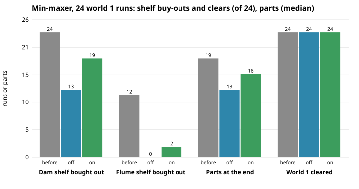

# Economy balance (pass B, world 1)

**Proposed change, measured and not yet in the game.** New prices at Moss's counter (the workshop barge that docks after each Warden) make the flume shelf a choice. A player who buys everything used to empty it in 12 of 24 runs; with the new prices that drops to 0 of 24, and to 2 of 24 with Moss's scale on. The dam shelf changes most in what it costs: emptying it used to take 48% of the cogs a player carried, and now takes 97%. A player still empties it in 13 of 24 runs, by spending every cog, or in 19 of 24 when the scale is on. Every run still clears world 1. The numbers are in [values.patch](values.patch): `COG_PRICES` in `fabricators.gd` and `START_COGS` in `start_picks.gd`. They go into PR 768 (Marked hull and Moss's scale), which holds `fabricators.gd`. This page's pull request carries the sim and the evidence and changes no game file.

**Words used here.**
- **Player types.** The rusher is the skipper bot (the main route, no side spots). The completionist is the completionist bot (side spots first). The min-maxer is the new policy in [econ_ledger.gd](../../../sketches/core-loop/tools/sysaudit/econ_ledger.gd). It takes the skipper's route, takes the start pick (a core or a part, never the cogs), takes every upgrade-tree offer, and stops at Moss's counter at each stage. There it buys the shelf from the dearest part down, takes one reroll and buys again, then buys charge cells.
- **Moss's scale** is the new counter verb on PR 768 (`--moss-scale=on`): it trades mass, the scrap the ball carries, for cogs. With the scale on, when a buy is out of reach the min-maxer sells mass in lumps until the buy is affordable. It never makes a sale that would drop the ball below the heft class it arrived with. Heft class is the ball's weight class, which sets max hull, the lock on Moss's top part and the crowd size.
- **Buying out the shelf** means a visit that leaves nothing on it.
- **The wallet** is the cogs a player carries on arrival at Moss's counter.
- **An arm** is one set of 24 runs at one code version: before (`stage/alpha-w37` with PR 765, at `87784f5a`), after with the scale off, and after with the scale on (both are PR 768 plus `values.patch` at `7a210caa` on `scratch/sysaudit-econ-after`).

Scope: world 1, meaning the dam, the flume and Brindle, on the park table.

## Before and after (the min-maxer, median of 24 runs)

```
                    BEFORE                  AFTER, SCALE OFF          AFTER, SCALE ON
 Dam wallet         576 cogs                576                       576
 Dam spend          267 (48%)               558 (97%)                 615 (sells 175 mass)
 Dam shelf emptied  24 of 24                13 of 24                  19 of 24
 Flume wallet       870                     589                       574
 Flume spend        729 (89%)               565 (97%)                 633 (sells 129 mass)
 Flume shelf emptied 12 of 24               0 of 24, 2 parts left     2 of 24, 2 parts left
 Parts at the end   19                      13                        16
 Cogs at the end    613                     499                       518
 World 1 cleared    24 of 24                24 of 24                  24 of 24
```




The rusher and the completionist never stop at Moss, so no price reaches them. Six replays of the new code (3 rusher and 3 completionist, seeds 2860 to 2862) match the before arm on every seed, in game time, cogs, Brindle's time and lowest hull ([evidence/replays-runs.json](evidence/replays-runs.json)). Per-type medians and ranges are in `evidence/<arm>-summary.json`, and every run is in `evidence/<arm>-runs.json`.

## Every source and sink, per resource

Rates are per game minute, pooled over the 24 runs of each type in the before arm, in the order rusher / completionist / min-maxer. The last column carries the same rates to 10 game hours. Twenty-four runs per type is 2.8 to 3.9 game hours, so no one waits on a 10-hour wall-clock run (Andrew, 11 Nov 18:42Z; ruling db).

| Resource | Sources (code) | Sinks (code) | Rate per game minute | Carried to 10 game hours |
| --- | --- | --- | --- | --- |
| Scrap | Ground trail pieces, 1 each (`scrap_field.gd`); kill drops; activity pay (`activities.gd` `_pay_scrap`); event scrap (`world.gd`); discovery bursts of 20 x stage (`flow.gd` `BURST_PER_STAGE`); Brindle's piles (`boss.gd`); the blood shrine, at 0.5 scrap per hull paid (`stake_devices.gd`) | Not spent since cogs became the money. Lost as armour on hits (`run_state.gd` `SCRAP_PER_HP` 10), stolen by Brindle's crane, sold at Moss's scale (PR 768) | 223 / 208 / 231, counted as scrap held at the end of the run | 134k / 125k / 139k |
| Mass | 1 per scrap piece. For heft, a panel counts as 6 mass (`panels.gd` `PANEL_MASS`) and a part adds 0.2 heft (`run_state.gd` `HEFT_PER_PART`) | Crane theft; Moss's scale | Held at the end: 430-1,593 / 492-1,979 / 947-1,565 | Not spent; it sets the heft class |
| Cogs | 1 per scrap unit from kills, activities, events and Brindle; discovery bursts; the start pick; hot-wire recycling; selling a part back at 50% | Moss's shelf, top part, reroll and charge cells (`shop.gd`, `COG_PRICES`); the trade chest's cog price (`stake_devices.gd`); fabricator hoops, but park maps lay none | Earned 223 / 206 / 235: kill and boss gears 144 / 94 / 150, discovery bursts 52 / 42 / 56, other pickups (folded gears, Brindle's piles) 24 / 18 / 26, activities, events and the start pick 3 / 52 / 3. Spent 0 / 0 / 143 | Earned 134k / 123k / 141k; spent 0 / 0 / 86k |
| Cores | Event milestones, the ambush altar, bet crates, the vault, the start pick (`run_state.gd` `add_core`) | A better next gate offer, the healing ward (1 to 3), bet crates. Wiped at every stage entry (`run_state.gd` `enter_stage`) | 0 / 0 / 0.085 gained, and every one wiped | 0 / 0 / 51 gained, 51 wiped |
| Hull | Base hull plus growth per heft class; regen of 6 a second after 5 s with no hit (`run_state.gd` `REGEN_*`); hull tiles; the healing ward | Hits after armour; payments at the trade chest and blood shrine (`HEALTH_SHARES` 25, 50 and 75%) | Hull lost after armour: 2.0 / 2.3 / 1.7 (10.5 / 11.6 / 12.7 before armour). In the after arms, regen and heals give back 0.5 to 0.6 and max-hull growth 9.7: bots lose so little hull that a heft class rise refills it | Hull lost 1,215 / 1,398 / 1,032 |
| Panels | Kill drops (world 1: 32% chance, 6% pity per dry kill, with elite, rib and jackpot multipliers; `panels.gd` `DROP_BY_WORLD`); 3 rib caches a stage | None; kept for the run | 1.38 / 0.94 / 1.52 | 829 / 564 / 911 |
| Parts | Reward gates (2 a run), Brindle (1), activities (camp, surge, ambush, bounty, cache), Moss, trade chests, the start pick | Selling back at Moss | 0.43 / 0.58 / 2.69; the shop supplies 1.94 of the min-maxer's 2.69 | 258 / 350 / 1,615 |
| Relics | Cracked caches (`cracked_cache.gd`) | None | 0 / 0 / 0; no bot cracks a cache on these routes | 0 |
| Tree picks | One per new heft class at safe moments, plus the first counter visit of the world (`world.gd` `_open_pick`); world 1 caps the tree at depth 2 | None | 0 / 0 / 0.29, 2 a run (the rusher and completionist leave offers untaken) | 0 / 0 / 175 |
| Meta unlocks | Run ends, firsts, discoveries (profile, codex, cosmetics) | None in a run | Out of scope: no stats, no run currency | n/a |

The "before" hull row for the min-maxer counted only single-tick rises over 0.5 hull, which misses regen. The after arms count every tick.

## Flags

| Flag | Before | After | Verdict |
| --- | --- | --- | --- |
| Inflation: the shelf asks no choice | Dam shelf emptied 24 of 24 times with 48% of the wallet; flume 12 of 24 | Scale off: dam 13 of 24 at 97% of the wallet, flume 0 of 24. Scale on: dam 19 of 24, flume 2 of 24 | Fixed at the flume. Improved at the dam, but the flag still fires there: emptying it now takes the whole wallet, which leaves nothing for the flume. My call, which Andrew can overturn: keep `part_base` at 40. If the sitting finds the dam shelf too easy, raise it to 45 |
| Hoarding | The rusher holds 1,559 cogs and the completionist 2,012, with 0 spent; the min-maxer holds 613 | The rusher and completionist are unchanged; the min-maxer holds 499 (scale off) or 518 (scale on) | Two causes, neither of them a price. (1) Neither bot policy stops at Moss, which is a bot gap. (2) Moss's counter is the only cog sink on the main route, and the cogs a run earns after the flume visit (from the flume gate and Brindle) have no shop until world 2. Deferred to a world 2 pass, because those cogs reach world 2's first shop |
| Dead currency: cores | 0 cores for the rusher and the completionist. 14 of 24 min-maxer runs took a core at the start, and all 14 were wiped at the next stage entry | Same | Andrew approved "Carry a core" on 11 Nov 19:08Z (Bible change request 5); the thread "Build marked hull and resource sinks" builds it |
| Dead option: the start pick's cogs | 15 cogs against a 576-cog wallet at the first shop | 60 cogs, about one and a half tier-1 parts at the new prices | Still the weakest of the three options. My call, which Andrew can overturn: make it a number that matters and leave the option list alone |
| Moss's top part never sells | Locked in every visit | Locked in every visit | By rule: Moss stocks it one heft class above the ball (`shop.gd` `_stock_stage`), and nobody gains a class aboard. No change |
| Dead sink: fabricator hoops | Park maps lay no `scrap_lines`, so no hoop stands in world 1 (ruling cd: "no hoops") | Same | By ruling; no change |
| A strategy that wins over 60% | Every type clears world 1 in at least 23 of 24 runs | The min-maxer clears 24 of 24 in both after arms | Win rate is no balance sensor here, because world 1 bots almost never lose. No type wins on time: the min-maxer and the rusher both take about 7.0 game minutes. The completionist takes 10.0 and ends with 2 to 3 more parts from side spots |
| Power the bots cannot see | The min-maxer ends with 19 parts against the rusher's 3, yet Brindle falls in 83.6 s against 84.1 s, with the same hull lost | Same shape | The bots do not use what a part does, and Brindle's phases run on a clock. No bot run here measures power, only flow. A power read needs a lab run in which a bot plays each part's ability |

## The value changes

All of these are in [values.patch](values.patch), which applies cleanly on PR 768 at `d5f30a04` and at `e672da1d`. The coordinator passes it to that PR's writer.

| Value | Before | After | Why |
| --- | --- | --- | --- |
| `COG_PRICES.part_base` | 10 | 40 | Each visit leaves a choice on the shelf |
| `COG_PRICES.part_growth` (per part held) | 1.15 | 1.06 | At 1.15 the flume prices ran away as parts piled up. At 1.06 both visits cost about the same share of the wallet (97% in the scale-off arm) |
| `COG_PRICES.reroll_base` | 12 | 30 | A reroll costs about a tier-1 part, not a rounding error |
| `COG_PRICES.cell_base` | 20 | 40 | Charge cells stay cheaper than a part, so they stay a top-up |
| `COG_PRICES.weigh_lump` (Moss's scale) | 25 (placeholder) | 50 | One sale is a lump of 50 mass; the min-maxer made a median of 6 sales a run |
| `COG_PRICES.mass_per_cog` (Moss's scale) | 4.0 (placeholder) | 2.0 | A sale pays half what the scrap paid on the way in (1 cog and 1 mass per piece). The min-maxer sold a median of 300 mass a run for 150 cogs, kept its heft class, ended at 953 mass against 1,258 without the scale, and bought 3 more parts |
| `start_picks.gd` `START_COGS` | 15 | 60 | One and a half tier-1 parts at the new `part_base` |

`part_base` sets prices beyond the shelf too. None of these were measured, because no bot meets them:
- The trade chest's cog price, which has no growth term (`stake_devices.gd`), goes from 10, 16 and 26 cogs to 40, 64 and 104 for tiers 1 to 3.
- Rack active offers on the shelf (`active_offers.gd`) rise by the same factor.
- Fabricator hoops on the legacy maps (`build.gd`) rise by the same factor; park maps lay no hoops.

Sent as recommendations only, on paper, because no bot visits a trade chest or a blood shrine:
- **`HEALTH_SHARES` with Marked hull on:** 0.15, 0.30 and 0.45, in place of 0.25, 0.50 and 0.75. Marked hull lowers max hull until the next Warden. At 75%, a tier-3 trade would leave 25% of max hull for a stage that costs a median 30 to 60 hull before armour, which is a near-certain death, not a gamble.
- **`SCRAP_PER_HP_PAID`:** 0.5 to 4.0, so a blood shrine pays about one sale at Moss's scale. A 15% stake on 110 hull is 66 scrap, about 33 cogs.
- Both values also change the game with the flag off, so leave them alone until Marked hull is the default. That call belongs to PR 768's writer and the coordinator.

The panel drop table (`panels.gd`) is unchanged. The sim shows 9 to 11 panels a run with no inflation or hoarding sign, because panels are kept, not spent. A panel change moves heft and the bands, which this pass avoids.

## Hull is still free when Marked hull is off

The rate behind free hull prices is regen (`run_state.gd` `REGEN_DELAY` 5 s, `REGEN_RATE` 6 a second, with multipliers in `challenge_dials.gd`). Both files are held by the difficulty stack and PR 763, and pass A read the fix as a design change, not a number. Andrew answered it on 11 Nov 19:08Z by approving Marked hull (PR 768, `--marked-hull=on`): hull paid at a trade chest lowers max hull until the next Warden, so regen cannot refund it. The open design item from this pass, a second cog sink on the main route, is deferred to world 2 (see "Hoarding"). No NEEDS ANDREW item is left open.

## Bands

The world 1 bands were not rerun, on purpose. The band table plays saved builds made by completionist and skipper library runs. Its fight personas are the brawler (the completionist's fight profile), the camper and the skipper. None of them stops at Moss, so a shop price cannot reach a band run. The six replays above prove it for the two policies the library uses. So the Novice target (ruling cu) cannot get easier from this change. The 10 Nov re-measure also found that band win counts at 24 seeds are no balance sensor. My call, which the coordinator can overturn: if PR 768 makes Marked hull or Moss's scale the default, the band read belongs on that PR.

## How to run it

```bash
# From a repo root, in a worktree: a bot run reads the working tree as it starts. GODOT_BIN is Godot 4.7.2.
$GODOT_BIN --headless --import --path sketches/core-loop
# before arm (claude/project-thread-37yl0c)
JOBS=16 docs/systems-audit/economy/run.sh $PWD/artifacts/local/econ/before 2860 24 rusher completionist minmax
# after arms (scratch/sysaudit-econ-after: PR 768 plus values.patch)
JOBS=16 docs/systems-audit/economy/run.sh $PWD/artifacts/local/econ/after-scale-off 2860 24 minmax
JOBS=16 EXTRA=--moss-scale=on docs/systems-audit/economy/run.sh $PWD/artifacts/local/econ/after-scale-on 2860 24 minmax
JOBS=16 docs/systems-audit/economy/run.sh $PWD/artifacts/local/econ/replays 2860 3 rusher completionist
# analysis and charts
for arm in before after-scale-off after-scale-on replays; do
  python3 -I docs/systems-audit/economy/analyse.py artifacts/local/econ/$arm docs/systems-audit/economy/evidence $arm
done
python3 -I docs/systems-audit/economy/compare.py docs/systems-audit/economy/evidence
```

The evidence came from Andrew's PC (Ryzen 9 5950X, Godot 4.7.2, headless, CPU only) on 11 Nov 2026, between 20:23Z and 22:20Z. The before arm and the replays ran at the probe heads `87784f5a` and `af3e49df`. The two after arms ran at `7a210caa`, after the independent review found that the earlier scale rule gave up a heft class. Probe changes since the replays only add fields to the ledger; the game a bot plays is the same. The raw ledgers, one per run (122 of them), are on the branch `scratch/sysaudit-econ-results`, under `runs/`. A run is about 7 game minutes, and one core finishes it in about 6 wall-clock minutes. Every run uses `--fixed-fps 90`, so machine load changes wall time, not results. The same seed on another machine gives a different run: the cloud's min-maxer on seed 2860 ended at 434 s with 521 cogs, against the PC's 410 s with 647. So compare arms only on one machine, as bot_run's header says.

What this evidence does not show:
- Feel, which needs a human read (AGENTS.md).
- Trade chests, the blood shrine and the healing ward, because no bot visits them.
- Relics, because no bot cracks a cache.
- Worlds 2 and 3.
- What a part's power is worth (see "Power the bots cannot see").
- The probe misses a non-shop cog spend that lands on the same tick as a cog gain. None of these bots makes such a spend.
- The probe reaches private members of the game (`run._start_pick_open`, `world._shop`, `world._bay_fact`) to drive the min-maxer. It is a lab tool, not game code, so a rename there breaks the probe, not the game.
- Cog gains are sorted into sources by amount, so a burst and a pickup of the same size can land in the wrong row.

## Follow-ups (not built here)

- **A power read:** a lab run in which a bot plays parts' abilities, to say whether 16 parts beat 3. PR 772 asked how to measure whether two pieces from one maker are worth taking. That measure belongs in the same run, with a min-maxer that buys toward a maker pair, meaning two parts from one maker that wake that maker's trick.
- **A second cog sink on the main route,** for a player who skips Moss. This is a design call, deferred to world 2.
- **Rerun at every sprint close,** with the same seeds and the same commands (the card's regression rule).

## Systems health (for the coordinator's digest)

| System | Pass status | Top open issue | Last sim result | What changed |
| --- | --- | --- | --- | --- |
| Cogs and Moss's shelf | B done; values go into PR 768 | Emptying the dam shelf is still possible, but only by spending the whole wallet | Scale off: dam emptied 13 of 24 at 97% of the wallet, flume 0 of 24 | `part_base` 10 to 40 and `part_growth` 1.15 to 1.06, plus reroll and cell prices (values.patch) |
| Moss's scale | Rates set | None found | 6 sales and 300 mass a run for 150 cogs; heft class kept; 24 of 24 clear | `weigh_lump` 50, `mass_per_cog` 2.0 |
| Cores | Waiting on Carry a core | Wiped at every stage entry | 14 of 14 start-pick cores wiped | Nothing yet |
| Hull and trade chests | Marked hull approved | Hull prices are free with the flag off | No bot reaches a trade chest | Shares recommended for when the flag is on |
| Panels, parts, tree | No change | Bots cannot see a part's power | 9 to 11 panels; 3 / 6 / 13 to 16 parts; 2 tree picks for the min-maxer | Nothing |

**One finding in plain words.** Cogs come in at one per piece of scrap, about 220 a minute. Before this pass, Moss's first shelf cost less than half of what a player carried, so buying was a stop on the way, not a decision. With the proposed prices, a full shelf costs everything the player carries, so they choose between buying now and saving for the flume. With Moss's scale they have a third way to pay: sell part of the ball. That costs armour, because the ball's mass is its armour.
