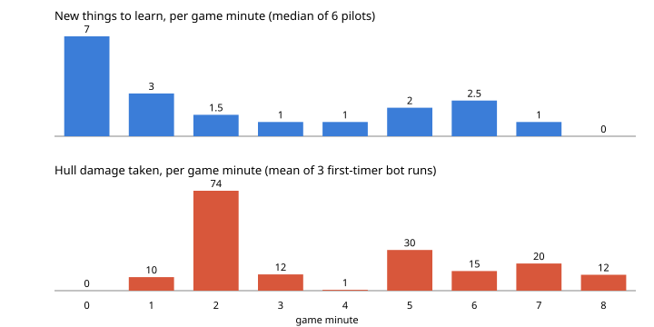

# The first 15 minutes (pass E, world 1)

**What this page says.** World 1 teaches every mechanic it asks for on the park maps before it asks for it. The [first-timer audit](first-timer-report.md) passes for all six pilots. Getting there took two fixes to the audit itself (section 4). The order is wrong in two places, though:

- **The first 13 seconds.** Seven lessons arrive while the player is still learning to roll. Three of them teach things the player does not need for minutes.
- **The dam Warden.** It is where the player takes their first real damage, and it asks for a new traversal, riding the water sheet up, while lobber shells fall. In the film, those shells are the first ones that land.

After minute 3, world 1 gets easier, not harder. Damage taken falls while max hull grows from 90 to 155. The fixes sit in files other threads hold, so this pass sends them as described changes (section 5) and changes no game file.

**Read at.** `stage/alpha-w37` head `7eea9226`, 11 Nov 2026, with pass C's mechanics table ([PR 773](https://github.com/bananahana720/scrapkeep/pull/773), `docs/systems-audit/mechanics/README.md`) and pass D's [feature-fit.md](../feature-fit.md). Card: [SA-E in BACKLOG.md](../../../BACKLOG.md#sa-e). The new and changed mechanics in flight are counted here only as their owners describe them, because none is on by default. They are the fold (PR 772), Marked hull and Moss's scale (PR 768), and Heat, Reservoir and Called Shot (PR 763).

**Game minutes, not player minutes.** The evidence is bot play. The first-timer bot (the `random` policy) clears world 1 in 6.4 to 8.3 game minutes, and the fastest-line film takes 7. A person meeting the game for the first time reads, hesitates and dies, so "the first 15 minutes" of a real first-timer covers about this same stretch: one world 1 run, from the title to Brindle. That is an estimate. A first-timer film on Andrew's PC is the check (section 6).

## 1. The order a first-timer meets things

Sable, seed 1, on the park table, from the [first-timer probe](first-timer-report.md) and the [whole-world film](#6-evidence-and-how-to-rerun). Times are game seconds from the drop into the dam. The other five pilots meet the same things within a few seconds of these times.

| Time | Meets | Kind | Alone? | Practised safely? | Tested | Combined with one earlier thing? |
| --- | --- | --- | --- | --- | --- | --- |
| 0 s | Roll, boost, "Find the Warden" | key prompts, objective row | three at once, but roll and the route are one idea | yes: 0 hits in minute 0 in all 3 runs | at the Warden | no |
| 3 s | The radio dial | tip ("Its keys are in the notes") | **no**: still learning to roll | n/a (music only) | never | no |
| 6 s | Harpoon | key prompt | **no** | yes: first latch at 55 s, no damage yet | yard crew, Warden | yes: roll |
| 6 s | Actives | tip ("Press the active's key on the bar") | **no** | not needed until a fight | n/a | no |
| 7 s | Mount (E) | key prompt | **no** | yes | no | no |
| 9 to 12 s | Wall grip | tip ("Stay fast against a wall and it holds you") | **no**; it fires from the first seam hop, with no wall near | n/a | never | no |
| 42 s | First fight: the yard crew | objective row | yes | yes: 0 to 1 hits in minute 1 | yes | yes: ram and harpoon |
| 75 s | The Warden and its clamp crews | objective row, boss bar | yes | the clamp crews are the practice | yes | yes: the yard fight |
| 79 s | Jump | key prompt | yes | yes | at the sheet | yes |
| 93 s | Ultimate | key prompt | yes | in the Warden fight | yes | yes |
| 94 s | **Ride the water sheet up**, under **lobber shells** | objective row; the film's first lobber hits | **no: a new traversal under the first shells that land** | **no**: the film's three lobber hits land here, in 16 s | yes | two at once |
| 143 s | Reward gates | objective row | yes | yes (no enemies) | yes | no |
| 146 s | The dunk | tip | yes | in stage 2 | stage 2 Warden | yes: slam |
| 180 s | The launch to the flume | screen | yes | n/a | n/a | n/a |
| 235 s | Stage 2 Warden: "Hook, shoot, smash core" | objective row (three steps) | yes, one loop | the steps dim as they are done | yes | **yes: harpoon, weapon and slam, all met before** |
| 240 s | Slam the open core | key prompt | yes | first stagger | yes | yes |
| 261 s | Brindle: one row a phase (shoot magnets, slam caps, bait into walls, ram the scooter) | objective rows | one phase at a time | each phase repeats its loop | yes | **yes: each phase reuses one earlier verb** |

**What works.** From the yard crew on, each new thing comes alone, gets a safe try, and is then tested. The stage 2 Warden and the four Brindle phases each combine verbs the player has already used, one loop at a time. That is the shape the card asks for.

**What does not.**
- **The first 13 seconds.** These carry seven lessons. Three of them (the radio, actives and wall grip) are not needed for minutes, and the radio is never needed.
- **The first ten seconds on screen.** Each tip replaces the one before it. The film shows a new sentence at the top of the screen every 1 to 3 seconds while the ball learns to roll (`0014-prompt-tip_active.jpg`, `0016-prompt-tip_radio.jpg`, `0017-prompt-tip_grip.jpg` on the scratch branch).
- **The dam Warden.** This is the first real test, and it teaches the water-sheet ride while lobber shells land. The film's three lobber hits and the 74 hull a minute in the chart all come from this fight. Lobbers can spawn earlier (the director's cards and the dam's ledges), and the film shows none hitting the ball before the Warden. The pace rows do not record what hit the ball, so the three bot runs cannot confirm it.

## 2. Difficulty and new things, minute by minute



Top: lessons first shown on screen each minute (key prompts, first-meet tips, objective rows), the median of the six pilots. Bottom: hull damage taken each minute, the mean of three first-timer bot runs (the `random` policy, seeds 2860 to 2862). Numbers: [data.json](data.json).

| Minute | New things | Damage taken | Enemies alive (mean) | Flag |
| --- | --- | --- | --- | --- |
| 0 | 7 | 0 | 5.3 | **spike in lessons**: 7 in the first 13 s |
| 1 | 3 | 10 | 8.9 | |
| 2 | 1.5 | 74 | 11.2 | **spike in damage**: the dam Warden; one run fell to 45 of 90 hull |
| 3 | 1 | 12 | 12.2 | |
| 4 | 1 | 0.6 | 11.1 | **flat**: the flume's first minute, nothing new and almost no damage |
| 5 | 2 | 30 | 10.4 | |
| 6 | 2.5 | 14.5 | 12.0 | |
| 7 | 1 | 20 | 6.3 | Brindle |
| 8 | 0 | 12 | 6.5 | Brindle (two runs still in it) |

What it says:
- **Two spikes, one flat stretch.** The lessons pile up in minute 0, before anything can hurt. The damage piles up in minute 2, at the first Warden. Minute 4, the flume's opening, asks almost nothing.
- **World 1 gets easier after minute 3.** Damage per minute after the dam Warden never comes back to its minute 2 level. Meanwhile max hull rises with every panel and heft class: 90 to 119, 105 to 140, and 100 to 155 across the three runs. Brindle takes 12 to 23 hull a minute from a ball with 119 to 155. Ruling cu says difficulty only goes up. The parked difficulty stack on `claude/w37-difficulty` is the owner and lands at the end of the sprint. This page gives it the target: from minute 4 on, the flume and Brindle should take at least the dam Warden's share of max hull.
- **Minute 1 is the safe practice the card asks for.** No new rules arrive, the first kills happen, and one run took one hit. It should stay.

## 3. Two things a first-timer is never taught

From the first-timer report. Both are optional, so neither fails the audit.

- **Scrap makes you heavier.** The first scrap is picked up at 0.9 s, and no lesson ever says what it does. The old "Scrap = heft" callout was retired (LEGIBILITY.md item 33). Pass C's mechanics table shows the heft class change has a pop, a sound and a toast, and pass C added a rumble. That is a shape-and-sound lesson in the spirit of ruling cx, but the probe does not count it, so this is open, not failed. The PC film should say whether a player notices the ball grow.
- **What cogs buy.** No run in the probe reaches Moss's bay. Pass D's "Moss weighs your haul" (PR 768) changes this anyway.

## 4. What this pass changed

All of these are tools. No game file changed.

1. **The first-timer audit now plays the park maps.** A test-mode game with no `--table` plays the legacy default table (`src/game.gd` `_chosen_table`). So `scripts/first-timer.mjs` measured the old maps, the same blind spot the red team had before PR 761. It now passes `--table=park` by default. The run on the park maps found the next fix.
2. **Brindle's lesson is the plate the park fight shows.** On the park table, Brindle's objective plate names each phase's loop from the arena's first frame (`objectives.gd` `STEPS`). The audit only knew the legacy rows (`break_guard`, `smash_core`), so it failed "Stagger Brindle" for all six pilots. The audit now counts `shoot_magnets` and `break_brindle`, and passes. Two tests pin both fixes in `scripts/first-timer.test.mjs` (16 of 16 pass).
3. **A pace probe.** `sketches/core-loop/tools/sysaudit/first15_pace.gd` writes one row per game second: hull, enemies alive, hits, damage and kills.
4. **The chart script.** `scripts/sysaudit/first15-chart.mjs` builds this page's chart and data from the probes and the pace rows.

## 5. Changes to make, by owner

Each change keeps every story beat. Wording follows ruling cx: where a shape, an icon or a sound can carry the fact, it does.

| # | Change | Why (section) | Owner and file | Kind |
| --- | --- | --- | --- | --- |
| 1 | Pace the first-meet tips. Keep at most one tip on screen in the first 20 s of a run. Move the actives tip from the drop to the first moment an active is ready in a fight. Move the radio tip until after the first stage is cleared. | 7 lessons in 13 s, 3 of them not needed (1, 2) | "Rebuild game UI for clarity" (PR 764): `src/ui/field_tips.gd` | number and order, no new rule |
| 2 | Raise the wall-grip tip on pass C's `carved` event, a real carve of 0.3 s or more, instead of the first grip contact. Today it fires from a seam hop with no wall in view. | 1 | UI thread, after PR 773 stacks | wiring |
| 3 | The radio tip says "Its keys are in the notes", which sends the player away from the game. Show the three key glyphs instead, or drop the tip. The radio only changes the music. | 1; ruling cx | UI thread: `field_tips.gd` | words |
| 4 | Make the lobber's ring something a player has dodged before the dam Warden: one lobber on the yard crew's ground, in reach of its route, so the Warden fight tests the shell rather than introducing it during the water-sheet ride. This is harder sooner, never easier (ruling cu). | 1, 2 | the wave 37 board thread or the park owner: the dam's park file (`src/world/park/park_dam.json`, check board 749 at claim) | layout |
| 5 | From minute 4 on, the flume and Brindle take at least the dam Warden's share of max hull, so world 1 keeps getting harder as the ball grows. | 2 | the difficulty stack on `claude/w37-difficulty` | numbers, end of sprint |
| 6 | A first-timer film on the PC with a pad, to check: the tip pacing after change 1; whether a player notices the ball grow (section 3); and how long a person takes over world 1, against the bots' 6 to 8 minutes. | 3; game minutes | PC lane, NEEDS: gpu on board 749 | evidence |

None of these is NEEDS ANDREW. Each is a number, an order, a word or a layout tweak within the rulings. Changes 1 to 4 are decided here and logged as assumptions Andrew can overturn. Change 5 is already the parked stack's job.

## 6. Evidence and how to rerun

The raw film (147 frames, software renderer), the six probes and the pace rows are on the branch [scratch/systems-audit-pass-e](https://github.com/bananahana720/scrapkeep/tree/scratch/systems-audit-pass-e/evidence/systems-audit-pass-e), not in the docs. The cloud film shows words, layout and marks truly; colour, light and frame pacing belong to a PC film (`tools/eye_film.gd` header).

```bash
# from the repo root, GODOT_BIN set (cloud: /opt/scrapkeep-toolchain/Godot_v4.7.2-stable_linux.x86_64)
$GODOT_BIN --headless --import --path sketches/core-loop
# the first-timer audit, all six pilots, park maps (about 25 min on 4 cores)
node scripts/first-timer.mjs --pilots=all --jobs=3 --out=$PWD/artifacts/local/sysaudit-e/park
# the pace rows, three first-timer bot runs (about 8 min, one seed per process)
for s in 2860 2861 2862; do mkdir -p artifacts/local/sysaudit-e/pace/r$s
  $GODOT_BIN --headless --fixed-fps 90 --path sketches/core-loop --script res://tools/sysaudit/first15_pace.gd -- \
    --out=$PWD/artifacts/local/sysaudit-e/pace/r$s --policy=random --seeds=$s --table=park --until=2 & done; wait
# the chart
node scripts/sysaudit/first15-chart.mjs --probes=artifacts/local/sysaudit-e/park --pace=artifacts/local/sysaudit-e/pace --out=docs/systems-audit/first-15
# the whole-world film (about 30 min under xvfb)
node scripts/redteam/eye.mjs --persona=first-timer --film=whole --seed=1 --pilot=pylon_engineer --out=artifacts/local/sysaudit-e/eye-whole
```

The `--out` paths must be absolute for the Godot probes, which run with the sketch as their working folder.

## Systems health (for the coordinator's digest)

| System group | Pass status | Top open issue | Last result | What changed |
| --- | --- | --- | --- | --- |
| Teaching (tips, prompts, plates) | E done; 3 changes to the UI thread | 7 lessons in the first 13 s | first-timer audit PASS, 6 of 6 pilots, park maps | the audit plays the park maps and knows Brindle's park plate |
| World 1 difficulty curve | E done; 2 changes to their owners | gets easier after minute 3 while max hull grows 90 to 155 | 3 first-timer bot runs: 74 hull lost in minute 2, 0.6 to 30 a minute after | nothing in the game |

**One finding in plain words.** The game teaches everything, but it says the most when the player can take in the least. In the first 13 seconds the screen changes its sentence every two seconds while the player is still finding the stick. Then nothing new arrives for half a minute. Moving three of those sentences to the moment they matter costs nothing and frees the opening for the one thing it should teach: rolling.
