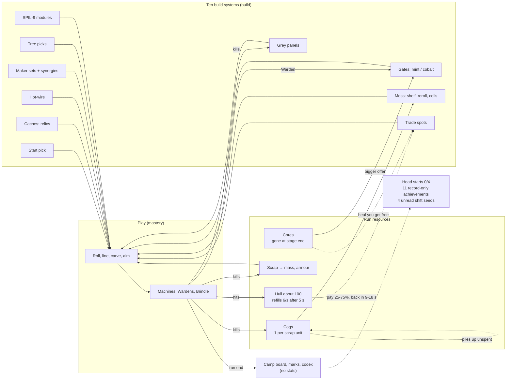
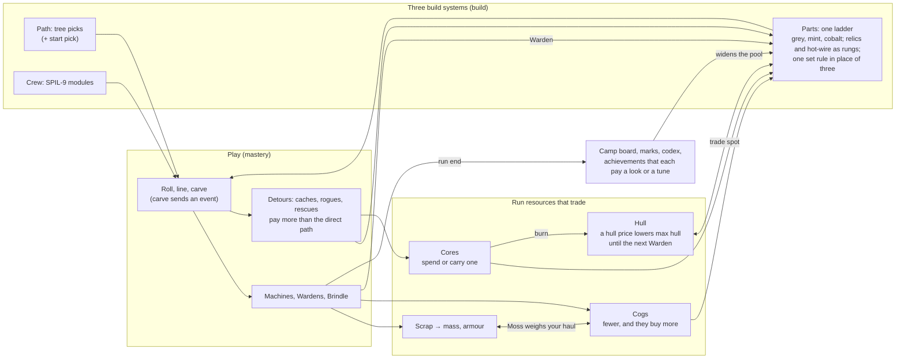

# Systems map (pass A, world 1)

**What this page says.** World 1 has 39 systems ([PLAN.md](PLAN.md) section 2), and most of them work. The weakest part is the wiring between them. Hull is a free currency, so every hull price is a few seconds of waiting. Skipping is the best line. Ten ways to change your build crowd a seven-minute world. Cogs pile up unspent and cores never arrive. Five problems are first, then the before and after diagrams, then every system with its inputs, outputs, resources and pillar.

**Words used here.** "The direct path" is the shortest roll from a stage's start to its Warden and exit, which the skipper bot follows. A "build system" is any system that changes what the ball does: a pick, a drop, a shop or a set rule. The pillars are BIBLE.md section 1's three, named by short word: **mastery** (joyful physical mastery), **build** (scrap becomes your build) and **world** (a world worth crossing).

**Read at.** `stage/alpha-w37` head `995f3dd2`, 11 Nov 2026. Evidence: code reads (file and constant named on each row), a regen probe, and world 1 bot runs with a resource ledger (section "How the evidence was made"). Scope is world 1: the dam (stage 1), the flume (stage 2) and Brindle.

## The core loop in one sentence

Roll through an open stage, break the Foreman's working machines for scrap (which makes the ball bigger and armoured) and cogs (which Moss takes as pay), crack the Warden's guard for a cobalt part, and carry the build down the line to Brindle.

## The five biggest problems

Each problem names its kind (dominant strategy, dead mechanic, overlapping systems, choice with no tradeoff, or feedback the player cannot read), the evidence, and the pass that takes it. The bot table under "How the evidence was made" backs the numbers. Bots never shop, never take a tree offer and visit few side spots, so the runs show what the world hands a player, not what a player who shops would do; pass B adds that player.

### 1. Hull is a free currency (a choice with no tradeoff)

Every "pay with hull" offer costs about 9 to 18 seconds of not being hit. The trade chest sells a part for 25, 50 or 75% of max hull, or for 10, 16 or 26 cogs (`src/world/stake_devices.gd`, `HEALTH_SHARES`; `src/build/fabricators.gd` `part_base` times `part_tier`). Hull refills at 6 per second after 5 seconds with no hit (`run_state.gd` `REGEN_DELAY`, `REGEN_RATE`). The regen probe measured the refill on this head: 25% back in 9.2 s, 50% in 13.3 s, 75% in 17.5 s. In the eight bot runs the skipper on seed 2860 lost 131 hull in the dam (more than its whole bar) and its lowest hull was still 90. So the keeper's gamble, whose whole meaning is a stake (Story map: "Stake hull ... for more"), stakes nothing a rolling player feels, and the foreman's kindness (cores for a heal) sells what regen gives away. The parked difficulty stack makes regen run only while rolling, which keeps it free for a ball that keeps rolling.

Pillar at stake: scrap becomes your build and the game's one line, give and take. Takes it: pass B for prices; a hull price that lasts (for example max hull lowered until the next Warden) is a rule change, so NEEDS ANDREW.

### 2. Skipping is the best line (a dominant strategy)

Every bot cleared world 1, Brindle included, with no death. The skipper took 5.9 to 8.1 game minutes; the completionist took 10.4 to 10.5. The extra 2.5 to 4.5 minutes bought two or three more parts (the surge run, the ambush altar, the camp) and nothing else that shows: no cores, no rogue beaten, no secret, and Brindle went down in 78 to 85 s for the completionist against 80 to 128 s for the skipper. The wave 36 red team saw the same on the legacy maps: six speedrunners won all six stages in 7.2 to 8.7 minutes with 2 to 14 hits. The mission says every run gives "things to look forward to, explore and discover"; today the run that explores is only slower. (Bots visit few side spots and fight no rogue, so this undercounts what a detour can pay; pass B measures it with a player who hunts them.)

Pillar at stake: a world worth crossing and the Isaac mission. Takes it: pass B (detour pay is numbers), pass E (layout that pulls the eye off the direct path). The difficulty stack (ruling cu) is what makes the line itself cost something; this pass does not touch it.

### 3. Ten ways to change your build in a seven-minute world (overlapping systems, feedback the player cannot read)

A world 1 run changes the build through ten separate build systems: the start pick, grey panels, mint and cobalt gates, Moss's shelf and cells, trade spots, cracked caches (relics), hot-wire, maker sets with their named synergies, the upgrade tree and SPIL-9's modules. The catalogues behind them: 37 parts, 7 maker sets and 9 named synergies on top of them, relic rows per pilot and slot, 12 panel rows, 6 rack actives, a 30-node tree per pilot and 6 start lists (constant maps in `src/build/` and `src/core/`, counted on this head). The bots met 7 to 15 grey panels and 3 to 6 parts per run. The Bible names three things that make a build ("Path, Relic and Parts combine into the build", section 1) and asks that "a player comparing two branches ... not decode a list of unexplained percentages" (section 6); grey panels read as stacked percentage lines ("BRACKET +4% ACTIVE RECHARGE" over "LOUVRE +5% FIRE RATE", a camp-cleared still noted in the design lane's 10 Nov hand-off, `handoff/design-goal-plate.md` in the project's shared Library, outside the repo). Three set systems sit on one shelf: maker sets (three of one maker, `src/build/maker_sets.gd`), named synergies (`src/build/synergies.gd`) and three-part sets (three members of one set change what an action does, `src/build/part_sets.gd`, used by `build.gd`).

Pillar at stake: scrap becomes your build. Takes it: pass D proposes a fold into three build systems (a merge, so NEEDS ANDREW); pass C adds the feedback. The Bible's three are Path, Relic and Parts; this page proposes Path, Parts (with relics as a rung) and Crew (SPIL-9), because relics are already one more kind of part and SPIL-9 is the one door the Bible's list leaves out.

### 4. Cogs pile up and cores never arrive (inflation, hoarding, a dead currency)

Cogs drop one per scrap unit (`src/build/scrap_field.gd`: "a kill drops one 1-cog gear per scrap unit it drops"), so the cog count shadows the scrap count and asks no decision of its own. The bots held 1,332 to 1,956 cogs at the end of world 1, 2.7 to 5.1 cogs a game second, with 0 spent. A part costs 10 to 26 cogs before the held-parts growth (1.15 per part held), a reroll 12 then 18, a charge cell 20, 32, then 51. Bought out at both Moss visits, world 1 costs on the order of 500 cogs (an estimate from `COG_PRICES` with the shelf of 3 and one reroll a visit, not a measure; pass B measures it). So even a player who buys everything ends world 1 with hundreds of cogs that buy nothing. Cores are the other way round: 0 cores in all eight runs, including both completionists, who joined the relay and the surge run. Cores reset at every stage entry (`run_state.gd` `enter_stage`, `bonus_cores = 0`), so one that does arrive must be used in its own stage.

Pillar at stake: scrap becomes your build. Takes it: pass B (rates and prices). New conversions between resources (Moss weighs scrap for cogs; a carried core) are rule changes, so NEEDS ANDREW; the 9 Nov systems plan already proposed them as "Resources that trade".

### 5. Promises that pay nothing (dead mechanics)

Built pieces a player can see that do nothing yet: the "Head starts: 0 of 4" page (`src/core/meta_options.gd` `open_earned` has no caller, checked on this head); eleven record-only achievements (`src/core/achievements.gd`); four stage-variant and run-modifier seeds on the shift board ("Nothing reads these yet", `src/core/shift_board.gd`); carving, one of the four verbs, which sends no game event (`src/core/game_events.gd`), so sound, the tricks book and the crowd rules cannot answer it. Two more are spec only with no screen: the respec opportunity (BIBLE.md section 6) and the scrap-bot crew (TADR-011). The world 1 sitting's bar is zero placeholders.

Pillar at stake: a world worth crossing, and scrap becomes your build. Takes it: pass D (keep, cut or defer each; the cut of the head starts page is NEEDS ANDREW), pass C (the carve event).

## Before: how the systems connect today

Pillars as named at the top. Each arrow is a flow the code makes today. Dashed arrows are flows that exist but do not cost the player anything they care about. Four resources (hull, scrap, cogs, cores) each run one way, and the build has ten separate doors.



## After: the proposed wiring

Proposed, not decided. Each change below names the pass that would build or judge it. Three ideas: every resource costs something and buys something else; the ten build systems fold into three, close to the three the Bible names (it says "Path, Relic and Parts combine into the build", BIBLE.md section 1; this proposal keeps Path and Parts, makes relics a rung of Parts, and adds Crew for SPIL-9); and a detour pays more than the direct path.



| Change | Problem it answers | Who | Needs Andrew? |
| --- | --- | --- | --- |
| A hull price costs something that lasts (for example, max hull lowered until the next Warden), so the gamble is a gamble | 1 | pass B (number), pass D (rule) | Yes if it is a rule change; a number change (prices, floor) is B's call |
| Detours pay more than the direct path: more scrap, cogs and part rungs in side spots than on the direct path | 2 | pass B | No (numbers), unless it needs a new reward kind |
| Fold ten build systems into Path, Parts and Crew (a proposal; the Bible names Path, Relic and Parts) in what the player reads: one ladder, one set rule in place of three | 3 | D proposes, C builds feedback | Yes: it merges features |
| Cogs scarce enough that the shelf is a choice; Moss weighs scrap for cogs; cores can be carried or spent | 4 | pass B | Yes for new conversions (a rule); no for rates |
| Every promise pays: hide head starts until they fill, achievements pay a look or a tune | 5 | pass D | Yes for the cut of the head starts page |

## Every system: inputs, outputs, resources, pillar

Pillars as named above. Verdict is pass A's first read: **keep**, **keep, connect** (keep it, but connect it to the rest of the game), **merge (proposed)** or **cut (proposed)** (proposals that go to pass D and then to Andrew; nothing is cut here).

| # | System | Inputs | Outputs | Resources touched | Pillar | Verdict |
| --- | --- | --- | --- | --- | --- | --- |
| 1 | Rolling ball, boost, jump, slam, speed tiers | stick, boost, jump keys; terrain slope | speed, position, contact damage (ram, slam) | momentum, heft (scales punch) | mastery | keep |
| 2 | Harpoon line | line key, aim, a hook point | swing, fling, reel impacts, chain count | momentum, ultimate charge | mastery | keep |
| 3 | Carve | rolling into a cracked face | a cut in the face, speed held | momentum | mastery, world | keep, connect: send a game event so sound, tricks and crowd rules can answer it |
| 4 | Aim and weapons | aim, fire | shots, hits | ultimate charge | mastery | keep |
| 5 | Six pilots and kits | pilot pick | a weapon, a Shift move, a special | none | mastery | keep |
| 6 | Actives and the ultimate | rack key, meter full | area, rockets, lance, quake, lift, battery; the ultimate | ultimate charge | mastery | keep |
| 7 | Hull, scrap armour, regen, one-shot guard, escape window, death save | hits, time since the last hit | hull, armour lost as spilled scrap, a death or a save | hull (100 for most pilots; the pilot and heft class set it), scrap | mastery | keep, connect: hull refills for free (problem 1) |
| 8 | Ordinary enemies, elites, pack pressure, telegraphs | director spawns, ball position | hits on the ball, scrap and cogs on a kill, panels on a kill | hull, scrap, cogs, panels | mastery | keep; the difficulty stack lands the "harder by movement" changes |
| 9 | Reactor Wardens | ram and reel impacts, the guard | guard break, core smash, a cobalt gate | cobalt part, cores | mastery, build | keep |
| 10 | Brindle | the run's build | three phases, the world's end | cobalt part, cogs, scrap | mastery | keep |
| 11 | Rogue mini-bosses | one seeded site a stage | an optional fight, a part | parts | world | keep |
| 12 | Event director and stage events | stage time, the difficulty clock | floods, falls, weather, spawns; scrap and an event core on a won event | scrap, cogs, cores | world | keep |
| 13 | Side spots: rib caches, cracked caches, bet crates, altar, relay, rescue, surge, radio | a detour off the direct path | parts, relics, cores, scrap, a pilot unlock, a tape | all run resources | world, build | keep, connect: the detour has to pay more than the line (problem 2) |
| 14 | Scrap: pull, mass, heft, size, armour, spill, wear | scrap pieces in reach | mass (size), heft (punch), armour that spills when hit | scrap, mass | build | keep |
| 15 | Cogs and Moss's counter | cogs from kills, events, discoveries, recycling | parts, a reroll, charge cells, a sale | cogs | build | keep, connect: one way in, one way out (problem 4) |
| 16 | Cores | events, the altar, bet crates, the start pick | a better next gate offer, a heal at the ward, a bet | cores (zone-local) | build | keep, connect: they vanish at the stage end (problem 4) |
| 17 | Item ladder: grey panels, mint parts, cobalt parts | kills (panels), gates, Moss, chests, caches, Wardens | flat stats (panels), a changed verb (mint), a changed way to play (cobalt) | panels, parts | build | keep |
| 18 | Pearl, gold, brass trophies, the Mind's offerings | none yet | none yet | none | build | defer (after the alpha) |
| 19 | Maker sets, named synergies and three-part sets | three pieces of one maker; named pairs; three members of one set | the maker's trick; a named synergy; a changed action | parts | build, world | merge?: three set systems on one shelf (problem 3) |
| 20 | Relics | cracked caches | a pilot-slot change | relics | build | merge (proposed) into the part ladder (problem 3) |
| 21 | Hot-wire | an offer at a gate | fit (Spark Tread) or recycle for cogs | parts, cogs | build | merge (proposed; problem 3) |
| 22 | Upgrade tree | growth milestones at safe moments | one of two branches, depths 1 and 2 in world 1 | tree picks | build | keep |
| 23 | Start pick | run start | one of three small grants, one reroll | parts, cogs, cores | build | keep |
| 24 | Trade spots: the keeper's gamble and the foreman's kindness | hull, cogs, cores, scrap | a part, scrap, a heal | hull, cogs, cores, scrap | build, theme | keep, connect: the hull price costs nothing (problem 1) |
| 25 | SPIL-9 companion | two module sockets | help on the next ram, a brace, an escape lane | none | mastery | keep; the Bible's crew (TADR-011) is a change request for pass D |
| 26 | Scrap-bot crew (TADR-011) | none (not built) | none | none | build | defer; change request |
| 27 | Devices (charges, sentry, stakes) | a pilot's special | an autonomous helper with a cap and a leash | none | mastery | keep |
| 28 | Element by material | an element cast on water or another material | ice to stand on, live water | none | mastery, world | keep |
| 29 | Run tier (HARD ladder) | the first win, a pick on the start card | harder dials per rung | none | mastery | keep |
| 30 | Run flow: death, restart, save and resume | death, quit | a fast restart, the same entrance on resume | everything run-local resets | mastery | keep (pass F hunts lost progress) |
| 31 | Respec by a special opportunity | none (not built) | none | tree picks | build | defer; change request |
| 32 | Meta: profile, shift board, marks, cosmetics, codex, scrapbook | finished runs, firsts, discoveries | items into the pool, paints, pages, codex lines | unlocks (no stats) | world | keep |
| 33 | Head starts | none (nothing opens one) | a page that shows "0 of 4" | none | none today | cut (proposed) the page until it can fill (problem 5) |
| 34 | Achievements | run summaries | eleven are record-only | none | world (discovery across runs) | keep, connect: each one pays something you can see (problem 5) |
| 35 | Stage variants and run modifiers | none (four seeds, read by nothing) | none | none | world | defer; already planned for after the sitting |
| 36 | Camp: Moss, skee, trial, sandbox, bay | between runs | practice, cosmetics, the shop's voice | none | mastery, world | keep |
| 37 | HUD, objectives, danger marks, call-ins, tips | game state | what the player reads | none | mastery | keep (UI thread owns it) |
| 38 | Reactive music and sound | speed, threat, chains, size, boss phase | the band | none | mastery, world | keep, connect: it does not hear hull, items or sets (9 Nov audit, finding 8) |
| 39 | Chain counter and tricks book | chains, stunts | a count, a book of firsts | none | mastery | keep |

Every system feeds a pillar except the head starts page (row 33), which feeds none today and is marked "cut (proposed)".

## How the evidence was made

Eight world 1 runs on the park table (the maps a launched game plays), from the title to the frame stage 3 opens after Brindle falls, at `--fixed-fps 90` (one frame is one physics tick, so a seed repeats). Three policies: skipper (the rusher), completionist, random (the first-timer persona). Seeds 2860 to 2862, so each policy flew the same three pilots: Tally (`tally`), the Cannon (`remembered_cannon`) and Sable (`pylon_engineer`). The completionist's third seed was stopped at 18:53Z to keep the run short, as Andrew asked on 11 Nov (ruling db, [DECISIONS.md](../../project-guide/handoff/DECISIONS.md)); eight runs are enough to show the five problems, and pass B runs 24 seeds a type for rates.

A wrapper over `tools/bot_run.gd` writes a resource ledger per run: every cog, part, core and panel gain, every scrap loss, every drop in cogs, and the state at each stage entry and at the end. It changes nothing in the game. The joined table is [evidence/pass-a/ledger.json](evidence/pass-a/ledger.json), with each run's `bots.ndjson` beside it. The probe source, the run script, the analysis script and the raw per-run ledgers are on the branch [scratch/systems-audit-pass-a](https://github.com/bananahana720/scrapkeep/tree/scratch/systems-audit-pass-a/docs/systems-audit/evidence/pass-a), not in the docs; a pass that keeps a probe moves it to `tools/qa/` with a header.

```bash
# in a scratch worktree of branch scratch/systems-audit-pass-a (never your working checkout: the scripts copy probes into sketches/core-loop/tools/), (it is stage/alpha-w37 at 995f3dd2 plus this pass), GODOT_BIN set (cloud: /opt/scrapkeep-toolchain/Godot_v4.7.2-stable_linux.x86_64)
$GODOT_BIN --headless --import --path sketches/core-loop
docs/systems-audit/evidence/pass-a/run.sh skipper 2860 2861 2862
docs/systems-audit/evidence/pass-a/run.sh completionist 2860 2861 2862
docs/systems-audit/evidence/pass-a/run.sh random 2860 2861 2862
python3 -I docs/systems-audit/evidence/pass-a/ledger.py artifacts/local/sysaudit
# the regen probe, in the same scratch worktree
cp docs/systems-audit/evidence/pass-a/regen_probe.gd sketches/core-loop/tools/zz_sysaudit_regen_probe.gd
$GODOT_BIN --headless --path sketches/core-loop --script res://tools/zz_sysaudit_regen_probe.gd
```

Wall time on a 4-core cloud box, three runs at once: 255 to 499 s a run, about 25 minutes in all. Exit: every run ended `until` at stage 3 (Brindle beaten).

| Run (policy, seed) | Pilot | World 1 game time | Lowest hull | Cogs held at Brindle's end | Cogs spent | Parts (from) | Grey panels | Cores | Tree picks | Brindle down in |
| --- | --- | --- | --- | --- | --- | --- | --- | --- | --- | --- |
| completionist 2860 | tally | 10.5 min | 57.1 | 1956 | 0 | 5 (gate 2, activity_surge 1, activity_ambush 1, boss 1) | 11 | 0 | 0 | 78 s |
| completionist 2861 | remembered_cannon | 10.4 min | 91.9 | 1912 | 0 | 6 (activity_camp 1, gate 2, activity_surge 1, activity_ambush 1, boss 1) | 7 | 0 | 0 | 85 s |
| random 2860 | tally | 8.3 min | 44.8 | 1332 | 0 | 3 (gate 2, boss 1) | 8 | 0 | 0 | 80 s |
| random 2861 | remembered_cannon | 8.3 min | 80.8 | 1380 | 0 | 3 (gate 2, boss 1) | 7 | 0 | 0 | 87 s |
| random 2862 | pylon_engineer | 6.4 min | 100.0 | 1585 | 0 | 3 (gate 2, boss 1) | 10 | 0 | 0 | 83 s |
| skipper 2860 | tally | 8.1 min | 90.0 | 1473 | 0 | 3 (gate 2, boss 1) | 8 | 0 | 0 | 128 s |
| skipper 2861 | remembered_cannon | 7.1 min | 105.0 | 1630 | 0 | 3 (gate 2, boss 1) | 12 | 0 | 0 | 80 s |
| skipper 2862 | pylon_engineer | 5.9 min | 100.0 | 1820 | 0 | 3 (gate 2, boss 1) | 15 | 0 | 0 | 84 s |

What this evidence does not show: what a player who shops, takes tree offers or hunts side spots gets (bots do none of these; pass B adds a min-maxer that does), and anything about feel (a human read, AGENTS.md). Eight runs show a pattern, not a rate; no rate here is a band number.

## Systems health (for the coordinator's digest)

Pass A is done when this page merges. B, C and D can start then.

| System group | Pass status | Top open issue | Last sim or bot result | What changed |
| --- | --- | --- | --- | --- |
| Hull and regen | A mapped; B and D next | A hull price costs 9 to 18 s of not being hit | Regen probe: 75% back in 17.5 s; lowest hull 44.8 to 105 across 8 runs | Nothing in the game |
| Route and detours | A mapped; B and E next | Skipping wins on time with no loss | 8 of 8 runs cleared world 1; skipper 5.9 to 8.1 min, completionist 10.4 to 10.5 | Nothing |
| Build layers | A mapped; D and C next | Ten build systems where the Bible names three | 3 to 6 parts and 7 to 15 panels a run | Nothing |
| Cogs and cores | A mapped; B next | 1,332 to 1,956 cogs unspent; 0 cores in 8 runs | Ledger, 8 runs | Nothing |
| Meta and promises | A mapped; D next | Head starts page shows 0 of 4 forever | Code read on 995f3dd2 | Nothing |

**One finding in plain words.** The game heals you for free if you avoid being hit for five seconds, at 6 hull a second. So anything priced in hull is priced in a few seconds of waiting, not in risk. That is why the keeper's gamble, which is meant to be the game's one real bet, does not feel like one, and why a heal for sale is worth nothing. The fix is either a different price (cogs, or max hull for a while) or regen that does not undo the bet. Which one is a design call, not a number.
