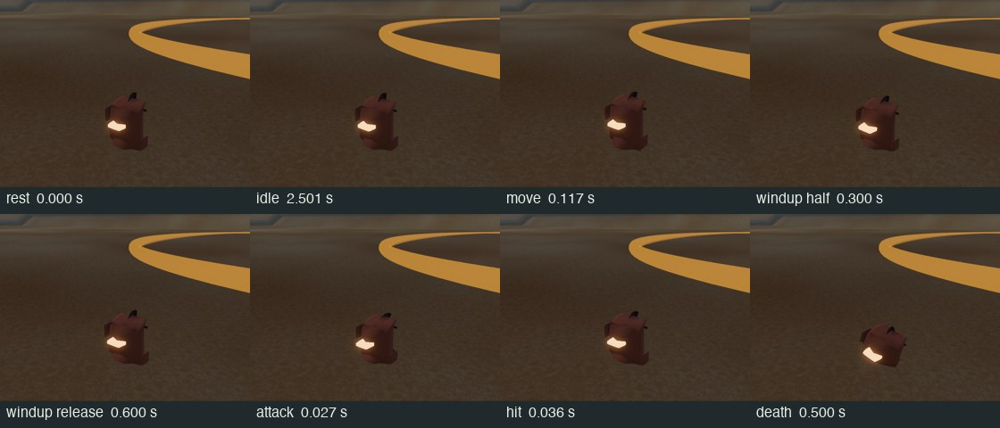
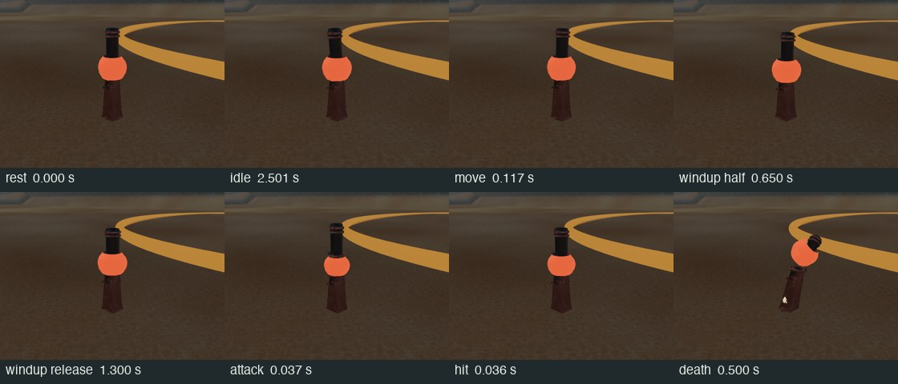
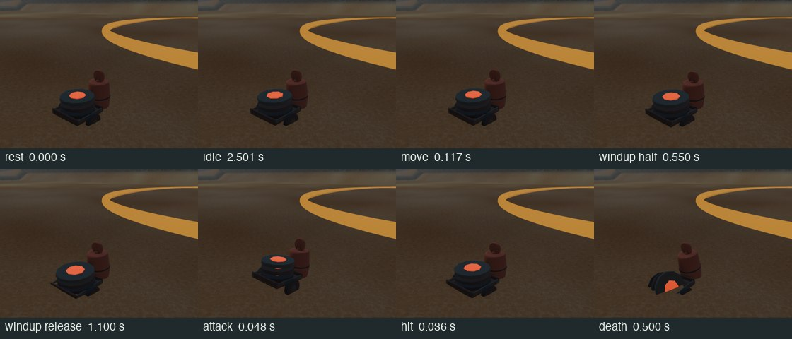
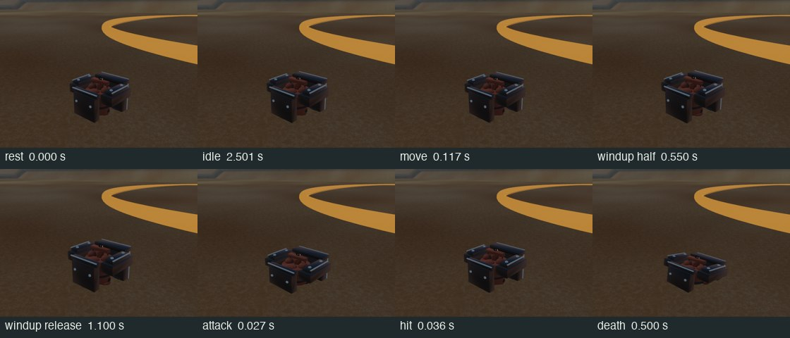
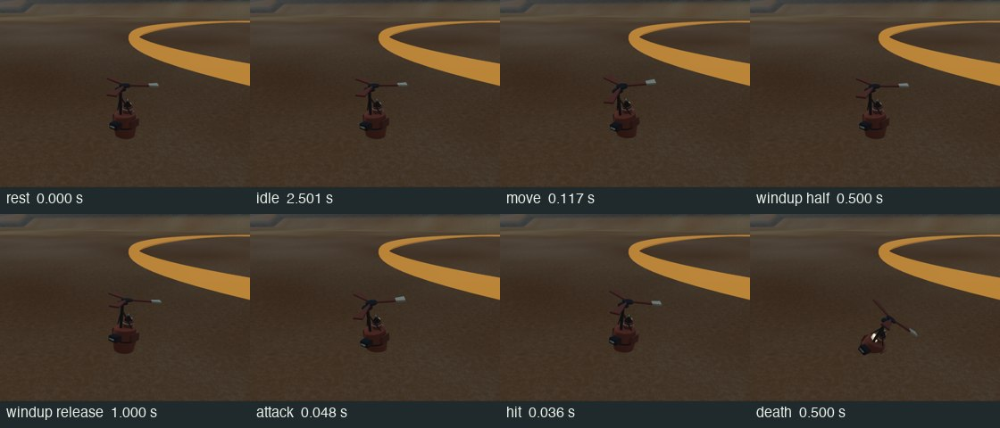
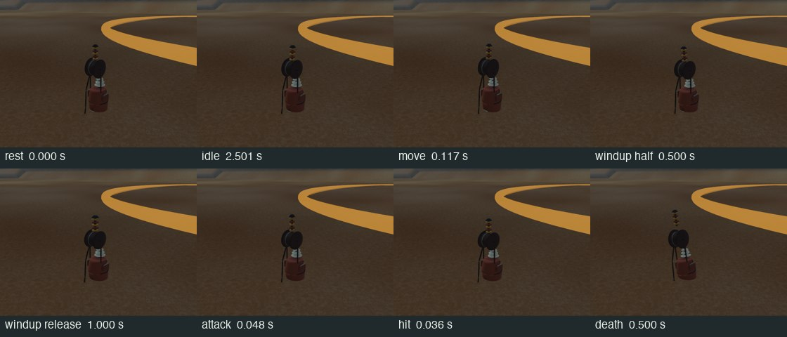
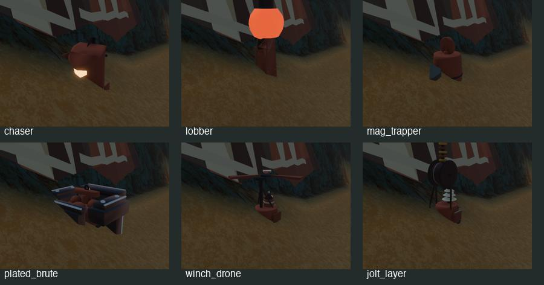

# Six Spillway enemies in the Godot renderer

These strips show the clip library’s poses in the audited build. Read each sheet left to right across the first row, then the second. Labels give seconds **within each clip**. A running attack layers its scripted wind-up and live movement over these poses. The posed death clip, for example, has a different clock from a live particle burst. [Capture manifest](../../../../../artifacts/visual-audit-w44/evidence/crew-clip-shots.json) · [Animation assignment](tasks/enemy-motion.md)

| Machine | What to look for in the live chase view |
| --- | --- |
| Chaser | Does the sprung head visibly load before a lunge when seen head-on and passing from the side? |
| Lobber | Can the rider see the firing end and shell separately from the reinforcement mark? |
| Mag trapper | Can a rider distinguish the carried working magnet from a disc already laid in its path? |
| Plated brute | Does a high approach expose a different route around the plate from the ground approach? |
| Winch drone | Between trestles, can the rider see the drum, the cable and the ground beneath the suspended body? |
| Jolt layer | Can the roller be identified before the active mat competes with the ball’s ground shadow? |

## Capture method and a problem with the stock view

The stock pose fixture uses one launch-lip position, a 40° three-quarter camera and a fixed distance per kind. With the sitting park selected, ground obscured part of several bodies. That makes the stock sheet a poor basis for judging ground contact or commissioning new meshes. The image below shows all six at rest from that setup.

For the six strips above, a disposable copy of `enemy_clip_capture.gd` changed three staging values: the subject used `terrain.drop_point(10.0, 540.0, 1.2)`, the camera aimed 1.6 m above that position, and the per-kind camera distance was multiplied by 1.55. The fixture sampled eight poses for each of six machines at 640 × 480, with the HUD hidden. Contact-sheet tiles use the full uncropped frame. The scratch run used Godot 4.7.2, Metal Forward+, High, sitting, park, Tripo and cutaway on the audit commit. Its renderer also reported cleanup errors at exit. These measurements concern the posed presentation. The [approach and combat frames](README.md) show the actual player view. [Stock capture script](../../../../../sketches/core-loop/tools/enemy_clip_capture.gd)
