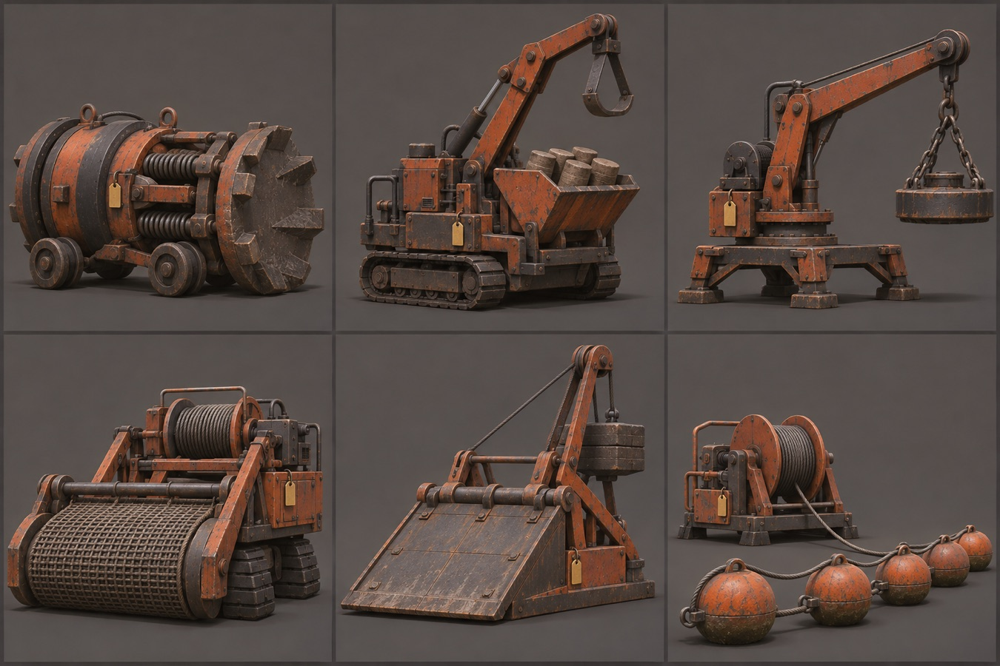
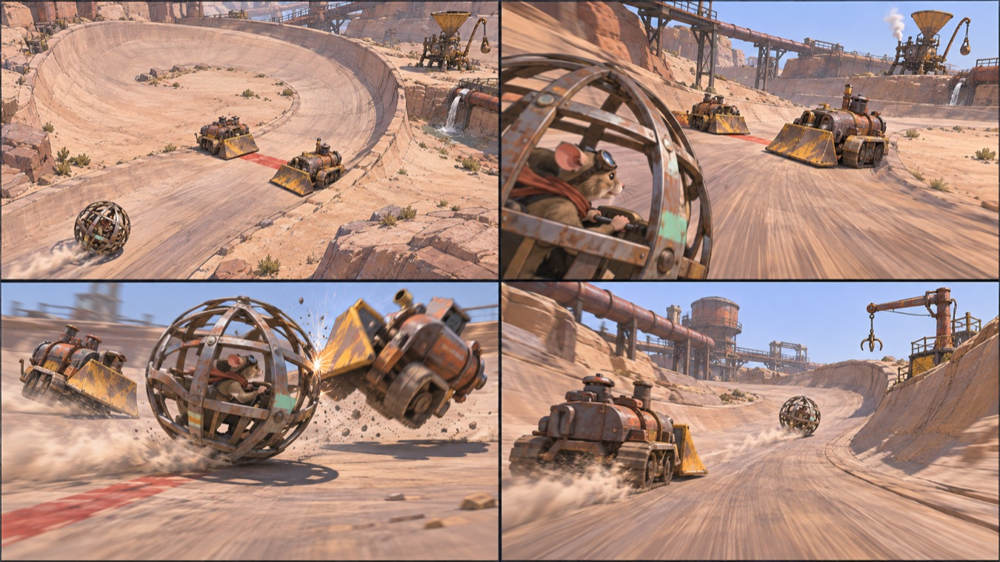

# Who belongs in a Spillway fight

**Give a fast rider something worth aiming at before the pack slips behind the camera.** A chaser can cross the rider’s line, a lobber can make an approaching bank valuable, and a boom tender can give a grown pilot a row of floats to bowl through. These are different jobs. A pack earns its place when the rider can read the first job, choose a line and see the result before the next threat commits. [Fast-pilot experiment](tasks/fast-pack.md) · [Encounter curation assignment](tasks/encounter-curation.md)

*Concept sheet. Top row, left to right: sprung scraper, bung sling and intake magnet. Bottom row: mat roller, hinged sluice flap and boom tender. Use the working part to identify the silhouette. The shipped bodies and approved old jobs are the production references.* [Spillway roster](../../../../../sketches/core-loop/design-v3/SPILLWAY-ROSTER.md) · [Existing enemy art](../../../../../docs/art/reference/enemies/enemies-spillway-moodboard.jpg)

## Put the encounter where its answer works

| Place and existing crew | Primary decision for a fast pilot | Design to try and evidence to collect |
| --- | --- | --- |
| Dam west wash · culvert chasers | Bank off the wash wall or ram the sprung scraper during its wind-up. | Frame the near chaser against the floor and the outside turn beyond it. Film a head-on interrupt, a turning miss and a slow hit. |
| Dam ledge · lobbers | Change line under the shell, or take height and slam the firing position. | Stand the working arm against open sky and keep the landing perimeter on readable ground. Compare from the low approach and from atop the ledge. |
| Dam powerhouse and flume bench landing · mag trappers (the flume home activates when the bench dropship lands) | A small ball can jump or smash the disc. A heavy enough ball can roll through. | Separate the carried magnet from the armed floor disc in profile. Compare small and grown riders at the same approach speed. |
| Flume trestle · winch drones | Maintain line speed or jump to snap the cable. | Show the winch *above* the trough and the line’s attachment to the rider. Record beside, beneath and past the drone while bank shadows move over the ball. |
| Flume wasteway and forecourt · chasers and brutes at their respective homes | Pump the chute to meet the chaser from above. At the forecourt take height to cross the brute’s protected front. | Read the distinguishing tool before spending a jump or grapple. Reserve the wide plated silhouette for the brute. Film the high and low approaches. |
| Late locked-yard waves · mat then flap | A slow, grounded ball meets the mat. Speed, air or a line beats it. A fast rider can turn the raised flap into a launch. | Put the working tool where the approach reveals its action and landing. Return a slow consequence and a moving counter for each. |
| Open-route boom tender · optional bowling encounter | Break through the float line at FAST tier and keep rolling. | Test a diagonal entry that sends several floats aside and exposes the next bank. Check float contacts, payout and exit speed against the existing encounter. |

The home rows describe a specific affordance at a specific worksite. The lock rows describe a contained sequence. Overtime adds an elite to its final-wave composition and lands its crew relative to the rider. The ambient director uses separate pack and route logic. A close screenshot of several enemies does not identify which system placed them. [Dam homes](../../../../../sketches/core-loop/src/world/park/park_dam.json) · [Flume homes](../../../../../sketches/core-loop/src/world/park/park_flume.json) · [Yard rows](../../../../../sketches/core-loop/src/world/lock_rows.gd) · [Overtime](../../../../../sketches/core-loop/src/world/overtime.gd)

## What a fast pass changes

At 14 m/s cruise, a rider covers 8.4 m during the chaser’s 0.6 s wind-up. At the 35.7 m/s recorded in the flume turn, a straight unimpeded rider would cover 21.4 m in the same time. The chaser enters its lunge within 10 m and travels 11 m on a committed lane. Those figures explain why a spectacular attack can happen behind the rider. They are a constant-speed illustration; the audit did not measure the chaser’s miss rate. World 1’s ordinary tracking lead fades as the pilot reaches cruise. A design can challenge the *line ahead* while honouring that choice. [Chaser timing](../../../../../sketches/core-loop/src/combat/chaser.gd) · [Lead and flanker rules](../../../../../sketches/core-loop/src/combat/pack_pressure.gd)

Measure the first visible tell, time to the decision, distance travelled after the ram, and the rider’s next visible target. Compare a stalled rider, a fast rider holding a line, a fast rider turning, and a grown rider taking the contact deliberately. These cases reveal whether enemies keep participating, whether a dodge is achievable and whether bowling feels materially different from avoiding everything. Human feel is a question for the sitting. [Grapple and roll routes](tasks/grapple-roll.md) · [Spawn placement](tasks/spawn-approaches.md) · [Enemy poses in the running renderer](CREW-POSES.md)
