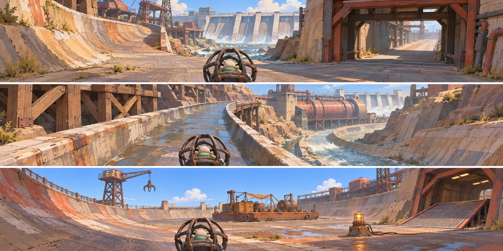
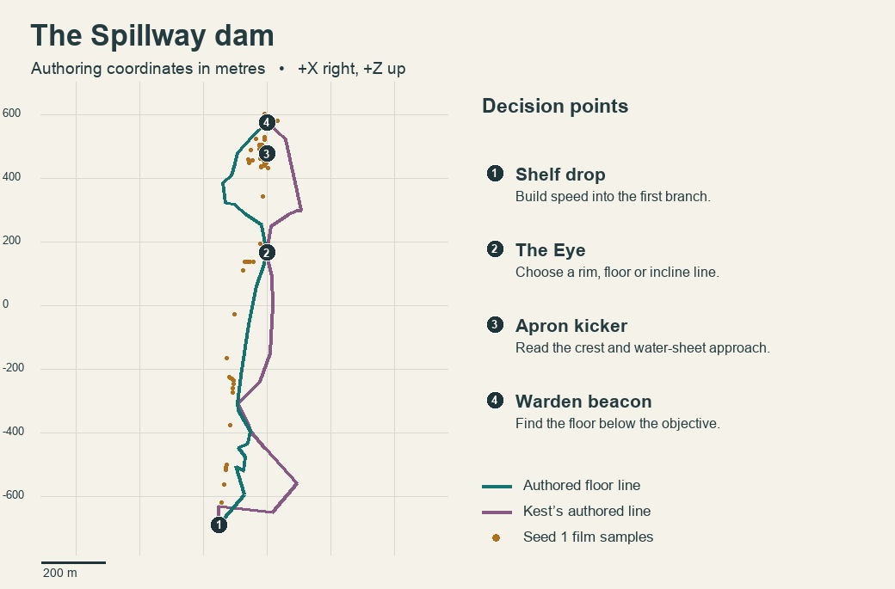
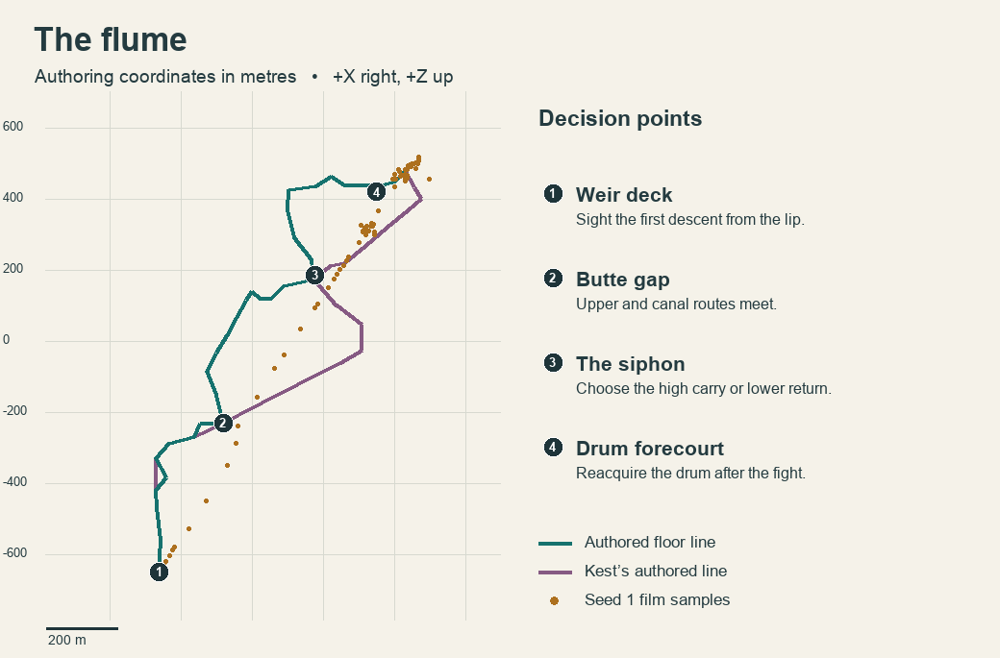
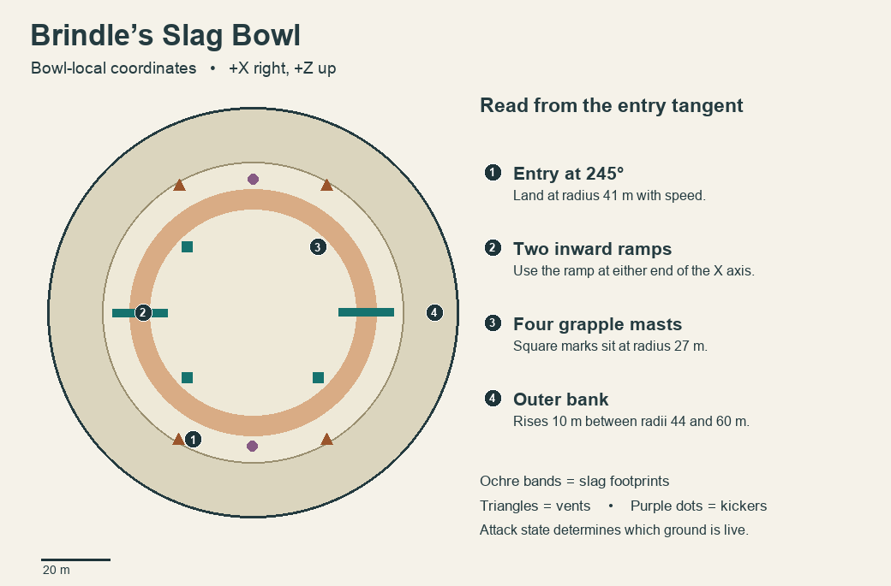

# The Spillway from above

Give the rider a visible answer to two questions before each commitment. **What can I do here, and where will I land?** At the dam, that decision is a fork off the Eye. In the flume it is a choice between the high carry and a recoverable lower line. In Brindle’s bowl it is whether to keep turning along the bank or cut toward a ramp or mast. All three fit inside the existing playable footprint.

The plans below show authored geometry and a sampled ride on the audit commit. Each task proposes a small change that a writer can test at speed. The design follows the project’s ten map points and its rule that difficulty presses a rider who slows or stops. Landmark sight and a change of pace are established level-design techniques. [World 1 map standard and measured results](../map-audit.md) · [Difficulty plan](../difficulty-plan.md) · [Michael Barclay on signposting and pacing](https://mikebarclay.co.uk/my-level-design-guidelines/)

*Rider-height concept views. Use the scaled plans below for geometry. Test the [hook, swing and rolling return](tasks/grapple-roll.md) against the actual terrain and anchor faces.*

## Dam · read the choice before the ball reaches it

From the shelf, the dam face gives the entire park a heading. The Eye at (0, 165) is the place to show two immediate opportunities: a broad, banked turn along the existing rim and a straighter commitment down the construction incline. Try a long rounded lip on the rideable bend and the square ends of service frames along the industrial descent. Give both exits a visible patch of receiving ground. Where a real hazard can deny a line, its active warning owns the sharp edge and strongest value. Dry service paint must read as part of the works when the threat clears.

The yard lock follows the approach. Its radius is 26 m and its centre lies 10 m toward the beacon from the rider when it closes. A fixed “safe” shape at the authored bowl centre would mislead riders who enter off-axis. At the Warden, test the water sheet and landing floor from the chase camera before altering terrain. [Dam assignment](tasks/dam-route.md) · [Lock placement](../../../../../sketches/core-loop/src/world/lock_rows.gd)

## Flume · show where a missed high line goes

The butte gap and siphon already join multiple approaches. At the siphon, compose one view that shows what the rider gains by climbing and where the lower route rejoins. The upper lip and repeating supports can point toward the drum. A wider curved wash can show the continuous lower turn. A rectangular maintenance pier can communicate utility if its collision really stops the attack in question. In this build the dam and flume allow terrain to intercept an outbound lobber shell. A thin dress mesh or an open arch cannot promise that protection. [Shell behavior](../../../../../sketches/core-loop/src/combat/projectile.gd) · [Stage dials](../../../../../sketches/core-loop/src/core/challenge_dials.gd)

Let the lower carry give a brief view back to the worksite while the ball is still moving. The previous map audit measured the flume’s clear riding-line share at 0.255 against a 0.25 floor. That measure excludes the director’s timed packs. Observe a live return before changing a spawn, reward, shortcut or quiet interval. [Flume assignment](tasks/flume-route.md) · [Earlier rhythm and breathing measurements](../map-audit.md)

## Brindle · make the first turn readable before the next charge

At the entry tangent, reveal one ramp mouth, a grapple mast and the outer bank in depth. Use the curve of the bank to suggest continued movement, a square mast base to identify grapple utility, and the live attack edge to identify the threatened sector. Both concentric slag bands change state. A permanent luminous stripe along the bank could promise safety during an incoming charge. Keep rival hull plates and vent caps visible as working ship parts, especially during the reveal after the flume launch. [Arena assignment](tasks/bowl-route.md) · [Spillway combat art reference](../../../../../docs/art/reference/spillway/spillway-combat-brindle-bowl.jpg)

## Check each region’s job

| Region | Action and payoff | Threat and next point of attention |
| --- | --- | --- |
| Dam shelf → Eye | Roll into a choice, then bank or descend while retaining speed. | The dam face remains the distant destination. The near lip shows the turn and receiving ground. |
| Yard → Warden → reward | Dodge across the sheet and turn through a chosen reward arch. | A moving fight boundary and a committed attack require different edges. At reward time the choice needs room to read. |
| Butte gap → siphon → drum | Carry the upper line, drop to the lower route, then rejoin toward the drum. | A pier can hide the landing or barrel. The lower route gives a rhythm change without requiring a stop. |
| Bowl entry → first charge | Follow the tangent, grapple or turn across a ramp, then find the bow again. | The active lane can cut across any apparent route. Keep a patch of reachable floor beside it in view. |

For each map experiment, record the approach, decision and recovery from riding height as well as overhead. Identify the verb, benefit, actual hazard and next visible landmark in those frames. A new region earns its area by offering a distinct traversal, tactical choice or story beat. These three proposals first reuse existing regions. The plans project X and Z only. The park lines join authored waypoints; ochre points are individual film samples. The arena diagram uses bowl-local metres and shows persistent footprints across attack states. [Dam lines](../../../../../sketches/core-loop/assets/park/park_dam/lines.json) · [Flume lines](../../../../../sketches/core-loop/assets/park/park_flume/lines.json) · [Arena geometry](../../../../../sketches/core-loop/src/boss/arena.gd)
