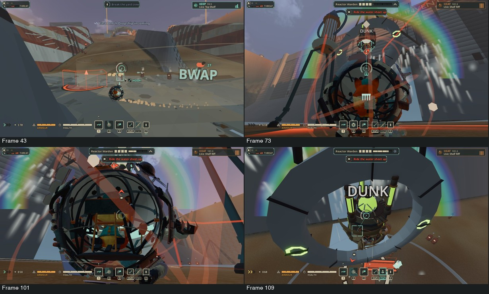
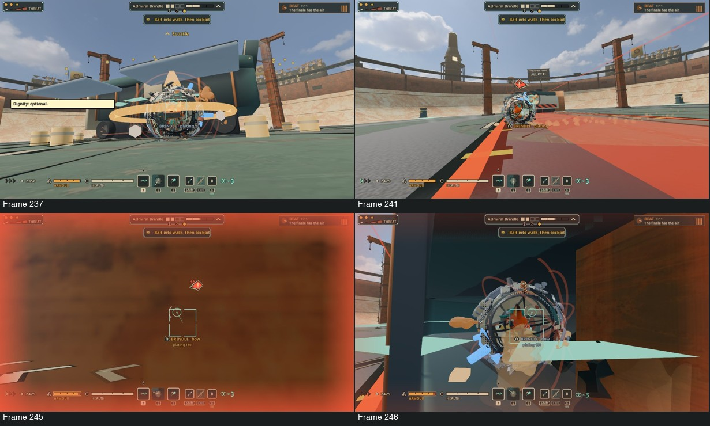
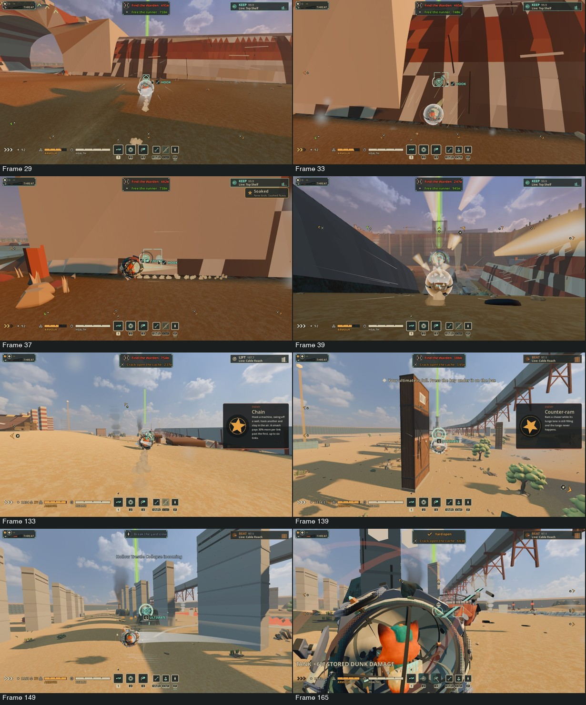
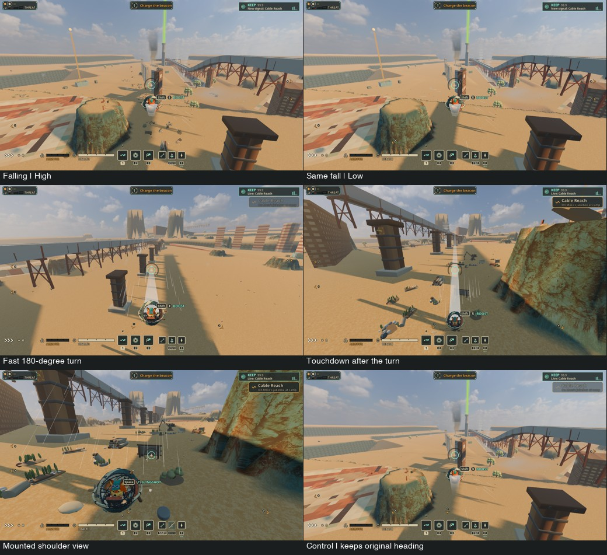
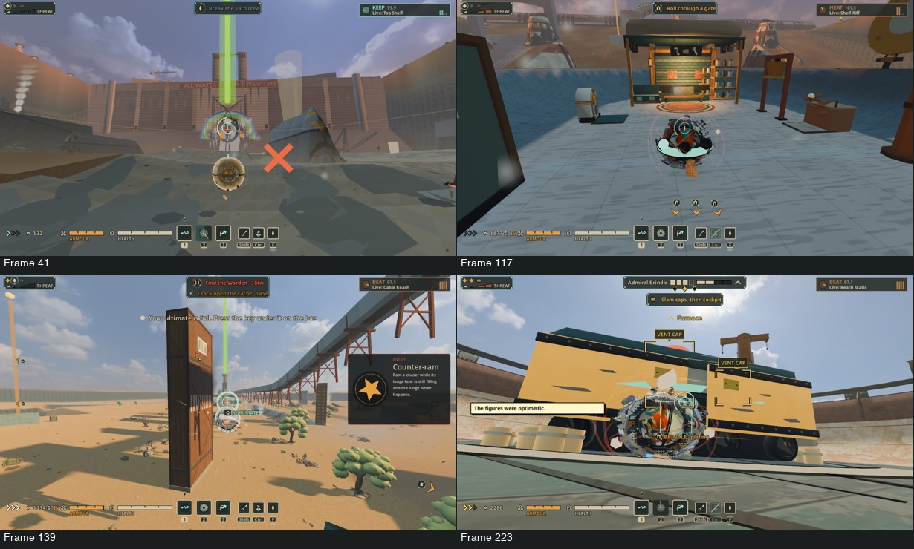
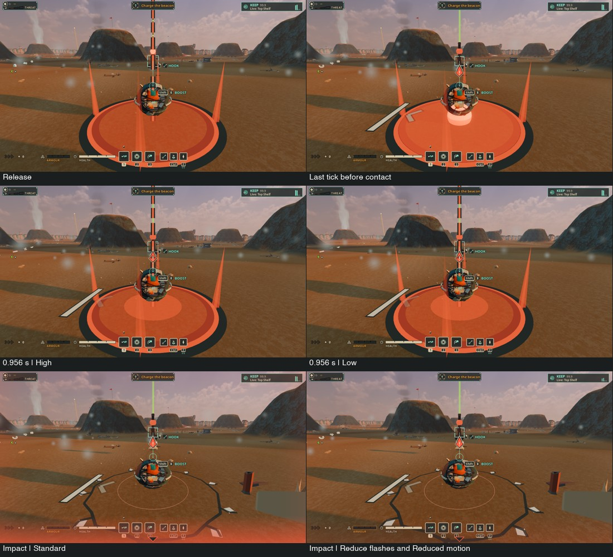
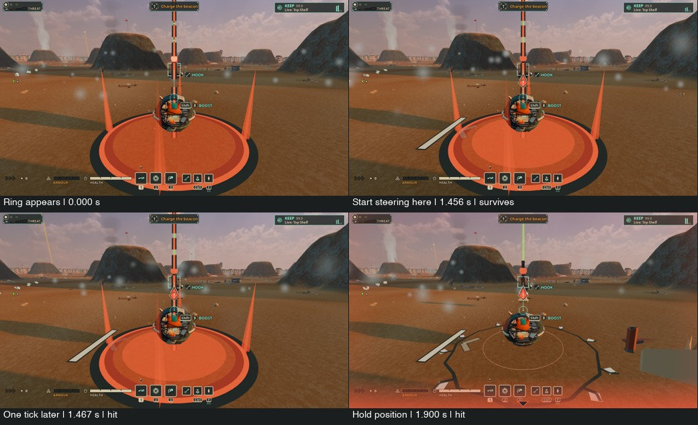
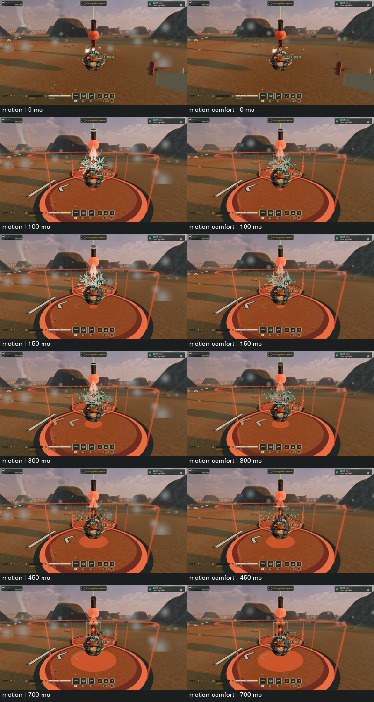

# World 1 visual design audit · 17 November 2026

**At the dam Warden and under Brindle’s bow, the camera hides the floor just when the player needs to pick an escape line.** In the open flume the same camera follows a fast reversal and landing. The strongest design opportunity is to recover the view during contact while keeping the open-space shot. Two smaller changes would help riders make immediate decisions. Give a live shell priority over reinforcement marks, and keep a reward’s full trade-off attached to its arch at the screen edge. [Session handoff and thirteen proposed assignments](HANDOFF.md) · [Top-down map plans](MAP-DESIGN.md)

For combat at bowling speed, the [encounter brief](ENCOUNTERS.md) compares a crossing chaser, a lobber covering a bank entry and a breakable boom line. The [enemy pose sheets](CREW-POSES.md) show six actual machines. The [grapple and roll spec](tasks/grapple-roll.md) pairs those encounters with real hook targets and recoverable landings.

## What the run showed

Godot 4.7.2, Metal Forward+, Apple M5 Max, stage `stage/alpha-w44` at `bf80564798868331c1d86bc51939d97d305abcaf`. At 1280 × 720 on High, Sable (`pylon_engineer`) played seed 1 with the skipper policy, sitting profile, park maps, Tripo models and cutaway ball. Automated input reached both rewards and beat Brindle. The watcher recorded zero stuck, hung, wedged or fall-through events. The 255 HUD-visible frames include event lead-ins and aftermath. Counts below describe that sample, not the proportion of play time. [Frame-by-frame game state](../../../../../artifacts/visual-audit-w44/evidence/film.ndjson)

| Moment | What the player can see | Where to start |
| --- | --- | --- |
| Dam Warden, frames 73 and 101 | The cage covers the reticle and much of the water-sheet approach. Ground held the arm below 4 m in 38 of the 45 sampled stage-one beacon frames. At 169.84 s the arm wanted 8.77 m and reached 3.24 m against tile 5_8. | [Dam camera](tasks/dam-camera.md) |
| Brindle, frames 241, 245 and 246 | Before contact, the lane edge and the ground outside it read together. At contact, a brown surface fills the frame. The arm reports the bowl, then the ship. The camera still projects the ball’s centre inside the viewport in both frames. | [Brindle camera](tasks/brindle-camera.md) |
| Flume, frames 157–160 | Broad orange crosses obscure the lobber barrel and compete with the shell arc. In frame 157, 11.25% of pixels are within three RGB levels per channel of the mark’s flat orange. That count includes other orange objects. Heat cook-off caused the hit in frame 159. | [Reinforcement marks](tasks/reinforcement-marks.md) |
| Dam reward, frames 113–115 | Three names read on approach. As the rightmost offer expands, the viewport cuts off “Riveted Sh…” and its armour, steering and synergy text. A slam tip from the previous encounter still occupies the screen. The flume presents a four-arch comparison. | [Reward signs and tips](tasks/reward-signs.md) |

## The route, the machines and the light

The dam’s green beam gives the rider a distant heading. Following a near wall briefly exchanges that view for a wall face. In the flume, the trough, repeated supports and their shadows carry the eye past the next pier. A controlled flume reversal turned the view 180° in six physics ticks at 35.7 m/s. The ball stayed framed and landed at 47.6 m/s. The mounted shot left the aim point clear on the right. [Turn and no-turn measurements](../../../../../artifacts/visual-audit-w44/evidence/measurements.json)

The 1 m ball radius provides a scale reference. Terrain3D draws a heightfield sampled at 1 m and Jolt uses tiled triangle collision. A sweep sampled visible props and collision at 0.75 m intervals. At a 1.5 m search radius all 49,447 dam, 4,157 flume and 15,337 bowl samples had drawn geometry nearby. At 0.4 m, 6,878 dam samples and 74 flume samples lacked a match. Six hard grazes against dam hoodoo 15 all had visible rock at contact. The sweep excludes ground tiles, including the tile that stopped the dam camera. [Sweep totals and grazing lanes](../../../../../artifacts/visual-audit-w44/evidence/measurements.json)

Moss’s lit workbench reads as a place somebody uses. The dam’s repeated bays and water-inventory sign explain what its operators valued. Brindle’s separate plates and vent caps make the ship look dismantlable. At riding distance the lobber’s barrel carries its identity better than a brass tag. These scenes support the Spillway’s existing distinction between workshops, old infrastructure and Fleet machinery. [Story map](../../../../../sketches/core-loop/design-v3/STORY-MAP.md)

## Godot settings and combat timing

| Domain | Observed behavior and design implication |
| --- | --- |
| Camera and perspective | Separate yaw and clamped pitch drive a perspective spring arm. Resting FOV is 65°, fast roll reaches 80° and the combined ceiling is 88°. Dash adds 7°, boost 5° for 0.3 s. Free roll requests 7.5–10.5 m. Mounted aim uses 4.2 m with a 1.5 m shoulder offset and 0.7 m lift. A 0.30 m sphere with 0.25 m margin tests terrain and camera-only boss bodies. The open-space film supports these profiles. [Chase rig](../../../../../sketches/core-loop/src/movement/chase_camera.gd) |
| Colour, silhouettes and contact | Pale sand, dark machine outlines, worn enamel, working lamps and an angle-dependent canopy rim separate the moving parts. Triplanar rock gives the terrain coherent surface scale. The pier shadows survive on Low. While airborne, the ball’s shadow can merge with them, so the corridor reads more clearly than exact landing height. [Material roles](../../../../../sketches/core-loop/src/presentation/material_slots.gd) |
| Lighting and guidance | A shadowed sun and shadowless fill light the park. High uses AgX, glow (Screen), SSAO and volumetric fog. Low drops the last three effects. Both retain distance fog and leave SSIL and SDFGI off. The distant beam crosses the fog. The cache lamp and the shapes of the reward arches signal closer destinations. [World look](../../../../../sketches/core-loop/src/presentation/world_look.gd) · [Graphics presets](../../../../../sketches/core-loop/src/presentation/graphics_preset.gd) |
| Ground telegraphs | The lobber marks a 3.6 m radius with a dark-edged ring. At 0.956 s its edge and escape mark read on High and Low. The last held pre-impact sample was 1.889 s. At 1.900 s the shell tested the same ring for damage. At 90 Hz, steering from a held start at tick 131 returned the shell. Starting one tick later produced a hit 1.26 m from centre. This tests the return action from that pose. [Shell](../../../../../sketches/core-loop/src/combat/projectile.gd) |
| Hit feedback and particles | Ordinary sparks last 0.30 s, critical sparks 0.40 s and roll dust 0.70 s. In a staged overlap of three critical/kill bursts, the new warning perimeter read on its first 100 ms sample while debris covered the centre. A four-point hit issued a 12 ms stop. Enemy tint retained 36% strength at 300 ms and cleared by 450 ms. Enabling both comfort settings reduced the incoming edge alpha from 0.648 to 0.162 and kept the directional notch visible. [Matched fixture readings](../../../../../artifacts/visual-audit-w44/evidence/measurements.json) |

## Frame pacing

Two uncapped debug-editor runs reused a warm cache and dummy audio. Each sampled 48 seconds of the dam fight after 50 seconds of warmup. The logger measured drawn frames at the default window setting. The actual drawable size was unrecorded. [Warm timing receipts](../../../../../artifacts/visual-audit-w44/evidence/measurements.json) · [Hitch investigation](tasks/frame-pacing.md)

| Pass | Frames | p99 | Maximum | Times of frames over 33 ms, from sample start |
| --- | ---: | ---: | ---: | --- |
| Warm | 8,745 | 12.87 ms | 41.98 ms | 19.29, 33.18, 46.07 s |
| Warm repeat | 9,218 | 13.55 ms | 43.24 ms | 20.30, 32.86, 45.91 s |

Both runs met the 16.7 ms p99 budget and missed the zero-hitch target. The separate full film logged four Godot light-unpair errors. Two carried a stack in natural-event cleanup and two occurred at shutdown. Their relationship to frame time is unknown. Import and all 13 focused tests passed at the audit commit. This evidence covers one automated route and separate controlled fixtures on one Mac. Human first-read timing, other seeds and pilots, and packed Linux performance remain unmeasured here. [Renderer log excerpts](../../../../../artifacts/visual-audit-w44/evidence/renderer.log) · [Test verdicts and capture data](../../../../../artifacts/visual-audit-w44/evidence/measurements.json)
