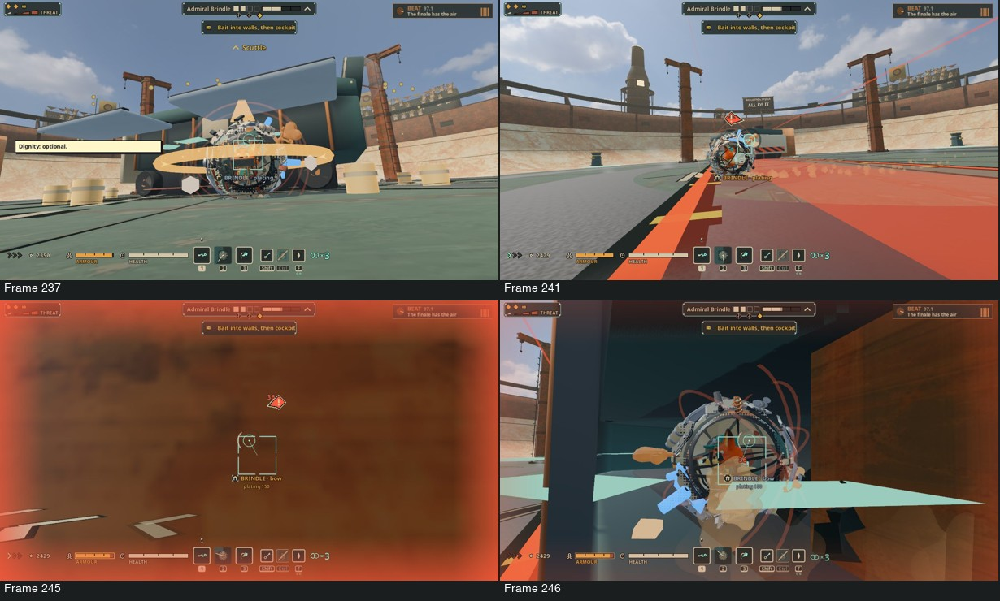
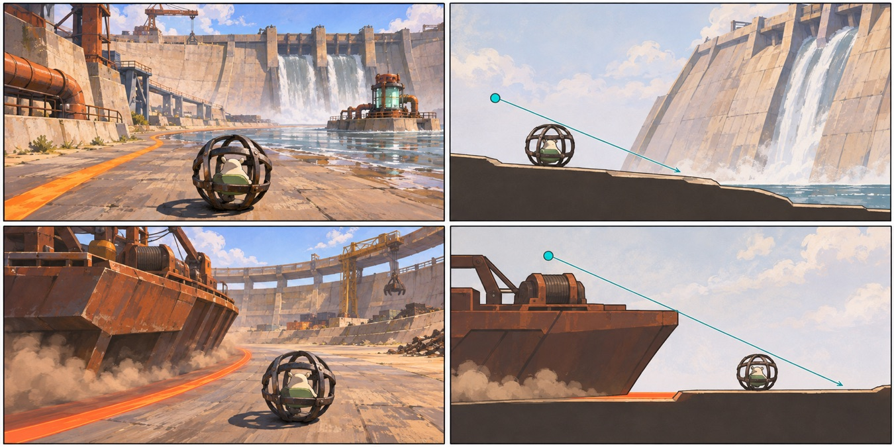

# Keep an escape line visible under Brindle’s bow

**Boss presentation writer · PF-06 and PF-16.** Preserve the scale of the approach shot. At impact and 0.30 s later, show the ball and enough floor to steer around the hull. Start after the dam camera change if both assignments touch the rig. [Replay instructions](../HANDOFF.md)

1. Reproduce frames 240–247. At frame 241 the left lane edge and the ground outside it are visible. At frame 245 the arm requested 9.10 m and reached 4.45 m against the bowl. At frame 246 it reached 3.17 m against a Requisition camera body. Match the charge phase on a newer stage. A change to the boss’s lead can move the point of contact. [Recorded rows](../../../../../../artifacts/visual-audit-w44/evidence/film.ndjson) · [Boss lead change](https://github.com/bananahana720/scrapkeep/pull/1122)
2. Trace the lens against the bowl and visible bow through the moving contact. The ship builds camera-only boxes from drawn parts and updates their pose, size and visibility each physics tick. Cables intentionally have no camera box. Capture the obstructing part, its oriented box and the camera pose on the same tick. Establish whether obstruction comes from the two surfaces trapping the shot, box fit, or update order. [Requisition](../../../../../../sketches/core-loop/src/boss/requisition.gd) · [Bowl](../../../../../../sketches/core-loop/src/boss/arena.gd)
3. If one box blocks visibly empty space, correct its fit. If the proxies match the hull, try a collision-tested view above or alongside the bow through recovery. Keep the existing physical collision, charge lane, hit timing, player look and ordinary-enemy exclusion. The dormant `set_boss_reach` changes framing across the fight and needs its own evidence before use.
4. Run `camera_tight_test`, `camera_aim_rest_test`, `boss_charge_tear_test` and `body_run_warning_test`. Check a near miss, a direct hit, an ordinary enemy passing behind the ball, and mounted aim alongside the ship.

**Return** a contact strip with the lane edge identified before impact and the ball and steerable side identified at impact and recovery. Include the body trace. The film’s `ball_on_screen` field projects a point inside the viewport even when opaque geometry fills it. Judge visibility from the pictures. [Film recorder](../../../../../../sketches/core-loop/tools/eye_film.gd)
