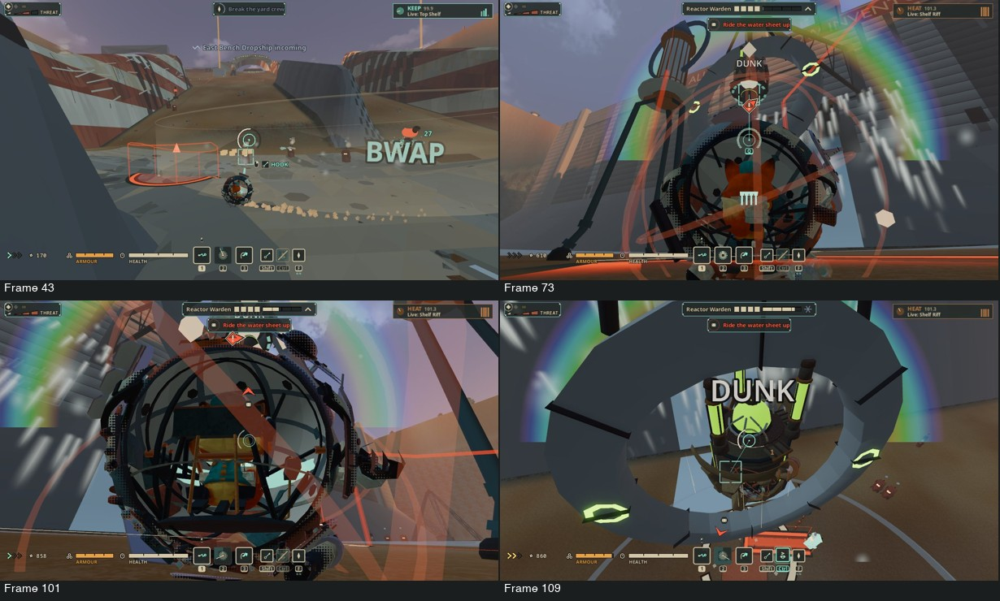

# Keep the water-sheet approach in view

**Camera writer · PF-06, W1-14, W1-109.** Give the rider a view of the Warden, the warning edge and a reachable strip of floor while rolling into the dam face. Keep the open flume reversal as the control shot. [Replay instructions](../HANDOFF.md)

1. Reproduce the two approaches around frames 73 and 101. Match ball position, arm request, hit length and contacted tile to the [recorded rows](../../../../../../artifacts/visual-audit-w44/evidence/film.ndjson). Save a frame on either side of each hit.
2. Inspect `_free_arm` and `_tight_target`. The lift probe treats a floor-like normal as free and tests whether tipping up buys clearance. The spring arm itself can still retract against terrain. Log the actual normal and candidate clearances at tile 5_8 to test whether that explains this shot. [Chase camera](../../../../../../sketches/core-loop/src/movement/chase_camera.gd)
3. Prototype the smallest local framing change supported by that trace. A candidate shot lifts the line of sight over the cage through sustained contact, then settles back as the rider clears the face. Compare short obstructions, open-ground look-up, low roofs and back-to-back rim contacts for snapping or oscillation.
4. Compare the same mounted target with the camera change enabled and disabled. The resting aim origin follows the mount. Record the first shot origin and hit, and check locked aim, mouse look and reduced-motion behavior. Run `camera_tight_test`, `camera_aim_rest_test`, `camera_profiles_test` and `camera_glance_test`.

**Return** matched dam and flume strips, arm readings and the focused test receipt. Pass when the floor, warning and target remain distinguishable on both dam approaches, the open-space turn still frames the ball through landing, and mounted fire still meets the reticle. Keep the next task on the same camera base. [Brindle contact](brindle-camera.md)
