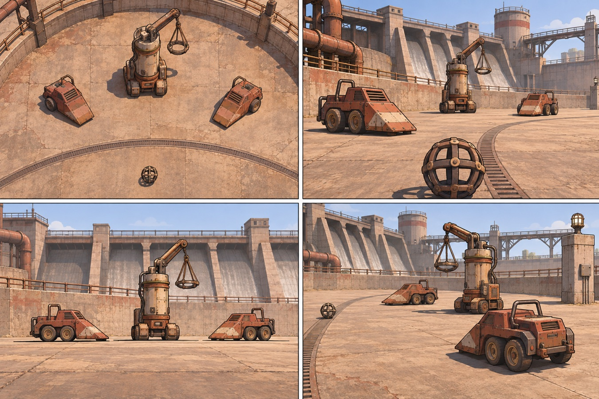

# Give each wave a readable first decision

**Encounter designer · authored World 1 roster and lock waves.** Start with a single dam yard sequence. Keep one primary threat legible while another gives the rider a reason to turn, climb, hook or ram. [Role-by-site brief](../ENCOUNTERS.md) · [Formation study](../../../../../../artifacts/visual-audit-w44/images/arrival-formation-study.jpg)

1. Build a baseline strip of the approach sentry, first yard wave, penultimate wave and final wave. Record who spawned each member, remaining budget, the first attack to commit, and which approach remained rideable. The dam has five waves and the flume seven, with 3.5 s between cleared waves. Both open with two chasers and a lobber. The late waves introduce a jolt layer and then a ramp flipper. The two yards have different clear-time caps. [Exact composition](../../../../../../sketches/core-loop/src/world/lock_rows.gd)
2. Try a change in arrangement first. Stage a low scraper and an upright lobber on distinct bearings so the rider sees who is committing. Make the outside bank a possible dodge and the inside line a possible ram. Rotate through the existing spawn spots, preserving crew count and attack timing. Compare to the original kind-to-spot order. If the same blocker persists, record a **separate** roster substitution experiment with its own baseline.
3. For the late waves show the mat roller or hinged plate before another body masks it. Avoid a locked yard whose only exit from a hold requires a grown build. The dam sentry, open-route homes, Warden unlock accounting, overtime rewards and the per-pack attack budget all consume different crew state. Record survivors and both clear and timeout outcomes, including the next reward.
4. Run `stage_locks_test`, `director_stage_packs_test`, `attack_budget_test` and `overtime_test`. Compare first small-build entry, a grown bowl-through and a route change mid-wave. Use the project’s matched-seed difficulty-band checks before admitting a gameplay change. [Difficulty plan](../../difficulty-plan.md)

**Return** the old and proposed wave rows, one overhead showing bearings, a muted chase strip from warning through recovery, and a table of first tells, contacts and clear times. Pass when a moving rider can answer the primary threat and choose a second action, a stalled rider remains under pressure, and a grown pilot can still drive through eligible crew. Coordinate with the [spawn writer](spawn-approaches.md) before changing a shared placement function.
