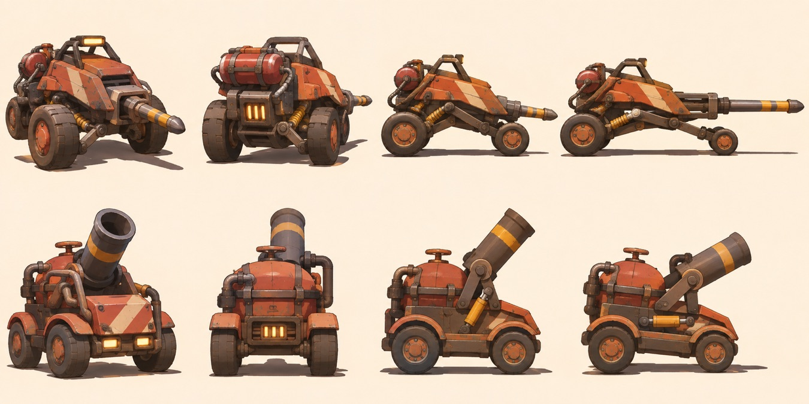

# Make each machine’s working tool readable while both sides move

**Enemy art and animation writer · start with one chaser or one lobber.** Carry the old job through approach, wind-up, release, hit and recovery. A player approaching from the side or rear needs to identify the machine before its lamp or floor mark does all the work. [Six captured machines](../CREW-POSES.md) · [Canonical roles and tools](../../../../../../sketches/core-loop/design-v3/SPILLWAY-ROSTER.md)

1. Choose the least legible phase from a **moving** chase replay. Use a frozen lit pose and front/side/rear silhouette views to isolate the problem. Inspect the actual collision/contact plane beside the visible feet or wheels. For the winch drone check the air gap, cable and projected ground position. On a rough bank check that the working tool stays readable against the horizon.
2. Prototype one change to the profile or motion. For a chaser, separate the sprung scraper’s load from its committed thrust. For a lobber, expose the raised firing tool above its hopper through wind-up and recoil. Keep the common Fleet material family and reuse the crew lamp. The concept shows relative shapes; the approved old job determines what the tool actually is.
3. Trace `enemy_clips.gd`, `windup_poses.gd` and the enemy’s attack script together. A clip sample omits the script pose layered onto it during live combat. Check muzzle or tool origin, hit volume, ground warning, release and interruption on the same physics ticks. Run the matching `enemy_chaser_windup_test` or `enemy_lobber_windup_test`, plus `enemy_clips_test`, `enemy_ground_contact_test` and `crew_lamp_test`. [Clip owner](../../../../../../sketches/core-loop/src/presentation/enemy_clips.gd) · [Wind-up poses](../../../../../../sketches/core-loop/src/presentation/windup_poses.gd)
4. Match High and Low, muted audio and comfort controls. Include a singleton, two bodies crossing in projection, and the selected machine partly behind a same-colour pier. Show what a grown rider sees after interrupting the tool at speed. Confirm reused or respawned machines return to their correct rest pose.

**Return** a front/side/rear study, a lit pose strip, and a 720p chase strip at first recognition, commitment and recovery. Pass when a reader can name the working end and intended movement before the attack becomes live and the collider and warning still agree with the action. Reuse the [asset capture cameras](../../../../../../sketches/core-loop/tools/asset_capture.gd) for comparable orthographic views.
