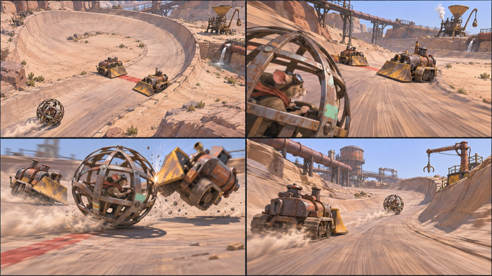

# Make a fast pass through a pack worth playing

**Combat designer · start with a chaser pair in one open dam approach.** Put an enemy where a zooming pilot will see a commitment, then let the pilot bank out, interrupt it with a ram or bowl through eligible targets. The worked example in the [encounter brief](../ENCOUNTERS.md) gives the distances. This is a design experiment. The seed 1 film establishes the camera speed and the cue overlap. It does not establish that every crew misses.

| Redesign to compare | How it challenges a fast rider | Counterplay and cost |
| --- | --- | --- |
| **Cross the line ahead** · first experiment | Use the existing `--pack-pressure=C` flanker on the same open-route pack. A second chaser can approach a crossing, call, raise its sprung head and commit across the rider’s line. Start at a bank whose exit is visible. | A deliberate turn beats the committed lane. A head-on ram during wind-up can interrupt it. Track offscreen commitments and false calls. The default World 1 cruise lead and chaser running-speed ceiling have separate owners. |
| **Make the next bank a decision** · ranged follow-up | At an authored lobber home, try an oblique sightline from the pressure tool to the *entry* of the rider’s next turn. Present the site early enough to choose the high route, change line, bat the shell or close for a ram. | Keep the launched shell’s committed ring, roof/terrain cover and damage clock. Test the blind side of the pier. Reject a placement whose only escape is braking, or whose shell quietly follows the ball after release. |
| **Give the rider something to bowl through** · second encounter | Use an existing boom tender with a diagonal float line and clear runout. Stage the spent crew off the exit tangent so the contacts and next landmark stay visible. Let a grown rider line up several contacts while a lighter rider can hook or bank outside. | The tender already distinguishes a slow hold from a FAST bowl-through. Check float interaction, velocity after contact, payout and repeated crossings. Keep a clear runout even when nearby bodies tumble. |

1. Freeze the route, seed, wave composition and equipment. Run the stock pack against the flanker experiment before changing a single dial. Record when each attacker first entered view, when the warning appeared, where its lane committed, and whether a body occupied it when damage occurred. Current chaser speed starts at 4.8 m/s and is capped at 12 m/s below 14 m/s cruise. Its 0.6 s wind-up, short committed lunge and interrupt are part of its identity. [Chaser](../../../../../../sketches/core-loop/src/combat/chaser.gd) · [Pack experiments](../../../../../../sketches/core-loop/src/combat/pack_pressure.gd)
2. Drive four matched approaches: stalled, straight cruise, high speed with a turn after commitment, and an intentional ram. Repeat the ram with starting and grown heft. Capture overhead trajectories and the muted chase view for call, wind-up, strike and recovery. Track the share of encounters whose first commitment happened after the pilot had passed, the number that offered a visible moving response, and which outcome followed the player’s input.
3. If the flank experiment fails, identify whether the pack arrived behind the rider, the chaser never reached a crossing, or the tell was hidden. Change the responsible owner in the next trial. A spawn revision belongs with the [director writer](spawn-approaches.md). A silhouette problem belongs with the [motion writer](enemy-motion.md). Compare one alternative at a time.
4. Run `pack_pressure_test`, `chaser_speed_test`, `chaser_lead_test`, `pocket_entry_test`, `attack_budget_test` and `body_run_warning_test`. Check the early-entry grace and the 0.2 s budget gap between distinct threats. Compare the project’s novice, learner and expert bands before proposing a gameplay default. [Attack budget](../../../../../../sketches/core-loop/src/combat/attack_budget.gd) · [Boom tender](../../../../../../sketches/core-loop/src/combat/boom_tender.gd)

**Return** one preferred design or the measured reason to retain the baseline. Show a straight rider having to decide earlier, a turning rider beating the committed threat, a stalled rider still paying for delay, and an eligible ram scattering targets with a readable exit. Report failures and denominators. Judge the proposed change on decisions offered at speed, alongside damage and clear time.
