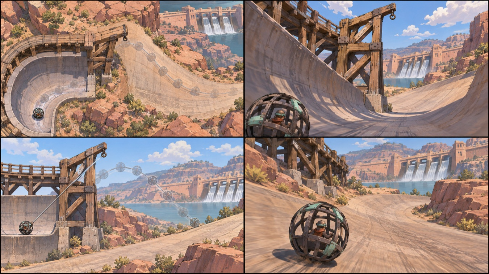

# Build a line worth grappling into and rolling out of

**Traversal designer · own one named anchor field and its receiving ground per implementation.** Make a successful hook feel like choosing a faster or higher way through the same space. A missed hook should leave the moving rider a legible lower route. Start at the dam viga span or the flume hollow trestles. [Top-down route plans](../MAP-DESIGN.md)

| Candidate | Rolling approach | Hook, release and payoff to test |
| --- | --- | --- |
| Dam ledge line | Arrive along the west rim toward `viga_span` at (−190, 425). | Reveal one actual timber attachment with sky behind it. Release toward the existing service-ledge line. Verify the lower pool route remains visible on a miss. |
| Flume hollow | Pump the `trestle_hollow` half-pipe at (−185, 10). | Use a reachable post from `hollow_trestles` around (−115, 5.5). Aim for a tangent along the trough toward the siphon. Test where the ball actually recontacts after an early or late release. |
| Brindle bowl | Enter the curved bank and select a diagonal mast. | A mast can turn a rider across the radius toward an inward ramp. Check the real cable attachment and where the bow or an active slag band cuts that line. Use the [bowl assignment](bowl-route.md) to coordinate changes. |

These coordinates identify row centres. Each timber field places several actual posts. Sample the nearest legal face from the approach before drawing a swing arc. The harpoon checks range from the ball, looks for an eligible surface and rejects walkable floor. A zip cable and a moving winch drone have different behavior from attaching to a static post. [Anchor placement](../../../../../../sketches/core-loop/src/world/park/park_recipes.gd) · [Harpoon targeting](../../../../../../sketches/core-loop/src/movement/harpoon.gd) · [Rope and release](../../../../../../sketches/core-loop/src/movement/augments.gd)

1. Record three existing runs through the same section: roll and pump without grappling, hold a world hook through the bend and release along the tangent, then intentionally miss and recover. Mark the real attachment and landing coordinates on the plan. Record speed before commitment and after landing, minimum clearance from the post and underside, height gained and progress toward the rejoin. Include the light starter and a larger ball.
2. Choose one obstruction from the baseline. Open a sightline around the timber, move the working attachment within its authored field, or soften one receiving lip if that surface catches the exit. Retain a landmark beyond the target so the player sees both hook and destination. Show the full mast base and return line when a crew enters beside the landing.
3. Repeat with an early release, late release, reverse entry, a moving chase pack and a missed catch. Film at chase height and from the side including the ground shadow. Confirm the real attach result, rope length and tangent speed. A planned curve drawn through a post proves neither reach nor clearance.
4. Run `harpoon_line_test`, `harpoon_shot_bite_range_test`, `harpoon_lock_collider_test`, `park_skill_lines_test` and `snag_sweep_test`. Check `park_bake_fresh_test` for geometry changes, and recheck route/encounter difficulty bands if the route saves time or avoids pressure.

**Return** the three input traces, a scaled overhead with successful and missed release points, a side view showing clearance, and approach/attach/release/landing chase frames. Pass when the working face and receiving surface are visible before commitment, the swing provides a measured advantage in speed, height or line choice, and the roll-only or missed-hook result rejoins under player control. [Airborne and mounted composition study](../../../../../../artifacts/visual-audit-w44/images/player-movement-study.jpg)
