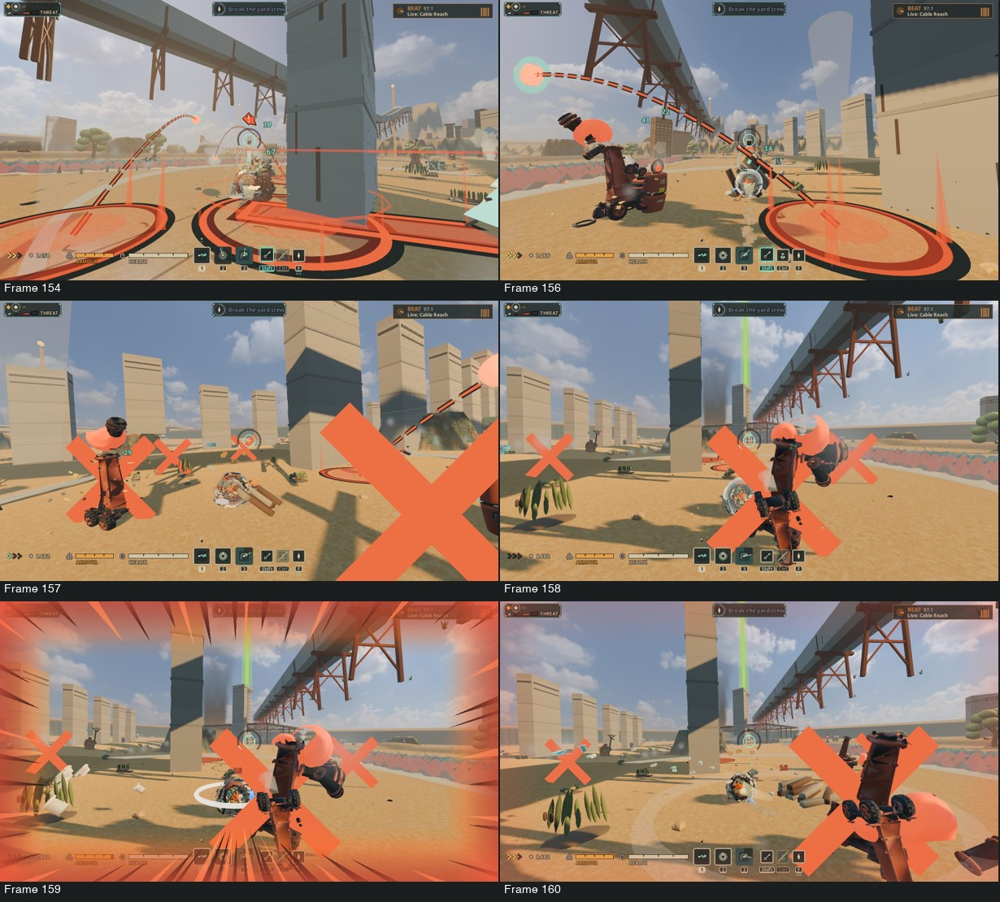
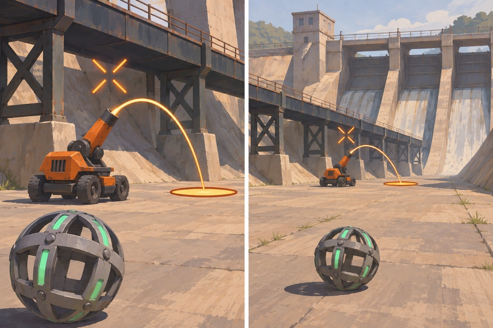

# See the next crew without losing the live shell

**VFX writer · W1-108 and UA-07.** Keep the incoming crew’s landing point and closing motion readable with sound muted. Give the active shell arc and its ground perimeter the strongest read when the two events overlap. [Replay instructions](../HANDOFF.md)

*Concept art, generated with OpenAI ImageGen for this brief. Use the gaps and overlap order as the reference. The machine, materials and scale are illustrative.*

1. Recreate frames 156–160. Freeze the near marker across the barrel, then capture the same mark at ordinary approach distance. Include the actual ground damage ring in the composition. [Frame rows](../evidence/film.ndjson)
2. Try four short diagonal tips with a clear centre. Cap the near mark’s apparent span using the active camera projection, with enough change in span or stroke position for the countdown to read at the cap. Keep the existing orange X in the distance. Choose the cap against the 720p shot and report the resulting pixel extent and viewport fraction.
3. Work in `wave_cross.gd`. Its billboard currently spans two solid 3.2 m bars, initially scaled by 2.2. The yard supplies a lead time and removes the marks when the crew lands. Overtime supplies zero lead and a hold. Keep the registry’s colour, height, positions, event clock and whistle for both consumers. The landing spot itself deals no damage. [Wave mark](../../../../../../sketches/core-loop/src/world/wave_cross.gd) · [Yard](../../../../../../sketches/core-loop/src/world/stage_locks.gd) · [Overtime](../../../../../../sketches/core-loop/src/world/overtime.gd) · [Sound equivalents](../../../../../../sketches/core-loop/src/presentation/sound_twins.gd)
4. Replay near/far, High/Low, sound muted, and both comfort controls. Run `stage_locks_test`, `overtime_test` and `sound_twins_test`. Check for a clear centre when several drops coincide in projection and for an unmistakable X at ordinary viewing distance.

**Return** matched strips and two measured near/far extents. Pass when a reviewer can point to the spawn, barrel and in-flight shell at the same time and can see when the yard crew is about to land. A change in the orange pixel count alone cannot show this.
