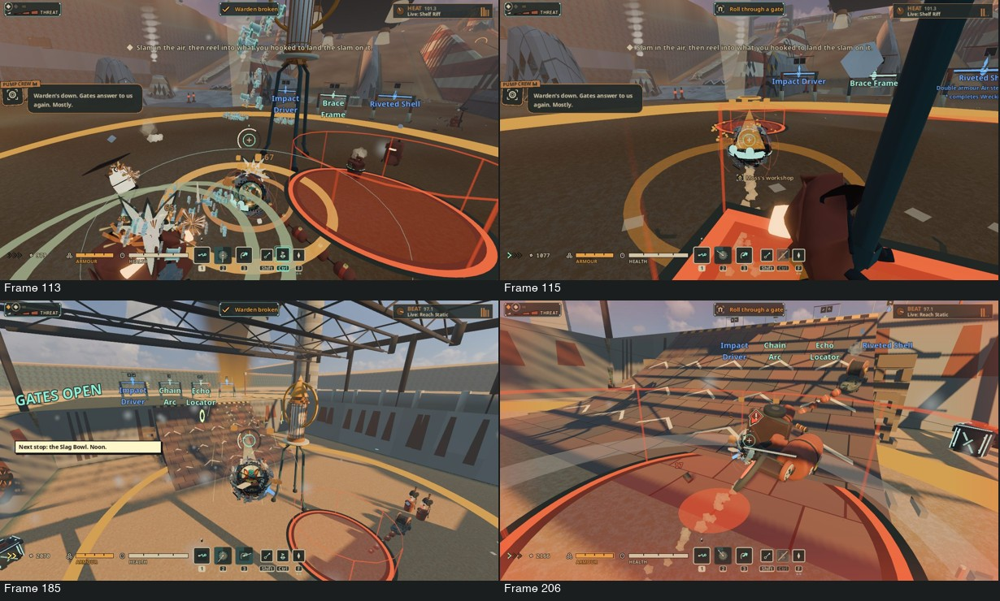
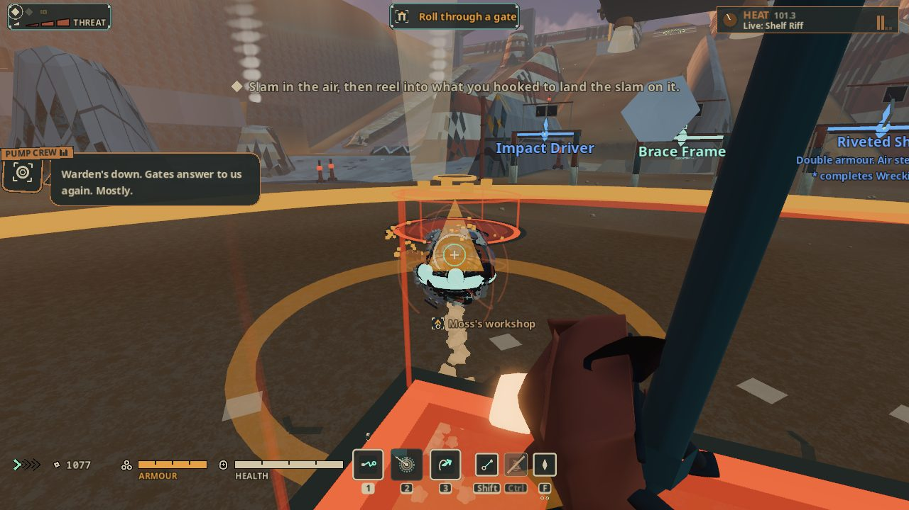

# Read the full offer while rolling toward its arch

**Reward UI writer · PF-22.** Keep the three- or four-way physical choice. A rider approaching an edge arch needs its name, benefit and trade-off before crossing it. [Replay instructions](../HANDOFF.md)

1. Reproduce frame 115 and mirror the approach to the left edge. `_place_names` checks whether the crossbar point is in view. `fit_names` receives its neighbours and the top band, but no viewport width. It can accept a centred rectangle whose right edge falls outside the screen. Gate signs set `owner_placed`, so the general HUD prompt clamp skips them. [Gate placement and measured name forms](../../../../../../sketches/core-loop/src/build/reward_gates.gd) · [Screen regions](../../../../../../sketches/core-loop/src/ui/screen_regions.gd)
2. Fit the actual text footprint to the space around its arch. Try inward wrapping or an inward-facing detail block that still shares an edge or column with the crossbar. Retain the nearest-gate ordering, legible type size and hysteresis as neighbours move. Publish the actual drawn bounds to `keep_clear_rects` so effects respect the sign. Keep selection, payouts and arch collision in their existing owners.
3. Trace the slam tip during the reward transition. A tip waits for time actually visible before it marks the profile. Withdraw it when the reward owns the choice, and defer a still-unseen tip through the existing queue. Verify the HUD resumes the right tip after the choice and that a previously seen tip stays seen. [Field tips](../../../../../../sketches/core-loop/src/ui/field_tips.gd)
4. Exercise short and long names, a synergy line, both edges, three and four offers, pause and resume, and riding through the selected arch. Run `reward_gate_nameplate_test`, `reward_gates_slot_row_test`, `reward_gates_park_test` and `field_tips_test`. Include a rect crossing the viewport with its anchor still inside.

**Return** a HUD-visible approach strip for each gate count, with the resulting part identified after pickup. At 1280 × 720 the complete details on the approached offer must fit, its arch must be unambiguous, and stale combat instruction must yield before the choice. [Screen writing and carrier order](../../../../../../sketches/core-loop/design-v3/LEGIBILITY.md)
