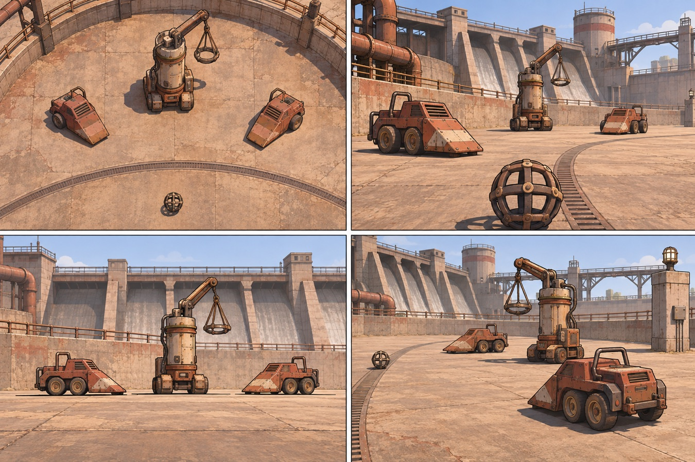

# Put arriving crews where a moving rider can meet them

**Director writer · open-route spawns, locked-yard and overtime controls.** Start with a branch in the flume and compare one crew appearing beside the chosen route to a crew coming from an authored home. Return matched evidence before changing encounter composition. [Context](../ENCOUNTERS.md)

1. Tag each observed arrival with its source, seed, player heading and speed, spawn point and first hostile action. For an open-route pack, inspect `_window_homes`, `_line_spot` and `_park_safe`. The director filters homes by progress toward the landmark and heading. Its free ahead-line search samples points 60–100 m ahead with a 12–20 m side offset. The general ahead and flank fallbacks use different distances. Record which branch actually chose the spot. [Director](../../../../../../sketches/core-loop/src/world/director.gd)
2. Test a rider choosing the upper line, switching to the lower line and doubling back. At the reveal, try a position along the same eligible side that brings the lead machine into view before it reaches the playable corridor. Preserve the corridor, quiet areas, live-home/destruction rules and seeded selection. If visibility alone is poor, test adjusting intervening scenery before changing the spawn distribution.
3. Check the special cases independently. The yard boundary has a 26 m radius. The crew drops on a rotating arc 15.6 m from the lock centre (0.6 × 26 m), and the whole crew shares one pack sequence. Its warning and landing both call `_wave_spots`. Overtime builds drops and marks them at arrival. On retry, stage change or a cleared wave, a stale cross or crew must not reappear. Test actual spawn position against its mark, collision clearance, live attack budget and any overlap with a landing bank. [Yard](../../../../../../sketches/core-loop/src/world/stage_locks.gd) · [Overtime](../../../../../../sketches/core-loop/src/world/overtime.gd)
4. Run `director_route_test`, `director_homes_test`, `director_breather_test`, `stage_locks_test`, `overtime_test` and `sound_twins_test`. Repeat the same input and seed, then a different seed. Compare spawns, skips, offscreen first attacks, route completion and carried RNG changes. Use a rider-height shot where the pack first becomes actionable alongside the overhead plot.

**Return** a per-arrival trace and matched approach/landing/first-attack stills. A passing candidate gives a fast rider a visible decision along the route they chose, keeps authored cover and movement lines usable, and retains the same outcome on repeated identical inputs. Coordinate with [encounter curation](encounter-curation.md) if a roster or wave row needs to change.
