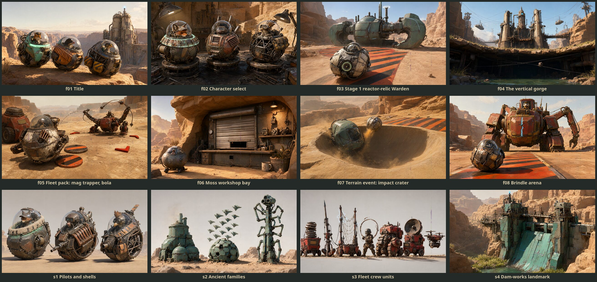

# Primer visual board

This is one of the primer boards (plan addendum "Pacing"). It sits beside `STORY-THREADS.md` and `PROGRESSION.md`. It shows the demo's look before any heavy build, so Andrew can react to a direction instead of a description.

**Status.** These are concept references only. They are not runtime assets, they are not admission evidence, and they prove nothing about the Godot build. They were rendered locally with Qwen-Image 2.1 on the RTX 4080, and nothing left the machine. The prompts and seeds are in `prompts.md`, and the script is `tools/concept/render_board.py`. The full-size renders stay under `artifacts/local/v2-primer/visual/`, which git ignores.

## Across the board

- **What holds.**
  - Three pilots stay visible behind the cockpit glass.
  - Hostile ground reads as red-orange and charcoal stripes.
  - The ancients read as a separate, cast material era with blue seams.
  - The Fleet reads as bolted rust-red gear with brass tags.
- **What drifts.**
  - The model leans toward detailed realism, not the chunky low-poly style in the prompt. Retry frames added "painterly, not photorealistic", which only helped a little. The Godot build should take its shapes from these frames, not their surface detail.
  - Ancient enamel comes out bright turquoise in places, close enough to field mint to blur "mint is yours". VISUAL-LANGUAGE §2 wants dull petrol.
- **What no frame can show.** Motion (roll, speed and the telegraph fill that measures time), scale from a moving camera, sound, and a live HUD. Every frame was prompted without UI, so the icon and HUD grammar is not tested here.
- **A finding for VISUAL-LANGUAGE.** In f01, Kest's amber-and-black satchel stripes read as hazard tape. §6 says "amber-striped satchels". The fix is horizontal amber bands, never 45° diagonals, because diagonals belong to hostile danger (§3). I'll carry this into VISUAL-LANGUAGE when I next touch it.

## Frames

Each entry names the attempt kept. Attempt 0 is the first render. Attempts 1 and 2 add the revisions listed in `prompts.md`.

### f01 Title (attempt 1 of 2)
- **Intent.** Three pilots at a mesa edge, looking out at the dam-works landmark. Awe, and small machines under a big sky.
- **Right.** All three pilots are visible: the fox in a cap, the mole in a visor, the bird in goggles. Each shell has its own shape: Sable's mint collar and spool, Rivet's copper fins, Kest's truss and satchels. The landmark carries its blue light.
- **Off.** Kest's satchels carry diagonal amber-and-black stripes (see the finding above). Sable's shell is painted mint over most of its body, not just the working collar. Attempt 0 had uniform wheeled pods with no visible pilots.
- **Can't show.** How the title settles, and the music.

### f02 Character select (attempt 0)
- **Intent.** The three shells on turntables in a workshop.
- **Right.** It matches the §6 descriptions best of any frame. Sable has the fox, the mint collar ring and the rope spool. Rivet has the visor, copper fins, exhaust stacks and a forward rail. Kest has the crest, goggles, open truss and satchels.
- **Off.** Rivet's nose is hidden by the visor. Kest's satchels are brown, not amber. The surface is photoreal.
- **Can't show.** The turntable spin and the class sound signatures.

### f03 Stage 1, the reactor-relic Warden (attempt 1 of 2)
- **Intent.** Rolling into the stage 1 Warden, with the danger footprint and an escape visible.
- **Right.** The player ball is bone-coloured with a mint coil ring, clearly not the machine. The machine is a clamp with C-jaws, a dome, vent stacks and blue seams, and the beacon mast has a glowing ring. The striped footprint is hostile-only, and open ground is left free.
- **Off.** The camera sits beside the ball, not behind it. The footprint reads as a lane, not the circle asked for. The jaws are not closed on the mast. Attempt 0 gave the ball the ancients' teal and had no beacon.
- **Can't show.** The fill measuring the wind-up, or the Warden's hum.

### f04 The vertical gorge (attempt 0)
- **Intent.** The I3 stage: an undercroft, a shelf and a cable sky layer around the landmark.
- **Right.** All three layers read at once: the canal below, the shelf, and the cables with hover barges above. The tower cluster with its blue light anchors the frame, as DESIGN-V2 §9 asks.
- **Off.** The shelf reads as a flat plateau, not a gorge wall. The ball on the cable is too small to find.
- **Can't show.** The transitions between layers, which are the whole point of the stage.

### f05 Fleet reinforcement pack (attempt 1 of 2)
- **Intent.** A mag trapper and a bola thrower, with their telegraphs.
- **Right.** The player ball is bone with copper fins (Rivet), clearly not Fleet. The trapper cart carries its disc stack and a brass tag. The bola machine has a crew rider, and the dotted flight trace and corner brackets are there. Every enemy is tool-shaped (§11).
- **Off.** The striped mag pits are small physical plates, not a drawn danger area. The brackets are scattered instead of closing on one circle. Attempt 0's ball wore Fleet rust red.
- **Can't show.** The projectile bracket closing, and the pull of the pit.

### f06 Moss's workshop bay (attempt 2 of 2)
- **Intent.** The calm bay, with Moss unseen behind a shutter hatch (the keeper's default).
- **Right.** The shutter is closed, and only the hatch opens onto darkness. The three-part shelf, the padlocked hook and the pressure dial map to DESIGN-V2 §12. The chipped mug and the plant in a tin carry the Bible's small comforts.
- **Off.** The ball sits on a small wheeled stand. The locked hook holds a padlock but no top-shelf part. Attempts 0 and 1 left the shutter half open.
- **Can't show.** The lounge arrangement, and Moss's babble through the hatch.

### f07 Terrain event, impact crater (attempt 2 of 2)
- **Intent.** Something has landed, and the crater becomes a halfpipe. A collapse strip shows what comes next.
- **Right.** The crashed chunk is ancient teal. The player ball is bone. The collapse strip is red-orange and charcoal only.
- **Off.** The chunk has no blue seams and a visor that reads like a vehicle. The ball's pilot isn't visible. The ride up the crater wall reads less clearly than in attempt 1, which gave the ball hostile orange, and attempt 0 put amber in the hazard stripes.
- **Can't show.** The projectile telegraph before the impact, or the new collider appearing.

### f08 Brindle's arena (attempt 0)
- **Intent.** The Requisition, with Brindle in the cabin.
- **Right.** The Requisition is a rust-red, brass-trimmed Fleet war machine with a badger in a captain's cap. A cracked chest plate shows a blue seam (STORY-THREADS C10, proposed). A striped lane telegraph sits in front of it.
- **Off.** The lane's stripes run across the lane, not at 45°. The player's pilot also reads as a badger, which blurs with Brindle.
- **Can't show.** The reverse-quote phases or the scale of the fight.

### s1 Pilots and shells (attempt 0)
- **Intent.** A model sheet of the three shells at the same scale.
- **Right.** It is the strongest read of the §6 shells. Sable has a felt-lined collar, a spool and a mint glow. Rivet has a visor with a visible nose, copper fins and a rail. Kest has a crest, goggles, a beak, a mortar tube and a vane.
- **Off.** The background isn't the neutral grey asked for. Rivet's rail reads as a gun barrel. Kest's amber is muted.
- **Can't show.** The pilot's head reacting to abilities, or cockpit counter-rotation.

### s2 The three ancient families (attempt 1 of 2)
- **Intent.** Three silhouettes that could never be reskins of one another.
- **Right.** A squat domed reactor relic, an arrowhead swarm over a honeycomb hive and a many-armed pylon for the Mind's hands. All three have blue seams in a cast material with no bolts.
- **Off.** The swarm is loose, not a locked formation. Attempt 0's Mind's hands was a humanoid biped.
- **Can't show.** Flocking, adaptation, or each family's sound.

### s3 Fleet crew units (attempt 0)
- **Intent.** The seven reinforcement units, each shaped by its tool.
- **Right.** All seven read by tool: disc cart, harpoon post, net masts, bola, plated brute, dish deflector and winch drone. Rust red, brass tags.
- **Off.** The bola reads as a hoop. The one visible crew member looks human, which is off-lore, since animals crew the Fleet. The tag plates carry fake text.
- **Can't show.** Each unit's hold and break-free.

### s4 The dam-works landmark (attempt 0)
- **Intent.** The focal landmark, mixing both material eras.
- **Right.** Cast spillway and towers with blue seams, steampunk pipes, catwalks and cables grown over them, a blue light on top, and a green river below.
- **Off.** The enamel is too bright a turquoise, close to mint. It reads as one dam more than a tower cluster.
- **Can't show.** Its role as the anchor you orient by from every layer.

## For the meeting of the minds

- The shells in s1 and f02 show that the class silhouettes survive a strong image model, so they're a sound basis for V3 blockouts.
- s2 and s3 support the no-reskins rule. Every enemy there is distinct at thumbnail size.
- Two VISUAL-LANGUAGE follow-ups came out of the renders.
  - Kest's satchel stripes become horizontal bands.
  - Ancient enamel needs a value and saturation cap so it stays dull petrol, well away from mint. Blue seams need their charcoal groove (§2) to read, as s4 shows.
