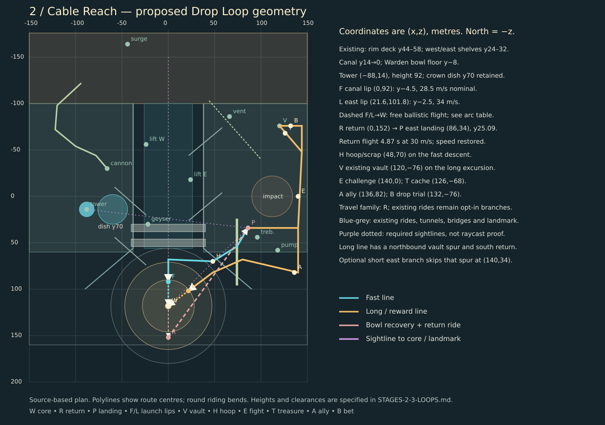
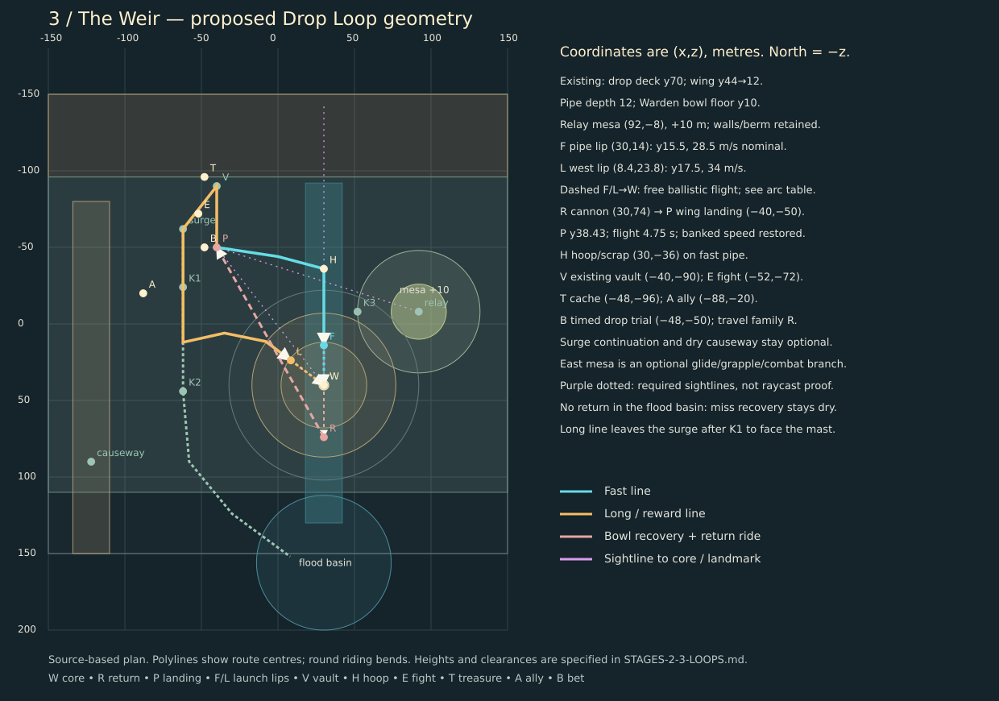

# Stages 2 and 3: Drop Loop geometry

Design handoff, 28 September 2026. Build on the existing Cable Reach and Weir. Keep a short repeatable attempt near each Warden and let the established stage supply longer reward trips. Do not send a miss back through the entire stage.

This is a design candidate for ROADMAP row 1, conditional on the lab's spine decision and the coordinator's build authorization. No gameplay implementation, playtest verdict or canonical board update accompanies it. Workspace identity `proto/core-loop-v3-stages` at `494cd44` is supplied by the assignment, not independently verified. The only Git operation used was the explicitly requested read of `3c219ab` in `core-loop-v2`. Stage 1 is the reference and is not redesigned.

Source contracts: [Drop Loop and stage brief](../LOOP-REDESIGN.md), [review findings 1–5](../research/CODEX-REVIEW-1.md), [roadmap](../ROADMAP.md), [Layered Spillway study](../../design-v2/visual-development/LAYERED-SPILLWAY.md), [W6 notes 1–12](../../DESIGN-NOTES.md#v2-w6-stage-and-world). Script paths below are relative to `sketches/core-loop/`.

## Geometry and evidence conventions

Plan coordinates are `(x,z)` in metres; north is negative z. Heights are world y. A lip's `lip` field is its rise above the existing ground, not its world height. The diagrams draw real map coordinates; broad coloured regions indicate height bands, not surveyed contours. Route polylines specify stations, not sharp turns to build into the ground.

The current bowl has a 28 m flat floor, bank to radius 47 m, and blend back to terrain by radius 62 m. Its bank slope is 0.445, about 24 degrees. Preserve it. The existing 6 m pulse core ring is a damage hazard. The current `FAMILY_REACH=3.2` contact reach and `FAMILY_POINT_RADIUS=1.3` visual weak point are different values. This design uses a proposed, visibly drawn **3.2 m contact radius** at the weak point's height. Do not silently interpret the pulse ring as the landing target or add the ball radius again to these tolerances.

`warden.gd` places its origin 1.6 m above ground. `warden_kit.gd` adds `DECK=2.2`, then 2.9 for the queen or 5.4 for the lens. Thus the current target centres are:

| Stage | Mast plan position | Bowl floor | Target centre y | Proposed contact ring |
| --- | --- | --- | --- | --- |
| 2, Hive | `(0,118)` | −8 | −1.3 | 3.2 m radius at y −1.3 |
| 3, Mind | `(30,40)` | 10 | 19.2 | 3.2 m radius at y 19.2 |

If the lab changes these heights or the physical hit predicate, recalculate the lips before building them. The ring is a combat/rendering contract dependency, not a map-only change.

### Physics basis

| Source | Actual default | Design consequence |
| --- | --- | --- |
| `src/movement/tuning.gd` | Gravity 26 m/s²; radius 1 m; jump 13 m/s | A plain vertical jump gains 3.25 m before drag. It cannot supply either core height from the floor. |
| `rigid_ball.gd`, `ball_rules.gd` | Cruise 14; drive accel 34; torque 220; air control 0.25; ground rolling resistance 0.30 | Cruise is a drive target, not a speed cap. Descents and returns can exceed it. Rigid drive applies torque plus 0.3 of the central drive term. |
| `ball_rules.gd`, `speed_tier.gd` | Air drag magnitude `0.0045 × max(speed−16.1,0)²` | Integrate vector drag for flight estimates. Do not use a vacuum parabola as the final acceptance check. |
| `augments.gd` | Sable vault `min(45,max(13,1.8×incoming))`; eject direction depends on face and aim; grapple range 45 | A 25 m/s vault can produce 45 m/s total speed. It is an approach shortcut, not the same launch state as a normal lip. |
| `augments.gd`, `ability_state.gd` | Rivet sprint targets 17.5 m/s, lasts 2 s, cooldown 5 s | Sprint protects the approach from control and helps recovery. It does not manufacture a 34 m/s flat-ground launch. |
| `augments.gd` | Kest glide uses 0.30 gravity, then transfers falling speed toward forward speed at rate 1.30/s | Glide changes both time and range. Release Space before the committed ballistic drop. A held glide does not follow the tables below. |
| `ride_rail.gd` | Bank planar speed, release `max(input,floor)`; release 0.04 s early; downward release capped at 10 m/s | Return keeps 100% of banked planar speed or gifts speed. The old 85% transition threshold is not permission for routine loss. |

Shared boost adds 11 m/s with a 1.1 s cooldown. All flight tables exclude boost, jump, glide, grapple, slam, gun recoil, enemies and steering after departure. Those actions need separate replay cases. No class upgrades are prerequisites.

### Arc calculation and tolerance

At departure, use ball centre `y0 = ground + lip + 1`, horizontal speed `v`, and vertical speed `s×v`, where the kicker's local tangent `s = 1.6×lip/length`. The undamped estimate is `p(t)=lip_position+dir×v×t`, `y(t)=y0+s×v×t−13t²`. The table uses RK4 integration at 0.0005 s with the actual air-drag law above. The calculation and JSON receipt are under `artifacts/local/stages-2-3-design/` at the repository root.

These are calculated **departure-state targets**, not measured Jolt takeoffs. A rolling sphere follows a surface normal offset; the 1 m centre-height approximation, mesh tessellation and the kicker's 5 m tail can change departure. Build the local mesh at 0.5 m resolution, measure the real departure state, and tune length within ±15% before moving the core or widening its hidden hitbox. A failure beyond that bound returns to spatial review.

| Line | Lip `(x,z)` / direction | Ground / lip surface y | Rise / length / width | Nominal planar / vertical launch m/s | Air time to descending core plane | Impact total / downward m/s |
| --- | --- | --- | --- | --- | --- | --- |
| G-fast | `(0,92)` / `(0,1)` | −8 / −4.5 | 3.5 / 11.021 / 10 | 28.5 / 14.482 | 0.924 s | 29.44 / 9.61 |
| G-long | `(21.6,101.8)` / `(−0.8,0.6)` | −8 / −2.5 | 5.5 / 27.650 / 12 | 34 / 10.821 | 0.808 s | 34.41 / 10.20 |
| W-fast | `(30,14)` / `(0,1)` | 10 / 15.5 | 5.5 / 16.683 / 10 | 28.5 / 15.034 | 0.924 s | 29.26 / 9.08 |
| W-long | `(8.4,23.8)` / `(0.8,0.6)` | 10 / 17.5 | 7.5 / 35.625 / 12 | 34 / 11.453 | 0.808 s | 34.23 / 9.60 |

All four nominal trajectories cross the descending target plane at the mast centre, to numerical precision. Their apices are world y `0.488`, `0.724`, `20.795`, `20.989`, respectively. The higher long lips buy a faster useful approach; a greater lip height alone does not guarantee more impact damage.

| Line | Calculated planar speed band for ±2.5 m along-line error | Early and late endpoints at core height | Impact speed across band |
| --- | --- | --- | --- |
| G-fast | 27.345–29.631 m/s | `(0,115.5)` to `(0,120.5)` | 28.20–30.61 |
| G-long | 32.362–35.578 m/s | `(2,116.5)` to `(−2,119.5)` | 32.91–35.81 |
| W-fast | 27.413–29.572 m/s | `(30,37.5)` to `(30,42.5)` | 28.08–30.40 |
| W-long | 32.463–35.487 m/s | `(28,38.5)` to `(32,41.5)` | 32.81–35.57 |

Reserve up to 1.5 m transverse error at the ±2.5 m endpoints: combined radial error 2.92 m, inside 3.2 m. This is a coupled budget, not independent permission for ±3.2 m in both axes. With no other error, 1.5 m lateral drift corresponds to about 3.2 degrees over 27 m. A ±0.25 m departure-height error uses roughly 0.7–0.9 m of range budget. Never claim the full speed band, full heading error and full height error simultaneously pass.

The bands are narrower than a casual 25–40 m/s approach. A player can bank, deliberately brake, choose the faster long lip or take a bypass. Preserve speed on the return; do not add an automatic speed clamp to make the table pass. Show the existing landing projection and a visible aiming stripe before commitment. If ordinary players must repeatedly brake just to hit these lips, change the ramp fan/target design after the first geometry trial. Do not call that solved by the numerical table.

## Stage 2: Cable Reach

### Keep the gorge; add a short return

Keep spawn `(0,−160)`, bowl `(0,118)`, shelf profile, bridges at z 30–38 and 46–54, all four tunnels, the marble run, two barges, both periodic lifts, the cannon, trebuchet, geyser, cable, thermals and both valves. The tower at `(−88,14)` remains the landmark, with its 92 m height and crown dish at `(-60,70,14)`.

The existing geyser at `(−22,30)` stays an optional route to the dish. Making that upstream sky journey compulsory after every miss would create the review's commute tax. Add a steam return at `(0,152)`, 34 m south of the mast and inside the supplied play rectangle. Mouth radius 5 m; ground y −5.775, mouth centre y −4.775. It throws to east landing `(86,34)`, whose source-sampled ground is approximately y 25.093. This is a middle-shelf landing, not the sky dish.

Use `RideRail.arc` with `flight_planar=30`, floor 30, minimum flight 0.5, charge 1.2 s, and a release heading toward `(74,54)`. Planar travel is 146.014 m, flight 4.867 s, initial vertical speed 69.615 m/s, apex y 88.421. These fit the existing 95 m/s vertical limit. Keep the fixed flight speed separate from restored release speed. Sample the actual mouth and landing heights from built geometry when instantiating; these decimals are not replacements for `terrain.height()`.

The return crosses no existing bridge in plan before landing. At its landing it is 11 m south of the skylight door and 6 m east of the halfpipe edge. Reserve the final 32 m of arrival/release travel, roughly `(86,34)` through `(74,54)` to `(65,60)`, as a hostile-free apron. Retain at least 16 m traversable width across its natural slope. It may descend into the skylight; it must not acquire a lip or wall at that join. At 40 m/s this buys about 0.8 s to read the next choice. Native camera and collider checks own the final clearance.

### Route stations and rewards

| Line | Ordered ground stations from the return landing | Purpose |
| --- | --- | --- |
| Fast | `(86,34) → (74,54) → (48,70) → (0,68) → (0,92) → mast` | Skylight tail, open canal and the north kicker. About 125.9 m to the lip. Hoop at `(48,70)`; scrap on `(48,70)→(12,68)` and `(0,72)→(0,79)`. |
| Long | `(86,34) → (140,34) → (144,−48) → (144,−76) → (120,−76) → (144,−48) → (140,34) → (140,82) → (80,68) → (48,82) → (21.6,101.8) → mast` | Existing vault and an eastern return down past the pump house, then the higher diagonal lip. About 484.6 m to the lip, intentionally optional. Scrap on the eastern straight and on `(80,68)→(48,82)`; a second hoop at `(80,68)`. |
| Short east branch | At `(140,34)`, turn south toward `(140,82)` instead of taking the north vault spur | Keeps the higher lip available without another vault commute after the reward is spent. Approximately 231.5 m from landing to lip. |

The far-east centreline at x144 leaves 6 m to the play boundary. Use 8 m riding width there, no side props, and turn inward before the boundary. The vault is a chosen pit stop; the sharp change of direction there is not a high-speed racing turn. Elsewhere smooth stations into arcs of at least 18 m radius with 12–16 m open shoulders. Recompute route lengths after rounding and record them in the bot report.

Keep the existing Surge Run on the north deck. Its finish already feeds the marble run and cannon. The reactor vent, cracked e1 wall and original vault remain discoverable from the optional north excursion. The new east line passes around the impact footprint at `(112,0)`, radius 22, and does not require the cave-in's w1 or w2 tunnel. Riding the resulting crater remains a bonus third approach, pending its own arc proof; it is not a certified drop line in this document.

| Interactable family | Spot and clearance | What the player chooses |
| --- | --- | --- |
| Travel | Steam return `(0,152)`; approach from the south bank, mouth radius 5 | E arms the drawn arc to the middle shelf; continue along the bank to bypass. |
| Opt-in fight | Challenge post `(140,0)`, glyph beside the eastern straight | Arm a pack on the vault excursion. Keep spawn circles out of the return apron and launch noses. |
| Treasure | Existing vault `(120,−76)` plus cache plinth `(126,−68)` | Take the visible vault or investigate the grooved cache. Existing vent/wall callbacks remain independent. |
| Ally | Housing `(136,82)`, outside the pump house footprint and off the turn's centre | Buy a temporary window-holding ally with wallet scrap. Spending does not reduce heft. |
| Risk bet | Trial dial `(132,−76)`, beside the deliberate vault stop | Arm a 20 s drop trial before returning south. At slow traversal this is risky; show the deadline before consent. One wager per activation source. |

### Choices, classes and sightlines

From the return landing, the skylight descent and the eastern shelf remain open. The north shelf leads to the vault, cable and reactor vent; westbound travel reaches the existing bridges, marble run and tower routes. Neither lip blocks the ordinary canal beside it. Keep a minimum 8 m bypass beside each kicker's full support, including its 4 m side fades.

At the sky deck, choose the ordinary fall line, west marble run, east cable or barge. At the dish, choose the visible south exit to the western shelf or a class-assisted crossing. At middle height, choose a bridge crossing, a shelf reward or descent. In the undercroft, choose the near-bowl return, the existing upstream lifts/geyser or a ground approach to a lip. A moving barge or shut valve must never be the only exit from a height band.

Sable can use the existing east shelf walls and posts to cut back toward the skylight. Add one optional vault face at `(58,66)`, 8 m long, 5 m high, parallel to the local descending travel direction, clear of the fast centreline. Her 1.8× kick must land on the broad approach upstream of `(0,76)`, not be assumed to hit the cell directly. Rivet favours the eastern straight and the retained cracked-wall callback on an excursion. Kest can glide from the dish or rim to either shelf, or cut across the gorge to the lower approach. The ordinary ground loop remains available to all three.

Required sightlines are spawn `(0,−150)` to the Warden; landing `(86,34)` to both the lower route and east shelf; `(0,68)` and `(48,82)` to the open cell and projected landing; every layer to the tower crown. Put no tall new object inside those cones. The two existing bridges must stay under the spawn-to-Warden line. Dynamic rack warnings must identify the same elevation as their collision geometry.

## Stage 3: The Weir

### Use the pipe and west wing; return before the flood

Keep spawn `(30,−150)`, bowl `(30,40)`, `PIPE_X=30`, halfpipe z −92 to 130, relay `(92,−8)`, its mesa and four walls, the east berm, vault `(−40,−90)`, all three original kickers, causeway x −122 and basin `(30,156)`.

Add the return cannon at `(30,74)`, 34 m south of the mast, with ground y 12.225 and mouth centre y 13.225. It is upstream of the flood basin, whose near radius starts at z112. The earlier proposal's cannon at the basin's south rim would stand near z200, beyond the play rectangle's south edge at z150, and require a long trip after a miss. Keep the basin and causeway as optional space instead.

Return to west wing `(−40,−50)`, approximately ground y 38.433. From there the pipe is east, vault north, Surge Run northwest, dry causeway west, relay mesa across the pipe. This revises the draft's causeway landing to avoid forcing an additional 80 m crossing on every attempt.

Use the same return parameters as stage 2, style `cannon`, with `release_heading` toward `(0,−44)`. Planar travel 142.394 m, flight 4.746 s, initial vertical speed 67.226 m/s, apex y 100.134. Reserve a 32 m by 18 m landing/release apron centred along the outgoing wing, no enemies or reward choice screens. Keep cannon barrel, dial and supports outside a 12 m bank bypass; no new obstruction lies directly down the pipe centreline except the optional consent mouth itself.

### Route stations and rewards

| Line | Ordered ground stations from landing | Purpose |
| --- | --- | --- |
| Fast | `(−40,−50) → (0,−44) → (30,−36) → (30,−4) → (30,14) → mast` | West wing feeds the existing pipe, then its new north lip. About 121.5 m to lip. Hoop at `(30,−36)` and scrap on `(30,−30)→(30,−10)`. |
| Long | `(−40,−50) → (−40,−90) → (−62,−62) → (−62,−24) → (−62,12) → (−35,6) → (−8,11.5) → (8.4,23.8) → mast` | Vault, Surge Run start, first existing west kicker, then turn across the wing to a dedicated higher lip aimed at the lens. About 225.3 m to lip. Scrap on the west descent; hoop at `(−35,6)`. |
| Full surge excursion | Continue past `(−62,12)` to the existing second kicker `(−62,44)` and the unchanged downstream gates | Finishes the existing event, then returns by the dry causeway or ordinary terrain. It is not included in long-line lap timing. |

Do not rotate the original west kickers toward the Warden. They belong to the Surge Run. Add the diagonal drop lip separately. The relay mesa is a third optional combat shelf: cross from the pipe's upstream mouth, take the relay, then return around its berm or glide toward a launch approach. It does not become a mandatory key.

| Interactable family | Spot and clearance | What the player chooses |
| --- | --- | --- |
| Travel | Return cannon `(30,74)`, radius 5 | A visible arc to the wing, or an open bank bypass. |
| Opt-in fight | Challenge post `(−52,−72)` beside the long route | A discrete fight before the Surge Run start. Existing relay at `(92,−8)` offers the other fight location. |
| Treasure | Grooved cache `(−48,−96)` beside existing vault `(−40,−90)` | Stop for a pick or stay on the west descent. Keep it outside the vault's direct approach. |
| Ally | Housing `(−88,−20)` on an 8 m pull-off from the west wing | Buy support, then rejoin the long approach; a visible bypass avoids it. |
| Risk bet | Timed drop dial `(−48,−50)`, 8 m from landing centre and outside the fast exit line | A 20 s trial that favours the fast line and makes taking the vault a real wager. |

Sable favours pipe-wall vaults. Retain the existing alternating posts and add a short face beside `(12,−18)`, outside the pipe's 12 m half-width, to point a vault toward the north approach. It must have a rolling bypass and no interactable within its mount reach. Rivet favours the straight pipe; sprint helps retain control through a trap, but the slope and banked return supply the launch speed. Kest can glide from the return/wing toward the mesa or across the west-wing bend, release glide, then descend onto the chosen approach. Do not claim a held glide hits a ballistic target.

The relay mesa is the stage landmark. Preserve its silhouette and walls; use one amber travel cue at the cannon and the Mind's distinct open-core cue. From the landing, show the pipe mouth, vault direction and mesa in the same turning view. From `(30,−4)` and `(−8,11.5)`, the lens and its timing cue must be unobstructed. The north-facing camera should reveal the return gauge while leaving a miss on the south bank.

## Lap time, return retention and miss recovery

A lap here is core-height crossing to the next core-height crossing. Timing estimates assume a ready return, a navigable miss/hit exit, no stop at a cache, and no combat delay. The two return rails contribute fixed 4.867 and 4.746 s. Add 1.8–3.0 s for core-to-mouth recovery, route length divided by the assumed mean speed, the table's 0.8–0.93 s final flight, and the listed allowance for bends/launch preparation. Actual lap time is a native-test output, not a number derived exactly from gravity.

| Stage / class | Fast estimate | Full long estimate | Assumption behind class difference |
| --- | --- | --- | --- |
| Gorge / Sable | 12–17 s | 26–35 s | Mean ground progress 24–29 m/s fast, 24–30 long; 0.5–4 s steering/aim allowance. Vault shortcuts may improve it; no guaranteed direct hit from vault. |
| Gorge / Rivet | 12–16 s | 25–34 s | 25–30 fast, 26–32 long; 0.5–4 s steering/aim. Long straight is his advantage, not a fictitious sprint speed multiplier. |
| Gorge / Kest | 12–17 s | 27–36 s | 23–29 fast, 23–29 long; 0.5–5 s glide release/steering. Sky excursions add time. |
| Weir / Sable | 12–16 s | 16–22 s | 24–30 fast, 24–30 long; 0.5–4 s steering/aim. A successful face shortcut can shorten the long route. |
| Weir / Rivet | 12–16 s | 16–22 s | 25–31 fast, 24–30 long; 0.5–4 s steering/aim. |
| Weir / Kest | 12–17 s | 17–23 s | 23–29 fast, 23–29 long; 0.5–4 s glide release/steering. |

These overlapping bands deliberately do not promise a class winner before driving the layouts. The gorge's short east branch should take roughly 17–23 s. Opt-in fight duration and treasure selection are reported separately; never hide a 30 s event inside a traversal average.

Starting from the entry landing, estimate the first attempted core crossing at 12–20 s for the gorge and 9–16 s for the weir with an inherited entry speed around 21 m/s. This follows roughly 280 m and 190 m of direct travel. Stage transitions actually inherit velocity, so also test 14 and 40 m/s entry cases. These times do not include an unbounded wait for the Warden to open.

The return must release `max(planar_in,30)` at 14, 21, 30, 40 and 50 m/s entry speeds. Do not multiply by 0.85. Test the instantaneous release and 0.3 s after touchdown separately: ≥100% at release within numerical tolerance; ≥95% after a normal landing at 30/40 m/s, then still rolling and steerable one second later. Compare to a matching free landing to identify contact loss. A failed landing test requires fixing the landing angle or apron, not loosening the speed bank.

For a miss within 12 m of the core, the intended runout crosses the southern half of the bowl into the return approach. Reserve the sector with local z 0–36 and lateral x ±40 as dry recovery. The diagonal long drops need that width; an 18 m half-width would miss their natural runouts. No pack, crater, rack dive or Mind lane may simultaneously deny both this sector and its side bypass. The 24-degree bank lifts a rolling ball; it does not guarantee a particular rebound heading. Test the actual miss and rebound states, including wrong-way bounces.

Target median miss-to-next-fast-impact ≤14 s, p95 ≤18 s over the defined launch envelope; no more than 1.7 s is allowed to come from a just-fired return's 0.5 s cool plus 1.2 s charge. A normal lap exceeds the recharge time, so routine arrival is ready. Rolling past an unready mouth must leave a usable bank circuit, never a waiting cage. Wider misses and deliberate sky/basin excursions are logged separately. If the 18 s bound fails, shorten the landing-to-lip route or add a local retry branch before increasing required successful drops. Trial two successful drops first, as the review recommends; damage count belongs to the combat decision.

## Opening, consent and invitation contracts

The map cannot repair the current horizontal-only contact predicate. The combat owner must require a downward crossing of the physical weak point, open state at crossing, sufficient impact speed, and one award per airborne encounter. Suggested commissioning threshold is downward speed ≥4 m/s and total impact ≥25 m/s; approve it against the lab before implementation. A grounded pass, pulse farm or repeated overlap must not score by proximity. A legitimate enemy-assisted shortcut should be judged by the same physical rule, not a hidden shelf-visit flag.

The player must see a committed opening before the final launch decision. A 30 m proximity cycle that needs four seconds of residence cannot supply this. Provide at least 1.5 s of advance warning upstream, then hold the promised opening through the predicted arrival interval plus 0.5 s. The pre-lip cue uses the real current velocity, including upgrades; it does not steer the ball.

For the Hive, recommend moving the guard interception to the approach, about 55 m from the mast along the selected line: fast `(0,63)`, long `(44,85)`. Breaking it opens the cell before takeoff, leaving roughly two seconds to reach the core. Commit the rack's position for that attempt, never move it under a ball after a route switch. If the lab keeps an airborne rack between lip and core, show a committed prospective opening before launch and test that the collision cannot consume the hit velocity. Those are alternative combat contracts, not both active at once.

For the Mind, expose its upcoming brace/open schedule at the approach and preserve the promised interval after the ball commits. Retain verb reading and the quoted-lane punish, but do not place the counter lane across the return landing. A late arrival can bypass the kicker onto the bank and retry; never require parking on the lip for a ten-second cycle. Whether a commitment can extend the family cycle is a bounded combat-owner decision.

At 40 m/s, a 12 m consent lane lasts 0.30 s; a six-metre-radius diameter pass also lasts 0.30 s. Both are shorter than a 0.35 s hold. Reserve a **24 m acquisition lane**, visible at least 30 m ahead, with target lock persisting through the hold after leaving the small interaction radius. At 40 m/s it gives 0.60 s; at 50, 0.48 s. Costs fire only on explicit completion; mobility already begun keeps its action. Clear competing targets from that corridor. Stop-and-choose treasure stays in a side pocket. This is an interaction-system dependency; extra ground paint alone cannot fix it.

Invitation is tested at the landings, not by counting mandatory waypoints. Each landing shows at least two usable paths. The fast line offers another attempt; the long line offers identifiable scrap, a part or a core at a time/pressure cost. A missed upper route rejoins a shelf or bank. Ordinary routes do not depend on a surviving enemy, closed valve, class ability or moving barge. No reward gate, pack controller or interactable occupies every exit at once.

## Exact implementation plan

### Preserve the reference schema

Take `stage_map.gd` from `3c219ab` without renaming its fields:

- `loop: PackedVector2Array`; `drop_lines: Array`; `return_at: Vector2`; `return_to: Vector2`; `loop_live: bool`; `LOOP_SWAP="drop_loop"`.
- Each line has `id`, `kind`, `start`, `via`, `at`, `dir`, `width`, `length`, `lip`, `target`. `at`, `start`, `target` and entries in `via` are Vector2. `dir` is a unit Vector2. `lip` is additive rise.
- Keep `off_line()` for the v2 route tests and `off_loop()` for the loop. Do not rename one into the other as the earlier prose suggested.

Populate `gorge_fast`, `gorge_long`, `weir_fast`, `weir_long` with the line geometry table. `start` is the first route station, `via` is every intermediate station before the lip, and `target` is that map's existing `BEACON`. Set `return_at`/`return_to` to the R/P coordinates above. For each map, set `loop` to `[return_to] + fast stations after the landing + [mast, return_at, return_to]`. Do not duplicate the landing as a zero-length segment. The long route belongs in `drop_lines`, not in one self-crossing mandatory loop. Its reuse of stations on the vault spur is intentional.

`off_loop()` measures only the fast representative loop in that schema. Reward placement and bot route coverage must also measure distance to every selected `drop_lines` polyline. Do not reject the long route's loot because it is far from the fast loop or the old spawn-to-beacon line.

### Map and runtime changes

| Exact file / function | Proposed change |
| --- | --- |
| `src/world/map_gorge.gd`: `_init()`, new `_loop_specs()` | Call after `_specs()`. Append the return launcher and fill the reference fields. Do not overwrite the original contraption array. Store v2 scrap lines intact and provide loop-mode lines through the existing stage-entry selection seam. Preserve `sites.surge_run`, `terrain_sites`, `start_overlays`, `marble_path` and all callback IDs. |
| `map_gorge.gd`: `overlay_height()`, `build_props()`, new `_build_loop_props()` | Add `LOOP_SWAP+"_after"` case returning `ground+drop_lip_height`. Build each lip with `LocalMesh.grid` and `Features.kicker`, using reference placement logic with 0.5 m cells. Add the optional face and consent/aim markers. Merge `swaps[LOOP_SWAP]` after `_swaps()`; never replace cave-in/impact dictionaries. Keep `sample()`, `flank()`, `gorge()` and existing terrain overlays unchanged. |
| `map_gorge.gd`: `apply_swap()` | Existing generic swap logic already handles a merged entry. Preserve old swap IDs and home transforms; do not rebuild trimeshes on a live switch. |
| `src/world/map_weir.gd`: `_init()`, new `_loop_specs()` | Add `contraptions`, `contraptions_need_loop=true`, `swaps`; fill reference fields and cannon spec. Keep `_profile()`, `sample()`, `PIPE_*`, `KICKERS`, mesa, basin and causeway unchanged. Loop-mode scrap replaces only the active loot layout. |
| `map_weir.gd`: `build_props()`, new `_build_loop_props()`, `overlay_height()`, `apply_swap()` | Preload `LocalMesh`; append the two raised lips and optional face; use `move_swap` and the same overlay convention. Existing kickers remain terrain features in both modes. New lip supports get amber movement tint, not threat stripes. |
| `src/world/contraptions.gd`: `_build_launcher()`, `step()`, `reset()` | Reuse `steam_lift` from the reference for stage 2 and existing `cannon` style for stage 3. Forward an optional `ride_opts` dictionary to `RideRail.arc`, containing `flight_planar=30` and a world-space `release_heading`. Defaults for old rides remain unchanged. Add per-spec `needs_loop` enable/visibility handling, resettable at stage entry. |
| `src/world/world.gd`: `_apply_loop()` and stage-entry setup | Toggle only gorge return/loop additions when switching modes. A whole-map `Contraptions.live=false` would disable the original gorge rides. The weir can use the reference whole-container flag because all its contraptions are new. Apply mode-specific scrap before fabricators are placed; restore v2 layout on retry. |
| `src/world/terrain.gd`: `height()` / build API | No planned production edit. Its max-overlay height query and parked stage roots already support these additions. Verify collider-versus-overlay height at the same sampled points and after stage switches. All new surfaces are additive; none attempts a negative carve through `max()`. |
| `src/world/ride_rail.gd`, `steam_cycle.gd`, `features.gd`, `stage_map.gd` | Reuse the reference implementations. No new return physics or kicker formula. Extra metadata such as interaction placements stays outside the reference line schema. |

Launcher rows use `kind="launcher"`, unique IDs `gorge_return` / `weir_return`, `at=return_at`, `radius=5`, `target=Vector3(return_to.x,built_ground_y+1,return_to.y)`, `floor=30`, `min_flight=0.5`, `charge=1.2`. Build target height from the same ground callable as the collider, after ground construction. `needs_loop` and `ride_opts` are explicitly new contraption options, not fields already understood by `3c219ab`.

Interactable family gameplay belongs to `src/world/interactables.gd` and its UI owner from A7. This map unit supplies positions, oriented acquisition corridors and empty pockets. Do not duplicate purchase, bet, target-lock or E-routing logic in a map script. Likewise, opening reservations and the physical hit test belong to the Warden owner.

The gorge preservation check covers W6 1–12 individually: three layers/landmark; rail math; barge carry; both terrain swaps; bay and pit-stop lap; gate sweeps; native performance; Rivet cracked wall; Kest thermals; reactor valve; lore callback; spawn sightline. W6's straight-line scrap restriction is the one intentional mode-scoped replacement. The v2 control still uses it.

## Tests and bot routes

Add or extend the following when the coordinator authorizes the build. This design does not run a game build or claim these tests pass.

| Test file | Required new cases / observable assertion |
| --- | --- |
| `tests/world_loop_test.gd` | Three-stage schema and stage 1 reference regression; two real drop lines per stage; live collider and overlay heights agree within mesh tolerance; correct core y; swept physical contact once on descent, not horizontal proximity. For each new lip, run 20 native launches per class at nominal speed, speed-band edges, heading ±2 degrees, height ±0.25 m, and upgrades separately. Do not require every combined corner of that error box to hit; compare against the coupled 3.2 m envelope. At least 19/20 nominal launches hit with total speed ≥25 and downward speed ≥4; otherwise revise geometry. Seeded imperfect launches report hit fraction and miss recovery. |
| `tests/stage_transitions_test.gd` | Keep all original gorge transitions. Add both returns at planar input 14/21/30/40/50, all classes, instant release and 0.3/1 s after landing. Sweep cycle phase, consent/unarmed passage, wrong-way entry, and bank bypass. Assert speed bank, no terrain penetration and no ability requirement. Reset in one physics tick; observe on later ticks. |
| `tests/stage_gate_sweep_test.gd` | Both stages and both modes; lips, faces, return supports, dials, interactable pockets and arrival aprons. Radius-1 sphere probe must detect each new collider before it can prove a clear approach. Use ground-following and ballistic sweeps, because a straight chord alone misses lips. Repeat after both gorge swaps, with several barge phases, and after Moss's bay docks relative to the reward gates. Bay/cradle placement must leave the return mouth and its flight clear. Reserve at least 24 m of launch run-up and 32 m of return release lane from gate placement. |
| `tests/world_warden_flow_test.gd`, `tests/stage_callbacks_test.gd`, `tests/stage_layers_test.gd` | Keep existing spawn sightline and W6 callbacks. Add chase-camera views from the P/F/L decision stations, with rack/lens warning visible before commitment. Cross-height warnings must match their physical elevation. |
| `tests/loop_mode_test.gd`, `tests/stage_terrain_events_test.gd` | Repeated v2→drop→v2, retry and stage transitions restore correct lips, overlays, loop loot, original rides and terrain-swap state. Gorge return disabled must not disable its geyser/cannon/valves. No swap lands under an occupied footprint. |
| `tests/world_interact_test.gd` and Warden tests | 0.35 s hold at 25/40/50 m/s, locked target through radius exit, mount already begun, overlapping prompts, unready return, family opening arrival bounds, pulse/nearest-kicker farming and duplicate contact rejection. These are seam tests owned with A1/A7. |

In `tools/bot_driver.gd`, add explicit route names `gorge_fast`, `gorge_long`, `gorge_east_short`, `weir_fast`, `weir_long`; the tables above are their stations. Drive and steer the real ball between them. Do not teleport over bends, accept waypoint timeout as success, or count touching a lip as damaging the Warden. Distinguish `return_approach`, `ride`, `landing_choice`, `approach`, `committed_drop`, `recover` in the policy report; these are bot states, not mandatory player checkpoints.

Run lapper on fast, a mixed policy switching lines after a miss, completionist taking the long reward route once then choosing again, and the old skipper/camper. Add nearest-kicker repeat, pulse-farm, return-camping, closed-window launch, held-glide overshoot and failed-consent policies. Each miss policy returns to the fast line; it never blindly repeats a 485 m vault excursion.

Use 16 matched seeds per class/policy/mode for stage reports. Extend `tools/balance_report.gd` with departure/impact vectors, ring error, minimum terrain clearance, return retention, first-attempt time, miss-to-next-impact p50/p95, stationary waiting, line choice, reward taken, window committed/actual, damage by source and time without meaningful input. Separate traversal from fights and choice screens. `hold` and `full` have different damage acceptance; do not fail the authorized full-gun variant for using its gun. Drop-count and outside-bowl percentages from the older draft are not geometry success measures.

The build's final checks include `npm run sketch:smoke`, the expanded native tests, and native 1080p dense-scene p99 ≤16.7 ms on Andrew's PC under the project's normal containment. A headless trace cannot prove that performance, camera readability or human feel. Andrew must be able to name the next landing before consent, choose a route without coaching, and find a useful action immediately after a miss. His play remains the verdict.

## Proposed build units and bounded decisions

| Unit | Exact files | Acceptance / dependency |
| --- | --- | --- |
| S23-1: shared return seam | `src/world/contraptions.gd`, `src/world/world.gd`, `tests/loop_mode_test.gd`, `tests/stage_transitions_test.gd` | After reference commit admission. Per-device mode gating and optional ride options work; original gorge rides still run in v2. Coordinate with A7 consent owner. |
| S23-2: gorge geometry | `src/world/map_gorge.gd`, `tests/world_loop_test.gd`, `tests/stage_callbacks_test.gd`, `tests/stage_gate_sweep_test.gd` | Two lips, near-bowl return, active loot lines; W6 retained; native trajectory and recovery bounds. |
| S23-3: weir geometry | `src/world/map_weir.gd`, the same loop/transition/gate tests | Two lips, dry return, original Surge Run/mesa/causeway preserved. Serialize edits to shared test files after S23-2. |
| S23-4: routes and evidence | `tools/bot_driver.gd`, `tools/balance_report.gd`, `tests/loop_bot_test.gd` | After physical-hit/opening contract and S23-2/3. Matched-seed reports, camera captures, then human trial. |

1. **Keep the near-bowl returns.** This is an explicit revision to §3's geyser-only gorge return and basin/causeway weir return. Reconsider only if native routing meets the ≤18 s miss recovery target using the old locations. Do not move the existing geyser or basin to satisfy the loop.
2. **Bind the core contract before building lips.** Recommend the current core centre heights, a drawn 3.2 m contact ring, descending crossing and duplicate rejection. A different radius/height changes all four solutions. This is the highest-consequence integration question.
3. **Treat narrow departure bands as the first geometry experiment.** Preserve banked speed and player braking choice; measure how often the player has to correct from a naturally faster descent. If constant speed correction dominates, replace the uniform lip with a visible multi-angle fan or revisit target size. Do not secretly steer, clamp or count near misses as hits.
4. **Commit the opening before takeoff.** Recommend pre-lip Hive interception and an arrival commitment for the Mind. The lab owner must resolve family timing; exact geography alone cannot guarantee an open core.
5. **Keep the full gorge vault trip optional.** It is about 485 m and 25–36 s per traversal lap before fights. If players never choose it, improve its distinct reward or shorten its connector. Do not mandate it to manufacture route diversity.
6. **Keep loop enabling local to each addition.** The gorge already has valuable rides and overlays. Whole-container disabling or replacing its `swaps` dictionary would be a regression, not acceptable simplification.
7. **Protect landing and recovery space before adding density.** These layouts reserve that space but do not establish chase-camera visibility, rebound direction, gate clearance or late-run performance. Failures get a local prop/route fix before another boss-count or clock tuning pass.
