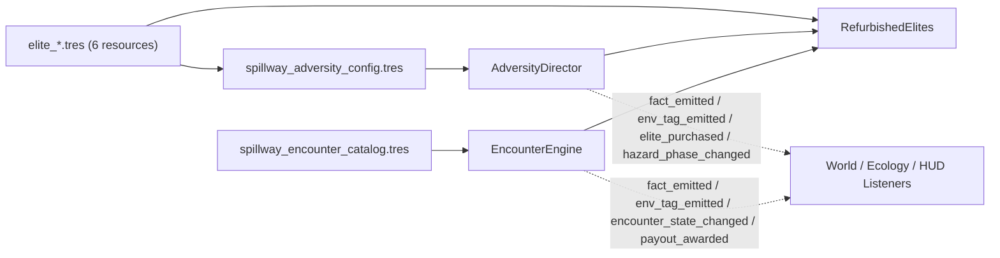

# Experimental Blueprint: Dual-Pressure Adversity Director & Dynamic Encounters (Pillars 4 & 5)

**Status:** Experimental gameplay-depth prototype (`experimental/director-events`, branched from `stage/alpha-w47`).
**Ground truth anchors:** [STORY-MAP.md](../STORY-MAP.md), [TONE-BIBLE.md](../TONE-BIBLE.md), [VISUAL-LANGUAGE.md](../../VISUAL-LANGUAGE.md), and [World 1 Difficulty Plan](../../../../project-guide/handoff/shared/world1/difficulty-plan.md).

---

## 1. Design Thesis: Escalation Through Behavior, Movement, and Gambles

Scrapkeep is **a crew of loose cannons, bulls in the Foreman's china shop, taking their world back from a machine that believes life can be run perfectly** ([STORY-MAP.md](../STORY-MAP.md)). That premise dictates how adversity escalates across a run:

1. **Behavioral Escalation, Never Bullet Sponges (Ruling `al`):**
   Base enemy hull HP reads `stage_threat` alone and **never scales with the stage clock or `hazard_tier`**. Instead, rising `hazard_tier` unlocks new Fleet pack roles, specialized **Refurbished Elite** chassis mutations with breakable armor plates, higher tactical cadence, and multi-phase **Environmental Hazards**.
2. **Momentum-First Difficulty Asymmetry (Rule 9 / Ruling `cu`):**
   *"Hardness presses a ball that slows or stops, and never stops a ball that keeps rolling and turning."*
   The Adversity Director tracks `stall_meter` (low speed `< 0.55 * cruise` or camping inside an `8.5 m` radius) against `flow_meter` (rolling `>= 0.85 * cruise` with active heading turns). Stalling sharpens credit income (up to `1.85x`), weights flank/cordon packs, and accelerates Refurbished elite pressure. Fast turning rolls keep `escape_lane_open = true` and convert magnetic hazards into tangential **slingshot** boosts via `never_brake()`.
3. **Keeper's Gambles vs. Unbanked Tension (Ruling `ci`):**
   - **Triggered Encounters** are explicit opt-in Keeper's Gambles (*"Nobody makes you."*): rolling into a Scrap Beacon Press locks a worn-bone perimeter fence for escalating waves and an Apex Construct, paying a guaranteed Relic/Rare jackpot once on clear.
   - **Run-State Random Encounters** react to live risk: carrying unbanked `unrefined_scrap` or neutral courier hauls wakes Brindle's Requisition Recovery Swarm (`greed_ambush_swarm`), creating push-your-luck tension until you cash in.
4. **Data-Driven `.tres` Tuning & Signal Decoupling (Rule 7):**
   All credit curves, Fleet pack spawn weights, third-person enemy role clarity specs, Refurbished Elite modifier pools, hazard timings, and encounter payouts live in loadable Godot 4 `.tres` resources under `sketches/core-loop/src/experimental/resources/director/`, wired via Godot signals with zero circular dependencies and zero static mutable state.

---

## 2. Shared Environmental Tag Vocabulary (Cross-Pillar Contract)

All three experimental tracks (`exp-builds-ecology`, `exp-director-events`, `exp-vertical-setpieces`) exchange environmental state using one canonical 6-tag vocabulary and dictionary payload schema:

| Tag (`StringName`) | Emitted By (Director & Encounters) | Cross-Pillar Compositional Hook |
| --- | --- | --- |
| `&"electrified"` | `Arc-Capacitor Relay`, `Overclocked Foreman-Spec`, `Magnetic Storm` | Chains across `&"slag_coated"` and `&"soaked_conductive"` via `exp-builds-ecology` bounded cascade solver |
| `&"burning"` | `Slag-Spill Exhaust`, `Rising Slag Tide`, `Air-Drop Salvage Pod` | Thermal shatter combo with `&"coolant_brittle"` and pressurized cryo-pipes in `exp-vertical-setpieces` |
| `&"slag_coated"` | `Rising Slag Tide`, `Over-Plated Juggernaut`, `Slag-Spill Exhaust`, `Air-Drop Pod` | Conductive floor band forcing vertical catwalk/rail rotation (`Smelter Pit` chunk) |
| `&"magnetic"` | `Magnetic Storm`, `Magnetic Tow-Winch`, `Overclocked Foreman-Spec` | Pulls loose scrap/barrels, curves metal projectiles, grants fast-ball slingshot arcs, fuels `magnetic + electrified -> rail_surge` |
| `&"coolant_brittle"` | `Brine-Coolant Scrubber`, `Corrosive Steam Squall` | Doubles (`2.0x`) Refurbished armor-plate shatter damage on vulnerable plates |
| `&"soaked_conductive"` | `Brine-Coolant Scrubber`, `Corrosive Steam Squall` | Primes Fleet packs for single-step arc jumps (mirroring `overtime.gd` sluice soak) |

**Canonical Payload Schema** (`RefurbishedElites.make_env_tag_payload`):
```gdscript
{
    "tag": StringName,       # one of the 6 canonical tags above
    "origin": Vector3,       # world-space center of effect
    "radius_m": float,       # positive spatial footprint radius
    "source_id": String,     # deterministic emitter id (e.g. "hazard:rising_slag_tide", "refurb_3:plate_0")
    "intensity": float,      # non-negative strength scalar (0.0 .. ~1.5)
    "ttl_s": float,          # positive lifetime in seconds
}
```

---

## 3. Architecture & Production Seam Mapping

The experimental modules mirror Scrapkeep's existing pure-simulation seam design so they can drop alongside shipped systems without rewriting movement, saves, or UI:

| Experimental File | Responsibility | Production Seam It Maps Onto |
| --- | --- | --- |
| `src/experimental/adversity_director.gd` | Seeded dual-pressure credit pool, stall-vs-flow tracker, behavioral tier escalation, Refurbished elite buyer, and 3-hazard cycle state machine | `src/world/director.gd` (`mode = "credit"`, `credits`, `effective_tier`, `ARRIVAL`), `src/world/event_director.gd` (`FloodCycle`, `DustSquall`, `never_brake`, `PARK_FLOOD_HOLD_CAP_S`), `src/combat/pack_pressure.gd` (line-hold & speed fade) |
| `src/experimental/refurbished_elites.gd` | 6 data-driven Refurbished mutations, layered destructible armor plates, third-person clarity cues, slingshot tether, once-only Salvage Bounty | `src/combat/elite_affixes.gd`, `src/world/director_cards.gd`, `src/combat/destructibles.gd` (`PaysOnce`) |
| `src/experimental/encounter_engine.gd` | `Area3D`-ready opt-in triggered Gambles (`Scrap Beacon`, `Over-Audit Blitz`) + greed/biome-weighted random encounters (`Air-Drop Pod`, `Rogue Compactor No. 38`, `Greed Swarm`) | `src/world/stage_locks.gd` (worn-bone perimeter wall, `YardLock` invariants), `src/world/overtime.gd` (opt-in bell/pot stakes), `src/world/activities.gd` (ring activation & once-only payouts), `src/world/events/stage_modifier.gd` (Foreman memo voice) |
| `src/experimental/resources/director/*.tres` | Rapid-tuning `.tres` configs for director curves, pack weights, 6 Refurbished elites, and encounter tables | Decoupled Godot 4 `Resource` tuning layer (zero hardcoded balance numbers in runtime logic) |

### Signal & Dependency Flow (Zero Cycles)



---

## 4. Third-Person Combat Clarity Catalog

Every enemy role, Refurbished Elite, and Apex Construct carries an authored silhouette, movement cadence, and telegraph window (`tell_s >= 0.6 s`) readable at third-person play distance (`VISUAL-LANGUAGE.md` §3–§4: 45-degree HAZARD `#ff5a3c` stripes with charcoal keylines for danger; worn-bone `#d2c5a5` for non-damaging lock walls; brass `#d9b44a` for Fleet requisition tags; dashed ANCIENT `#9dff3c` seams on Old Works casings).

### 4.1 Base Fleet Enemy Roles (`spillway_adversity_config.tres`)

| Role | Silhouette Cue | Movement Cadence | Telegraph & Floor |
| --- | --- | --- | --- |
| `chaser` | Low forward-raked wedge, welded ram bumper, single red lamp | `9.0 m/s` pursuit jog (under `14 m/s` cruise), lunges along held straight lines | `lane`, `0.65 s` |
| `lobber` | High-angle foundry mortar barrel on chunky tripod legs | Anchored mortar cadence; leads predictable lines with bracketed arc | `projectile`, `0.90 s` |
| `hooker` | Wide-jaw grapple claw hoisted over tracked carriage | Plants rear anchor, whines tether; cruise speed or boost snaps line | `lane`, `0.75 s` |
| `plated_brute` | Broad slab-shouldered bulkhead frame with riveted brass apron | Heavy march, overhead slam telegraph; exposes hull in recovery | `instant`, `0.85 s` |
| `jolt_layer` | Three-legged insulator frame with exposed copper spark crown | Plants grounded pylon stakes on concentric ring charge | `instant`, `0.80 s` |
| `boom_tender` | Tall crane jib with brass counterweight over iron-oxide base | Pivots heavy boom arm across riding lane | `lane`, `0.85 s` |
| `winch_drone` | Suspended cable drum under twin rotor ducts | Hovering orbit, sweeping wave tug against stalled balls | `wave`, `0.80 s` |
| `dispatcher` | Tall vertical chimney chute with blinking brass lantern | Stationary hopper; drops fresh chaser behind striped arrival ring | `instant`, `1.00 s` |

### 4.2 Six Refurbished Elite Variants (`elite_*.tres`)

All Refurbished Elites obey **ruling `al`** (base hull HP never grows with clock tier). Armor plates absorb incoming strikes first; high-momentum rams (`>= 0.85 * cruise`) apply `1.5x` plate shatter, and matching environmental weak tags apply `2.0x`. Breaking a plate during `telegraph` or `execute` staggers the elite and spills scrap (`+14` scrap per plate).

| Variant (`id`) | Maker / Code | Cost / Tier | Plates (Weak Tags) | Mutated Behavior & Counterplay | Card Line (`TONE-BIBLE`) |
| --- | --- | --- | --- | --- | --- |
| **Over-Plated Juggernaut** (`over_plated_juggernaut`) | Fleet `REFURB-09H` (`plated_brute`) | `18` / T1 | `3 x 40` (`coolant_brittle`, `burning`) | `0.95 s` braced HAZARD lane charge; curve off line or ram mid-brace to pop plate & stagger `2.2 s`. Spills `&"slag_coated"` sparks. | `"Bolts: 47. Brakes: pending audit."` |
| **Arc-Capacitor Relay** (`arc_capacitor_relay`) | Fleet `REFURB-14C` (`jolt_layer`) | `20` / T1 | `2 x 30` (`magnetic`, `soaked_conductive`) | `0.85 s` concentric `&"electrified"` pulse (`11 m`). Stripping both ceramic shrouds triggers an **overload backfire** that electrifies nearby Fleet packs! | `"Rated for dry shifts. Never checked the river."` |
| **Magnetic Tow-Winch** (`magnetic_tow_winch`) | Fleet `REFURB-22M` (`winch_drone`) | `22` / T2 | `2 x 35` (`electrified`, `coolant_brittle`) | `0.80 s` sweeping `&"magnetic"` tether (`14 m`). Drags slow balls inward, but fast balls (`>= 0.85x cruise`) turn lateral pull into a **tangential slingshot** (`never_brake`). | `"Pulls anything loose. Especially your line."` |
| **Slag-Spill Exhaust** (`slag_spill_exhaust`) | Fleet `REFURB-31S` (`lobber`) | `24` / T2 | `3 x 32` (`coolant_brittle`, `soaked_conductive`) | `0.90 s` molten shell lob + `&"slag_coated"`/`&"burning"` wake (`8.5 m`). Quench flaps or electrify wake for `conductive_arc_chain`. | `"Running 300 degrees over spec. Fleet calls it warm."` |
| **Brine-Coolant Scrubber** (`coolant_cryo_hauler`) | Fleet `REFURB-19B` (`boom_tender`) | `21` / T2 | `2 x 34` (`burning`, `electrified`) | `0.85 s` brine wave (`&"soaked_conductive"` + `&"coolant_brittle"`). Rupturing tank cages drenches surrounding Fleet units in freezing brittle brine for player combos. | `"Pressure relief valve welded shut for efficiency."` |
| **Overclocked Foreman-Spec** (`overclocked_foreman_spec`) | Old Works `MIND-01F` (`foreman`) | `30` / T3 | `4 x 36` (`electrified`, `slag_coated`) | `0.75 s` gridded alignment pulse (`&"electrified"` + `&"magnetic"`). Grants pack rest aura (`0.82x`) while dorsal plates stand; stripping plates breaks unison and staggers `2.6 s`. Relic bounty. | `"Scheduled a quick sync. Attendance mandatory."` |
| **Corrosive Bore-Warden** (`corrosive_bore_warden`) | Fleet `REFURB-42D` (`plated_brute`) | `23` / T1 (Dig) | `3 x 38` (`burning`, `coolant_brittle`) | `0.90 s` rotary auger trench (`&"soaked_conductive"` + `&"slag_coated"`). Carve off its striped bore lane or quench its heated collar plates to stagger the drill (`2.3 s`). | `"Shaft depth exceeds survey. Proceeding anyway."` |
| **Cryo-Slurry Tanker** (`cryo_slurry_tanker`) | Fleet `REFURB-47C` (`boom_tender`) | `24` / T2 (Dig) | `3 x 34` (`burning`, `electrified`) | `0.85 s` pressurized slurry sweep (`&"coolant_brittle"` + `&"soaked_conductive"`). Pop its frosted cistern bands with flame or live current to freeze surrounding Fleet rigs. | `"Coolant quota frozen at last quarter's rate."` |
| **Gale-Shear Harrier** (`gale_shear_harrier`) | Fleet `REFURB-63G` (`winch_drone`) | `25` / T1 (Highdraft) | `2 x 32` (`electrified`, `coolant_brittle`) | `0.80 s` sweeping crosswind tether (`&"magnetic"` + `&"electrified"`, `pull_accel = 15.0`). Stalled balls get dragged off-line; fast rolls (`>= 0.85x cruise`) turn lateral pull into a `never_brake` slingshot (`1.45x`). | `"Wind shear verified. Stay inside the guide rails."` |
| **Choir Resonator Pylon** (`choir_resonator_pylon`) | Old Works `MIND-04R` (`foreman`) | `29` / T2 (Highdraft) | `4 x 35` (`slag_coated`, `burning`) | `0.80 s` harmonic electric ring (`&"electrified"` + `&"magnetic"`). Holds `0.80x` pack unison aura while plates stand; stripping all four tuning plates triggers an overload backfire and staggers `2.5 s`. | `"Harmonic alignment is mandatory for all deck hands."` |

### 4.3 Worlds 2 (The Dig) & 3 (The Highdraft) Director Profiles & Opt-In `LiveRunBridge`

Each world loads its own data-driven `.tres` director profile and encounter catalog automatically via `LiveRunBridge.profile_for_stage(stage_index)` (`stages 1–2 -> spillway`, `stages 3–4 -> dig`, `stages 5–6 -> highdraft`), keeping `base_hull_hp` strictly independent of clock `hazard_tier` (ruling `al`):

| World | Director `.tres` | Encounter Catalog `.tres` | Signature Hazards (Rule 9 Compliant) | Lockdown Apex Construct | Signature Random Encounters |
| --- | --- | --- | --- | --- | --- |
| **World 1: Spillway** | `spillway_adversity_config.tres` | `spillway_encounter_catalog.tres` | `rising_slag_tide`, `corrosive_steam_squall`, `magnetic_storm` | **Refurbished Compactor Rig** (`over_plated_juggernaut`, `4` plates) | Air-Drop Pod, Rogue Compactor No. 38, Greed Ambush Swarm |
| **World 2: The Dig** | `dig_adversity_config.tres` | `dig_encounter_catalog.tres` | `corrosive_acid_squall` (sightline `340 -> 80 m`, silhouette boost `1.65x`), `subterranean_tremor` (jolts stalled balls, `never_brake` on fast rolls), `rising_slag_tide` (T2+) | **Bore-Rig Apex Construct** (`corrosive_bore_warden`, `5` plates) | High-weight **Rogue Compactor No. 38** chase, **Pit Recovery Ambush Swarm** (`corrosive_bore_warden` elite on high unrefined scrap), Air-Drop Pod |
| **World 3: The Highdraft** | `highdraft_adversity_config.tres` | `highdraft_encounter_catalog.tres` | `gale_shear_crosswind` (`never_brake` tailwind slingshot for fast balls, lateral drift on scrap/projectiles), `magnetic_storm` (T2+, stronger pull/slingshot), `corrosive_steam_squall` | **Sky-Dredge Choir Relay** (`choir_resonator_pylon`, `6` plates, backfires on strip) | High-weight **Air-Drop Salvage Pod** crash, **Highdraft Recovery Swarm** (`gale_shear_harrier` elite), Rogue Compactor No. 38 |

**Opt-In `LiveRunBridge` & `ExperimentalAudioBank` Wiring (`src/experimental/live_run_bridge.gd`):**
- Gated strictly OFF by default (`LiveRunBridge.is_enabled(args, env) == false`) so deterministic World 1 sitting pins never drift; enabled via `--experimental-depth=on` or `SCRAPKEEP_EXPERIMENTAL=1` (explicit `--experimental-depth=off` overrides env).
- Composes `EnvTags`, `JuryRigSynergies`, `EcologyActors`, `AdversityDirector`, `EncounterEngine`, optional `DynamicSetpieces`, and `ExperimentalAudioBank` (`src/presentation/experimental_audio_bank.gd`) through tracked `WeakRef` signals with zero circular `preload` dependencies and zero orphan nodes on `teardown()`.
- Signal-to-audio cue routing (cooldown-enforced and headless-safe):
  - Stage start -> `smelter_ambience` (loop)
  - Hazard `WARNING` -> `pa_hazard_squall_incoming` (PA dispatch); `RAMP`/`PEAK` -> `hazard_squall_alarm` (loop, stopped on `RECEDE`/`COOLDOWN`)
  - Lockdown start -> `pa_salvage_press_lockdown` + `apex_lockdown` (loop, stopped on lockdown settle)
  - Apex Construct spawn or Old Works / Foreman elite purchase -> `pa_foreman_rig_deployed`
  - Air-Drop Salvage Pod announcement -> `pa_airdrop_pod_inbound`

---

## 5. Dual-Pressure Pacing & Environmental Hazard Director

### 5.1 Credit Pool & Momentum/Stall Asymmetry

Each tick, `AdversityDirector.advance()` updates:
- **Income rate & wallet cap:** `(base_income_per_s + (hazard_tier - 1) * tier_income_step) * (1.0 + stall_meter * stall_income_max_bonus)`, clamped to `credit_pool_cap = 48.0` so late-run banked credits cannot dump a synchronized elite + hazard + max-pack spike the instant cooldowns expire.
  - Default `spillway_adversity_config.tres`: `2.4 + 0.55 * (tier - 1)` credits/s at flow (`stall_meter = 0`), climbing up to `1.85x` when stalled (`stall_meter = 1.0`).
- **Stall detection:** Speed `< 0.55 * cruise` (`7.7 m/s` at `14 m/s` cruise) OR sustained hovering/tight orbiting inside `8.5 m` for `>= 2.0 s` raises `stall_meter` (`+0.28/s`, or `+0.378/s` when both slow and camped) and decays `flow_meter`. A fast ball crossing `8.5 m` in `~0.6 s` never triggers camping.
- **Flow reward:** Rolling `>= 0.85 * cruise` (`>= 11.9 m/s`) decays `stall_meter` (`-0.45/s`, boosted `1.25x` while turning `>= 0.45 rad/s`), builds `flow_meter`, keeps `escape_lane_open = true`, and keeps elite/pack spawn cones ahead/flank rather than closing a cordon.
- **Slingshot speed ceiling:** Magnetic Storm tangential boosts cap forward acceleration above `1.65x` cruise so chained pulls cannot pinball-tunnel inside perimeter fences.
- **Foreman Tier Announcements:** Every `hazard_tier` step emits `hazard_tier_rose` with a dry executive memo (*"Throughput adjustment approved. Carry on."*). Nothing escalates silently.

### 5.2 Environmental Hazard Cycles (`WARNING -> RAMP -> PEAK -> RECEDE -> COOLDOWN`)

Every hazard obeys a strict finite phase cycle with mandatory pre-impact warning (`>= 4.0 s`, never below `0.6 s`) and guaranteed recession:

1. **Rising Slag Tide (`&"rising_slag_tide"`, T1+, `14` credits):**
   - `4.5 s` warning -> `4.0 s` ramp (rises from `-1.5 m` hidden to `+2.4 m` basin depth) -> `10.0 s` peak -> `5.0 s` recede back below `0.0 m`.
   - Emits `&"slag_coated"` and `&"burning"` across the lower basin (`46 m` radius), forcing vertical high-ground rotation onto catwalks, jump pads, and rails.
   - **ParkFlood Bounded Hold (`SLAG_HOLD_CAP_S = 2.0 s`):** If a grounded ball is inside the low basin during `RAMP`, the rise pauses up to `2.0 s` so molten slag never surprises a ball with zero reaction room, then finishes rising and receding cleanly (`FloodNeverHeld`).
2. **Corrosive Steam Squall (`&"corrosive_steam_squall"`, T1+, `12` credits):**
   - `5.0 s` warning -> `3.0 s` ramp -> `12.0 s` peak -> `4.0 s` recede.
   - Compresses `current_sightline_m()` from `360 m` down to `85 m` while raising `close_silhouette_boost()` (`1.0 -> 1.65`) and `telegraph_contrast_boost()` (`1.0 -> 1.4`) so close-quarters silhouettes and HAZARD stripes pop cleanly.
   - Emits `&"soaked_conductive"` and `&"coolant_brittle"` pockets at peak.
3. **Magnetic Storm (`&"magnetic_storm"`, T2+, `16` credits):**
   - `4.0 s` warning -> `2.5 s` ramp -> `11.0 s` peak -> `3.5 s` recede.
   - Emits `&"magnetic"` and `&"electrified"` across a `42 m` pole radius.
   - Deterministic `compute_magnetic_force(pos, vel, mass_class, cruise_mps)`:
     - `&"loose_scrap"` & `&"metallic_prop"`: strong inward pull + orbital swirl.
     - `&"metal_projectile"`: predictable lateral Lorentz deflection curve.
     - `&"player_ball"`: gentle inward tug below `0.85x` cruise; **tangential slingshot acceleration** (`never_brake`) at or above `0.85x` cruise!

---

## 6. Triggered Keeper's Gambles vs. Run-State Random Encounters

### 6.1 Triggered Encounters (Opt-in `Area3D` Volumes)

Registered via `EncounterEngine.register_triggered_volume()` and instantiable in any scene via `EncounterEngine.build_trigger_area(volume)` (standard `Area3D` + `SphereShape3D` + metadata):

1. **Scrap Beacon / Salvage Press Lockdown (`&"scrap_beacon_lockdown"`):**
   - *Door line:* `"Scrap Beacon. Press locks the yard. Nobody makes you."`
   - *Flow:* `ARMED -> LOCKED_WAVES` (Wave 1: 2 Chasers + 1 Lobber; `1.8 s` gap; Wave 2: Chaser + Hooker + Plated Brute) `-> APEX_ACTIVE` (**Refurbished Compactor Rig**: towering dual-ram salvage press on quad treads, `4` destructible crusher plates, `0.95 s` lane smash) `-> SETTLED`.
   - *Perimeter fence:* Non-damaging worn-bone spring fence (`radius = 28 m`, `WALL_SPRING = 60.0`), matching `stage_locks.gd` visual semantics (never red HAZARD).
   - *Jackpot payout (paid once):* `240` scrap, `30` cogs, `1` core, `2` part rolls with guaranteed `&"relic"` rarity.
2. **Over-Audit Blitz Gate (`&"over_audit_blitz_gate"`):**
   - *Door line:* `"Audit Blitz Gate. Fast chains multiply the cores."`
   - *Flow:* `28.0 s` open-park takedown sprint (no perimeter lock). Kills landed at `>= 1.0x` cruise add `+0.35x` to `chain_multiplier` (up to `3.0x`), multiplying cogs and cores on quota (`8` kills) or clean timer settlement (`>= 4` kills).

### 6.2 Run-State Random Encounters

Weighted every cooldown window by `EncounterEngine.evaluate_random_weights(run_ctx)`:

1. **Air-Drop Salvage Pod Crash (`&"airdrop_salvage_pod"`):**
   - `3.5 s` closing-bracket projectile telegraph ahead of the riding line -> impact emits `&"burning"` + `&"slag_coated"`, spawns a fresh destructible cover hull (`half_extents = Vector3(3.2, 2.6, 3.2)`, `destructible_tier = 2`), and triggers an `18 s` contested salvage race against Fleet scavengers. Strongest weight in `orbital_graveyard` and `spillway`.
2. **Rogue Compactor Chase (`&"rogue_compactor_chase"`):**
   - Freed Old Works machine **No. 38** (cut command line, brass governor, no purple, no speech — only work-cycle klaxon).
   - `2.5 s` lane telegraph -> tears along corridor at `18.0 m/s` for `9.0 s`. Players can jump/vault clear OR **bait Fleet packs into its crusher lane** (`evaluate_compactor_crusher()` resolves `220` crusher damage + `+35` scrap per crushed Fleet machine!). Strongest weight in `compactor_canyon` and `smelter_pit`.
3. **High-Value Greed Ambush Swarm (`&"greed_ambush_swarm"`):**
   - Brindle's Requisition Recovery Crew (*"Unfiled inventory detected. Sending recovery invoice."*).
   - **Dynamic tension curve:** Weight is **`0.0`** when `unrefined_scrap < 120` and `courier_bounty == 0`. Above threshold, weight rises steeply up to **`6.5`** as carried unbanked scrap and courier bounty climb, sending an interceptor pack + `Magnetic Tow-Winch` elite. Clearing the first squad pays a capped **`+25%` Risk-Carry Dividend** (`dividend_scrap_cap = 160`) plus a guaranteed Rare part roll and `1` core; repeat unbanked swarms in the same stage grant a diminished scrap-only dividend (zero repeat cores/rares) to close exponential farming exploits. Banking scrap immediately resets greed weight to `0.0`.

---

## 7. Formal Safety Invariants & Verification Mapping

Every experimental mechanic preserves the formal model promises checked by Scrapkeep's TLA+ suite (`.agents/skills/scrapkeep-verify-formal/`):

| Formal Model / Rule | Experimental Guarantee Enforced in Code | Test Coverage (`experimental_director_events_test.gd`) |
| --- | --- | --- |
| `YardLock.tla`: `SingleActiveLockdown` | `activate_triggered()` rejects a lockdown whenever another triggered encounter or external `active_lockdown` is live. | Second Scrap Beacon activation rejected while first is locked. |
| `YardLock.tla`: `NoLockInWardenFight` | `warden_awake == true` blocks new lockdowns and immediately preempts/unlocks any live Scrap Beacon (`outcome = &"warden_preempted"`). | Mid-lockdown `warden_awake = true` immediately sets `has_active_lockdown() == false`. |
| `YardLock.tla`: `LockAlwaysOpens` | `elapsed_s >= max_duration_s` (`75 s`) unconditionally opens the perimeter and settles the volume (`outcome = &"timed_out"`). | Stepping past `75 s` unconditionally unlocks the beacon. |
| `ParkFlood.tla`: `FloodNeverHeld` / `HoldEnds` | `Rising Slag Tide` holds at most `SLAG_HOLD_CAP_S = 2.0 s` under a grounded ball, then completes `RAMP -> PEAK -> RECEDE -> COOLDOWN` with `is_slag_floor_clear() == true`. | Full cycle stepped with grounded ball inside basin proves bounded hold and full recession. |
| `HazardCycle.tla`: `TellBeforeStrike` / `RollingNeverSought` | Every elite attack, enemy role, hazard, and random encounter enforces `tell_s >= 0.6 s`; fast rolling balls keep `escape_lane_open == true` and receive `never_brake` slingshots. | Audited across all `.tres` configs, elite steps, and Magnetic Storm force vectors. |
| `Rewards.tla`: `AtMostOnce` (`RewardsBankedOnce`) | `bounty_paid` on `RefurbishedInstance` and `payout_settled` on every triggered/random encounter guarantee every reward is emitted at most once, even under duplicate kills or teardown. | Repeated hits on defeated elite/Apex and duplicate `resolve_active_random()` calls pay `{}`. |
| Warm-Batch Isolation (`--shuffle`) | Zero mutable `static var` across all experimental `.gd` files; all `Area3D` nodes freed cleanly in tests. | Repeated shuffled/back-to-back test runs produce identical deterministic outputs with zero leaks. |
