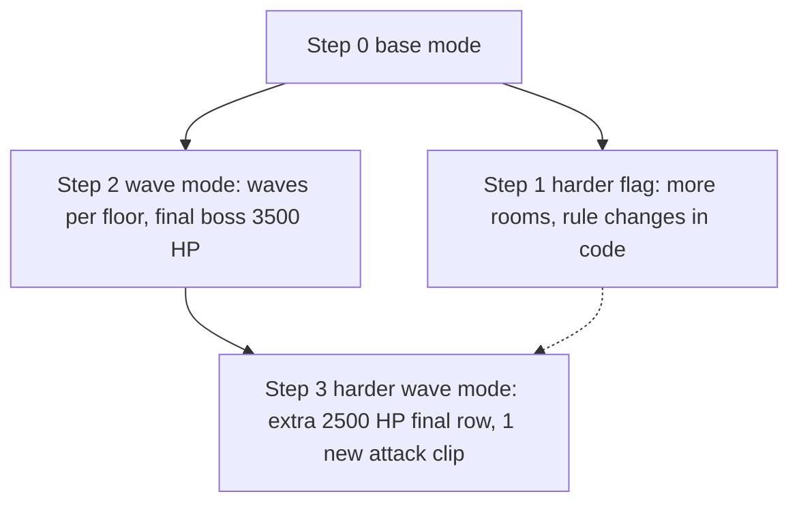

# The Binding of Isaac difficulty reference (comps note)

Evidence: this install is the Afterbirth+ build, not Repentance. Level 2: the largest boss-or-effect entity id in `isaac/extracted/resources/entities2.xml` below the effect range is 413 and the file has no ids in the 900s; `rooms/` stops at file 25 (greed final) with `stages.xml` ending at stage id 26; the extract log reads the `afterbirthp_*.a` archives (`isaac/extract-difficulty.log`). No Tainted characters, no alternate-path floors, no later boss ids exist in the data. Level 4 (a script read the value) for HP, color multipliers, room and wave statistics, ambush and boss-rush tables (scripts in `~/scratch/game-study/difficulty-tools/isaac/`: `bosses.py`, `misc.py`, `rooms2.py`, `greed.py`, `rush.py`, `ttk.py`). Level 4 for animation frame counts and event triggers (`anm.py`, `bossanim.py`, `appear.py`, `tells.py`), but those are animation-file timings, not proof of the code-driven attack timing (see Gaps). Level 2 for enum pointers (`scripts/enums.lua`). Player DPS, hit damage, per-stage item power and every hard-mode or champion-rate rule are INFERRED or gaps, labelled where used. Wiki (public) numbers come only from the existing comps memos `sketches/core-loop/design-v3/research/comps/isaac/floor-generation.md` and `pacing-and-trades.md`. Everything below is in my own words; entity names appear only in Source cells as file or id labels.

Conventions: frames are 30 fps in every animation read (`Info Fps="30"` in each anm2; seconds = frames / 30). Stage numbers are the game's run stages 1 to 12 (`scripts/enums.lua` LevelStage, lines 1072-1085): two per early chapter, a third stage inside the fourth chapter, then three single-stage endings. Boss stage positions are data where marked "challenges.xml endstage" and general knowledge (INFERRED, not read) otherwise.

## Bosses

### How boss HP is stored

- `entities2.xml` gives each boss a `baseHP` and a `stageHP`. Of the 133 boss-flagged rows (122 are real boss ids below 1000, 11 are effect rows), `stageHP` is non-zero on 18 rows, all lesser bosses: seven themed minibosses at 7.5 to 24 per stage and two late ones at 30 and 45 (`entities2.xml boss="1" stageHP`, `chk.py`). All main-line bosses have `stageHP` = 0. So main-line boss HP is a fixed number, not a function of the floor.
- INFERRED (general knowledge, not read): effective HP = `baseHP + stageHP x stage number`; applied to the 23 non-boss rows that carry `stageHP` (values 1 to 8) and the minibosses, it adds roughly +15 to +24 per stage on a 60 base.
- Champion-style boss variants live in `bosscolors.xml`: 62 color variants over 41 boss entries; 28 of them carry an `hp` multiplier. Multipliers: 0.45, 0.5 (x3), 0.55, 0.85, 0.9, 1.15, 1.23 (x2), 1.25 (x14), 1.3, 1.45, 1.56, 2.0; median 1.25, 21 above 1.0 and 7 below. Scale (body size) ranges 0.58 to 1.15 on 21 of them. (`bosscolors.xml boss/color@hp`, `@scale`, script `misc.py`.)
- Boss rooms in the room library: 431 boss rooms in `rooms/00.special rooms.stb`; 386 (89.6%) contain one boss entity, 43 (10.0%) two, 2 (0.5%) three; 77 distinct boss entity-variant pairs appear (`rooms1.py`, same file).

### DPS and time-to-kill assumption (INFERRED, read this first)

- Base player: shots per second = 30 / (10 + 1) = 2.73 and base damage 3.5, so about 9.55 DPS. Neither number is in `players.xml` (it only holds starting hearts, bombs, and starting items per character); both are general knowledge, not read.
- Ordinary build by stage (INFERRED): DPS multiplier = 1 + 0.18 x (stage - 1), meaning stage 6 is 1.9x (18.1 DPS), stage 10 is 2.6x (25.0 DPS), stage 12 is 2.98x (28.4 DPS). "Ordinary" means a mix of damage and rate items picked up from treasure rooms and drops, no run-defining synergy.
- Uptime on the boss 0.7 (dodging, line-of-sight, bosses that move or hide). TTK = baseHP / (DPS x 0.7). Sensitivity: low build (-30% DPS) and high build (+60% DPS) shown in brackets. Script `ttk.py`.

### Early bosses (stages 1 to 2)

| Position | baseHP, scaling | Effective DPS and TTK (INFERRED) | Contact damage field | Phases | Source |
|---|---|---|---|---|---|
| floor-1 first-pool boss (single body, walks and jumps) | 250, stageHP 0 | 6.7 DPS, TTK 37 s (23 to 53) | 1 | none in data | `entities2.xml id=20 baseHP,stageHP,collisionDamage` |
| floor-1 segmented boss (a chain of small bodies) | 22 per segment, stageHP 0; segment count is code | n/a (segment count unknown) | 1 | none in data | `entities2.xml id=19 variant=0 baseHP` |
| floor-2 default boss (head plus two bodies in the animation set) | 350, stageHP 0 | 7.9 DPS, TTK 44 s (28 to 63) | 2 | none; three body parts have separate death animations | `entities2.xml id=28 variant=0 baseHP`; `gfx/028.000_chub.anm2` DeathHead, DeathBody01, DeathBody02 |

Attack data (frames at 30 fps; trigger = the first `Shoot`-type event; tell = start to trigger, tail = trigger to end):

| Attack | Frames | Tell (s) | Active and recovery (s) | Note | Source |
|---|---|---|---|---|---|
| floor-2 default boss, spit (3 directions) | 20, trigger at 12 | 0.40 | 0.27 | whole move 0.67 s | `gfx/028.000_chub.anm2` SpitHori/Down/Up, event Shoot |
| floor-2 default boss, dropping a hazard | 16 | not split | 0.53 whole | no trigger | `gfx/028.000_chub.anm2` PoopSide/Up/Down |
| floor-1 first-pool boss, jump | 15 up, 64 down | 0.5 up (INFERRED to be the visible lead-in; no trigger marks it) | 2.13 down and land | code-driven: no trigger in the file, so the shadow-to-landing sequence is code | `gfx/020.000_monstro.anm2` JumpUp, JumpDown |
| floor-1 first-pool boss, taunt then action | 66 | 2.2 whole | not split | pause between actions, code-driven | `gfx/020.000_monstro.anm2` Taunt |
| floor-1 and floor-2 pool, simple spit-type bosses | 16 to 20 | 0.1 to 0.4 | 0.4 to 0.5 | trigger at frame 3 to 12 | `gfx/261.000_dingle.anm2` Spit; `gfx/260.000_haunt.anm2` SpitNoSkin |

What the early tier shows: HP 250 to 350 with a TTK near 40 s at an ordinary build; attacks are one or two projectile or jump patterns; contact damage is the only threat for the first several seconds because the first boss animation is an Appear of 20 to 26 frames (0.67 to 0.87 s) followed by walking. Median Appear across all 67 boss animation sets with one: 0.67 s (min 0.13, max 4.3) (`appear.py`).

### Mid bosses (stages 3 to 8)

| Position | baseHP, scaling | Effective DPS and TTK (INFERRED) | Contact damage field | Phases | Source |
|---|---|---|---|---|---|
| stage 3 to 4 boss slot (stage INFERRED), body with 6 attack animations | 595, stageHP 0 | 10.3 DPS, TTK 58 s (36 to 83) | 1 | none in data | `entities2.xml id=36 baseHP`; `gfx/036.000_gurdy.anm2` Attack1..Attack6 |
| stage 5 to 6 boss (stage INFERRED), two-hand multi-part | 750 body, hands 1 each | 11.5 DPS at stage 5, TTK about 65 s | 2 | body plus two hands (hands are 1 HP, so they are not an HP gate) | `entities2.xml id=266 variant 0,1,2 baseHP` |
| stage 6 end boss (data: the stage-6 end for 13 challenges) | 645, stageHP 0 | 12.7 DPS, TTK 51 s (32 to 73) | 2 | stomp is a separate entity row of 645 | `entities2.xml id=45 variant=0,10 baseHP`; `challenges.xml endstage="6"` |
| stage 8 end boss (data: the stage-8 end for 9 challenges) | 950, stageHP 0 | 15.1 DPS, TTK 63 s (39 to 90) | 0 (it is a stationary target) | pulse cadence in three tiers (see below) | `entities2.xml id=78 variant=0 baseHP`; `challenges.xml endstage="8"` |
| main-line boss rows with HP up to 1000 (77 rows, minibosses and body parts removed) | median 350, p25 200, p75 500, min 22, max 1000 | TTK band 37 to 63 s for the ones placed at stages 1 to 8 | 0 to 2 | mostly 1 | `entities2.xml boss="1" id<1000`, script `chk.py` |

Attack data:

| Attack | Frames | Tell (s) | Active and recovery (s) | Note | Source |
|---|---|---|---|---|---|
| stage 5 to 6 two-hand boss, spread shot | 55, trigger 32 | 1.07 | 0.77 | | `gfx/266.000_mega gurdy.anm2` Shoot |
| same boss, long shot | 73, trigger 44 | 1.47 | 0.97 | longest wind-up of any trigger-based attack found | `gfx/266.000_mega gurdy.anm2` Puke |
| same boss, hand moves | 65 and 50 | 2.17 and 1.67 whole | not split | no triggers, code-driven | `gfx/266.000_mega gurdy.anm2` Attack1, Attack2 |
| stage 3 to 4 boss slot (stage INFERRED), six attack animations | 34 to 54 | 1.13 to 1.80 whole | not split | no triggers, code-driven | `gfx/036.000_gurdy.anm2` Attack1..6 |
| mid boss, big belly burst | 62, trigger 21 | 0.70 | 1.37 | 41 frames of tail | `gfx/264.000_mega fatty.anm2` Fart |
| same boss, projectile spew | 48, trigger 3, stop 39 | 0.10 | 1.20 active | continuous | `gfx/264.000_mega fatty.anm2` Puking |
| mid boss, suck-in pull | 62, start 6, end 45 | 0.2 | 1.3 pull | | `gfx/264.000_mega fatty.anm2` Sucking |
| mid boss, ring shot | 45, trigger 15 | 0.50 | 1.00 | | `gfx/262.000_megamaw.anm2` FireRing |
| mid boss, summon after short tell | 11 tell animation, then 49 with trigger 42 | 0.37 tell; 1.4 | 0.23 | one tell is under 0.6 s | `gfx/262.000_megamaw.anm2` SummonTell, Summon |
| stage-6 end boss, foot stomp | 75 | 2.5 whole | not split | stomp is a separate effect entity; code-driven | `gfx/045.010_mom stomp.anm2` Stomp |
| stage-6 end boss, eye and arm and door animations | 60 to 63 each | 2.0 to 2.1 whole | not split | no triggers | `gfx/045.000_mom.anm2` Eye, ArmOpen, DoorOpen |
| stage-8 end boss, pulse (tier 1, 2, 3) | 24, 15, 6 | 0.2, 0.2, 0.1 to the pulse event (trigger frames 6, 6, 3) | cycle 0.8, 0.5, 0.2 s | three speed tiers; the thresholds that switch tiers are in code | `gfx/078.000_moms heart.anm2` Heartbeat1/2/3 |
| stage-8 end boss, summon beat | 33, trigger 6 | 0.20 | 0.90 | | `gfx/078.000_moms heart.anm2` HeartSummon |
| stage-9 secret boss, laser | LaserStart 15, LaserLoop 13, LaserEnd 7 | 0.50 warm-up | 0.43 loop, 0.23 end | the one laser warm-up found, under 0.6 s; this boss is in the late tier but the number belongs here as the shortest lethal-class tell | `gfx/407.000_hush.anm2` |

Punish windows for the mid tier, from named rest animations (all clip lengths from `appear.py`):

| Window | Duration | Source |
|---|---|---|
| rest after a slide attack | 0.8 s | `gfx/261.000_dingle.anm2` Tired |
| panting rest | 0.67 s | `gfx/079.000_gemini.anm2` Pant |
| dizzy chain after a bomb-throwing move (three clips, plus a 0.5 s pop-up) | 0.67 + 0.63 + 0.43 = 1.73 s | `gfx/411.000_bighorn.anm2` BombDizzy, DizzyLoop, DizzyEnd |
| flinch on a stagger (ground, air) | 0.5 s, 0.57 s | `gfx/413.000_matriarch.anm2` Flinch, AirFlinch |

Most bosses in this game have no named rest at all and stay damageable the whole fight (INFERRED from the absence of a rest or stun animation in 90 boss animation files and from the HP-bar design; whether a state is damage-immune is a code flag, not data).

### Late bosses (stages 9 to 12, plus the wave-mode final)

| Position | baseHP, scaling | Effective DPS and TTK (INFERRED) | Contact damage field | Phases (data evidence) | Source |
|---|---|---|---|---|---|
| stage-10 end boss (light branch; INFERRED stage), row variant 0 | 2000 | 17.5 DPS, TTK 114 s (71 to 163) | 1 | three form prefixes in the animation file (forms 1, 2, 3) with a 0.67 s transform and a 1.33 s stand-up; thresholds are in code | `entities2.xml id=102 variant=0 baseHP`; `gfx/102.000_isaac (final boss).anm2` 1Attack, 2Attack, 2Evolve, 3Idle |
| stage-11 alternate-branch end boss (INFERRED stage; rows variant 1 and variant 2) | 2000 and 1000 (the 1000 row is an alternate-form row) | variant 1: 18.7 DPS, TTK 107 s | 1 | not separately read; the forms in the animation file are shared with the row above | `entities2.xml id=102 variant=1,2 baseHP`; `gfx/102.001_ (final boss).anm2`, `102.002_ (alt).anm2` |
| stage-10 end boss (dark branch) | 600 body, 600 for the stomp row | 17.5 DPS, TTK 34 s per 600 | 2 | body plus a stomp entity; three body attacks | `entities2.xml id=84 baseHP`; `gfx/084.000_satan.anm2` Attack01..03; `084.010_satan stomp.anm2` |
| stage-11 end boss (head and body rows) | 2000 head, 600 body | 18.7 DPS, TTK 107 s head, 139 s with body (67 to 199) | 2 | two entities | `entities2.xml id=273 variant=0,10 baseHP`; `challenges.xml endstage="11"` (2 challenges) |
| optional stage-11 super boss | 3000 head, 600 each of two hands; second form 2000 head, 600 each of two hands | 160 s phase one head; 267 s two heads (100 to 382 s) | 2 | two entities (phase one and two); hands hide and reveal | `entities2.xml id=274, id=275`; `gfx/274.000_megasatanhead.anm2` |
| stage-9 secret boss | 6666 body, 500 for the second stage | 16.3 DPS, TTK 409 s (256 to 584) | 1 | two entity rows (a second stage at 7.5% of the first); the thresholds are in code | `entities2.xml id=407 baseHP`, `id=408 baseHP` |
| stage-12 final boss | 10000, a shape-shifter | 19.9 DPS, TTK 502 s (314 to 717) | 1 | animation file has 3 clips only (idle, blink, scream); the whole fight is code-driven | `entities2.xml id=412 baseHP`; `gfx/412.000_delirium.anm2`; `challenges.xml endstage="12"` (3 challenges) |
| wave-mode final boss | 3500 (tier-2 variant 2500) | 13.9 DPS (assumes stage 7, INFERRED), TTK 252 s (157 to 360); the second row (2500) 180 s on its own | 2 | the second row's animation file has 27 triggers vs 17; of the 10 extra, 8 are gib events in two break-free clips (80 and 170 frames), 1 is a death-clip disappear, 1 is a new attack (smash, 28 frames, trigger at frame 20 = 0.67 s); whether the second row replaces or follows the 3500 form is in code, and the break-free clips suggest it follows (INFERRED), so total could be near 6000 | `entities2.xml id=406 variant=0,1 baseHP`; `gfx/406.000_ultragreed.anm2`, `406.001_ultragreedier.anm2` |

Attack data for the late tier:

| Attack | Frames | Tell (s) | Active and recovery (s) | Note | Source |
|---|---|---|---|---|---|
| stage-10 end boss form 1, shot | 16 | not split | 0.53 whole | | `gfx/102.000_isaac (final boss).anm2` 1Attack |
| form 2, shot | 29 | not split | 0.97 whole | | same, 2Attack |
| form 3, special attack, start / loop / end | 32 / 16 / 27 | 1.07 start | 0.53 loop, 0.90 end | the loop repeats | same, 3FBAttack4Start/Loop/End |
| form 3, burst | 27 | not split | 0.90 whole | | same, 3FBAttack3 |
| dark-branch body, three attacks | 57, 59, 50 | 1.67 to 1.97 whole | not split | no triggers | `gfx/084.000_satan.anm2` Attack01..03 |
| dark-branch stomp | 88 | 2.93 whole | not split | the big hit; code-driven | `gfx/084.010_satan stomp.anm2` Stomp |
| stage-11 end boss, swarm and blast | 32 each, trigger 3 | wind-up is the 26-frame charge clip: 0.87 | 0.97 | pairing of charge clip with shot is INFERRED | `gfx/273.000_thelamb.anm2` Swarm, Blast, Charge |
| same boss, head dash | 8 | 0.27 | not split | | same, HeadDashDown/Up/Side |
| super boss head, shot | 65, trigger 4 | wind-up is the 30-frame charging clip: 1.0 | 2.03 | pairing INFERRED | `gfx/274.000_megasatanhead.anm2` Shoot1, Charging |
| same boss, head smash (single) | 48, trigger 27 | 0.90 | 0.70 | | same, SmashHead |
| same boss, head smash x3 / x5 | 68 / 88, triggers 27, 37, 47 (and 57, 67) | 0.90 to first | 0.33 s between hits | rhythm attack | same, SmashHead3, SmashHead5 |
| same boss, hand smash | 59, trigger 31 | 1.03 | 0.93 | | `gfx/274.001_megasatanhand.anm2` SmashHand1 |
| same boss, quake | 32, trigger 17 | 0.57 | 0.50 | | same, SmashQuake |
| stage-9 secret boss, scream and tell | 43 and 28 | 1.43 and 0.93 | not split | no triggers, code-driven | `gfx/407.000_hush.anm2` Scream, Tell1 |
| wave-mode final, jump | 17 up (trigger 10), 19 down (trigger 7) | 0.33 | stomp lands 0.23 after the down start | the short tell on a jump | `gfx/406.000_ultragreed.anm2` JumpUp, JumpDown |
| wave-mode final, shoot | 19, trigger 3 | 0.10 | 0.53 | | same, ShootDown etc. |
| wave-mode final, tantrum | 40, triggers 10 and 30 | 0.33 to first stomp | stomps 0.67 s apart | | same, Tantrum |

Late-tier immune or guarded windows (the opposite of a punish window; whether damage is actually blocked is a code flag, so the duty of these clips is INFERRED from their names):

| Window | Frames, duration | Source |
|---|---|---|
| wave-mode final boss, guard enter / hold / exit | 10 / 1 (looped) / 10 frames = 0.33 s in, hold length set by code, 0.33 s out; guard-flash clips 12, 7, 3 frames (0.40, 0.23, 0.10 s) | `gfx/406.001_ultragreedier.anm2` and `406.000_ultragreed.anm2` GuardStart, Guarding, GuardEnd, GuardFlashSlow/Medium/Fast |
| optional super boss head, hide and reveal | 30 frames each = 1.0 s out and 1.0 s back (hiding is a 1-frame loop of code-set length) | `gfx/274.000_megasatanhead.anm2` Hide, Hiding, Reveal; hands the same in `274.001_megasatanhand.anm2` |

### Aggregate attack timings across all boss animation files

- 79 animations with a shoot-type trigger in 29 boss animation files (deaths and appear clips removed): trigger time min 0.0 s, p25 0.10, median 0.33, p75 0.67, max 1.47; time after the trigger: p25 0.50, median 0.70, p75 1.03, max 2.6; whole animation: median 1.07 s, p75 1.70 (`bossanim.py`). 23 of 79 (29%) have the trigger at 0.6 s or later.
- 301 attack-like animations in 90 boss files (name contains attack, charge, slam, stomp, smash, jump, spit, puke, laser, tell or summon): whole length min 0.07 s, median 1.07 s, p75 1.77 s, max 3.53 s; 239 of them carry no trigger at all (`bossanim.py`).
- Wind-up-named clips (charge, charging, scream, before-slide, tell), hand-cleaned from `tells.py` output to drop rage idles and sub-0.25 s direction variants: 23 clips, median 26 frames (0.87 s), p25 about 0.7 s, p75 about 1.1 s, min 0.37 s, max 2.8 s; 21 of 23 (91%) are at or above 0.6 s. The two shorter ones are a 0.37 s summon tell on a stage 5-to-6 mid boss and a 0.47 s charge-start on a lesser boss; the 0.5 s laser warm-up is a separate clip not in this set (name did not match). This is the best data-based read of how long a "tell" runs, and it is INFERRED because the anm2 does not say which clip precedes which attack.
- Largest single-hit or burst damage as a share of base health: not in the data (see Gaps). INFERRED (general knowledge, not read): the vast majority of hits cost one full heart (2 half-hearts); the default character has 6 half-hearts (`players.xml id=0 hp="6"`), so a hit is 33% and three hits kill, and the character range is 2 to 8 half-hearts (`players.xml` hp attributes over the 12 red-heart characters, median 4). Boss collision field values: of 122 real boss rows, 62 are 2, 53 are 1, 7 are 0 (`entities2.xml boss="1" id<1000 collisionDamage`, `chk.py`); for non-boss ids 10 to 399, 157 rows are 1, 19 are 2, 52 are 0. Units of that field are not documented in the file.
- Time before the first dangerous attack: no data on the intro or the vs-screen timer. The first Appear clips are 0.67 s (median) and the early bosses' first attack animations are 0.4 to 2 s; INFERRED that the first lethal exposure comes inside a few seconds of control, and INFERRED that the opening is contact-only (no attack animation is named before the first walk clip). This is far shorter than the Scrapkeep 45 s rule, so the game does not model a safe opening.

```mermaid
flowchart LR
  A[Stage 1-2: HP 250-350, TTK about 40 s] --> B[Stage 3-6: HP 595-750, TTK 50-60 s]
  B --> C[Stage 8: HP 950, pulse in 3 speed tiers, TTK about 63 s]
  C --> D[Stage 10-11: HP 2000-3000, forms 2-3, TTK 2-3 min]
  D --> E[Stage 9, 12: HP 6666 and 10000, TTK 7-8 min]
  A -. DPS x1.0 .-> F[ordinary DPS rises x3 by stage 12]
  E -. DPS x3 .-> F
```

## Mobs and events

All numbers from `rooms/*.stb` parsed with `~/scratch/game-study/tools/isaac/stb.py` and joined to `entities2.xml` `baseHP` (`rooms2.py`, `misc.py`). "Enemy" means an enemy-range spawn point (types 10 to 999, not fire, not boss-flagged). Means are weighted by the room weight. These HP numbers use `baseHP` only, so the stage term in the INFERRED formula would add a little on a few enemy types.

### Room spawn budget by floor family

| Floor family (stage files) | Rooms | Mean enemies per room | Median and p90 | Max | Mean HP per room (baseHP sum) | Share of rooms with zero enemies | Source |
|---|---|---|---|---|---|---|---|
| chapter 1 (files 01 to 03) | 3,111 | 3.77 to 3.94 | 3 to 4 / 8 | 24 | 43.1 to 44.4 | 14 to 16% | `rooms/01.basement.stb` .. `03` |
| chapter 2 (04 to 06) | 2,981 | 3.82 to 3.85 | 4 / 7 to 8 | 19 | 58.7 to 64.6 | 12 to 14% | `rooms/04.caves.stb` .. `06` |
| chapter 3 (07 to 09) | 3,013 | 3.61 to 3.77 | 3 to 4 / 6 to 7 | 24 | 77.3 to 93.5 | 12% | `rooms/07.depths.stb` .. `09` |
| chapter 4 (10 to 12) | 2,792 | 4.30 to 4.34 | 4 / 8 | 32 | 105.3 to 106.7 | 14 to 15% | `rooms/10.womb.stb` .. `12` |
| light and dark branch floors (14, 15) | 785 | 3.02 and 3.17 | 3 / 6 to 7 | 18 and 12 | 67.3 and 67.4 | 21% and 29% | `rooms/14.sheol.stb`, `15.cathedral.stb` |
| last two branch floors (16, 17) | 382 | 1.64 and 1.28 | 0 / 4 to 5 | 24 | 42.9 and 26.9 | 69% and 85% | `rooms/16.dark room.stb`, `17.chest.stb` |

Reading: the enemy count per room is flat (3.6 to 4.3) across the whole run; the HP per room rises from 43.6 to 105.9 (a ratio of 2.43, family means from the table), so the growth is carried by sturdier enemy types, not by more bodies: HP per enemy rises from about 11 to about 25 (x2.2). The enemy base HP distribution over 228 non-boss rows with HP: median 20, p10 5, p90 50, max 450 (`entities2.xml`, `misc.py`).

### Room difficulty classes inside a floor

Each room carries a difficulty tag with values 0, 1, 2, 5, 10, 15; three of those hold 99% of the weight, in near-equal thirds (30 to 38% each for 1, 5 and 10). Per chapter, the class means:

| Chapter | Class 1 enemies / HP | Class 5 enemies / HP | Class 10 enemies / HP | Class 10 vs class 1 | Source |
|---|---|---|---|---|---|
| 1 | 2.84 / 30.0 | 3.90 / 41.8 | 4.85 / 58.3 | x1.71 count, x1.94 HP | `rooms/01-03`, `misc.py` |
| 2 | 3.21 / 48.9 | 3.85 / 64.8 | 4.49 / 70.2 | x1.40, x1.44 | `rooms/04-06` |
| 3 | 3.26 / 69.0 | 3.81 / 87.2 | 3.94 / 93.7 | x1.21, x1.36 | `rooms/07-09` |
| 4 | 3.66 / 87.5 | 4.57 / 110.3 | 4.65 / 118.1 | x1.27, x1.35 | `rooms/10-12` |

Which classes a floor draws is a generator rule in the executable. INFERRED from the existing comps memo (wiki, public, `rooms.md` line 55 citing the level-generation article): early floors draw the lower classes and the second floor of a chapter draws the higher ones. Not verified in this data.

### Ambush rooms and the boss-rush gauntlet

- Ambush rooms (locked arena with waves): three waves per stage entry in the regular set, two in the boss-ambush set (three on the last stage); each stage has a base script and an alternate; a secondary pair exists for the first three stages (`ambush.xml` baseWave, altWave, secBaseWave, secAltWave, bossAmbushRoom). Counts per entry: median 1 to 5 enemies (115 entries, 70 of them count 1 per the earlier study).
- Wave HP, mean of the base and alternate scripts (`misc.py`): stage 1 waves 36 / 33 / 36 (mean 3.5 enemies per wave); stage 2: 52 / 84 / 41; stage 3: 72 / 60 / 88; stage 4 (2 scripts): 63 / 380 / 425. Boss-ambush waves: stage 1: 217 then 109; stage 2: 357 then 333; stage 3: 367 then 378; stage 4: 60, 350, 350 (one script). So ambush pressure is roughly flat inside a stage and steps up sharply on the last stage, where the alternate script's waves are single large bodies (one body each) and the base script's wave 2 is one type-28 body plus three type-23 and wave 3 is two type-20 bodies (`ambush.xml` lines 36-46, 83-92). These big bodies are boss rows reused as wave enemies.
- Boss-rush gauntlet: 15 waves, 2 spawns each, drawn from 50 candidate spawns (`ambush.xml bossrush numWaves="15" spawnsPerWave="2"`). Spawn HP: min 60, median 250, mean 303, max 800; a wave averages about 606 HP, the whole gauntlet about 9,100 HP (`rush.py`). At the stage-10 ordinary effective DPS of 17.5 that is about 520 s of pure shooting (INFERRED). The clock for it is 20 minutes in this build (wiki (public), via `pacing-and-trades.md`).

### Elites (champions)

- 121 of 763 entity rows carry `champion="1"` (16%): 116 are non-boss enemy rows, 2 are real boss rows and 3 are effect rows (`entities2.xml`, `chk.py`). The attribute only marks eligibility.
- Mechanics are not in the data. The boss version is in `bosscolors.xml`: each eligible boss has 1 to 3 recolor variants, a minority of which change HP (see above, 28 of 62 variants, median x1.25, range x0.45 to x2.0) and body scale (x0.58 to x1.15). Stacking: INFERRED one color per spawn (the file lists colors as alternatives per boss), so the maximum HP multiplier is 2.0 on the whole file and 1.25 on the median variant.
- INFERRED (general knowledge, not read, low confidence): a champion roll happens per eligible spawn at a base chance that rises with stage and in the harder modes; a global seed switch makes every enemy a champion (`scripts/enums.lua` line 2817, the seed constant for all-champions, value 13). Rates and affix effects are gaps.

### Wave mode room data

- Wave-mode floors use their own files: five wave floors (19 to 23), a sixth wave floor (24) that has the lesser bosses mixed with wave enemies, and a final boss room file (25) with 13 rooms (`rooms/19.greed basement.stb` .. `25.ultra greed.stb`). Each floor file holds roughly 180 to 220 wave rooms plus 63 to 98 boss-wave rooms (`greed.py`).
- Weighted mean enemies per wave room and HP: floor 19: 5.42 / 60.3 (vs 3.94 / 43.1 in the matching normal file: x1.38 count, x1.40 HP); floor 20: 3.76 / 59.9 (vs 3.83 / 58.7: flat); floor 21: 3.60 / 71.8 (vs 3.61 / 77.3: flat); floor 22: 4.28 / 118.9 (vs 4.32 / 106.7: x1.11 HP); floor 23: 3.86 / 91.8 (vs 3.02 / 67.3, branch floor: x1.28 count, x1.36 HP); floor 24: 4.19 / 105.2 (no normal match) (`rooms2.py`).
- How many waves each floor runs, and the wave timer, are not in the data (executable). Gap.

### Telegraph, caps and spacing conventions (what the files show)

- Every boss attack animation has a wind-up before its release event; the trigger medians in the aggregate section are the release moment, not the visible start.
- A pulse that speeds up through three tiers (24, 15, 6 frames per cycle on one boss) is the game's way of raising pressure without adding bodies.
- Spawn caps per authored room: 12 to 32 enemy spawn points at the maximum, p90 6 to 8 (`rooms2.py`); 99.6% of spawn stacks hold a single entry, so room content is deterministic per layout (`isaac-data.md` section 1).
- Room spacing and obstacle density are layout data: median spawn points per room 19 in chapter 1, 28 in chapter 2, 25 to 26 in chapter 3, 22 to 23 in chapter 4 (`isaac-data.md` section 1), with enemies a minority (9 to 14% of spawn points in chapters 1 to 3) beside obstacles.

## Difficulty ladder

Step names are replaced by numbers; the four steps are the four values of the difficulty enum (`scripts/enums.lua` lines 1622-1626, four values 0 to 3).

| Step | Rule it adds | Numeric effect (data or label) | Cumulative where computable | Source |
|---|---|---|---|---|
| 0 | base mode | boss HP chain 250 to 10,000, room HP 43 to 106, 3 to 4 enemies per room | reference | `entities2.xml`, `rooms/01-12`, `misc.py` |
| 1 | harder run flag set by the player | in data: it is a flag, and one of the 35 challenge definitions (id 26, endstage 12) forces it; no boss HP or room data differs. Rooms per floor +2 to 3 (wiki, public, via `floor-generation.md` line 66). INFERRED (general knowledge, not read): fewer healing drops and a higher champion rate. | no HP multiplier in data | `challenges.xml challenge id=26 difficulty="1"`; `floor-generation.md` |
| 2 | a different run structure: wave floors instead of exploration | wave rooms hold 3.6 to 5.4 enemies and 60 to 119 HP, flat to x1.4 vs the matching exploration floor; the final boss has 3500 HP | HP chain stops at 3500 | `rooms/19-24`, `greed.py`; `entities2.xml id=406 variant=0 baseHP` |
| 3 | the same structure with the harder-tier flag | final boss second row has 2500 HP; whether it replaces or follows the 3500 form is in code (break-free clips suggest it follows, INFERRED, so total could be near 6000); its animation file adds one new attack clip (a smash with a 0.67 s lead) among 10 extra triggers, the rest being gibs and a death disappear; the wave rooms are the same files; rule differences are in the executable | not computable (HP could be 2500 or up to about 6000, INFERRED) | `entities2.xml id=406 variant=1 baseHP`; `gfx/406.001_ultragreedier.anm2`; `stages.xml stage 19-25` |
| in-run ladder | stage index 1 to 12 | boss HP grows x40 over the run (250 to 10,000), room HP x2.4 (43.6 to 105.9), room enemy count x1.1 | see rows above | `bosses.py`, `rooms2.py` |
| unlock ladder | character count, optional end points | 12 red-heart characters start at 2 to 8 half-hearts; challenge end stages 6 (13), 8 (9), 10 (8), 11 (2), 12 (3) (35 total); the run depth is a content gate, not a stat gate | n/a | `players.xml`; `challenges.xml endstage` |

The ladder in this game is in the executable, not the data: steps 1 and 3 change little that the files can show. What the files show for the harder wave-mode step is one added final-boss row (2500 HP) and one extra attack clip; whether that raises or lowers the total fight is a code question, so the data gives no ladder multiplier.



## Why it works

- Boss HP is nearly flat in time. Main-line boss HP rises x2.6 from stage 1 to stage 6 (250 to 645) while the ordinary build's DPS rises about x1.9 (INFERRED), so time to kill stays in a 37 to 63 s band at stages 1 to 8, and only the optional and final bosses stretch to 2 to 8 minutes (`ttk.py`, table above). Each early fight is long enough to teach patterns and short enough that a death is cheap.
- Pressure is added by a thing the player can see. The stage-8 end boss raises tempo by shortening its pulse (24, 15, 6 frames) rather than adding HP, and the ambush last-stage waves jump to a few large bodies (63, 380, 425 HP mean per wave) instead of more small ones (`ambush.xml`, `misc.py`). The learner reads one thing change.
- Room density is flat; durability rises. Enemies per room stay near 4 for the whole run while HP per enemy doubles. The player never meets a crowd much bigger than the first floor's; the sponge grows, and the player's gun grows with it (INFERRED).
- Within a floor, the room classes give a 3-way split of easy, medium and hard (30 to 38% each), where the hard class is x1.2 to x1.7 on count and x1.35 to x1.9 on HP of the easy class. That is a built-in difficulty spread without a modifier system (`misc.py`).
- Elite variants are small deltas, not new bosses: the median HP change on a boss recolor is x1.25 and the largest is x2.0, with 7 of 28 being weaker than base. The variant is a recolor, so the player can tell it at a glance.
- Wind-up clips are mostly long. 91% of the hand-cleaned wind-up clips are 0.6 s or more (median 0.87 s), though the release trigger sits earlier in many attack animations (median 0.33 s), which suggests the visible tell is a separate, preceding state.

## Patterns for Scrapkeep's skill bands

| Scrapkeep target | What this game's numbers suggest | Source rows |
|---|---|---|
| Boss TTK at an ordinary build, "big enemies first stagger in 45 to 70 s" | The game's early and mid bosses sit at 37 to 63 s TTK (low to high build 23 to 90 s). So 45 to 70 s for an ordinary build is inside this game's band; a boss at the far end of the band would need a 1.6x DPS build to fall under 40 s. | `ttk.py`; Early and Mid tables |
| Every lethal attack has a readable tell of at least 0.6 s | The wind-up-named clips: median 0.87 s, 91% at or above 0.6 s; the two shorter clips are a 0.37 s summon tell and a 0.47 s charge-start; separately the laser warm-up clip is 0.5 s. If Scrapkeep uses 0.6 s as a floor, treat the 0.5 s laser warm-up as the number to avoid for lethal damage and the 0.87 s median as the target; that the short tells belong to non-lethal moves is INFERRED (damage per move is not in the data). | `tells.py`; `gfx/407.000_hush.anm2` LaserStart; `gfx/262.000_megamaw.anm2` SummonTell; `gfx/081.000_the fallen.anm2` ChargeStart |
| Learner reads most tells, Novice misses tells | Trigger-time medians of 0.33 s (p75 0.67 s) mean that, if the Novice bot reacts 0.6 s late (INFERRED assumption), it would miss roughly 71% of trigger-timed releases (the share under 0.6 s) when no earlier wind-up is read. Pair a lethal release with a wind-up state of at least 0.6 s so the Novice gap is a skill gap, not an animation gap. | `bossanim.py` |
| No boss kills a Learner in its first 45 s | The game opens early fights, INFERRED as contact-only walking, after a 0.67 s (median) appear clip, then 0.4 to 2 s attacks; its protection is character-side (3 hits to die at base, INFERRED) and fight-side (low early damage). Scrapkeep's 45 s rule is stricter than the source and needs its own spawn-in-grace window. | `appear.py`; Early table |
| Burst damage as a share of health | One hit about 33% of base health, three hits to kill (INFERRED). A Learner at 15 to 35% first-attempt wins implies lethal bursts closer to 33 to 50% of health than to 100%, so the kill is the third or fourth mistake. | `players.xml id=0 hp`; hit damage INFERRED |
| Phase count and thresholds | Most bosses have one phase; the finals have 2 or 3 (3 forms; 2 entity rows plus hands; 3 pulse tiers). Thresholds are in code, not in data. Start with one phase for the base tier and add one extra phase at a hard-tier step. | Late tier; Mid tier (pulse) |
| Mob budget growth per stage | Enemy count per room is nearly flat (3.6 to 4.3) and only HP per enemy grows (x2.2). Scrapkeep cannot raise enemy HP, so use the within-floor class spread (x1.2 to x1.7 count at the top class) as the model for attacker-budget growth instead: top class 4.65 to 4.85 enemies vs easy class 2.84 to 3.66. | Room difficulty classes table |
| Elite rate and affixes | The game's variant HP is a median x1.25, max x2.0; Scrapkeep's cap of 1.6x HP fits the upper-middle of this range. Eligibility is a 16% row share, with the rate in code. | `bosscolors.xml`; `misc.py` |
| Hard tier as a replay ladder (Expert + ordinary build wins about half at the top) | The game's step 3 adds one extra final row (2500 HP) and one new attack clip; its net effect on the fight is not readable from data. Scrapkeep's rule is independent of this: a hard tier adds pattern count and combo density, not health. The data cannot give a win rate. | Ladder rows 2 to 3 |
| Parks: Novice reaches the world boss in 50% or fewer runs, Learner in 80% or more | No run-completion data in the files. The room-class spread and the ambush rooms are the only dials: a Learner clears a floor with a mixed room draw; the 3 hard-class thirds are where Novices drop. | Room classes; ambush wave HP |
| Attacker budget 6, +1 per heft class, +2 per world, cap 12 | The game's per-room spawn count maxes at 12 (late floors) to 32 (womb) with p90 at 6 to 8. Scrapkeep's budget of 6 start and cap 12 sits right on this game's p90 to its largest authored room. | `rooms2.py` max and p90 columns |

## What it must not copy

- Final bosses of 6,666 and 10,000 HP, which give a TTK of 7 to 8 minutes at an ordinary build (INFERRED). That is a stamina test and ignores Scrapkeep's rule that difficulty never comes from enemy health.
- Constant contact damage: 115 of 122 real boss rows have a non-zero contact field. Scrapkeep's tell-and-punish model does not want a boss that hurts by touching.
- Boss-rush gauntlet with a hard 20 minute clock: the existing comps memo records that TADR-010 rejects an elapsed-time baseline (`pacing-and-trades.md`).
- Hidden rules: the hard flag, champion rate, boss pool per stage and the wave counts are in the executable; players cannot learn them. Scrapkeep shows its tier rules.
- Run-level item-power variance as the main source of difficulty swing; this note's DPS curve is INFERRED and the real spread is wide.
- Animation-only tells for code-driven attacks: in 239 of 301 attack-like boss animations there is no trigger, so the release timing is set in code, while the visible wind-up is still the animation. Scrapkeep wants tell and active windows in one visible data record.

## Gaps

- Hard-mode rules, champion rates and affix effects, boss pools per stage, damage per hit, phase thresholds, wave counts and timers for the wave mode, the intro timer: all live in the executable and are not in the extracted resources. No wiki pages were saved on disk beyond the two existing comps memos, and I did not browse.
- Attack timing is partial: of 301 attack-like boss animations, 239 have no event trigger, and the triggered ones give the release moment, not the visible tell. The wind-up pairing for the late-tier attacks (a charge clip then a shot) is INFERRED from names. Several of the most-played fights (the early jump boss, the stage-6 end boss, the dark-branch body) are mostly code-driven.
- Player stats are not in `players.xml` (only starting hearts, pickups and starting items per character). Base damage 3.5, shot delay 10 and one-heart hit damage are INFERRED from general knowledge, not read. The per-stage DPS curve is my assumption, so every TTK is INFERRED; the bracketed range is the only sensitivity I computed.
- Stage position of each non-end boss is not in the data: only the end stages (6, 8, 10, 11, 12) come from `challenges.xml endstage`. The mid-tier stage labels are general knowledge (INFERRED, not read).
- Repentance content (Tainted characters, alternate-path floors, later bosses, the later difficulty-affecting changes) is absent from this install, so it is not covered.
- Segment counts for the segmented boss rows and the exact effect of the stage term on HP are not in the data.
- No data on run completion or Novice, Learner and Expert win rates; none of the Scrapkeep win-rate targets can be calibrated from this game.
