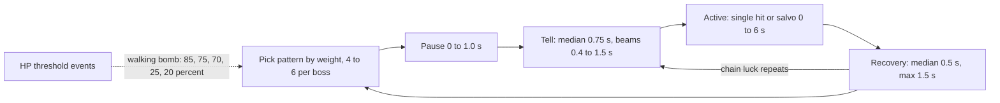
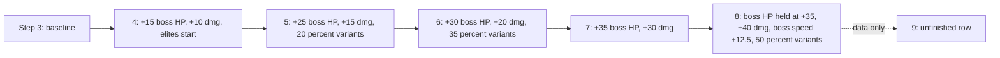

# Roboquest difficulty reference (comps note)

Evidence: level 2, read from tables dumped by a script (the scripts parsed the shipped data tables to the last byte; paths below); level 4 only where a script computed the aggregate (DPS medians, TTK, tell and salvo statistics, elite means, ladder deltas, hits to kill), and those aggregates rest on the marked INFERRED assumptions. Method: the 60 data tables were re-extracted read-only from the archived install into scratch, then dumped with the existing table reader plus new scripts under `~/scratch/game-study/difficulty-tools/roboquest/` (`dump_tables.py`, `join_boss.py`, `acts_boss.py`, `budget.py`, `calc.py`, `calc2.py`, `ttk.py`, `rows.py`; JSON dumps `DT_*.json` beside them). Earlier numeric CSVs: `~/scratch/game-study/roboquest/tables/`. This pass adds what those CSVs lacked: enemy skill lists, boss custom-number maps (timers, damage, HP-percent thresholds) and pattern weights. Level 2 (public wiki, saved pages only) is used for corroboration: `~/scratch/game-study/roboquest/wiki/Difficulty.txt`, `Updates.txt`, `Bosses.txt`. Level 3 is not claimed anywhere (blueprint logic, animation timing and the code that applies the multipliers were not decoded). Player DPS, build strength, player level at each boss and the way the multipliers combine are INFERRED and marked. Existing comps memos are reused with their source, not duplicated: `sketches/core-loop/design-v3/research/comps/roboquest/enemies-and-telegraphs.md`, `data-tables.md`.

Notation: `T/<table>.csv` means `~/scratch/game-study/roboquest/tables/<table>.csv`; `J/<table>.json` means `~/scratch/game-study/difficulty-tools/roboquest/<table>.json` (my dump of the same table with map and array contents kept). Times are seconds. Distances are the game's centimetres. Player base health is 200 (`J/DT_Player.json` rows.Player.Health), so "% of base HP" divides by 200.

## Bosses

### Where bosses sit in a run
The tables hold 12 campaign level rows in 4 acts (4 / 4 / 3 / 1), but a run does not visit all 12 (run length INFERRED, unresolved): two act-1 rows both lead to the act-2 first level, the two act-2 water rows both lead to the act-2 last level, two act-3 rows both lead to the final level, and four rows, the second water row among them, have no row leading into them (`~/scratch/game-study/difficulty-tools/roboquest/leveltiles.py`, field `EndTile.NextLevel`). So some rows are alternates and the run is shorter than 12 levels; the earlier wiki-based memo infers six levels (`reports/stage-anatomy.md`), which the tables neither confirm nor refute. Each act ends in one boss drawn from a small act pool. Pool sizes 3 / 2 / 2 / 1 (`J/DT_Acts.json` rows.Act1..Act4 Boss.BossClasses; names resolved by `acts_boss.py`, evidence labels only). The act's `Boss.BossLevel` is 4 / 9 / 13 / 15 (same rows), and the act's boss XP is 80 / 160 / 320 / 0 (`T/DT_Acts.csv`). Campaign enemy levels per level are 1, 3, 3, 3, 5, 5, 5, 7, 10, 11, 12, 13 (`J/DT_Levels.json` the 12 campaign rows, field `EnemyLevel`), and 9 of those 12 rows carry at least one tile flagged to raise the enemy level by one (`bLevelUpEnemies` on that tile entry; the flagged tile is the mid-level safe-room tile in 7 of the 9, an arena tile in the other 2; count by `leveltiles.py`, field `Tiles#list`). Counted without the second water row (one of the alternates) it is 8 of 11; I use 9 of 12 throughout.

| tier | slot | pool | base HP | impact resistance | stagger | move speed (cm/s) | source |
|---|---|---|---|---|---|---|---|
| early | act 1 boss, pool member 1 | burrower | 3300 | 850 | 0.70 | 600 | `T/DT_Enemy.csv RowKey=Mole` |
| early | act 1 boss, pool member 2 | turret tower | 5150 | 1250 | 0.75 | 400 | `T/DT_Enemy.csv RowKey=Tower` |
| early | act 1 boss, pool member 3 | walking bomb | 5250 | 1250 | 1.25 | 1025 | `T/DT_Enemy.csv RowKey=BoomBoss` |
| mid | act 2 boss, pool member 1 | rail rider | 3800 | 900 | 0.70 | 600 | `T/DT_Enemy.csv RowKey=Caterpillar` |
| mid | act 2 boss, pool member 2 | bouncing orb | 5000 | 1100 | 1.25 | 1250 | `T/DT_Enemy.csv RowKey=DiscoBall` |
| mid+ | act 3 boss, pool member 1 | big flyer | 6300 | 1450 | 1.25 | 1600 | `T/DT_Enemy.csv RowKey=Beetle` |
| mid+ | act 3 boss, pool member 2 | rising-platform machine | 6500 | 1450 | 1.25 | 1600 | `T/DT_Enemy.csv RowKey=Printer` |
| final | act 4 boss, form 1 | multi-eye machine | 13000 | 3600 | 1.25 | 400 | `T/DT_Enemy.csv RowKey=Iris` |
| final | act 4 boss, form 2 (INFERRED to follow form 1; both rows exist, only form 1 is in the act pool) | flying hand | 9000 | 4600 | 1.25 | 1600 | `T/DT_Enemy.csv RowKey=Iris2` |

Reading across the 9 rows: HP min 3300, median 5250, max 13000; two non-campaign rows (HP 4300 and 7000) appear only in endless/test tables (`J/DT_InfiniteBoss.json`, `J/DT_Acts.json` rows.ActDuke). Boss impact resistance is 850 to 4600 against a minion median of 65 (`~/scratch/game-study/roboquest/reports/data-tables.md`), so bosses stagger rarely and stagger reads as a reward for heavy hits, not a rhythm (INFERRED). Stagger length is 0.70 to 1.25 (median 1.25) against 1.25 for nearly every mob.

### HP scaling rule
- Bosses carry a flat per-row HP; there is no per-act boss HP multiplier in the act table. The act rows carry only an enemy-health modifier 0 / 30 / 70 / 140 percent and, for co-op, boss HP bonus 90 / 110 / 150 / 110 percent plus boss impact bonus 54 / 66 / 90 / 66 percent (`J/DT_Acts.json` rows.Act1..Act4 EnemyHealthImpactPercentModifier, BossMultiplayerHealthPercentBonus, BossMultiplayerImpactPercentBonus).
- The difficulty row has its own boss HP modifier: 0 at step 3, then +15, +25, +30, +35, +35 at steps 4 to 8 (see the ladder).
- A level-based health bonus exists for enemies: keys (0,0) (1,0) (2,20) (11,200), read as percent by level (`T/curves.csv CU_EnemyLevelHealth`, percent reading INFERRED). Whether bosses receive it from `BossLevel` is not stated by the data. I show both readings in the TTK table (INFERRED).
- Endless mode replaces the whole question: each endless boss encounter is a pair of boss rows sharing one HP value, 5000 to 6000 (6 of 7 pairs 6000, one 5000) (`J/DT_InfiniteBoss.json` all rows `Health`), while endless enemy HP bonus runs 0 to 2400 percent over 9 steps (`J/DT_InfiniteActs.json` EnemyHealthImpactPercentModifier).
- The patch notes say most boss HP values were retuned so that time to kill is more even across bosses (`wiki (public) Updates.txt:1190`, label only: no numbers).

### Player damage and time to kill (TTK)
Player output is read from the primary-fire rows of the player-skill table. Each row has an authored `DPS` field (the damage over firing time without reload). Joining 87 weapon rows to their primary-fire row (`~/scratch/game-study/difficulty-tools/roboquest/calc.py`, `J/DT_PlayerSkills.json` rows.PF_*, `J/DT_Weapons.json`): nominal DPS median 116.7 (quartiles 100 / 138; min 17.3, max 273.3; weapon power tier 1 median 114.3 on 47 rows, tier 2 median 123.6 on 40 rows), weak-point rate 1.25x (every row: `CriticalDPS` / `DPS`), median reload uptime 0.74 on the 83 magazine rows, median reload-adjusted DPS 85.7. Player-level damage scaling is 0 for weapons (`J/DT_Player.json` rows.Player.DamagePercentByLevel = 0), so weapon output rises through weapon level and perks, not character level. The public wiki puts weapon level at +10 percent damage per level above 1 (`wiki (public) Calculators.txt`, per `reports/weapons-items-elements.md`).

Build assumption, all INFERRED: effective DPS = 85.7 reload-adjusted x 0.7 (share of shots that land on the boss) x build multiplier B, with B = 1.0 / 1.5 / 2.0 / 2.5 for acts 1 to 4 (weapon levels and common damage perks accumulating; no data states the player's strength at each boss). Effective DPS 60 / 90 / 120 / 150. The first TTK column uses base HP only, the second applies the enemy level and act bonuses as an additive percent (INFERRED), the third applies the step-8 boss HP modifier (+35 percent) to base HP. Script: `ttk.py`.

| boss (positional) | base HP | eff. DPS (INFERRED) | TTK, base HP (INFERRED) | TTK, level + act bonus applied (INFERRED upper bound) | TTK, step-8 boss HP (INFERRED) | floor, computed, authored DPS only (HP / 116.7) |
|---|---|---|---|---|---|---|
| act 1 burrower | 3300 | 60 | 55 s | 88 s | 74 s | 28 s |
| act 1 turret tower | 5150 | 60 | 86 s | 137 s | 116 s | 44 s |
| act 1 walking bomb | 5250 | 60 | 88 s | 140 s | 118 s | 45 s |
| act 2 rail rider | 3800 | 90 | 42 s | 122 s | 57 s | 33 s |
| act 2 bouncing orb | 5000 | 90 | 56 s | 161 s | 75 s | 43 s |
| act 3 big flyer | 6300 | 120 | 53 s | 194 s | 71 s | 54 s |
| act 3 platform machine | 6500 | 120 | 54 s | 200 s | 73 s | 56 s |
| act 4 form 1 | 13000 | 150 | 87 s | 381 s | 117 s | 111 s |
| act 4 form 2 | 9000 | 150 | 60 s | 264 s | 81 s | 77 s |
| act 4 both forms | 22000 | 150 | 147 s | 645 s | 198 s | 188 s |

Read: under the base-HP reading the 7 non-final TTKs span 42 to 88 s (median about 55 s), which matches the patch note's goal of even TTK but is partly a product of my multiplier choice; under the level-bonus reading they run 88 to 200 s. The data cannot decide between them; Scrapkeep should use the base-HP column as the design target (a 45 to 90 s fight) and treat the upper column as the failure mode of stacking level scaling on bosses.

### Boss attack grammar (all campaign pool bosses)
Boss skill rows join to attack rows through `AttackRow.RowName` (`J/DT_EnemySkill.json`, `J/DT_AIAttacks.json`; script `join_boss.py`). Over the 46 boss skill rows (34 in the campaign pools, 12 on two non-campaign bosses) the tell (`PreshootDuration`), recovery, damage and area are:

| measure | n | min | median | max | source |
|---|---|---|---|---|---|
| tell, rows with a non-zero tell | 37 of 46 | 0.20 | 0.75 | 2.5 | `J/DT_EnemySkill.json PreshootDuration` |
| rows with no stored tell (animation timing not decoded) | 9 of 46 | | | | same |
| rows where the tell is stretched at close range (`bSlowPreshootInClose` = 1) | 10 of 34 campaign rows, 11 of 46 | | | | `T/DT_EnemySkill.csv` column 14 |
| recovery after the attack | 45 (one row is a hold) | 0.0 | 0.5 | 1.5 | same `RecoveryDuration` |
| cooldown, non-zero rows only | 7 of 46 | 1.0 | 5.0 | 6.5 | same `Cooldown` |
| single-hit damage (base, before level or difficulty) | 44 | 10 | 24 | 28 | `J/DT_AIAttacks.json Damage` |
| area radius, area attacks | 29 | | 400 | 850 | same `AreaRadius` |
| projectile speed | | 1800 | 2200 to 3800 typical | 5000 | same `Speed` |
| attack token rule | 48 rows | | None on 46, Simple 1, Priority 1 | | same `TokenRule` |

Caveat on every tell figure in this note: `PreshootDuration` is a data timer, not a measured on-screen telegraph (animation timing and visual cues were not decoded). On 10 of the 34 campaign rows (11 of 46) `bSlowPreshootInClose` is 1; by its name this stretches the wind-up when the player is close, so the effective tell at close range is longer than the stored value, by an amount the table does not give (INFERRED).

Bespoke boss attacks (beams, lasers, floor traps, charges) keep their timers in each boss row's custom-number map (`J/DT_Enemy.json rows.<boss>.CustomFloatProperties`), not in the skill table:

| attack type | tell | base damage | boss | source |
|---|---|---|---|---|
| tracking beam | 0.40 | 28 | act 2 bouncing orb | `J/DT_Enemy.json rows.DiscoBall BeamPreshootDuration, BeamDamage` |
| tracking beam | 0.65 | 20 | act 4 form 2 | `rows.Iris2 BeamPreshootDuration, BeamDamage` |
| tracking beam | 0.75 | 24 | act 1 turret tower | `rows.Tower BeamPreshootDuration, BeamDamage` |
| tracking beam | 1.0 | 20 | act 1 walking bomb | `rows.BoomBoss BeamPreshootDuration, BeamDamage` |
| tracking beam | 1.0 | 18 | act 4 form 1 | `rows.Iris BeamPreshootDuration, BeamDamage` |
| tracking beam | 1.5 | 20 (held 5.0 s) | act 3 platform machine | `rows.Printer BeamPreshootDuration, BeamDuration, BeamDamage` |
| rotating laser | 1.0 | 20 | act 4 form 2 | `rows.Iris2 LaserPreshootDuration, LaserDamage` |
| turret laser | 1.0 | 24 | act 1 turret tower | `rows.Tower LaserPreshootDuration, LaserDamage` |
| floor trap (cone, close, laser) | 0.65 / 0.75 / 2.0 | 16 / 16 / n.a. | act 1 tower; act 2 rail rider (laser) | `rows.Tower ConeTrapPreshootDelay, CloseTrapPreshootDelay`; `rows.Caterpillar LaserTrapPreshootDelay` |
| charge dash | 1.25 | 16 | act 2 rail rider | `rows.Caterpillar TurboPreshootDuration, TurboDamage` |
| wall jump | 1.0 | 20 | act 3 big flyer | `rows.Beetle JumpWallPreshootDuration, JumpWallDamage` |
| quick shock trap | 0.25 | 16 | act 4 form 2 | `rows.Iris2 ShockTrapPreshootDuration, ShockTrapDamage` |

Over the 14 individual bespoke tells above: median 1.0 s, min 0.25, 6 at or below 0.75.

How a boss picks its next move: each boss has 4 to 6 patterns (median 4; counts `PatternData` length: 4 / 4 / 4 / 4 / 5 / 4 / 5 / 5 / 6 over the 9 rows above in table order) with an integer `Frequency`, a `bChain` flag and a `ChainLuck` 0 to 5 (`J/DT_Enemy.json rows.<boss>.PatternData`). INFERRED reading: Frequency is a selection weight, chain is a chance to repeat. The signature pattern's weight share is 20 to 55 percent (burrower 28, tower 29, walking bomb 32, rail rider 45, orb 43, flyer 43, platform machine 55, form 1 25, form 2 20; median 32), computed from the weights. Between patterns the orb boss inserts a 1.0 s pause (all five `Pre*Delay` values 1.0, `rows.DiscoBall`); `FocusDuration` is 1.0 on all 11 boss rows (meaning of the field not stated).

### Per-boss detail (early, mid, final)
Salvo is the number of shots times pellets times base damage, if every shot landed. It is a ceiling, not an expectation (INFERRED: all of these are dodgeable fans or streams). "% of base HP" divides by 200.

**Act 1 pool (early).** Three bosses, 3300 to 5250 HP, 4 patterns each, 1 to 3 skill slots each.

| attack (act 1 walking bomb unless noted) | tell | active | recovery | cd | salvo | single hit, % of 200 | source |
|---|---|---|---|---|---|---|---|
| ground shockwave (jump over; height 250, speed 1600) | 0.35 | n.a. | 0.5 | 0 | 24 | 12% | `J/DT_EnemySkill.json Boomboss_Shockwave` (incl. its custom map) |
| rocket (replaced a stun ball in a patch) | 0.25 | n.a. | 0.5 | 0 | 26 | 13% | `Boomboss_StunLaserBar` |
| melee bash, radius 550 | 0.35 | n.a. | 0.5 | 5.0 | 24 | 12% | `Boomboss_Bash` |
| beam | 1.0 | n.a. | 0.5 | 0 | 20 | 10% | `rows.BoomBoss BeamPreshootDuration, BeamRecoveryDuration, BeamDamage` |
| fuse walk toward player (3.5 s walk, trigger at 850) | n.a. | 3.5 | n.a. | n.a. | n.a. | n.a. | `rows.BoomBoss WalkDuration, TriggerDistance` |
| act 1 burrower rocket fan (radius 160) | 0.5 | 1.87 | 0.3 | 0 | 468 (18 x 26) | 13% each | `Mole_ForkRocket` |
| act 1 burrower bomb drop (3 bombs, shootable, radius 400) | 0.0 | n.a. | 1.0 | 0 | 78 (3 x 26) | 13% each | `Mole_Grenade`; `rows.Mole BombAmount` |
| act 1 burrower ground wave / drill charge | no stored tell | n.a. | 0.4 / 0.45 chain gap | 0 | 20 / 24 per hit | 10% / 12% | `rows.Mole ShockwaveDamage, DrillDamage, ShockwaveRecoverDelay, DrillChainDelay` |
| act 1 tower cannon (radius 550) / homing mortar (radius 420) | 0.75 / 1.0 | n.a. | 0.5 / 0.35 | 0 | 24 / 26 | 12% / 13% | `Tower_Canon`, `Tower_Mortar` |

HP-percent thresholds present in the walking-bomb row: 85 (alarm feedback), 75 (skills disabled) and 70 (skills enabled), 25 (low-health state and warning gauge), 20 (the self-destruct explosion curve: input 0.75 percent HP gives 100, input 20 percent gives 0), low-health stun 8.0 s then 1.25 s recovery, explosion fuse 6.0 s, 30 s explosion recovery (`J/DT_Enemy.json rows.BoomBoss LowHealthPercent, SkillDisabledPercent, SkillEnabledPercent, AlarmFeedbackpercent, GaujeWarningHealthPercent, LowHealthStunDuration, LowHealthRecoveryDuration, ExplosionDelay, ExplosionRecoveryDelay`; `T/curves.csv CU_BoomBoss_ExplosionPercentByLife`). Function from field names: INFERRED. The wiki independently describes self-destruct at about one fifth of health (`wiki (public) Bosses.txt:13`, per `reports/enemies-and-bosses.md`). The other campaign bosses have no HP-percent thresholds in their rows (the non-campaign flyer has one, at 5 percent).

**Act 2 pool (mid).**

| attack | tell | active | recovery | cd | salvo | single hit, % of 200 | source |
|---|---|---|---|---|---|---|---|
| act 2 orb tracking beam (6.0 s sweep, up to 2 hits) | 0.40 | 6.0 | 0.25 | n.a. | 28 per hit | 14% | `rows.DiscoBall BeamPreshootDuration, LaserDuration, LaserEndDelay, LaserMaxHit, BeamDamage` |
| act 2 orb bounce charge (speed to 5800) | 1.0 | n.a. | n.a. | n.a. | 18 | 9% | `rows.DiscoBall BouncePreshootDuration, BounceMaxSpeed, BounceDamage` |
| act 2 orb mine stream (bouncing, radius 300) | 0.0 | 3.88 | 0.0 | 6.5 | 832 (32 x 26) | 13% each | `Discoball_BouncingBolt` |
| act 2 orb artillery mode 1 and mode 2 | 1.0 pause | 10 + 10 | n.a. | n.a. | stream of 16 per shot, 5/s | 8% | `rows.DiscoBall ArtilleryMode1Duration, ArtilleryMode2Duration, PreArtilleryDelay`; `DiscoBall_Artillery1_P1` |
| act 2 orb shockwave | 0.0 | n.a. | 1.5 | 0 | 24 | 12% | `DiscoBall_Artillery1_Shockwave` |
| act 2 rail rider homing missiles (radius 420, 2 per volley) | 0.5 | 0.45 | 1.25 | 0 | 52 | 13% each | `Caterpillar_HomingMissile` |
| act 2 rail rider mine (radius 200, lifetime 20) | 0.5 | n.a. | 1.0 | 0 | 24 | 12% | `Caterpillar_Mine` |
| act 2 rail rider charge dash (6.0 s, speed 3400) | 1.25 | 6.0 | n.a. | n.a. | 16 + ram | 8% | `rows.Caterpillar TurboPreshootDuration, TurboDuration, TurboSpeed, TurboDamage` |
| act 2 rail rider laser trap | 2.0 | 8.0 deactivate | n.a. | 6.0 activate | n.a. | n.a. | `rows.Caterpillar LaserTrapPreshootDelay, LaserTrapDeactivateDelay, LaserTrapActivateDelay` |

Phases: the orb has two timed artillery modes of 10 s each (no HP trigger in the data). The rail rider waits 5.0 s before first moving (`StartWaitingTime`, `rows.Caterpillar`) and fields at most 4 spawned walkers (`MaxWalkEnemyAmount`) and 4 cocoons.

**Act 3 pool.** Flyer: 5 patterns, shotgun of 5 pellets (tell 1.25, recovery 1.0, 24 each, ceiling 120 = 60%), floor-collapse plate (tell 1.0 with a 0.75 s pre-delay, recovery 1.25, radius 850, 28 = 14%), 20-mine rain over 2.28 s (260% ceiling), tornado 4.5 s (`Beetle_Shotgun`, `Beetle_DestructPlate`, `Beetle_Mine`, `rows.Beetle TrombeDuration`). Platform machine: gatling 70 shots over 4.14 s at 12 each (ceiling 840 = 420%, tell 0.75), homing missile (tell 1.0, 26), mine volley (tell 1.5, 5 x 22), a 5.0 s beam after a 1.5 s tell, and the arena rises: lava starts after 10 s (`Printer_Gatling`, `Printer_Missile`, `Printer_Mine`, `rows.Printer DelayBeforeLavaUp, BeamDuration`). Its missile pattern carries 6 of 11 weight points.

**Act 4 (final), two forms.**

| attack | tell | active | recovery | cd | salvo | single hit, % of 200 | source |
|---|---|---|---|---|---|---|---|
| form 1 homing missiles, three variants (3 / 2 / 1 missiles) | 0.3 / 1.0 / 2.5 | 2.0 / 1.5 / 0 | 0.6 / 0 / 0 | 0 | 60 / 52 / 26 | 10 to 13% each | `Iris_Missile1..3` |
| form 1 gravity bolts (4 bursts of 5 pellets, radius 400) | 1.0 | 0.9 | 0.5 | 0 | 320 (160%) | 8% per pellet | `Iris_GravityBolt` |
| form 1 fire zone (6 x 2, delayed 1.15) | 0.75 | 1.25 | 1.0 | 0 | 192 | 8% per hit | `Iris_FireZone` |
| form 1 floor-collapse plate (radius 850) | 1.0 | n.a. | 1.25 | 0 | 28 | 14% | `Iris_DestructPlate` |
| form 1 blinding flash | 1.5 | n.a. | 0.75 | 1.0 | 0 | 0 | `Iris_FlashHack` |
| form 1 beam | 1.0 | n.a. | 0.25 | n.a. | 18 | 9% | `rows.Iris BeamPreshootDuration, BeamDamage, BeamRecoveryDuration` |
| form 1 sustained volley mode | 1.0 | 24.0 | n.a. | n.a. | 12 per shot, firerate field 1.55 | 6% | `rows.Iris GuitarHeroDuration, GuitarHeroPreshootDelay, GuitarHeroDamage, GuitarHeroFirerate` |
| form 2 laser bar (18 shots) | 0.75 | 6.12 | 0.75 | 0 | 432 (216%) | 12% | `Iris2_LaserBar` |
| form 2 homing salvo (8 missiles) | 0.75 | 2.10 | 0.75 | 0 | 128 | 8% | `Iris2_HomingMissile` |
| form 2 slap (radius 550) | 0.4 | n.a. | 1.0 | 5.0 | 24 | 12% | `Iris2_Slap` |
| form 2 rotating laser (rotate speed 8, ramp 60 to 180, units not stated) | 1.0 | n.a. | 1.5 post-preshoot delay | n.a. | 20 | 10% | `rows.Iris2 LaserPreshootDuration, LaserRotateSpeed, LaserIncreaseSpeed, LaserMaxSpeed, LaserPostPreshootDelay` |
| form 2 shock trap | 0.25 | 1.5 | 0.25 | n.a. | 16 | 8% | `rows.Iris2 ShockTrapPreshootDuration, ShockTrapDuration, PostShockTrapDelay` |

Punish windows (scripted, not recovery tails; readings INFERRED from field names): form 1 has 5 weak-point eyes, shows 2 at a time for 8.0 s, then closes them after a 2.0 s delay for 5.0 s (`rows.Iris CriticalSwitchDuration, CriticalActivateAmount, CriticalBoneCloseDelay, CriticalBoneCloseDuration`). The act-3 platform machine has an open-head chance value of 60 and a close-head value of 40 (`rows.Printer OpenHeadLuck, CloseHeadLuck`). The act-1 walking bomb stuns itself for 8.0 s at low health.

Contact and anti-camping damage: melee bash 24 at radius 550 on three bosses (cd 5.0, tell 0.35 to 0.4); a punish for standing on the boss reads as 16 to 20 damage on two bosses (INFERRED from field names; `rows.Tower AntiHeadbonkDamage = 16`, duration 3.5, tell 1.0; `rows.Iris2 DamageWhileHeadbonk = 20`). Floor traps near the boss: 10 to 16 (`rows.Printer CloseTrapDamage = 10`, `rows.Tower CloseTrapDamage = 16`).

### Burst damage as a share of player health
- Largest base single hit in the campaign pool: 28 (floor-collapse plate; orb beam), 14 percent of base health (`J/DT_AIAttacks.json`, custom maps above). Median single hit 24, 12 percent.
- Single hits are 5 to 14 percent of base HP over the 46 boss skill rows (damage 10 to 28). Salvo ceilings (shots x pellets x damage, multi-shot rows only) run 26 to 420 percent (`rows.py` output); the one 200-shot artillery stream is excluded because the same formula gives 1600 percent (its row is in `rows.py` output). A salvo is a pattern to weave, never one hit (INFERRED).
- Player health: 200 at level 1 plus 30 per level (`J/DT_Player.json rows.Player.Health, HealthMaxByLevel`; per-level addition INFERRED as additive). Enemy damage bonus by enemy level: (1,0) to (30,580), which is +20 points per level (`T/curves.csv CU_EnemyLevelDamage`; application to boss attacks INFERRED). Hits to kill with a 26-damage hit at boss level L, player level = L (INFERRED, `calc2.py`):

| situation | boss level 4 | level 9 | level 13 | level 15 |
|---|---|---|---|---|
| step 3 (baseline), damage 26 x level bonus | 41.6 dmg, 7 hits | 67.6, 7 hits | 88.4, 7 hits | 98.8, 7 hits |
| step 8 (+40 percent damage) | 58.2, 5 hits | 94.6, 5 hits | 123.8, 5 hits | 138.3, 5 hits |

Hits to kill stays at 7 (step 3, levels 4 to 15) and 5 (step 8, levels 4 to 15) from the first boss to the last, because the player-health and enemy-damage curves grow together (INFERRED). A hit takes 14 to 16 percent of current health at step 3 and 20 to 22 percent at step 8. Part of each hit is "scratch" (recoverable) damage rather than permanent loss: the permanent-share field is overridden to 35 at step 1 (boss version: steps 1 and 2); other rows carry values with the override off, so a default probably applies (INFERRED; see the ladder note).

Defensive tools for reading these numbers: dash range 1600 at speed 9000, 3 dash stacks recharging every 3.0 s, cooldown 0.55, 0.25 s invulnerability at the end of a dash, double jump (`J/DT_Player.json rows.Player.DashRange, DashSpeed, DashStack, DashStackCooldown, DashCooldown, EndDashInvulnerability, MaxJumpCount`).

### Time before the first dangerous attack
The data has no per-boss opening timer except: rail rider waits 5.0 s; platform machine's lava starts at 10.0 s; every orb pattern carries a 1.0 s lead-in. Opening behaviour and intro cutscene lengths are not in the tables (Gap).

## Mobs and events

**Level spawn budget.** Regular enemies come in fixed encounters per level. For the 11 campaign level rows with enemies (the second water row is omitted as a near-duplicate; the final level has no regular encounters) (`budget.py`, `J/DT_EnemyBoard.json`, `J/DT_Levels.json`):

| level (positional) | enemy level | regular encounters (enemies) | scripted encounters (enemies) | small groups (enemies) | arena fights | big units: count / classes | wall turrets |
|---|---|---|---|---|---|---|---|
| act 1, level 1 | 1 | 6 (31) | 10 (54) | 0 | 0 | 0 / 0 | 0 |
| act 1, level 2 | 3 | 6 (33) | 5 (28) | 7 (3) | 1 | 3 / 1 | 0 |
| act 1, level 3 | 3 | 6 (39) | 5 (35) | 7 (7) | 1 | 0 / 0 | 0 |
| act 1, level 4 | 3 | 6 (44) | 0 | 5 (4) | 1 | 0 / 1 | 1 |
| act 2, mid level A | 5 | 6 (41) | 0 | 6 (4) | 1 | 3 / 1 | 0 |
| act 2, mid level B | 5 | 6 (39) | 0 | 4 (3) | 1 | 2 / 1 | 0 |
| act 2, last level | 7 | 5 (40) | 0 | 0 | 1 | 0 / 0 | 1 |
| act 3, level 1 | 10 | 5 (26) | 0 | 5 (2) | 0 | 4 quest / 4 | 1 |
| act 3, level 2 | 11 | 1 (8) | 0 | 0 | 2 | 0 / 3 | 0 |
| act 3, level 3 | 12 | 5 (47) | 0 | 6 (4) | 0 | 0 / 0 | 1 |
| act 4, final level | 13 | 0 | 0 | 0 | 2 | 0 / 0 | 0 |

Source for every cell: `J/DT_EnemyBoard.json` `RegularEncounters`, `SpecificEncounters`, `IndieEncounters`, `ArenaEncounters`, `BigClasses`, `WallTurrets` lists (script `budget.py`) and `J/DT_Levels.json` `EnemyLevel`, `BigCount`, `BigQuestCount`. Regular encounter size is 4 to 10 enemies (median 7), 5 to 6 encounters per level, 26 to 47 regular enemies per ordinary level (`~/scratch/game-study/roboquest/tables/SUMMARY.md` section e). The counts do not grow by act and do not change with difficulty (the difficulty row has no count field). Growth comes from enemy level (+20 points of HP up to level 11 and +20 points of damage per level), from the act modifier 0 / 30 / 70 / 140 percent, and from the mid-level enemy level step (`bLevelUpEnemies` flagged on a tile in 9 of the 12 level rows, 7 of them on the safe-room tile; `leveltiles.py`). Single-player enemy HP at level L (INFERRED additive): level 3 +40, level 5 +80, level 7 +120, level 10 +180, level 11 and above +200 percent (curve clamps; clamp INFERRED); damage at level L is +20 (L-1) percent: +40 / +80 / +120 / +180 / +200 / +220 / +240.

**Elite tier.** Seven elite rows, all with HP 300, impact resistance 180, experience 5, 2 to 3 skills (`T/DT_Enemy.csv`, `reports/data-tables.md`), against a minion median HP 80 to 90 and impact resistance 60 to 65: 3.3x HP and about 3x impact resistance. No affix stack: one flat tier; stat multipliers beyond the difficulty and act modifiers are not in the table. Act 1 elites take -20 percent health (`J/DT_Acts.json rows.Act1 EliteHealthImpactPercentModifier`), others 0. Their count per level is a range per difficulty step. Reading (INFERRED): the 7 index columns map to difficulty steps 3 to 9, so the step-3 index is all zeros, matching the wiki's statement that elites do not appear on step 3 or below (`wiki (public) Updates.txt:818-819`).

| difficulty step (INFERRED mapping of `EliteCount[0..6]`) | 3 | 4 | 5 | 6 | 7 | 8 | 9 |
|---|---|---|---|---|---|---|---|
| elites per ordinary campaign level, mean of 10 levels (min to max summed over 10 levels in brackets) | 0 | 0.1 to 0.8 (1 to 8) | 0.9 to 1.0 (9 to 10) | 1.1 to 1.8 (11 to 18) | 1.9 to 2.6 (19 to 26) | 2.8 to 2.9 (28 to 29) | 3.0 to 3.8 (30 to 38) |

Source: `J/DT_Levels.json` the 10 ordinary campaign rows (all campaign rows except the final level and one duplicate mid level), fields `EliteCount` and `EliteCount[1..6]` x and y (script `ladder_elites.py`). The final-level row fixes 12 elites at every index including index 0 (step 3 under this mapping), so it is the exception to the wiki's no-elites-at-Standard rule (`wiki (public) Updates.txt:818-819`) and the last fight is a dense elite arena regardless of difficulty (`EliteCount*`). Elites replace regular enemies: one or two regular classes per level are marked to be swapped (`ClassesToReplaceByElite` length 1 to 2, `DT_EnemyBoard`).

**Replacement variants.** From difficulty step 5, a percentage of regular enemies is replaced by tougher variants: 20 / 35 / 35 / 50 percent at steps 5 to 8 (`T/DT_Difficulty.csv EnemyReplacementPercent`). Each level lists 2 to 3 replacement groups of 6 classes each (`J/DT_EnemyBoard.json`, first campaign level row, `NewGamePlus`), picked by a pool id 0 / 0 / 0 / 0 / 0 / 1 / 2 / 2 / 0 across the 9 rows (`NewGamePlusPoolID`). Read as elemental or resistant variants (INFERRED from `wiki (public) Updates.txt:1172`, which says elemental versions are meant to diversify the highest tiers). Count of enemies is unchanged; composition gets harder.

**Aggression.** One axis, `TokenSpeedModifier`, steps -150, -75, 0, +10, +20, +25, +30, +40, +40 (the wiki calls it aggressiveness). Acts add 0 / 5 / 10 / 15 on top (`J/DT_Acts.json rows.Act1..Act4 TokenSpeedModifier`). The base token curve runs 0.4 at enemy level 1 to 0.3 at level 10 (`T/curves.csv CU_TokenSystem`). Reading (INFERRED): token speed is how fast the shared attack budget refills, so aggression raises how often mobs may attack, not how many exist. Of all 180 enemy skill rows, 71 use no token rule, 66 a simple one, 32 a priority one (`reports/data-tables.md`); for the 48 boss rows the split is 46 / 1 / 1, so bosses bypass the budget.

**Telegraph conventions for mobs.** Reuse of the existing memo, source `enemies-and-telegraphs.md`: pre-shoot median 0.75 for projectiles, 1.0 p90 for projectile-with-area, 0.25 median for area bursts, 1.0 to 2.5 for rays; recovery median 0.75; stagger uniformly 1.25; projectile damage median 18, area attacks median 24 to 26; area radius median 240 to 480, max 850. Chaos caps: attack tokens (above), 4 to 10 enemies per encounter, 1 or 2 arena fights per level, `bIgnoreForReinforcements` on 6 rows, respawns that avoid the type just killed (`wiki (public) Updates.txt:1180-1181`). 

**Optional hard side levels.** 12 corrupted level rows sit beside the campaign: 4 with a mini-boss (level 5 to 9, XP 80 to 160), 2 arena, 4 timed races (time limit 25 to 150 s) (`J/DT_Levels.json` fields `CorruptedLevelType`, `TimeLimitation`, `CorruptedBoss.BossLevel`; counts in `SUMMARY.md`). They give a second, optional difficulty lane separate from the numeric ladder.

## Difficulty ladder

Nine rows, none incremental: each row is absolute and replaces the last (so cumulative = the row). The public wiki lists 8 of them (steps 1 to 8); the 9th is data only. Step 4 is the first harder-than-baseline step; steps 5 to 8 are the four numbered top tiers, the same four rows the wiki table lists (their data keys carry a +2 to +5 suffix). Absolute reading: level 2; the wiki table lists the same values per tier (`wiki (public) Difficulty.txt:38-76`); the application code was not decoded. A row's value is a percent modifier unless stated. Unlock rule: winning at step 3 or 4 unlocks step 5, winning at 5 unlocks 6, at 6 unlocks 7, at 7 unlocks 8 (`bUnlockAnotherOnVictory` plus `DifficultyToUnlock`, `J/DT_Difficulty.json`); step 8 does not unlock step 9 (its flag is false) and steps 1 to 4 start unlocked.

| step | rule it adds | enemy HP | enemy impact resist | boss HP | boss impact | damage (enemy, trap) | boss speed | aggression | replacement | elites/level (INFERRED map) | wrenches per level | source `T/DT_Difficulty.csv` data row |
|---|---|---|---|---|---|---|---|---|---|---|---|---|
| 1 | assist tier: enemies much weaker and slower, pickups last 4x | -30 | -30 | -30 | -30 | -50 | -25 (enemy speed -15) | -150 | 0 | 0 | 0 | row 1 |
| 2 | assist tier | -20 | -20 | -20 | -20 | -25 | -15 (enemy speed -5) | -75 | 0 | 0 | 0 | row 2 |
| 3 | baseline | 0 | 0 | 0 | 0 | 0 | 0 | 0 | 0 | 0 | 0 | row 3 |
| 4 | first harder step: elites appear (INFERRED map), per-level wrench reward starts | +15 | +10 | +15 | +10 | +10 | +5 | +10 | 0 | 0.1 to 0.8 | 2 | row 4 |
| 5 | variant replacement starts, elite level ceiling flag set | +25 | +15 | +25 | +15 | +15 | +5 | +20 | 20 | 0.9 to 1.0 | 2 | row 5 |
| 6 | more of everything; boss HP rise slows (+30) | +35 | +20 | +30 | +20 | +20 | +7.5 | +25 | 35 | 1.1 to 1.8 | 2 | row 6 |
| 7 | enemy damage jumps to +30; boss impact already flat at +20 (since step 6), boss HP nearly done (+35) | +42 | +28 | +35 | +20 | +30 | +10 | +30 | 35 | 1.9 to 2.6 | 2 | row 7 |
| 8 | top public tier: boss HP held at +35, damage +40, replacement 50 | +50 | +33 | +35 | +20 | +40 | +12.5 | +40 | 50 | 2.8 to 2.9 | 3 | row 8 |
| 9 | data only, not on the public page: enemy HP and damage rise again, boss HP and impact fields blank (0) and replacement 0, so the row looks unfinished | +60 | +36 | 0 (blank) | 0 (blank) | +45 | +15 | +40 | 0 | 3.0 to 3.8 | 3 | row 9 |

Step-to-step changes, computed from the same rows (`ladder_elites.py`; not a stored field): enemy damage +10 / +5 / +5 / +10 / +10 (steps 4 to 8; +5 at step 9), boss HP +15 / +10 / +5 / +5 / 0, boss speed +5 / 0 / +2.5 / +2.5 / +2.5, aggression +10 / +10 / +5 / +5 / +10. So the ladder front-loads boss HP and flattens it: 25 of the 35 points of boss HP climb (71 percent) arrive by step 5, and the last two steps change boss HP by 0 to 5 points while enemy damage still climbs 10 per step. Also on every row: trap damage modifier equals the enemy damage modifier on all 9 rows; deployed-ally HP follows the same shape (+10 to +40); worker speed ratio 0.7 to 1.2 (`WorkerSpeedRatio`).

Cumulative effect at step 8 versus step 3 (computed): enemy damage x1.40, enemy HP x1.50, boss HP x1.35, boss speed x1.125, aggression +40 percent (token refill 1.4x, INFERRED reading), a 50 percent chance a regular enemy is a variant, about 2.9 elites per level versus 0. Boss time to kill at step 8 is 1.35x the step-3 TTK for the same player (INFERRED from the HP field alone). Wrench reward per level: 0 / 0 / 0 / 2 / 2 / 2 / 2 / 3 / 3 in the table; the public page lists 1 / 2 / 2 / 2 / 2 for steps 4 to 8, and the patch note records the step-4 reward raised from 1 to 2 (`wiki (public) Updates.txt:258`), so the table is the later value.

A separate, undocumented-in-play field: `PermanentDamagePercent` is 35 / 35 / 25 / 28 / 27 / 26 / 25 / 24 / 23 across the nine rows, and the boss version is 35, 35 then 25 on the rest (`J/DT_Difficulty.json`). Reading (INFERRED from the scratch-damage mechanic, the wiki class pages' repair lines): the share of each hit that is permanent rather than recoverable. The override flag `bOverridePermanentDamagePercent` is 1 only on step 1 and `bOverrideBossPermanentDamagePercent` is 1 only on steps 1 and 2 (`T/DT_Difficulty.csv` data rows 1 to 9), so the values on the other rows carry the override off and a default probably applies (INFERRED); no step-by-step trend is claimed.

Endless ladder (separate): 9 steps; enemy HP bonus 0 / 45 / 100 / 220 / 460 / 970 / 1400 / 1900 / 2400 percent; damage 0 / 5 / 10 / 15 / 20 / 25 / 32.5 / 40 / 50; variant replacement 0 / 20 / 35 / 45 / 55 / 65 / 75 / 85 / 100; aggression 0 / 2 / 4 / 6 / 8 / 10 / 12 / 15 / 15; elite ranges up to 4 to 5 per level at step 9 (`J/DT_InfiniteActs.json rows.Act1..Act9`). It shares the replacement and elite levers but turns HP up 25x (+2400 percent) while damage rises only +50 percent.

## Why it works

- **Damage per hit stays small and the hit count stays constant.** A single boss hit is 5 to 14 percent of base health and the player's health and enemy damage levels both grow, so hits to kill stay at about 7 at the baseline and 5 at the top public step across the whole run (INFERRED from `calc2.py`). The ladder tunes how many mistakes you can afford, not whether one mistake ends the fight.
- **The warning is bought by shape and attack kind, not tell length.** Of 34 campaign boss rows, 18 have a tell under 0.6 s, and 13 of those 18 hit for 24 to 26 base damage: 5 of them have no stored tell (animation timing not decoded), 8 have 0.25 to 0.5 s, and the melee ones add a 5 s cooldown. Three salvo streams of 18 to 32 shots (the rocket fan and two mine streams; already inside the 13) have tells of 0 to 0.5 s and rely on projectile travel (shot speed 2000 to 2400, so a shot from 20 m away takes 0.8 to 1 s to arrive; geometry INFERRED); beams, lasers and floor traps carry 0.65 to 2.5 s; the biggest area (radius 850) carries 1.0 s plus a 1.25 s recovery. Median tell of the 37 timed boss rows is 0.75 s, the same median as mobs (`reports/data-tables.md`).
- **One signature move dominates, a few others rotate.** Weight share of the top pattern is a median 32 percent (20 to 55), 4 to 6 patterns per boss, with a repeat chance, so a boss is learnable in a few cycles (INFERRED reading of `Frequency`).
- **Boss HP is kept flat; difficulty rides on speed, damage and aggression.** The boss HP modifier peaks at +35 and stops, while boss speed and enemy damage keep stepping. The patch notes also record that the boss enrage speed bonus was reduced at higher steps (`wiki (public) Updates.txt:1189`, no numbers), so boss speed is one dial the designers adjusted after release.
- **Counts are fixed, composition is the lever.** Encounters have the same enemy counts at every step; the ladder adds variants (up to 50 percent of regular enemies) and elites (up to about 3 per level) instead of more bodies, so readable density does not move.
- **Optional layers sit beside the ladder.** Unlock by victory, a hidden endless mode with its own HP-heavy ladder, and corrupted side levels with their own mini-bosses.

## Patterns for Scrapkeep's skill bands

| target | what Roboquest's numbers suggest | source rows |
|---|---|---|
| Base tier: bosses beat Novice in 85 percent or more, Learner wins 15 to 35 percent first try | Boss fights are 42 to 88 s at base HP and an ordinary build (INFERRED), with salvos that cost 5 to 7 hits. A Novice who misses tells still has 7 hits of buffer per boss at baseline, so the loss mechanism must be accumulated mistakes over a 45 to 90 s fight (and recoverable scratch damage), not a single missed tell. Set base-tier boss HP so that the fight is 45 to 90 s for the ordinary build. | `ttk.py`; `calc2.py`; `T/DT_Enemy.csv` |
| Every lethal attack has a readable tell of 0.6 s or more | Roboquest does not hold 0.6 s: 18 of 34 campaign boss rows have a tell under 0.6 s, and 13 of those 18 hit for 24 to 26 (5 with no stored tell, animation timing not decoded, 8 at 0.25 to 0.5 s) (12 to 13 percent of base HP). Three salvo streams with ceilings of 234 to 416 percent are among the 13 and have 0 to 0.5 s tells and are answered by projectile travel time, not by the tell. Beams, floor plates and large areas carry 0.65 s or more, with the 0.4 s orb beam (28 per hit, 14 percent) the one exception. A Scrapkeep reading: apply the 0.6 s floor to hits above about 15 percent of health and to anything that cannot be seen travelling; shorter tells suit 12 to 13 percent hits that are cooldown-gated or visibly in flight. | `calc2.py` short-tell list; `J/DT_Enemy.json rows.DiscoBall BeamPreshootDuration` |
| No boss kills a Learner in its first 45 s | The data has no opener timer except 5.0 s and 10.0 s waits on two bosses and a 1.0 s lead-in on one. Roboquest does not guard the first 45 s by data; it relies on 7 hits of buffer and mostly sub-30 percent single hits. Scrapkeep should state the guard as a check (simulated unavoided damage per second vs health), not copy a timer. | `J/DT_Enemy.json rows.Caterpillar StartWaitingTime`, `rows.Printer DelayBeforeLavaUp` |
| Punish windows | Recovery median 0.5 s, p75 1.0 s, max 1.5 s; staggers 0.7 to 1.25 s; scripted windows are longer: 8.0 s low-health self-stun, 8.0 s weak-point exposure cycles. A Learner window of about 0.5 to 1.0 s for ordinary attacks plus one long scripted window per boss matches. | `J/DT_EnemySkill.json RecoveryDuration`; `rows.BoomBoss LowHealthStunDuration`; `rows.Iris CriticalSwitchDuration` |
| Parks: Novice reaches the world boss in 50 percent or less, Learner 80 percent or more | Roboquest has no single gate; it spreads risk over the run's levels (the tables hold 12 rows, run length unresolved) at 26 to 47 enemies each, with elites 0 to 3 per level by step. For Scrapkeep, the same fixed-count rule means park attrition should come from elite and variant share, not mob count. At the top public step expect about 2.9 elites and 50 percent variants per level. | `J/DT_Levels.json EliteCount`; `T/DT_Difficulty.csv EnemyReplacementPercent` |
| Hard tier as a replay ladder (Expert + ordinary build wins about half at the top) | Four numbered top steps each add +5 to +10 points of damage, +0 to +20 points of replacement and +0 to +2.5 of boss speed, with boss HP at +35 from step 7. That is a ladder of small steps where each one changes boss damage, speed, aggression and composition, not HP. Scrapkeep caps damage at 1.3x for run tier; Roboquest's top step is 1.40x, so the equivalent top for Scrapkeep sits at the cap with speed and aggression carrying the remainder. | `T/DT_Difficulty.csv` data rows 4 to 8 |
| Big enemies first stagger in 45 to 70 s for ordinary pilots | Roboquest's bosses have impact resistance 850 to 4600 and 0.7 to 1.25 s stagger; the 7 big units sit at 330 to 800. It confirms staggering is a deliberately expensive reward, but there is no staggering-time number in the data. | `reports/data-tables.md`; `J/DT_Enemy.json` |
| Attacker budget 6, +1 per heft class, +2 per world, cap 12 | Roboquest's equivalent is a token refill speed (aggression axis -150 to +40 plus act +0 to 15), not a count; bosses bypass it (46 of 48 rows). Counts per encounter stay 4 to 10. Use a refill rate dial for aggression and keep the cap as the budget cap. | `T/curves.csv CU_TokenSystem`; `T/DT_Difficulty.csv TokenSpeedModifier` |
| Top-decile build + Expert wins 97 percent or more | No win-rate or build-strength data by tier exists in the tables, so this target gets no Roboquest number. Only the structure carries over: the boss-HP field stops at +35 while damage keeps rising, so a top-decile build meets a ladder whose last step changes damage and speed, not boss durability (INFERRED). | none |

## What it must not copy

- Enemy HP growth as a difficulty axis: enemy HP +50 percent and endless HP +2400 percent, and HP-driven boss TTK. Scrapkeep never raises enemy health with difficulty (run tier caps HP 1.6x and damage 1.3x).
- Damage above the Scrapkeep run-tier cap: the top public step is +40 percent and the unreleased step +45 percent.
- Level-based damage growth of +20 points per enemy level to +280 percent by the final boss: the design depends on player health growing alongside; copying one without the other changes hit count.
- The unfinished final row and the blank boss fields; the elite-count tables keyed by step; the exact weight lists and field names.
- Boss and attack names, models, layouts, text, and the multiplier values as shipped numbers; they are reference bands only.

## Gaps

- How the multipliers combine (additive percent or multiplicative), whether enemy level and act bonuses apply to bosses, and the exact player level at each boss: not in the tables; code and blueprint logic were not decoded. This decides the TTK upper column.
- Player strength per act (weapon level, perks), player accuracy against bosses and real boss uptime: not in the data. Build multiplier B, 0.7 hit share and level-to-health additions are INFERRED.
- Phase transitions for most bosses (the form switch of the final boss, HP-triggered changes for all but the walking bomb) and all tells driven by animation timing (rows with no stored tell or bespoke attacks without a stored timer, e.g. the burrower's wave and drill).
- Boss opening time, intro length, enrage trigger and per-boss win rates. The wiki gives no win rate; one patch note says one boss's win rate was too high (`wiki (public) Updates.txt:1198`).
- Attack-token budget size and max simultaneous attackers; per-step elite mapping is INFERRED from field width and the wiki's elite note.
- Meaning of `PermanentDamagePercent` direction, `bMaxEliteLevel`, `NewGamePlus` lists and pool ids, and `Frequency`/`ChainLuck`: field-name readings only.
- Co-op multipliers are listed (boss HP +90 to +150 percent) but the player-count rule is not decoded.
- Two non-campaign boss rows (HP 4300 and 7000) are in endless or test tables only; their attacks are not covered here.
