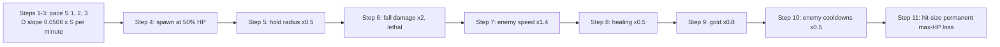

# Risk of Rain 2 difficulty reference (comps note)

Evidence: shipped-data reads and code walks. Level 4 (a script ran over the shipped bundles and read the value): body base stats, per-state tuning overrides, skill cooldowns, AI skill gates, elite multipliers, spawn-card costs, director and teleporter prefab values, projectile lifetimes. Level 3 (walked the decompiled code path): difficulty coefficient, level scaling, credit income, elite selection, the eight stacking ladder rules, boss credit, final-boss phase flow. Level 2 (file:line pointer only): a few helper facts. Everything labelled INFERRED is computed under a stated assumption (player DPS, level parity, pace, uptime). No wiki pages were used.

Abbreviations in Source columns: `DEC` = `~/scratch/game-study/ror2/decomp` (ILSpy output, one folder per namespace). `S1` = `~/scratch/game-study/difficulty-tools/ror2/scan.jsonl` (bodies, per-state override assets, elite defs, spawn cards; produced by `scan.py` in the same folder, UnityPy typetree reads over `Risk of Rain 2_Data/StreamingAssets/aa/StandaloneWindows64/*.bundle`). `S2` = `.../scan2.jsonl` (AI skill drivers, skill defs, director/holdout/boss-group/projectile/hurt-state prefab values; `scan2.py`). `S3` = `.../scan3.jsonl` (scripted encounters; `scan3.py`). Calculators: `ladder.py` and `model.py` in the same folder. State classes are quoted as `<folder>/<Class>` under `DEC`.

**Caveat on the data, answered.** Many state fields are blank or placeholder in code and are overridden by per-state configuration assets in the bundles. The UnityPy attempt worked: 932 override assets and 61 body prefabs read in about 4 minutes, no failure. Rule used below: the override value wins over the code default; a field with neither is marked "none found". Every number labelled ESC came from an asset, every "code" number from a decompiled initializer. Where both exist the two often differ (for example one heavy state is 3.5 s in code and 4.0 s in the asset), so code-only readings of this game are unreliable and were not used.

Two terms: **D** is the run's difficulty coefficient (one number that rises with time, player count and stages cleared); **level** is the enemy stat level derived from D. Both are defined in the ladder section.

## Bosses

How teleporter bosses are made (applies to every row below). The boss is an ordinary director spawn bought with a credit pot of `max(prefab override, int(600 x sqrt(D)))` at the moment charging starts, times (1 + shrine stacks + hex stacks). The same card repeats until the pot is spent or 6 spawns (series cap), so the count is floor(pot / card cost) of one card. It gets no extra HP multiplier except times living player count (code default true on the combat squad, prefab flag not checked); the "boss scaling" multiplier (HP x(1 + D/2.5) rounded to tenths, damage x(1 + D/30)) applies only to scripted encounters such as the final fight, plus one exception: a teleporter boss override flagged as a singular spawn also gets it (`DEC/RoR2/CombatDirector.cs` lines 448-453 and 1008-1010; `DEC/RoR2/VultureFightOverride.cs` line 90). Teleporter boss HP therefore grows only through enemy level (+30% of base HP per level, +20% of base damage per level). Source: `DEC/RoR2/TeleporterInteraction.cs` ChargingState.OnEnter; `DEC/RoR2/CombatDirector.cs` OnCardSpawned and the series cap; `DEC/RoR2/CharacterMaster.cs` ScaleDifficultyAsBoss; `DEC/RoR2/CharacterBody.cs` lines 4777-4785 (level defaults) and 5055 (HP); S2 director prefab rows (teleporter boss director: one wave only, series gap 0.1-1 s).

Pot size and boss count (solo, hard-tier scaling, the time points are INFERRED, see pace assumption below; credit values computed by `ladder.py`):

| Boss slot | D at spawn | Pot (credits) | Cost-600 bosses bought | Cost-800 | Cost-1150 |
|---|---|---|---|---|---|
| stage 1, ~min 5 | 1.76 | 795 | 1 | 0 | 0 |
| stage 2, ~min 12 | 3.24 | 1080 | 1 | 1 | 0 |
| stage 3, ~min 19 | 5.14 | 1359 | 2 | 1 | 1 |
| stage 4, ~min 26 | 7.52 | 1645 | 2 | 2 | 1 |
| stage 5, ~min 33 | 10.51 | 1945 | 3 | 2 | 1 |

An elite boss needs pot >= cost x 6, i.e. 3600 for a cost-600 card, which needs D >= 36, so a teleporter boss is non-elite without shrine stacks (needs D >= 36). With one shrine stack an elite cost-600 boss needs D >= 9, about stage 5 at the stated pace. With two it needs D >= 4, about stage 3. Only the first spawn is guaranteed elite: if the next elite price exceeds the remaining credit, the series reverts to non-elite (`DEC/RoR2/CombatDirector.cs` lines 888-907 and 809-810; `DEC/RoR2/TeleporterInteraction.cs` lines 212-219). INFERRED arithmetic. Pace assumption (INFERRED): about 7 minutes per stage, boss spawns when the 90 s teleporter charge starts.

**Boss body base stats** (S1 body rows, level 1; HP and damage rise +30% and +20% of base per level; armor reduces damage by armor/(armor+100), `DEC/RoR2/HealthComponent.cs` line 1751):

| Slot (archetype) | Spawn cost | Base HP | Base damage | Armor | HP per credit | Source |
|---|---|---|---|---|---|---|
| cost-600 A: slow heavy hitter, ground-marked fist, aimed beam | 600 | 2100 | 40 | 20 | 3.5 | S1 TitanBody; cscTitanBlackBeach |
| cost-600 B: floating caster, slow homing bomb, nova | 600 | 2100 | 6.5 | 15 | 3.5 | S1 VagrantBody; cscVagrant |
| cost-600 C: spitter, summoner, ward phase | 600 | 2100 | 25 | 20 | 3.5 | S1 BeetleQueen2Body; cscBeetleQueen |
| cost-600 D: lobber with heal-drain phase | 600 | 2100 | 20 | 20 | 3.5 | S1 ClayBossBody; cscClayBoss |
| cost-800 A: blink and ground pound | 800 | 2800 | 16 | 20 | 3.5 | S1 ImpBossBody; cscImpBoss |
| cost-800 B: pull-hook caster | 800 | 2800 | 23 | 20 | 3.5 | S1 GravekeeperBody; cscGravekeeper |
| cost-1150: swipe, sun channel | 1150 | 3625 | 26 | 20 | 3.2 | S1 GrandParentBody; cscGrandparent |
| cost-2000 (rare) | 2000 | 3800 | 4 | 20 | 1.9 | S1 ScavBody; cscScav |
| cost-4000 (rare) | 4000 | 12000 | 50 | 15 | 3.0 | S1 ElectricWormBody; cscElectricWorm |
| final boss form 1 and 3 | scripted | 1000 | 16 | 20 | n/a | S1 BrotherBody |
| final boss form 4 | scripted | 1400 | 3 | 20 | n/a | S1 BrotherHurtBody |

Median boss HP per credit 3.5 (range 1.9-3.5); ordinary mobs median 6.15 (range 4-12). Cost tracks HP, so the director budget is effectively an HP budget. Source: S1 spawncard and body rows, median computed in-session.

### Early boss slot (stage 1-2, cost 600), expected TTK

Player DPS is INFERRED: one ordinary player character (base damage 12, +2.4 per level, primary does 1.0x damage every 0.15 s; source: ESC `Commando/CommandoWeapon/FirePistol2` baseDuration and damageCoefficient, S1 CommandoBody base damage and level growth), times 1.5 for non-primary skills, times an item multiplier 1 + 0.45 x (stage number) (assumes about 3 damage-relevant items gained per stage), player level = enemy ambient level floor, boss takes damage 60% of the fight (dodging, repositioning). Armor 20 folded in. Treat the result as +-2x: halve or double the DPS and the TTK moves with it.

| Boss slot | Enemy level (hard-tier, solo) | Boss HP at that level | Effective HP (armor 20) | Player DPS (INFERRED) | TTK (INFERRED) |
|---|---|---|---|---|---|
| cost-600, stage 1 | 3 | 2730-3360 | 3280-4030 | 244 | ~28 s |
| cost-600, stage 2 | 7 | 5880 | 7060 | 502 | ~23 s |
| cost-600, stage 3 | 13 | 9660 | 11590 | 959 | ~20 s |
| cost-800, stage 3 | 13 | 12880 | 15460 | 959 | ~27 s |
| cost-1150, stage 3 | 13 | 16681 | 20020 | 959 | ~35 s |
| cost-600, stage 5 | 29 | 19740 | 23690 | 2574 | ~15 s |

Source: `model.py` (reads S1 body stats and the Run coefficient formula). Same model on the normal-tier (S=2) curve gives 26 s at stage 1, 23 s at stage 2, 19 s at stage 3: boss TTK barely moves with the tier because the tier moves D slowly (see ladder). The falling TTK trend comes from the item term (x1.45 at stage 1 to x3.25 at stage 5, `model.py` line 19). With the item multiplier held at 1 the model gives 40, 47 and 50 s at stages 1, 3 and 5, so TTK rises. The pot also buys 2 cost-600 bosses at stage 3 and 3 at stage 5, so per-event boss time is about 40 s and 46 s under the model. All of this is a modelling result, not a shipped fact.

### Cost-600 A: slow heavy hitter (fist, beam, rock summon)

Window arithmetic: durations are state lengths from the override assets; `fps` not applicable (durations are seconds). One AI skill runs at a time.

| Attack | Tell (wind-up) | Active | Recovery / dead time | Damage (x body damage) | Gate and cooldown | Source |
|---|---|---|---|---|---|---|
| Ground-marked fist | marker appears 0.5 s into a 2.0 s prep; detonates 1.0 s after the marker (impact ~1.5 s after cast start); aim fixed at 0.5 s | 1.2 s state | 3.0 s exit; ~4.7 s from impact to state end | 1.0 (36% of player base HP at level 1), blast radius 7 m | any HP, cd 10 s, up to 300 m | ESC `TitanMonster/FireFist` entryDuration, trackingDuration, fireDuration, exitDuration, fistDamageCoefficient; S2 TitanPreFistProjectile lifetime and blastRadius; S2 skill Fist |
| Aimed beam | 3.0 s charge (lock-on cone 3 degrees; lead-in is the long one) | 3.0-8.0 s, 8 ticks/s | none found; AI releases after 3 s minimum | 1.0 per second total (36% of player base HP per second at level 1; lethal after ~2.8 s standing in it) | HP <= 95%, range 20-80 m, line of sight, cd 20 s | ESC `TitanMonster/ChargeMegaLaser` baseDuration; `FireMegaLaser` damageCoefficient, fireFrequency, minimumDuration, maximumDuration; code: damage per tick = coefficient x damage / frequency (`FireMegaLaser.cs` line 244); S2 AI drivers TitanMaster |
| Rock summon (utility) | 9.0 s state | n/a | n/a | rocks coef 1.0, radius 2 | HP <= 60%, cd 40 s | ESC `TitanMonster/RechargeRocks`; S2 TitanRockProjectile |
| Spawn intro | 4.0 s before it acts | | | | | ESC `TitanMonster/SpawnState` duration |

Phase gates: two (95% and 60% HP). First possible hurt: spawn intro 4.0 s + fist 1.5 s = ~5.5 s. Cannot be stunned (no stun component on its body: no hurt-state row in S2).

### Cost-600 B: floating caster (bomb, barrage, nova)

| Attack | Tell | Active | Damage | Gate and cooldown | Source |
|---|---|---|---|---|---|
| Slow tracking bomb | 2.0 s charge | 2.0 s fire; bomb flies at 10 m/s, radius 15, up to 12 s | 6.0 (35% of player base HP at level 1) | HP <= 95%, 15-100 m, line of sight, cd 12 s | ESC `VagrantMonster/ChargeTrackingBomb`, `FireTrackingBomb` bombDamageCoefficient; S2 VagrantTrackingBomb |
| Missile barrage (primary) | 2.0 s state | 3 missiles/s | 4.0 each (24% of player base HP at level 1) | 15-100 m, cd 10 s | ESC `VagrantMonster/Weapon/JellyBarrage` |
| Room-wide nova | 4.0 s charge (radius 80) | 3.0 s fire | 20.0 (118% of player base HP at level 1; the player one-shot guard caps it at 90%) | HP <= 25%, cd 15 s | ESC `VagrantMonster/ChargeMegaNova` baseDuration, novaRadius; `FireMegaNova` novaDamageCoefficient; S2 skill ChargeMegaNova |
| Spawn intro | 8.0 s | | | | ESC `VagrantMonster/SpawnState` duration |

Phase gates: two (95%, 25%). First hurt after spawn: 8.0 s intro + 2.0 s bomb charge + flight time (distance / 10 m/s) so >= 10 s.

### Cost-600 C and D (cost-600 pool, brief)

C (spitter, ward phase): spit charge 2.0 s then 6 projectiles at coefficient 1.3 (30% of base HP each at level 1, 3 stocks, cd 10 s); summon eggs 9.0 s state, max 2 eggs, cd 28 s; ward spawn at HP <= 75%, 6.0 s state, 4 orbs, cd 20 s; a 4.0 s weak state with grub spawn. One phase gate (75%). Source: ESC `BeetleQueenMonster/ChargeSpit`, `FireSpit`, `SummonEggs`, `SpawnWards`, `WeakState`; S2 skills; S2 AI drivers BeetleQueenMaster.

D (lobber, heal drain): marked tarball prep 3.0 s, 3 shots 1.0 s apart at coefficient 2.0 (40 damage, 36% of base HP, cd 20 s, HP <= 75%); bombardment charge 4.0 s then up to 25 grenades 0.2 s apart at coefficient 1.0 each; heal-drain state 15 s at HP <= 25% (cd 60 s, tether 50 m). Two gates (75%, 25%). Source: ESC `ClayBoss/PrepTarBall`, `FireTarball`, `ClayBossWeapon/ChargeBombardment`, `FireBombardment`, `Recover`; S2 AI drivers ClayBossMaster.

### Cost-800 and cost-1150 slots (brief)

Cost-800 A: ground pound 3.0 s state coefficient 2.0 (radius 12, within 15 m, cd 1 s); void spikes 3.0 s, 6 spikes at 0.3 each; blink: 3.0 s with a 2.0 s destination alert, blast coefficient 4.0 radius 14 at arrival, cd 9 s (58% of base HP at level 1). ESC `ImpBossMonster/GroundPound`, `FireVoidspikes`, `BlinkState`; S2 skills. Cost-800 B: hook prep 2.0 s, 3.0 s fire, 12 projectiles at coefficient 1.0 pulling the player in, HP <= 90%, 15-90 m; barrage 3.0 s, 6 missiles/s at 1.0, cd 7 s. ESC `GravekeeperBoss/PrepHook`, `FireHook`, `GravekeeperMonster/Weapon/GravekeeperBarrage`. Cost-1150: ground swipe projectile fires 2.3 s after wind-up begins at coefficient 3.0 (78 damage, 71% of player base HP at level 1, cd 2 s, any range), secondary 3.0 s state at coefficient 1.0 with a 1.0 s fire delay (cd 10 s), a sun channel at HP <= 50% (4.0 s start, 2.0 s end, cd 30 s), a portal-fist 6.0 s (cd 11 s), a spirit-pull with zone radius 15 and 2.0 s pull timer. ESC `GrandParentBoss/GroundSwipe`, `FireSecondaryProjectile`, `PortalFist`, `SpiritPull`, `GrandParent/ChannelSunStart`; S2 skills and AI drivers GrandparentMaster.

### Final boss (four forms)

Flow (code, then data). Pre-encounter 4.0 s. Each phase waits 3.0 s, spawns its squad, then needs the squad empty plus at least 2.0 s before the next. Forms 1 and 3 spawn the same body with the boss multiplier. Phase 2 spawns six non-boss late-pool enemies (four of one card, two of another) plus a shielded centrepiece and pillars. Form 4 is a separate 1400-HP body with no boss multiplier. Source: `DEC/EntityStates.Missions.BrotherEncounter/Phase1..Phase4.cs`, `BrotherEncounterPhaseBaseState.cs`, `PreEncounter.cs`; S3 BrotherEncounter Phase 1-4 rows (grantUniqueBonusScaling true, true, false for phase 2, false for phase 4; spawn counts 1, 6, 1, 1); ESC `Missions/BrotherEncounter/PreEncounter` duration 4.0, `BrotherEncounterPhaseBaseState` durationBeforeEnablingCombatEncounter 3.0.

HP, solo, hard-tier, 5 stages cleared, ~min 40 (INFERRED time; computed by `model.py`):

| Form | Level | Base HP at level | Boss multiplier | HP | Effective HP (armor 20) | Source |
|---|---|---|---|---|---|---|
| 1 and 3 | 41 | 13000 | x6.7 (D 14.22: 1 + D/2.5, 57 stacks of +10%) | ~87,100 | ~104,500 | S1 BrotherBody; `CharacterMaster.ScaleDifficultyAsBoss`; `CharacterBody.cs` line 5066 |
| 4 | 41 | 18200 | none | 18,200 | ~21,800 | S1 BrotherHurtBody; S3 phase 4 |
| 1 and 3 on normal-tier curve | 28 | 9100 | x5.1 | ~46,400 | ~55,700 | same, S=2 |

Damage multiplier on forms 1 and 3: x1.5 at D 14.2 (x1.3 normal-tier). TTK under the same player model at the final slot (player dps ~3996 at level 41, 60% uptime): ~44 s per form 1 or 3 (hard-tier), ~33 s (normal-tier); form 4 ~9 s. INFERRED.

Form 1/3 attack gates (ESC states, S2 AI drivers BrotherMaster, S2 skills; the form cannot be stunned, hit-stun disabled; S2 hurt rows for BrotherBody):

| Attack | Duration (tell inside) | Damage (x body damage 16) | Share of player base HP at level 41 | Gate, range, cooldown |
|---|---|---|---|---|
| Hammer slam (primary) | 4.0 s state; shockwave arc of 3 waves | 12.0 at centre, waves 2.0, weapon 3.0 | slam centre ~121%, waves ~20% each | within 35 m, cd 4 s |
| Dash bash | priority drop after 0.5 s | waves 0.5 each | ~5% per wave | within 40 m, cd 5 s |
| Strafe slide | 0.3 s base | none | 0 | 2 stocks, cd 3 s |
| Shard volley | 0.11 s refire | 0.05 x projectile coef 12 = 0.6 per shard | ~6% per shard | HP <= 80%, >= 70 m, 12 stocks, cd 6 s |
| Ult | enter 0.2 s, up to 8 s channel, 4 waves of 9 projectiles | 9.0 | ~91% | HP <= 80%, cd 8 s |
| Leap to centre then sky-leap | 1.0 s enter, 3.0 s hold, 3.0 s exit; 12 wave projectiles at 4.0 | 4.0 | ~40% per wave | HP <= 75%, cd 30 s (5 stocks consumed) |
| Blocking wall (spell) | 1.0 s enter; wall crosses arena in 10.0 s; 3 casts | 25.0 | ~252% | caller not found in the two master drivers read; treat as unverified |

Source: ESC `BrotherMonster/WeaponSlam`, `SprintBash`, `BaseSlideState`, `FireLunarShards`, `UltChannelState`, `UltEnterState`, `EnterSkyLeap`, `HoldSkyLeap`, `ExitSkyLeap`, `BlockingWallChannel`; S2 AI drivers BrotherMaster and skill rows; shares computed by `model.py` at level 41 (player base HP 1430).

Optional-feat meter: a 0-8 meter, raised by about 25 optional-feat triggers (+1 each, one worth +2), scaled by a run-rule multiplier. Thresholds at 2, 3, 4, 5 and 6 (higher ones are unreachable sentinels) add attack features: slide spikes and sky-leap bombs at 2; hammer pillars, waves on the dash, and a stronger shard at 3; meteor storm, crawlers on the slam and phase-2 elite promotion at 4; extra sky spires at 5; sky-leap crawlers, ult spires, slide homing bomb and phase-3 elite promotion at 6. Source: `DEC/RoR2/KarmaManager.cs` (minKarma, maxKarma, trigger registry), ESC `BrotherMonster/WeaponSlam` requiredKarma, `ExitSkyLeap`, `BaseSlideState`, `SkySpawnState`, `UltExitState`, `SprintBash`; ESC `Missions/BrotherEncounter/Phase2`, `Phase3`. All shares above are before the x1.5 boss damage multiplier.

Form 4 (separate body, S2 AI drivers BrotherHurtMaster): a ground slam (6.0 s state, 6.0 centre and 4.0 waves, costs the boss 8% of its own HP, cd 8 s, HP <= 90%, any range), a basic shard shot, two storm skills gated at HP <= 50% (mortar storm cd 15 s, laser storm cd 25 s) and a heal-beam at HP <= 50%. Shares at level 41: slam centre ~60%, waves ~40%. Source: ESC `BrotherMonster/FistSlam` baseDuration, damageCoefficient, healthCostFraction, waveProjectileDamageCoefficient; S2 AI drivers BrotherHurtMaster; S2 skills FistSlam, LunarExploderMortarStorm, LunarGolemLaserBarrage. A separate channelled re-cast skill exists (cd 120 s; sunder waves at 75% and ults at 40% health in ESC `BrotherMonster/ReSpellChannelState`) but its caller was not in the two drivers read, so it is unverified.

### Single-hit and burst damage against the player

Player one-shot guard (code): a player-controlled body cannot lose more than 90% of its full combined health plus barrier within one server update unless the damage is flagged to bypass it. Damage spread over several updates is not capped together, and a triggered guard grants 0.1 s of immunity. A full-health player therefore survives any single-update burst; it is not a hit-count rule. The guard fraction shrinks by (1 - 1/curse divisor), so the top ladder step erodes it (see step 11). Source: `DEC/RoR2/HealthComponent.cs` lines 1771-1779, 2515 and 1428; `DEC/RoR2/CharacterBody.cs` lines 5014, 5385, 5880.

Share of player base HP (110 at level 1, +33 per level) per hit, no armor, enemy and player at the same level (INFERRED parity; computed by `model.py`):

| Hit | Level 1 | Level 10 | Level 20 | Level 40 |
|---|---|---|---|---|
| small melee mob headbutt (2.0x12) / second small mob bite (2.0x12) | 22% | 17% | 16% | 15% |
| cost-600 B bomb (6.0 x 6.5) | 35% | 27% | 25% | 25% |
| cost-600 A fist (1.0x40) | 36% | 28% | 26% | 25% |
| cost-600 C spit (1.3x25) | 30% | 22% | 21% | 20% |
| cost-800 A pound (2.0x16) | 29% | 22% | 21% | 20% |
| cost-800 A blink arrival (4.0x16) | 58% | 44% | 42% | 40% |
| mid-mob big hit (40-cost beam mob 2.5x20, 40-cost slam mob 4.4x12, 10-cost nova mob 12x5) | 45-55% | 34-41% | 33-39% | 31-38% |
| cost-1150 swipe (3.0x26) | 71% | 54% | 51% | 49% |
| cost-600 B nova (20x6.5) | 118% (capped 90%) | 89% | 85% | 82% |
| final form 1/3 hammer slam centre (12x16) | 175% | 132% | 125% | 121% |
| final form ult wave (9x16) | 131% | 99% | 94% | 91% |

Rule of the data: ordinary boss primary attacks sit at 25-36% of base HP (3-4 hits to kill), special telegraphed attacks at 50-120%, only the final boss and room-wide novas exceed the guard. All multiplied by 2.0 for an affixed enemy and by the boss multiplier for scripted bosses. Contact damage: none found (no touch-damage component was read; attacks are all state-driven). Source: S1 body base damage; ESC coefficients as above; level scaling `CharacterBody.cs` line 5386.

## Mobs and events

**Spawn budget rules (director).** Source for all: S2 director rows (stage-director prefab) and `DEC/RoR2/CombatDirector.cs`.

| Rule | Value | Source |
|---|---|---|
| Stage directors | two on every ordinary stage | S2 Director rows in `ror2-base-common_static` |
| Credit multiplier per director | 0.75 | same |
| Wave interval | 1.0 s per wave (every second) | same |
| Income per director per second | 0.75 x (1 + 0.4 D) x (0.5 + 0.5 N players) | code `CombatDirector.cs` money-wave update lines 100-109 |
| Re-pick gap after a skipped pick | 4.5-9.0 s (fast director), 22.5-30 s (slow director, saves for big cards) | same |
| Gap between spawns in one series | 0.1-1.0 s | same |
| Cap per series | 6 spawns, then re-pick | same |
| Starting stock at stage start | stage monster credits (100 for stages 1-3, 230 for stages 4-5, 900 on the final stage) x D, floored | `DEC/RoR2/SceneDirector.cs` line 87; `~/scratch/game-study/ror2/reports/stage-graphs.csv` monster_credits |
| Teleporter bonus director while charging | multiplier 2.0, same 1 s waves, series gap 0.5 s, re-pick 2-4 s | S2 Teleporter1 director rows |
| Teleporter charge | 90 s base, radius 60, player-count scaling 1.0 (all players inside = full speed) | S2 holdout rows; `HoldoutZoneController.cs` lines 418-465 |
| Boss-pot shrine | pot x (1 + stacks), rewards x (1 + stacks) | `DEC/RoR2/TeleporterInteraction.cs` line 212; `BossGroup.cs` line 297 |
| Spawn distance (m from player) | close 8-20, standard 25-40, far 70-120 | `DEC/RoR2/DirectorCore.cs` lines 261-285 |

Credits per minute, solo (hard-tier D), both stage directors summed (computed by `ladder.py`; INFERRED minutes):

| Moment | D | Credits per minute (hard-tier) | Credits per minute (normal-tier) |
|---|---|---|---|
| min 1, stage 1 | 1.15 | 131 | 130 |
| min 5, stage 1 | 1.76 | 153 | 144 |
| min 12, stage 2 | 3.24 | 207 | 182 |
| min 19, stage 3 | 5.14 | 275 | 229 |
| min 26, stage 4 | 7.52 | 361 | 289 |
| min 33, stage 5 | 10.51 | 468 | 363 |

Income is 3.6x higher at stage 5 than at the start (hard-tier), and the hard tier is only +6% at minute 5 (153 against 144) but +29% at minute 33 against the normal tier: the tier mostly acts late. Mob growth is therefore spend-rate growth, not a count schedule.

**Mob price list (examples, per spawn credit).** Small: 8 (80 HP, 12 dmg), 10 (60 HP, 5 dmg), 11 (80 HP, 12 dmg), 25 (100 HP), 28 (140 HP), 28 (140 HP, 15 dmg). Mid: 40 (480 HP, 20 dmg; also a 480-HP 12-dmg and a 290-HP 16-dmg), 60 (300 HP), 100 (585 HP, 16 dmg), 115 (900 HP, 16 dmg), 125 (700 HP, 16 dmg). Large: 200 (750 HP), 300 (1900 HP, 12 dmg). Bosses 600-4000. Source: S1 spawncard and body rows. At a 6-spawn series cap with stage-1 income (~131/min) the director buys 16 smallest mobs or 3 mid mobs per minute, plus the opening stock of 100.

**Mob attacks (tells and hits), early pool.** All ESC unless noted, S1 body for damage.

| Attack | Tell | Damage (x body damage) | Share of player base HP at level 1 | Source |
|---|---|---|---|---|
| small melee mob (cost 8) headbutt | 1.5 s state | 2.0 x 12 | 22% | ESC `BeetleMonster/HeadbuttState` |
| second small mob (cost 11) bite | 1.0 s state | 2.0 x 12 | 22% | ESC `LemurianMonster/Bite` |
| second small mob fireball | 0.6 s charge, 0.5 s fire | 1.0 x 12 | 11% | ESC `ChargeFireball`, `FireFireball` |
| small blinking melee mob (cost 28) double slash | 1.2 s state | 1.5 x 10 | 14% | ESC `ImpMonster/DoubleSlash` |
| small floating shooter (cost 10) embers | 1.6 s charge, 3 bullets at 1.5 | 1.5 x 15 each | 20% each | ESC `Wisp1Monster/ChargeEmbers`, `FireEmbers` |
| 40-cost beam mob beam | 3.0 s charge, 2.0 s fire, blast radius 4 | 2.5 x 20 | 45% | ESC `GolemMonster/ChargeLaser`, `FireLaser` |
| 10-cost nova mob nova | 1.0 s | 12 x 5 (radius 10) | 55% | ESC `JellyfishMonster/JellyNova` |
| 40-cost slam mob slam | 2.7 s state | 4.4 x 12 | 48% | ESC `BeetleGuardMonster/GroundSlam` |
| 115-cost volley mob fireball volley | 1.0 s charge, 5 balls | 2.0 x 16 each | 29% each | ESC `LemurianBruiserMonster/ChargeMegaFireball`, `FireMegaFireball` |
| 40-cost charger mob charge | 1.5 s prep, then 4.0 s run at speed x8, then 3.0 s self-stun | 2.5 x 12 impact | 27% | ESC `Bison/PrepCharge` basePrepDuration, `Bison/Charge` chargeDuration and damage fields |

Heavy-attack table (INFERRED selection rule: every attack in this note whose single hit, or one second of beam, costs a player 25% or more of base HP at level 1 with enemy and player level equal; one row per attack; tell = time from skill start to first damage, so projectile travel is excluded; where only a whole-state length exists it is marked ub, an upper bound):

| # | Attack (positional label) | Tell (s) | Hit, % of player base HP | Source |
|---|---|---|---|---|
| 1 | final boss, ult wave | 0.2 (enter state; waves are projectile lines that live 3 s) | 131 | ESC `BrotherMonster/UltEnterState` duration; S2 BrotherUltLineProjectile lifetime |
| 2 | 10-cost nova mob, nova | 1.0 | 55 | ESC `JellyfishMonster/JellyNova` |
| 3 | 115-cost volley mob, volley | 1.0 | 29 each | ESC `LemurianBruiserMonster/ChargeMegaFireball` |
| 4 | cost-600 A, ground-marked fist | 1.5 (marker to blast 1.0) | 36 | ESC `TitanMonster/FireFist`; S2 TitanPreFistProjectile |
| 5 | 40-cost charger mob, charge | 1.5 prep | 27 | ESC `Bison/PrepCharge` |
| 6 | cost-600 B, slow bomb | 2.0 | 35 | ESC `VagrantMonster/ChargeTrackingBomb` |
| 7 | cost-600 C, spit volley | 2.0 | 30 each | ESC `BeetleQueenMonster/ChargeSpit` |
| 8 | cost-800 A, blink arrival | 2.0 (destination alert) | 58 | ESC `ImpBossMonster/BlinkState` |
| 9 | cost-1150, ground swipe | 2.3 | 71 | ESC `GrandParentBoss/GroundSwipe` |
| 10 | 40-cost slam mob, slam | 2.7 (ub) | 48 | ESC `BeetleGuardMonster/GroundSlam` |
| 11 | cost-600 A, aimed beam | 3.0 | 36 per second | ESC `TitanMonster/ChargeMegaLaser` |
| 12 | cost-600 D, tarball | 3.0 | 36 | ESC `ClayBoss/PrepTarBall` |
| 13 | cost-800 A, ground pound | 3.0 (ub) | 29 | ESC `ImpBossMonster/GroundPound` |
| 14 | 40-cost beam mob, beam | 3.0 | 45 | ESC `GolemMonster/ChargeLaser` |
| 15 | cost-600 B, nova | 4.0 | 118 | ESC `VagrantMonster/ChargeMegaNova` |
| 16 | final boss, hammer slam | 4.0 (ub) | 175 | ESC `BrotherMonster/WeaponSlam` duration |
| 17 | final boss form 4, fist slam | 6.0 (ub) | 87 | ESC `BrotherMonster/FistSlam` baseDuration |

Recomputed over these 17 rows: minimum 0.2 s (the final-boss ult), next lowest 1.0 s, median 2.3 s (9th of 17), maximum 6.0 s. Excluding the final boss (rows 1, 16, 17) the minimum is 1.0 s and the median of the remaining 14 is 2.15 s. Hits above 50% (rows 1, 2, 8, 9, 15, 16, 17) sit behind tells from 0.2 s to 6.0 s; the 1.0 s one is a 55% nova of a cheap mob.

**Mob behaviour bands (aggression).** Skill-driver gates: the cost-8 melee mob attacks only within 2 m and chases when within 10 m; the cost-11 mob fires when 15-35 m away with line of sight and bites within 3-6 m; the 40-cost beam mob fires at 10-45 m with line of sight and melees only within 6 m; the cost-28 blinker slashes within 9 m and blinks when 8-25 m away. Source: S2 AI driver rows (BeetleMaster, LemurianMaster, GolemMaster, ImpMaster).

**Staggering.** Hit-stun threshold: a single hit of 15-35% of an enemy's max HP stuns it (cost-8 mob 20%, 40-cost beam mob 30%, cost-28 blinker 35%, cost-11 mob 15%, 40-cost slam mob 15%, one 50% for a late-pool mob). No hit-stun component was found on the teleporter-boss bodies read, and the final boss has it disabled (freezing is still allowed). Source: S2 hurt rows (BeetleBody, GolemBody, ImpBody, LemurianBody, LunarGolemBody, BrotherBody).

**Elites.** Selection is credit-driven, not a dice roll: at the moment a card is picked, the director checks each elite tier in order and uses the highest tier whose cost multiplier x card cost x bias (1) fits the current balance, so the series of that card (up to 6 spawns) stays elite while the remaining credit covers the multiplied price; each spawn pays it, and the series reverts to non-elite when it no longer does. No coefficient gate. Tiers by cost multiplier (counts by unnamed tier): one tier at x1 (not elite), two tiers at x6 (one before two stages cleared, one after), two at x3.5 (only with the elite-only rule), one at x36 (only after a loop), one at x6 (late-pool rule only). A body carries one affix (one equipment slot), so affixes do not stack on a single enemy through the director. The 21 elite definitions read have HP multipliers from 1.0 to 18 (median 3.0, mode 4.0) and damage multipliers from 1.0 to 6.0 (median 2.0); one standard tier shape is 4.0 HP / 2.0 damage, a weakened variant of each standard elite is 2.5 / 1.5, the heaviest four sit at 16-18 HP / 4-6 damage. Applied as +10% per stack of boost items (HP stacks = round((multiplier - 1) x 10)). Elite onset by card cost (balance needed = 6 x cost): 48 for the cheapest card, 240 for a 40-cost card, 690 for a 115-cost card. Source: `DEC/RoR2/CombatDirector.cs` lines 646-722 and 795-835, 1028-1055; S1 elite rows.

**Readability devices.** (1) Series spacing 0.1-1 s with a 6-spawn cap per series. (2) Standard spawns 25-40 m out, never on the player; far spawns are a fallback. (3) Every heavy skill has a named charge state with its own sound and a charge effect scaled to its duration (beam 3.0 s, bomb 2.0 s, nova 4.0 s). (4) Beam and marker attacks lock their aim before impact: marker position is frozen 0.5 s into a 2.0 s wind-up and detonates 1.0 s later. (5) Bosses unlock skills by HP gate rather than all at once (gates at 95, 90, 75, 60, 50 and 25% across bosses; median 75%). (6) Player-side: the one-shot guard, hit-stun on mobs, and boss-HP-gated skill introduction. Source: ESC states above; S2 AI drivers.

## Difficulty ladder

Eleven selectable steps. The first three set the pace of D and give the player a small modifier; the next eight add one rule each, and every rule keeps all the earlier ones (code: each uses `selectedDifficulty >= step`). The pace factor S is 1, 2, 3 then 3 for the rest. Source for S: `DEC/RoR2/DifficultyCatalog.cs` lines 15-25; formula `DEC/RoR2/Run.cs` lines 1126-1147.

Formula: D = (0.7 + 0.3 N + 0.0506 x S x N^0.2 x minutes floored) x 1.15^stages cleared (when the team holds the opt-in difficulty item, S is replaced by S x (1 + 0.25 x count / N^0.75), `DEC/RoR2/Run.cs` line 1134); enemy level = min(1 + (U - (0.7 + 0.3 N)) / 0.33, 99) where U is the same with unfloored minutes. Solo N=1: D at 10 minutes, no stages cleared: S=1: 1.51 (level 2.5), S=2: 2.01 (level 4.1), S=3: 2.52 (level 5.6). Computed by `ladder.py`.

| Step | Rule it adds | Numeric effect | Cumulative effect | Source |
|---|---|---|---|---|
| 1 (lowest) | pace S = 1; player armor +70 and regen +50% | damage taken x0.588 (armor 70); regen x1.5; D slope 0.0506 per minute | easiest | `Run.cs` line 1753-1755 grants a helper item; `CharacterBody.cs` lines 5160-5163, 5582 |
| 2 | pace S = 2 | D slope doubles (0.1012 per minute); no player modifier | D at 10 min 2.01 | DifficultyCatalog; Run.cs |
| 3 | pace S = 3; player regen x0.6 (minus 0.4 from the helper) | D slope x1.5 vs step 2; hard mode flag on | D at 10 min 2.52; credits per minute +29% vs step 2 at minute 33 | DifficultyCatalog; `Run.cs` line 1757-1759; `CharacterBody.cs` lines 5164-5167 |
| 4 (hard-mode rule 1) | players respawn and spawn at 50% HP | -50% starting HP on every spawn | step 3 + this | `DEC/RoR2/CharacterMaster.cs` lines 1531-1534 |
| 5 (rule 2) | teleporter hold radius halved | radius 60 -> 30 base (also a second zone controller) | steps 3-5 | `HoldoutZoneController.cs` lines 429-431; `KillZoneController.cs` line 310; S2 holdout prefab 60.0 |
| 6 (rule 3) | fall damage doubled and no longer non-lethal | x2, can kill | steps 3-6 | `DEC/RoR2/GlobalEventManager.cs` lines 1332-1337 |
| 7 (rule 4) | monster move speed +0.4 | +0.4 added to the move-speed multiplier (x1.4 on an otherwise unmodified enemy) | steps 3-7 | `CharacterBody.cs` lines 5233-5236 |
| 8 (rule 5) | all player healing halved | heal x0.5 (applies on top of step 3's regen x0.6) | steps 3-8; sustained healing x0.3 of the neutral baseline (x0.2 of step 1) | `HealthComponent.cs` lines 983-986 |
| 9 (rule 6) | gold per kill reduced | gold x0.8 | steps 3-9; fewer items per minute | `DeathRewards.cs` lines 109-112 |
| 10 (rule 7) | all monster skill cooldowns halved | cooldown scale x0.5 | steps 3-10; cooldown-gated attacks twice as frequent | `CharacterBody.cs` lines 5661-5665 |
| 11 (rule 8) | every hit on a player adds permanent max-HP penalty | stacks = floor(0.4 x percent of full health lost); each stack adds 0.01 to a max-HP divisor (e.g. a 25% hit = 10 stacks = max HP / 1.10 for the rest of the run); the one-shot guard fraction shrinks by (1 - 1/divisor): 10 stacks (one 25% hit) leave 0.009 of it, 12 stacks remove it, so one 30% hit at the top step removes the guard for the rest of the run (INFERRED arithmetic) | steps 3-11 | `HealthComponent.cs` lines 1985-1993; `CharacterBody.cs` lines 5760-5763, 5880 |

Cumulative effect at the top step (INFERRED from the table, simple products, no sim): enemy tempo x2 on cooldown-gated skills (skills on 20-30 s cooldowns fire every 10-15 s) and x1.4 on movement, player healing x0.2 of the lowest step (x0.3 of the neutral baseline), HP at spawn 50%, teleporter circle 4x smaller in area (radius 60 to 30), gold x0.8, plus a growing max-HP loss from taking big hits; one 30% hit removes the one-shot guard for the rest of the run (INFERRED arithmetic). No ladder step raises boss HP or damage coefficients directly; the only HP and damage growth is from the pace S (steps 1-3) through D and enemy level. Win-rate by step: not in the data (no public numbers allowed from disk).

## Why it works

- **The ladder changes the player's margin, not the boss's numbers.** Of eight stacking rules, six cut player margin (start HP, heal rate, fall damage, zone size, gold, permanent HP loss) and two raise enemy tempo (speed, cooldown). Boss HP and damage coefficients stay the same; the readable attack stays readable and the player is allowed fewer mistakes. Source: ladder rows 4-11.
- **A boss is HP bought with credits.** Cost is 3.5 HP per credit for every teleporter boss, so a bigger pot buys more of the same boss rather than a different, stronger one; difficulty at the boss slot is a count. Source: S1 spawncard and body rows; pot formula.
- **A hit-size ceiling keeps the lethal moments rare.** Ordinary boss hits are 25-36% of base HP, 3-4 hits to die; hits above 50% sit behind tells from 0.2 s to 6.0 s (55% behind 1.0 s, 58% behind a 2.0 s alert, 71% behind 2.3 s, 118% behind 4.0 s; see the heavy-attack table), and the one-shot guard caps one update's damage at 90% of full health. The player is almost never killed by something they did not see coming. Source: hit-share table; `HealthComponent.cs`.
- **HP gates make a fight longer without lengthening the first minute.** Bosses add skills at 95, 90, 75, 60, 50 or 25% HP; no boss row used all of its kit at spawn, and the earliest hurt after spawn is >= 5.5 s. Source: S2 AI drivers.
- **Cooldown halving is the cheapest pressure lever.** Because the boss kit is cooldown-gated (cooldowns 10-40 s), halving every cooldown doubles the density of telegraphed attacks without altering a single tell length or damage number. Source: ladder row 10; S2 skills.
- **Time-bounded dials.** Income and level rise with a once-a-minute step and a x1.15 per stage factor, so a slow run meets harder enemies than a fast one; the player controls their own D. Source: `Run.cs` lines 1126-1147.

## Patterns for Scrapkeep's skill bands

Targets, from the brief: Novice (late reactions, misses tells, basic attack), Learner (reads most tells), Expert (fast reads, full kit).

1. **Tell lengths (lethal-or-heavy attacks; target >= 0.6 s).** RoR2's heavy tells (17 attacks, heavy-attack table) have min 0.2 s (final-boss ult enter; its waves are 3 s projectile lines), next lowest 1.0 s, median 2.3 s, max 6.0 s. Hits above 50% sit behind 0.2-6.0 s tells, so RoR2 does not tie big hits to long tells. A Novice with ~0.6-1.0 s late reactions dodges ~0 of the 1.0 s tells and ~all of the 3.0 s+ tells, so for Scrapkeep give the Novice-lethal ones 2+ s. Rows: tell table above.
2. **Hit-count to kill (burst).** Ordinary hits 22-36% of base HP at level 1, falling to 15-28% at level 20+ (player HP grows faster than enemy damage); boss specials 50-120%. Suggested: general attacks 20-30% of base HP, no single hit above ~70% except behind a 3 s+ tell (RoR2 itself breaks this: 55% behind 1.0 s), and a per-update cap like RoR2's 90% of full health (it does not cap damage spread over several updates). Rows: hit-share table; `HealthComponent.cs`.
3. **First dangerous attack (no boss kills a Learner in its first 45 s).** RoR2 gives a 4.0-8.0 s spawn intro, then a first hit of ~36% at the earliest ~5.5 s. The guard alone forces at least 2 hits, and the slow-fist boss's own cooldown (10 s) puts three fist hits at ~25 s at the earliest (INFERRED, fists only). Its beam needs the boss at or below 95% HP first, the room-wide nova (118%) needs the floating boss at or below 25%, and the ult-class final-boss attacks need HP below 80%: the lethal specials are HP-gated so they cannot happen early. Rows: spawn state durations; AI gates.
4. **TTK and fight length (Learner win 15-35% first attempt, Expert >= 85%).** Under the INFERRED model an ordinary player kills a cost-600 early boss in ~15-28 s (about 40-50 s with no item growth, and 40-46 s per event at stages 3 and 5 because the pot buys 2-3 bosses), a cost-1150 slot in ~26-48 s across stages 1-5 (`model.py` output) and a final form in ~33-44 s; the fights last longer because attacks displace the damage window (uptime 0.6). This is the main knob: Scrapkeep does not raise enemy HP, so the lever must be uptime (how often the boss is open), not HP. RoR2 gives the boss ~4.7 s of dead time after a fist (1.2 s fire + 3.0 s exit + remaining prep) and a 3.0-8.0 s beam during which the boss is held in place. Rows: fist row; model table.
5. **Extra phases and HP gates.** RoR2 uses 1-2 gates per ordinary boss (median 75%) and a 4-form final fight with form transitions of 2-3 s plus 3 s spawn delays. Suggested for the hard tier: add a gate rather than HP, at 75% and 25%, each adding one skill and not removing any telegraph. Rows: AI gate list; final-boss flow.
6. **Optional-feat hardening.** The final boss has a 0-8 meter that rises with ~25 optional feats and unlocks extra attack features at 2, 3, 4, 5 and 6. This is a ready replay-ladder pattern: the hard tier can consume a meter of optional deeds instead of a global multiplier. Rows: optional-feat meter paragraph.
7. **Hard-tier replay ladder (Expert + ordinary build wins about half at the top).** RoR2's eight stacking rules map onto pressure axes Scrapkeep can use without touching enemy HP: tempo (cooldown x0.5 equals about 2x the frequency of cooldown-gated skills; speed x1.4), margin (start HP x0.5, healing x0.5, permanent HP loss per hit) and space (zone radius x0.5). Add one per replay step, each as a separate toggle visible on the tier card. Rows: ladder 4-11.
8. **Parks and mob aggression (Novice reaches world boss <= 50%, Learner >= 80%).** Mob income is a spend rate: ~131 credits/min at the start and ~468/min at stage 5, i.e. 3.6x over a run; heavy mobs cost 40-125 credits so at stage 1 about 3 mid mobs per minute; mid mobs hit for 45-55% of base HP behind 1.0-3.0 s tells. Suggested: Novice survival of a stage comes from the hit-share ceiling and the tell median, not a lower count. Rows: credits table; mob attack table.
9. **Attacker budget cap (existing Scrapkeep rule: 6, cap 12).** RoR2's equivalent is the per-series cap of 6 spawns with a 0.1-1 s gap; nothing in the data limits simultaneous attackers beyond the budget itself (gap, below). Rows: director rules table.

## What it must not copy

- The elite pot rule's side effect: a series of up to 6 spawns stays elite while credit covers the multiplied price, so several elites can arrive at once. Scrapkeep wants one rare strong enemy at a time.
- The boss-multiplier-by-D formula (1 + D/2.5 HP) for scripted bosses: it produces a final-form HP of ~87k at an ordinary late run and tracks the clock, not the player; Scrapkeep never scales enemy HP with difficulty.
- Level scaling of enemy damage by clock (+20% of base per level): with an unbounded clock the hit share falls then flattens; Scrapkeep caps run tier at 1.6x HP and 1.3x damage.
- Un-bypassable gold, heal and permanent-HP penalties as the *only* high-tier answer: they punish a Novice by attrition, which the replay ladder should avoid at lower steps.
- Names, text, art and audio of any boss, mob, affix or item.

## Gaps

- Which stage each boss appears on and the boss-pool weights and minimum-stage gates: they sit in director card-category assets whose references cross bundles; not resolved. The "stage 1-5" boss rows are by cost class (affordability), not by shipped stage lists.
- The player's real DPS, real item counts and real level at each stage: INFERRED only (model above); the data has no recorded runs.
- Exact hit timing inside many animation-driven states (hammer slam, fist slam, ground pound): hit frames live in animator curves, not in state fields; only whole-state durations are given. Recovery windows are therefore state remainders, not measured open frames.
- Maximum simultaneous enemies on the map: no cap found in the director code (the monster cap that exists only appears as an ignore flag on boss and shrine directors); the earlier comps memo cites an external figure of 40 not checked here.
- Contact or touch damage: no component was scanned; none found in state code read.
- Win rates per ladder step and per skill band: not in the shipped data.
- Elite tier membership (which affixes sit in which tier list): references to asset collections not resolved; the x18-HP/x6-damage group is likely the x36 loop-only tier (INFERRED from the cost structure).
- The per-form first-use time and the Phase-2 spawn composition by name: composition counts only (1, 6, 1, 1) from the encounter prefab; the six-spawn mix is two spawn cards not resolved by name.
- The optional-feat meter's starting value and multiplier come from run rules not read; only its range 0-8 and trigger counts were read.
