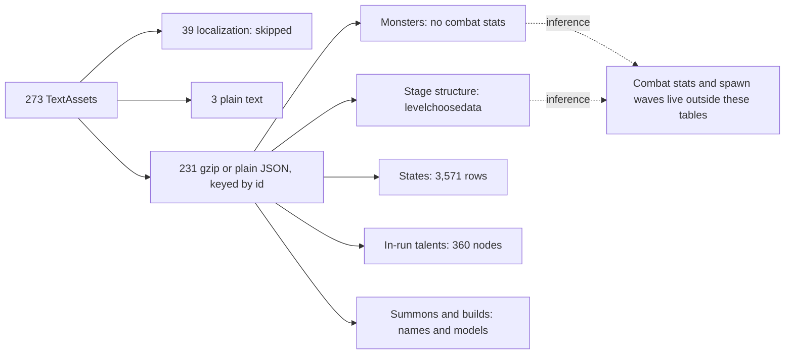

# Gunfire Reborn data tables worth keeping

Evidence: parsed from the game's own data files with a script that read every table, in the study's reports `gameplay-tables.md` and `tables/SUMMARY.md` (level 4 for counts and schemas: nothing failed to parse). Only counts, field names as identifiers and numeric ranges are kept here. This note holds no row content, names, descriptions or text. It is a data note, so it does not use the six-heading design-note shape. Statements marked inference are readings of structure, not decoded behavior.

## Method

The tables are TextAssets inside the Unity asset bundles: 273 in all. 39 are localization tables (19 languages, 7.86 MB) and were skipped by rule. Of the other 234, three are plain text (a font license and two line-break character lists) and the rest are UTF-8 JSON objects keyed by id (`{id: record}`); 211 of those are gzip-compressed. No protobuf and no custom binary were found. Per-mode suffixes 3001, 3004, 3008, 3011 and 3020 mark game modes (inference); 3001 is the main mode. Field statistics come from a field walk over each table (type, length for strings, min, median, max and distinct count for numbers). Source for every table: `data: gameplay-tables.md` and `data: SUMMARY.md`.

## Tables by group

**Stored size per group** (11 rows; reading: gameplay-relevant structure is small, 150 to 600 KB per group, and the localization text dwarfs all of it).

| group | assets | stored bytes |
| --- | --- | --- |
| localization (excluded) | 39 | 7,862,185 |
| season | 48 | 150,303 |
| monster | 13 | 52,747 |
| room and level | 17 | 42,545 |
| talent | 3 | 49,885 |
| build | 5 | 6,383 |
| summon | 6 | 6,426 |
| audio | 5 | 68,799 |
| path | 1 | 59,819 |
| notify | 1 | 40,662 |
| other (weapons, heroes, states, effects, icons, relics, pets, UI) | 135 | 583,116 |

## Stage structure

**Level choose per mode** (`levelchoosedata_3001`, `_3008`, `_3020`; one row per layer; reading: a run is a short ladder of layers, each with a few fight slots).

| mode file | layers | fight slots per layer |
| --- | --- | --- |
| 3001 | 5 | 4, 3, 3, 2, 2 |
| 3008 | 4 | not recorded in the report |
| 3020 | 1 | not recorded in the report |

Fields: `Layer` (1 to 5), `LobbyLevelID`, `BossLevelList` (level id mapped to a weight of 10 or 0; 12 entries in 3001), `FightLevelInfo` (14 slots in 3001), `LevelConditions` (174 level-id flags of 0 or 1 in 3001), `MusicEffectID`, `MonsterMusicEffectID`.

**Slot candidates** (reading: each fight slot picks one level from a pool of 8 to 19 candidates, and each layer has a lobby level and a weighted boss pool). Variety comes from the pool size, not from branching: hub-to-next-layer routing is not encoded beyond layer order (inference from structure).

**Hidden rooms** (`leveladditiondata_<mode>`, 80 and 36 rows in two modes; reading: hidden rooms are weighted pools, not fixed rooms). Field `HideLevelConfig` holds (`HideLevelID`, `Weight`) pairs; in mode 3001 there are 877 entries with weights 0 to 30.

**Level definitions** (reading: 554 level definitions, of which almost all are main line).

| table | rows | note |
| --- | --- | --- |
| `levelconfigdata` | 554 | field `HideLevelType` takes values 0 to 4 |
| `levelgmdata` types | 554 main line, 49 boss, 21 prep room, 1 hidden fight | type labels translated from Chinese by the study; the counts overlap `levelconfigdata` |
| `levelnotifydata_<mode>` | per layer and slot | announcement ids 2001 to 2046: which message plays, not what spawns |
| `roomchallengedata_<mode>` | 168 / 71 / 107 | name and detail strings only, no weights, no waves |

Design reading: stage structure is data, which is the part Scrapkeep can learn from: a layer count, slots per layer, a candidate pool per slot, a weighted boss pool and a weighted hidden-room pool are five small knobs that produce a varied run. Nothing here lists the enemies in a room.

## Monsters and combat

**Rows per mode** (`monsterdata_<mode>`; reading: the main mode holds most of the roster, and most ids repeat across modes).

| mode | rows |
| --- | --- |
| 3001 | 243 |
| 3004 | 94 |
| 3008 | 150 |
| 3011 | 23 |
| 3020 | 72 |

277 unique ids; 191 appear in more than one mode file. `monsterconfig_16` has 197 rows. `fightnpc_<mode>` has 197 / 191 / 188 rows (name and an alias to a base id).

**Monster fields** (reading: movement and attack cadence are data; health and damage are not).

| field | range or shape |
| --- | --- |
| `HitActCD` | 300 to 1,200 ms, median 600 |
| `MoveSpeed` | 30 to 4,000, median 150 |
| `SkillLst` | 0 to 22 skill ids |
| `CombatForce` | 0 to 10 (a threat weight; inference) |
| `PhaseInfo` | boss phases, ids 1 to 10 |
| `Name`, `ModelID`, `FightType`, `IconID`, `DataSID`, direction and sprint-ratio fields | present; `FightType` is a bitmask and `DataSID` is unresolved |
| `monsterflawdata.KillLineUpLimit` | 3,333 to 10,000 |

**Absent** (a field search across all tables): no health, shield, armor, damage, attack range or element on any monster row, and no spawn waves per room anywhere. Hp, Shield and Armor appear only in `herodata.BaseAttr`. Inference: combat stats and spawn waves live outside the TextAssets, most likely in the packed native logic library or on a server (see `provenance.md`). The study could not confirm either.

**Hero reference** (`herodata`, 16 rows; reading: hero stats are in data, which makes the monster gap deliberate rather than a format limit).

| field | range |
| --- | --- |
| `BaseAttr` Hp | 3,500 to 10,000, median 5,500 |
| `BaseAttr` Shield | 0 to 9,000 |
| `BaseAttr` Armor | 0 to 7,000 |
| `BaseAttr` MoveSpeed | 500 to 650 |
| hero grades | 5 grades; `CostNeed` 700 to 3,100; `LevelNeed` 2 to 18 |

Weapon-side tables (`weapondata`, `skillinfo`, `attackdata`, `careerpfdata`, `throwdata`) carry hero-side damage numbers, for example `Atk` up to 120,000 in `careerpfdata` and up to 150,000 in `throwdata`. They were not studied beyond their schemas.

## States

**State table** (`statedata`, 3,571 rows, id range 1002 to 45222; reading: it is mostly a helper-state registry, not a status-effect catalog).

| field | distribution |
| --- | --- |
| `JudgeType` | STATE_CLS_HELP 3,099; ABNORMAL 370; SPECIAL 102 |
| `AttName` (target) | OBJ_SELF 3,398; ENEMY 145; ALL 17; others 11 |
| `BehaviorID` | 291 distinct values, 0 to 50,548 |
| `Weights` | 0 to 13, 7 distinct values |
| `StateDescDic` | 1,541 entries; `Level` 0 to 5; `Tier` 0 to 40 |
| flags | `Showable`, `RunOwnBehaviorOnly`, `CacheTime`, `StateCountBehav`, `FreshRestartBehav`, `CanShowCount`, `NoCountCanShow` (all 0 or 1) |

No duration or tick-rate field exists. Inference: timing and magnitude live behind `BehaviorID` in non-TextAsset data. Design reading: 87% of states are helper states a player never sees, so the visible status set is about 470 states (ABNORMAL plus SPECIAL) before duplicates.

## Talents and builds

**In-run talent tree** (`talentdata`, 360 nodes, id range 2025 to 5427; reading: each hero has a small three-column tree, and a common tree sits beside them).

| group | nodes | shape |
| --- | --- | --- |
| common (`Career` 0) | 16 | includes `Type` 4, which appears only here |
| 16 heroes | 19 to 23 each | typically 7 / 7 / 7 across `Type` 1, 2, 3 |
| three-level nodes | 252 | `UpLevel` 2 |
| single-level nodes | 108 | `UpLevel` 0 |

`TalentDescDic` holds 864 level entries; `UpCost` is 0 on all of them, so no cost is in this table. `talentdatashield` has 54 rows (3 careers by 18). Flags: `Rare`, `PassiveMap`, `CommonTalent` (0 or 1). Inference from shape: this is the in-run ascension tree, not a persistent meta tree; the hero-grade `CostNeed` range above is a third system. Design reading: a tree of about 20 nodes per hero, mostly three levels deep, is the scale at which Scrapkeep's per-character upgrade lanes could stay readable.

**Summons and builds** (reading: names and models only, no stats).

| table | rows per mode (3001 / 3004 / 3008 / 3011 / 3020) | fields |
| --- | --- | --- |
| `summondata` | 92 / 23 / 76 / 0 / 75 | `Name`, `Shape`, `FightType`, `RemoveTypeLst` |
| `summonconfigdata` | 95 total | `Name` |
| `builddata` | 162 / 49 / 120 / 6 / 131 | `Name`, `ModelID` |

## Other tables

**Remaining families** (reading: small closed sets, none with combat numbers for enemies).

| table | rows | note |
| --- | --- | --- |
| `RolLinePathData` | 42 paths | waypoints with `vel`, `acVel`, a position string and `lineType` |
| `MasterAudioData` | 696 | sound-event name to path-string mapping |
| `pvedata_<mode>` | 1 each | `Shape`, `Info`, `WeaponLevelInfo` (11 levels of attribute boosts) |
| season tables | 48 assets | covered only briefly |

## Gaps

- Unresolved: `BehaviorID`, `DataSID`, `FightType` bitmasks, skill-id resolution, where monster health and damage live, and where room spawn waves live.
- Mode meanings (3001 and the rest) are inferred from suffixes.
- Row counts for the 3008 and 3020 slot structure were not recorded.
- The 39 localization tables were skipped by rule, so no text-length or language-coverage figure exists.
- All design readings are structural; none was tested against play.
