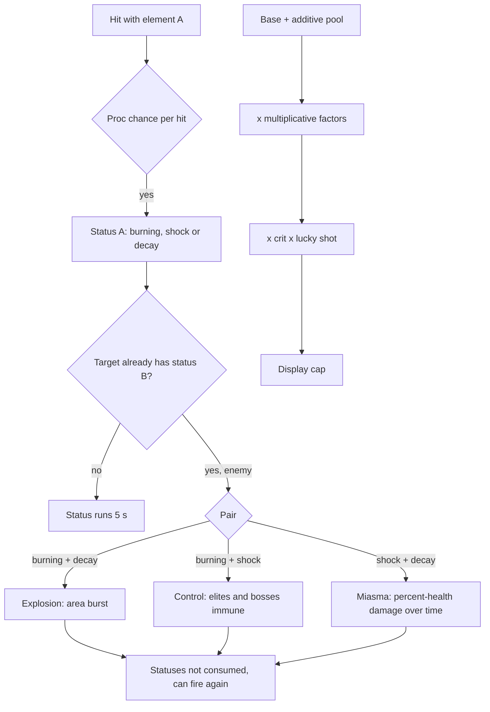

# Elements and fusion: three statuses, a pair grid and an additive-then-multiplicative order

Evidence: public wiki pages read by scouts (level 2, "wiki (public)", cited by page and line) and a community guide (qualitative, undated, marked removed on its host page). The wiki gives no single complete formula; the damage order below is the scout's synthesis and is inference. The shipped data tables hold no element, damage or status duration fields (level 4 at measurement, scripts outside the repo). Nothing was checked in the running game.

## What it does

Three elements, fire, lightning and corrosion, each roll a proc chance per hit, fixed per weapon, and apply a status: burning, shock and decay. Each element also has a defensive matchup: fire does +50% to health and -25% to shields and armor, lightning does +50% to shields, corrosion does +50% to armor, and true damage ignores all of it.

When a status lands on a target already under a different one, the pair fuses on enemies only. Fusions are not consumed and can fire twice in one hit. Burning and decay give an area explosion. Burning and shock give a control effect that elites and bosses resist. Shock and decay give a sustained health-percent damage cloud that deals reduced damage to elites and bosses and hits defensive layers first. Either order gives the same fusion.

Hit damage is a base plus a shared additive pool, then separate multiplicative factors, then crit and lucky-shot multipliers. Damage taken is a different product, and resistance is capped.

## Parameters

| Parameter | Value | Source |
|---|---|---|
| Elements and statuses | fire to burning, lightning to shock, corrosion to decay | wiki (public): Elemental_Effects page |
| Burning | 20% of the hit's damage per second for 5 s; a new one overrides | wiki (public): Elemental_Effects, Fire pages |
| Shock | +10% damage taken from all hits for 5 s | wiki (public): Elemental_Effects, Lightning pages |
| Decay | -50% move speed for 5 s, no effect on enemy actions | wiki (public): Elemental_Effects, Corrosion pages |
| Defense matchups | each element +50% against one layer, -25% against the other two; true damage 100% to all | wiki (public): Damage, Fire, Lightning, Corrosion pages |
| Proc chance | fixed per weapon, with per-projectile, per-shot and per-second values; examples 5% to 30% | wiki (public): Elemental_Effects page; Weapon_Stats table |
| Fusion rule | status lands on a target holding a different one; enemies only; not consumed; may fire twice per hit | wiki (public): Elemental_Effects page |
| Explosion fusion | 200% instant damage to the target, 100% to others in 5 m; 0.12 s per-enemy cooldown | wiki (public): Elemental_Effects page |
| Explosion with element bonus | 300% or 150% (bonus or penalty) | wiki (public): Damage_Modifiers page |
| Control fusion | elites and bosses immune | wiki (public): Elemental_Effects page |
| Miasma fusion | 9% max HP per second for 5 s, stacking to 9, for normal enemies; 0.75% vs elite and 0.3% vs boss; hits shields and armor first at double | wiki (public): Elemental_Effects page |
| Miasma spread | guide says it spreads; wiki history says it no longer does (contradiction, guide undated) | wiki (public): Elemental_Effects page history; community guide |
| Damage order (scout synthesis, inference) | `[base + base x (1 + additive pool)] x product of multipliers x crit x lucky shot`, then display cap | wiki (public): Damage_Modifiers, Critical_Hit, Lucky_Shot pages |
| Crit multiplier | base 2x, bonuses added | wiki (public): Critical_Hit page |
| Lucky shot | each 100% of chance guarantees one tier, 2x, 3x or 4x; crit and lucky multiply (4x and 2x gives 8x) | wiki (public): Lucky_Shot page |
| Skills | cannot crit or lucky-shot | wiki (public): Skills page |
| Damage taken | (1 - resistance) times product of (1 + modifier); resistance capped at +90% | wiki (public): Damage_Modifiers page |
| Display cap | 9,999,999 per hit | wiki (public): Damage page |
| Lightning chain inscription ranges | 3 m and 12 m (one example) | wiki (public): Elemental_Effects page |
| Fusion trigger order, shock and decay stacking, explosion falloff, difficulty scaling | not stated | wiki (public): absent from pages read |
| Status data in shipped tables | statedata has 3571 rows with a behavior id and a weight, and no duration or tick field; monster tables hold no health, armor or element | shipped data tables (level 4 at measurement, scripts outside the repo): statedata and monsterdata schemas |

## Why it works

1. **Each element answers one defense.** The matchup grid gives a reason to pick an element against a target, and the cost is a clear -25% elsewhere. Stated on the pages.
2. **The fusion grid has three pairs and three outcomes.** Damage, control and sustained damage are distinct, so a player can name what a pair is for. Stated; the readability claim is inference.
3. **Statuses are not consumed.** A fusion can fire again while the statuses last, so setup pays off repeatedly. Stated.
4. **Two stat kinds.** Members of the additive pool stack linearly and separate multipliers multiply, so the player can reason about which bonus is worth more. Stated on the pages; the synthesis into one formula is the scout's.
5. **Shock raises damage from every source.** Inference: it works as a team-wide amplifier, which helps allies and companions.

## What Scrapkeep borrows

Principles: **readability first** and **harmonize apparent contradictions**. The relationships worth building on are the one-element-one-layer pairing, the small fixed fusion grid and the shared status that amplifies all sources. Bible anchors that exist today: "A committed attack means what it shows" (`BIBLE.md:489`), "5.4 Attunement and transformative combinations" (`BIBLE.md:448`) and "Abilities, ultimates and combat rhythm" (`BIBLE.md:499`). TADR-009 (element and material interactions) is the engineering decision this would extend, and TADR-008 covers the ability contract a status would ride on.

Proposed relationships (design inference):

- The lightning ability could mark a target with a status that raises damage from every source, drawn as a persistent shape on the same committed geometry the telegraph uses, so damage and preview read from one result.
- A fusion effect should resolve once, with its area drawn from the resolved geometry before it fires, matching "A committed attack means what it shows".
- A resistance cap and a named additive pool in the build screen, so the player can see which bonus stacks which way.
- Elite and boss rules for control effects stated up front, as immunity, not as a hidden roll.

## What it must not copy

- Element art, status icons and VFX, including the color coding of fire, lightning and corrosion.
- Status names and fusion names as Scrapkeep names.
- The 5 m explosion, the 9% miasma and the 20% burning numbers as tuned values; they belong to another damage scale.
- A display cap as a design feature; it is a display limit.
- Fusions that bypass the commit-and-preview rule; any area hit must be shown first.
- Wiki text and the guide's prose.

## Lab measure

Add a headless "fusion pairing test": apply each pair of two statuses in both orders to the same dummy, and record the resulting effect type, its area or damage, and the frame at which the committed geometry preview first exists compared with the frame at which damage lands. Pass when (a) both orders of each pair produce the identical effect, (b) the preview geometry is available at least a declared number of frames before damage (propose 12) and matches the damage area exactly, and (c) an elite dummy takes no control effect and takes no more than a declared fraction (propose 10%) of the normal dummy's sustained damage.
