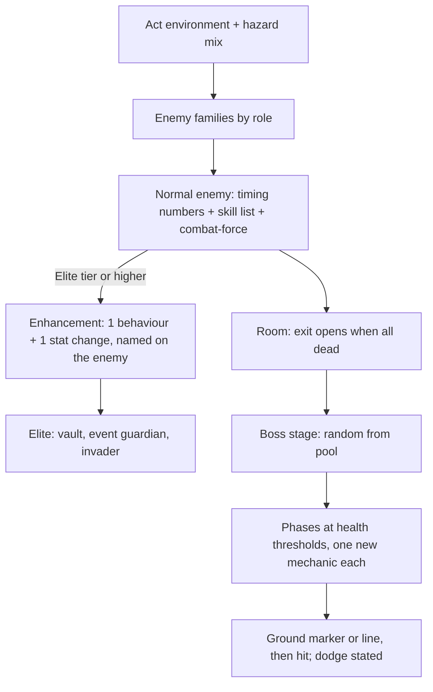

# Gunfire Reborn enemies and bosses (comps note)

Evidence: wiki (public), read by scouts at file:line (level 2), about 16 of 70 enemy pages read for attack text and the rest by infobox sweep; shipped data tables (level 4 at measurement, scripts outside the repo) for the monster record schema. Role labels below are the scout's inference from attack text. Normal and elite health, damage, speed, enemies per room and spawn entry are not stated on the wiki (69 enemy pages show an unknown health), and the shipped monster tables hold no health, damage or range at all.

## What it does

**Roster and rooms.** The wiki catalogues 52 normal enemies, 17 elites and 8 bosses. Per-act gallery counts are 12, 19, 16 and 8 normal; 3, 6, 6 and 2 elite; 2 bosses per act (one default, one unlocked alternate, rolled per run). Most rooms are normal enemies, and the exit opens when every enemy in the room is dead. Shields and armor appear in every act, so the wiki does not support a clean "one new mechanic per act" split.

**Enemy families by role (inferred).** Nine role groups cover the roster: melee or charge rusher (acts 1 to 4), ranged or sniper (1, 2, 4), shield-bearer with a block that must be flanked or broken (1 to 3), armored (3), summoner (1, 3), flyer (3), artillery or area (3, 4), tank or giant with a weak spot (3, 4) and teleporter or healer (3). Act identity comes from the environment and hazard mix: act 1 is indoor corridors, act 2 open ground then walls, act 3 very large areas with artillery zones, act 4 a day-to-night climb with ice slides.

**Elites and affixes.** An elite is a stronger variant with more health, shield or armor, extra attacks and higher damage. Most live in vaults, where killing one kills all normal enemies there; others appear as challenge-event guardians (after the room clears) or invaders (mid-room from Nightmare up). Separately, a normal enemy on Elite difficulty or higher can carry enhancements, one primary effect (an added attack or nearby aura) plus one secondary effect (a health or behaviour change), roughly 14 by 4 combinations by the scout's count. An enhanced enemy is named after its enhancements, which is the readability device: the name tells the player what to expect. Three of the numeric patterns scale by act (a defensive enhancement at -40, -50 or -60 percent; a shielding one at 10, 20 or 30 percent of max health). Radii are stated (aura 10 m, chain 15 m) and an immortal enhancement shows a 5-second invulnerable fuse before an explosion.

**Bosses and phases.** Boss health is a fixed pool with the tier multiplier applied, and fights run in phases keyed to health thresholds, each adding one mechanic or ending a shield. Examples (three of eight): act 3 default boss has shield breaks at 25, 50 and 75 percent; act 4 default phases at 75, 40 and 5 percent; act 4 alternate at 75, 40 and 25 percent. Body hits are reduced against weak spots on several bosses (95 percent on one), which rewards aim. Boss health ranges from 80,000 at act 1 Normal to 24,480,000 at the act 4 alternate on Reincarnation 8. Reincarnation changes behaviour, not only stats, at some levels.

**Design-side fact from the shipped data tables.** The tables hold 277 unique monster definitions across five game modes (243, 94, 150, 23 and 72 per mode; 191 shared). A monster row carries: hit cooldown 300 to 1200 (median 600), move speed 30 to 4000 (median 150), sprint ratios, a model id, a skill list of 0 to 22 ids, a fight type, a combat-force field of 0 to 10 and phase info. No health, damage or range is present, so the numbers that make a monster dangerous live outside the readable data (the scout infers a native library or the server). The study therefore sees a monster as a small set of timing numbers, a skill list and one coarse threat rating. No spawn waves appear in the tables.

**What makes an enemy readable at range.** Telegraphs use ground markers and cues: red circles for bites and pillars, overlapping circles for artillery, a line before a lunge, a text warning before a devour. The wiki states the dodge for each attack. One telegraph is noted as deceptive (shockwaves land sooner than they look), which the wiki treats as a flaw. Armor is a separate yellow bar that breaks at zero and does not regenerate, shields regenerate (10 percent per second after 5 seconds on most normal enemies, 2 percent after 10 on two elites), so the type of defence is visible in the bar colour.

## Parameters

| Parameter | Value | Source |
|---|---|---|
| Room exit | opens when every enemy in the room is dead | wiki (public): Enemies page, line 5 |
| Catalogue | 52 normal, 17 elite, 8 boss | wiki (public): Enemies page |
| Per-act normal / elite / boss | 12, 19, 16, 8 / 3, 6, 6, 2 / 2 each | wiki (public): the four act pages |
| Unique monster definitions | 277 (191 shared across modes) | shipped data tables (level 4 at measurement, scripts outside the repo) |
| Monster hit cooldown | 300 to 1200, median 600 | shipped data tables (level 4 at measurement, scripts outside the repo) |
| Monster move speed | 30 to 4000, median 150 | shipped data tables (level 4 at measurement, scripts outside the repo) |
| Skill list length | 0 to 22 ids | shipped data tables (level 4 at measurement, scripts outside the repo) |
| Combat-force field | 0 to 10 | shipped data tables (level 4 at measurement, scripts outside the repo) |
| Monster health, damage, range | absent from tables | shipped data tables (level 4 at measurement, scripts outside the repo) |
| Elite / Nightmare multipliers | 1.4 health and 1.4 damage / 2.4 and 1.8 | wiki (public): Difficulty page |
| Boss health, act 1 default | 80,000 Normal to 472,000 Reincarnation 8 | wiki (public): boss page |
| Boss health, act 4 alternate | 1,800,000 Normal to 24,480,000 Reincarnation 8 | wiki (public): boss page |
| Boss phase thresholds | 25/50/75, 75/40/5, 75/40/25 percent | wiki (public): three boss pages |
| Boss body-hit reduction | 95 percent on one boss | wiki (public): boss page |
| Shield regen, typical normal | 10 percent per s after 5 s | wiki (public): infobox sweep |
| Shield regen, two elites | 2 percent per s after 10 s | wiki (public): two elite pages |
| Enhancement scaling by act | -40/-50/-60 percent; 10/20/30 percent of max health | wiki (public): Enemy Enhancements page |
| Enhancement radii | 10 m aura, 15 m chain | wiki (public): Enemy Enhancements page |
| Immortal fuse | 5 s | wiki (public): Enemy Enhancements page |
| Elite gathering size | 2 to 5 by player count | wiki (public): Challenge Events page |
| Challenge event waves | 4 or 5 | wiki (public): Challenge Events page |
| Mounted elite revive timer | 60 s | wiki (public): one elite page |
| Normal and elite stats; enemies per room; spawn entry; per-stage elite counts | not stated | gap |
| Projectile speeds | qualitative only | gap |

## Why it works

- **One defence rule per bar colour.** Health, shield and armor each have a fixed regeneration and damage-type rule, so the bar a player sees predicts how to attack.
- **Names carry the affix.** Calling an enhanced enemy by its enhancements gives the player the threat before the fight starts.
- **Phase gates as thresholds.** Each boss adds one mechanic at a visible health mark, so a fight is a sequence of single new reads.
- **Weak spots reward aim over spray,** which keeps range play from collapsing into area damage.
- **A stated dodge per attack** means the wiki, and so the player, can name every telegraph's answer.
- **The combat-force field** shows the designers kept a single coarse threat number per monster beside the detailed timing numbers; it is an easy dial for director budgets.

## What Scrapkeep borrows

- **Enhancement as one behaviour plus one stat change, named on the enemy** (principle: readability first; the player reads the affix before the fight). Anchor: BIBLE.md "A silhouette has a job" (line 719).
- **Act-scaled constants for one mechanic** (principle: readable-capped scaling; three published values, none above the cap). Anchor: BIBLE.md "Encounters, waves and enemies" (line 517) and TADR-010.
- **Boss phases at health thresholds, one new mechanic each** (principle: harmonize apparent contradictions; a hard fight made fair by single new reads). Anchor: BIBLE.md "Encounters, waves and enemies" (line 517).
- **Ground-marker, then hit, on the same geometry** (principle: readability first). Anchor: BIBLE.md "A committed attack means what it shows" (line 489); the committed-geometry rule already requires damage and telegraph to share one shape, so the only borrow is a marker vocabulary: circle for area, line for lunge, text for a delayed devour. Avoid the deceptive-telegraph flaw the wiki notes.
- **A coarse per-enemy threat rating beside the timing numbers** (principle: opt-in layers; director budgets and optional hard layers read one number). Anchor: TADR-010.
- **Armor, shield and health as three visibly different bars** (principle: readability first). Anchor: BIBLE.md "Sound palette and audible information" (line 769) for the audible pair.
- **Elite in an optional pocket whose death clears the pocket** (principle: opt-in layers). Anchor: BIBLE.md "Encounters, waves and enemies" (line 517) and TADR-010.

## What it must not copy

- Enemy designs and silhouettes, including the nine role groups' concrete creatures and the mounted, levitating and mirror-image elite shapes.
- Boss arenas, boss mechanics as written (cannons, multiple heads, aura bars) and act environments.
- Enemy, elite, boss and enhancement names and the text of their descriptions.
- Voice lines, warning text and sound cues.
- The health, damage multiplier and phase-threshold numbers; Scrapkeep tunes its own from the lab. The combat-force scale of 0 to 10 is a shape to study, not a table to copy.

## Lab measure

In the headless lab, spawn each Scrapkeep enemy archetype alone, 50 times, and log the interval between telegraph start and damage onset plus the telegraph shape's area against the damage shape's area. Pass: for every archetype the telegraph lead time is at least the lab's reaction floor (set in the lab config, target 0.4 seconds) and the telegraph and damage areas overlap by at least 95 percent, with zero archetypes outside that bound.
