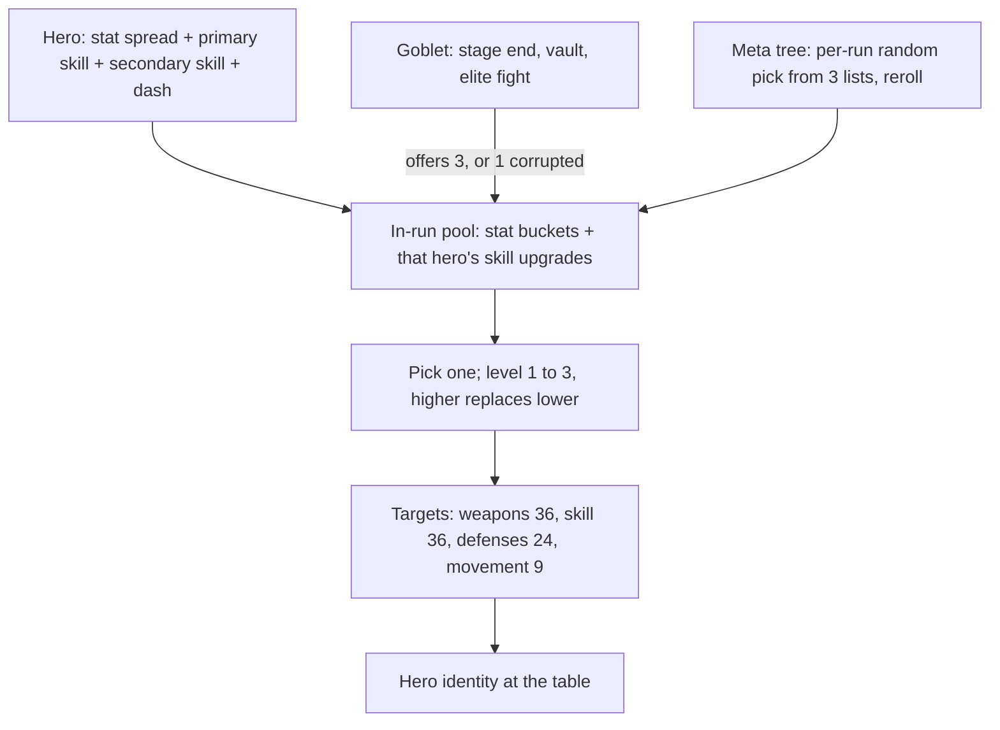

# Gunfire Reborn heroes and ascensions (comps note)

Evidence: wiki (public), read by scouts at file:line (level 2); wiki rendered tables counted against page totals (level 4 for counts, level 2 for category labels, which are keyword heuristics); shipped data tables (level 4 at measurement, scripts outside the repo) for roster and in-run tree shape. The wiki's per-hero ascension tables are template calls, so per-hero lists and primary-versus-secondary splits were not read. Base skill cooldowns, dash distance and dash cooldown are not stated.

## What it does

**Roster.** The shipped tables hold 16 hero records; the wiki's ascension page covers 12 heroes and its hero pages number 14 (the newest are missing from the tables and from the talent trivia). Every hero has a primary skill and a secondary skill, with the dash as a separate action. Only two hero pages state a passive. Heroes differ first in a stat spread, then in what their skills do.

- Maximum health 35 to 100 and maximum shield 30 to 90 at base (talents raise both caps). The spread is a partial trade-off, not strict: one build is 100 health with 30 shield, another 35 with 75.
- Armor exists on one hero (70).
- Base move speed 5.0 to 6.0. Movement bonuses add together, then a single status halves the total.
- Shield recharge 8% to 50% per second after a delay of 2.5 to 4.0 seconds; one hero has no shield.
- One damage table is reused across health, shield and armor: one damage type takes 150%, normal 100%, two types 75%, and the 150% type differs per layer.

**Identity expressed through numbers, with two examples as evidence labels.** A heavy build pairs high health and low shield with a skill set that pushes weapon damage and explosion area; its dual-wield costs extra ammo. A control build pairs a freezing area skill and a grenade with a talent-boosted shield and the slowest base speed. Identity is a stat spread plus a skill pair plus what the in-run picks push.

**In-run ascensions.** An ascension is a passive upgrade chosen from a goblet at stage end, in a vault or after an elite fight, reset each run. A normal goblet offers three picks. A corrupted goblet at act 4 stage ends offers one, take it or skip. Most picks have three levels; a higher level replaces the lower rather than stacking, and a maxed pick cannot be offered again. Each hero's pool is written as stat buckets (weapon, skill, shields, resistance, speed) plus named upgrades to that hero's own skills.

Shipped data tables show the same tree as 360 nodes: 16 common nodes plus 16 heroes at 19 to 23 nodes each, typically seven each of three types. 252 nodes have three levels and 108 have one. The wiki's rendered tables give 12 heroes by 18 rows (216), 177 of which carry a three-value step. Three-level steps seen (five examples): rate of fire +40/+50/+60% for 6 seconds; damage under any elemental effect +30/+60/+120%; grenade capacity +4/+8/+12; weapon damage +100/+125/+150%; a trade-off of less damage dealt for more damage taken at each level.

**Where picks point.** A keyword count over the 216 wiki rows (labels can overlap) gives weapons 36%, skill 36%, defenses 24%, movement 9% and other 26%. Movement is the thinnest bucket; several movement bonuses hang off skill or dash use, for example a stacking per-dash speed bonus capped at five stacks.

**Hero-flavoured hooks in the meta tree.** Each hero has a five-node tree; per run one option is drawn from each of three lists, the player takes one and may reroll. One talent raises the chance of level-3 ascensions and one raises an ascension by a level. Heroes unlock by talent level, soul cost, DLC or by default.

## Parameters

| Parameter | Value | Source |
|---|---|---|
| Hero records | 16 | shipped data tables (level 4 at measurement, scripts outside the repo) |
| Hero pages / ascension tables | 14 / 12 | wiki (public): Ascensions and hero pages |
| Base max health / shield range | 35 to 100 / 30 to 90 | wiki (public): Health and Shields pages |
| Armor | 70 on one hero | wiki (public): Armor page |
| Base move speed | 5.0 to 6.0 | wiki (public): Movement Speed page |
| Movement rule | additive bonuses, then one status halves | wiki (public): Movement Speed page |
| Shield recharge / delay | 8% to 50% per s / 2.5 to 4.0 s | wiki (public): Shields page |
| Damage table | 150% / 100% / 75%, 150% type differs per layer | wiki (public): Health, Shields, Armor pages |
| Goblet picks | 3 normal, 1 corrupted | wiki (public): Ascensions page |
| Ascension levels | up to 3, higher replaces lower | wiki (public): Ascensions page |
| In-run tree nodes | 360 (16 common + 16 heroes x 19 to 23) | shipped data tables (level 4 at measurement, scripts outside the repo) |
| Nodes by level count | 252 with 3 levels, 108 with 1 | shipped data tables (level 4 at measurement, scripts outside the repo) |
| Rendered ascension rows | 216 (12 x 18), 177 with a three-value step | wiki (public): rendered Ascensions tables, counted by scout |
| Target mix | weapons 36%, skill 36%, defenses 24%, movement 9%, other 26% | wiki (public): rendered Ascensions tables, keyword heuristic, overlapping labels |
| Dash speed stacking | +12% per dash, 5 stacks, +60% | wiki (public): Movement Speed page |
| Passives | stated for 2 heroes | wiki (public): two hero pages |
| Hero meta tree | 5 nodes each, 1 random pick of 3 lists per run | wiki (public): Talents page |
| Hero unlock | talent level 25 / 40 / 55; soul 400 / 600 | wiki (public): Talents and Unlockables pages |
| Per-hero ascension counts; skill cooldowns; dash distance and cooldown | not stated | gap |
| Primary versus secondary split of picks; goblet reroll rules | not stated | gap |

## Why it works

- **One stat table in three layers.** The same 150/100/75 shape on health, shield and armor means the player learns one rule and reads three bars.
- **Replacement instead of stacking.** A level-3 pick is simply better than level 2, so a choice is a clear upgrade and not arithmetic.
- **A forced-or-skip goblet** at the deepest act removes a reroll from the player's hands on purpose; the cost is attention, not currency.
- **Identity lives in targets.** Because pools are weighted toward each hero's weapon and skill, two players on different heroes meet different shelves with the same pick UI.
- **The movement share is small (9%),** so most picks leave the player's feel alone and change damage and survivability. That keeps movement a base trait of the hero.

## What Scrapkeep borrows

- **Hero identity as stat spread plus a skill pair plus a weighted pick pool** (principle: class identities; three characters with their own movement, so the pool for each leans toward its own weapon and defence needs). Anchor: BIBLE.md "5.1 Shared baseline and class roles" (line 398) and "Characters" (line 269).
- **Leave movement out of the generic pool** (principle: momentum is sacred; movement stays a hero trait and only skill-linked bonuses add speed). Anchor: BIBLE.md "Movement, camera and active aim" (line 479).
- **Three levels, higher replaces lower** (principle: readable-capped scaling; every pick is a legible step with a cap). Anchor: BIBLE.md "Four slots and milestone progression" (line 527).
- **One damage-multiplier table reused across every protection layer** (principle: readability first). Anchor: BIBLE.md "A committed attack means what it shows" (line 489).
- **A forced-or-skip late pick** (principle: opt-in layers; the player may decline the corrupted offer). Anchor: BIBLE.md "Abilities, ultimates and combat rhythm" (line 499).
- **A per-run random pick from three lists with a reroll in the meta tree** (principle: quick restart; each run starts with one small, visible choice). Anchor: TADR-008.

## What it must not copy

- Hero kits and names, skill names and descriptions, and the starter, heavy and control builds used above as evidence labels.
- Ascension names, text and the exact three-level values; goblet art and corrupted-goblet naming.
- The hero silhouettes, voices and flavour text, including community guide text.
- The stat numbers (health, shield, speed, recharge) as a roster; Scrapkeep sets its own from the lab.
- The five meta tree categories and their node names.

## Lab measure

In the headless lab, run each of the three Scrapkeep characters through 200 simulated goblet draws each using the proposed pools. Log the share of offers in weapon, skill, defense and movement buckets per character. Pass: each character's two dominant buckets differ from the other two characters' dominant pair, no character's movement share exceeds 15%, and no offer is repeated once a pick is at its top level.
