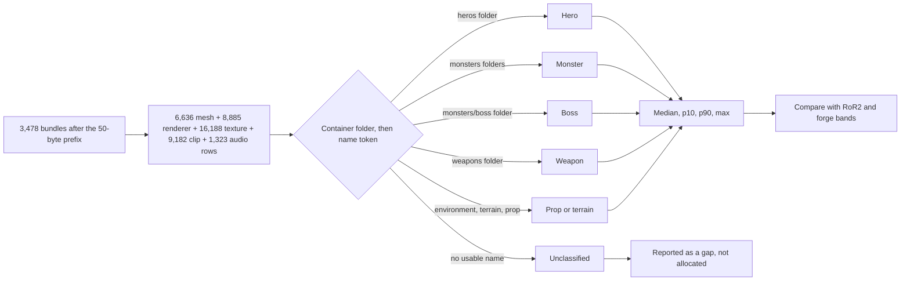

# Production budgets: what a shipped stylized first-person roguelite spends per category

Evidence: measured data (level 4 at measurement; level 2 from this repo, because the scripts and logs live outside it). A script opened every Unity bundle after its 50-byte prefix and wrote counts and dimensions only: 3,478 bundles, zero errors, 6,636 mesh rows, 8,885 skinned-renderer rows, 16,188 texture rows, 9,182 animation-clip rows and 1,323 audio-clip rows. No asset was exported, copied or viewed. The source report is `production-budgets.md` under the study tree's Gunfire reports folder. The Risk of Rain 2 column comes from the accepted note `ror2/production-budgets.md`; the forge bands are as that note cites them from the asset forge's pack file on the branch `claude/reverse-engineer-asset-pipeline-a5025f`. `sketches/core-loop/assets/asset_budgets.json` was not compared (the RoR2 note records it as absent).

Read the tables with four caveats. Each row is one Unity object in one bundle, so an asset shipped in several bundles counts once per bundle (about 36% of texture rows repeat a name from another bundle). Mesh rows are per mesh piece, not per character. Skinned-renderer rows have no container path, so their categories come from object names and are approximate. Unclassified shares are large (stated in Gaps) and none of them is reallocated here.

## What it does

The study grouped five object types by container folder first and name token second into hero, monster, boss, weapon, prop, terrain, primitive and unclassified, then reported a distribution per category (median, p10, p90, max). It shows where a stylized, low-polygon first-person shooter roguelite spends detail, and it is a second data point beside the third-person game in the RoR2 note.

## Parameters

Triangles per mesh piece:

| Category | Pieces | Median | p10 | p90 | Max | Source |
|---|---|---|---|---|---|---|
| Hero | 222 | 1,430 | 305 | 4,773 | 13,377 | measured: production-budgets.md |
| Monster | 464 | 443 | 83 | 3,691 | 9,766 | measured: production-budgets.md |
| Boss (from the boss folder; inference that these are bosses, ids not tied to names) | 697 | 90 | 1 | 2,488 | 15,977 | measured: production-budgets.md |
| Enemy (Monster + Boss) | 1,161 | 192 | 16 | 3,460 | 15,977 | measured: production-budgets.md |
| Weapon | 523 | 420 | 32 | 3,753 | 12,104 | measured: production-budgets.md |
| Prop | 820 | 232 | 38 | 1,261 | 8,916 | measured: production-budgets.md |
| Terrain | 1,990 | 212 | 38 | 913 | 10,671 | measured: production-budgets.md |
| Primitive (planes, spheres; probably VFX or collision, inference from names) | 657 | 112 | 26 | 566 | 7,200 | measured: production-budgets.md |
| Unclassified | 1,263 | 204 | 34 | 2,600 | 41,322 | measured: production-budgets.md |
| All | 6,636 | 212 | 26 | 1,992 | 41,322 | measured: production-budgets.md |

Reading: heroes are the heaviest per piece, monsters and weapons sit near 420 to 440, and props and terrain near 210 to 230. The Boss median of 90 is bent by many small pieces under that folder, so use its p90 and the Enemy row. Vertex counts read 0 in 6,521 of 6,636 rows (a Unity 2018 field quirk), so no vertex budget exists. Submesh median is 1 (max 170); no blend-shape rows.

Bones per skinned renderer (categories by object name only):

| Category | Renderers | Median | p90 | Max | Over 64 bones | Source |
|---|---|---|---|---|---|---|
| Hero | 662 | 17 | 20 | 203 | 49 (7%) | measured: production-budgets.md |
| Monster (bosses sit inside this row; inference) | 1,141 | 6 | 49 | 102 | 58 (5%) | measured: production-budgets.md |
| Weapon | 1,398 | 4 | 14 | 92 | 36 (3%) | measured: production-budgets.md |
| Prop | 1,511 | 2 | 27 | 88 | 1 (0%) | measured: production-budgets.md |
| Terrain | 487 | 1 | 15 | 15 | 0 | measured: production-budgets.md |
| Primitive | 485 | 2 | 11 | 48 | 0 | measured: production-budgets.md |
| Unclassified (numeric-id names; many probably bosses, inference) | 3,201 | 5 | 79 | 187 | 454 (14%) | measured: production-budgets.md |
| All | 8,885 | 5 | 49 | 203 | 598 (7%) | measured: production-budgets.md |

Reading: a typical hero renderer carries 17 bones and the p90 is 20, but the tail is not trivial: 49 of 662 hero renderers (7%) exceed 64 bones and the max is 203, so the median says low and the p90 and the 7% tail say some hero parts need much more. The numeric-id group holds 3,201 renderers (36%), and three of its top ids match boss-folder mesh ids, so the Monster row is likely understated at the top. 406 renderers have 0 bones.

Textures (larger side; rows by size class):

| Category | Rows | Unique names | 256 or less | 257 to 512 | 513 to 1024 | 1025 to 2048 | Over 2048 | Max side | Source |
|---|---|---|---|---|---|---|---|---|---|
| Hero | 155 | 149 | 22 | 34 | 93 | 6 | 0 | 2,048 | measured: production-budgets.md |
| Monster (bosses inside) | 483 | 474 | 43 | 246 | 194 | 0 | 0 | 1,024 | measured: production-budgets.md |
| Weapon | 304 | 290 | 6 | 18 | 279 | 1 | 0 | 2,048 | measured: production-budgets.md |
| Environment | 209 | 199 | 31 | 120 | 55 | 2 | 1 | 8,192 | measured: production-budgets.md |
| Lightmap (baked scene data, not authored art) | 987 | 43 | 2 | 11 | 895 | 79 | 0 | 2,048 | measured: production-budgets.md |
| VFX | 2,944 | 2,898 | 1,974 | 819 | 137 | 14 | 0 | 2,048 | measured: production-budgets.md |
| UI | 8,499 | 4,380 | 6,775 | 1,253 | 336 | 135 | 0 | 2,048 | measured: production-budgets.md |
| Unclassified | 2,607 | 2,104 | 1,977 | 398 | 177 | 55 | 0 | 2,048 | measured: production-budgets.md |
| All | 16,188 | 10,351 | 10,830 | 2,899 | 2,166 | 292 | 1 | 8,192 | measured: production-budgets.md |

Reading: 10,830 of 16,188 rows (67%) are 256 or smaller, but that share comes from UI (6,775 rows) and VFX (1,974 rows); do not read it as a character budget. Character and weapon textures cluster at 512 to 1,024 and are block-compressed (hero rows: DXT5 85, DXT1 69, one RGB24). Only one texture in the whole game is above 2048, and it is an environment texture. Lightmaps (987 rows, BC6H) are scene bakes. UI holds 3,402 uncompressed RGBA32 rows; the 3,748 RGBA32 total is mostly UI.

Animation clips (seconds):

| Category | Clips | Median | p90 | Max | Total min | Source |
|---|---|---|---|---|---|---|
| Hero | 313 | 0.80 | 2.66 | 25.00 | 7.1 | measured: production-budgets.md |
| Monster | 1,386 | 1.07 | 3.00 | 12.80 | 36.6 | measured: production-budgets.md |
| Boss (boss folder) | 238 | 1.73 | 5.20 | 11.07 | 9.2 | measured: production-budgets.md |
| Weapon | 289 | 0.53 | 2.04 | 10.00 | 4.7 | measured: production-budgets.md |
| UI (36% of all clips) | 3,297 | 0.00 | 1.00 | 63.30 | 16.9 | measured: production-budgets.md |
| Unclassified (numeric ids, recorder takes) | 3,659 | 1.00 | 4.00 | 95.17 | 102.9 | measured: production-budgets.md |
| Character clips (Hero + Monster + Boss) | 1,937 | 1.07 | 3.33 | 25.00 | 52.9 | measured: production-budgets.md |
| All | 9,182 | 0.67 | 2.67 | 95.17 | 177.5 | measured: production-budgets.md |

Reading: gameplay clips are short; hero p90 is 2.66 s, monster 3.00 s and weapon 2.04 s. Boss clips run longer (p90 5.20 s). Sixteen heroes (a count from the gameplay tables, not this scan) share 313 hero clips, about 20 each, against 38 to 143 per survivor in the RoR2 note. That per-hero figure is an inference: some hero clips may sit in the unclassified group.

Audio:

| Source | Count or size | Reading |
|---|---|---|
| Unity AudioClips | 1,323 rows, 46.1 min; median 1.10 s, p90 3.10 s, max 87.79 s | Mostly short one-shots; 1,019 stereo, 304 mono; 899 at 44.1 kHz, 424 at 48 kHz |
| Weapon folder | 361 clips, 13.6 min | Largest by count |
| Hero voice | 296 clips, 2.5 min (median 0.35 s) | Short barks |
| Monster | 247 clips, 7.3 min | |
| Hero skill | 233 clips, 6.6 min | |
| Music folder | 13 clips, 10.8 min (median 48 s) | Long loops, few files |
| Wwise packs | 142.8 MB in 13 files | Separate from the Unity AudioClips; sized from file listings, not opened |
| Per-act packs | 8.2, 9.2, 11.7 and 11.8 MB | One bank per act |
| Music pack | 39.7 MB | Largest pack; weapon pack 21.2 MB, hero pack 17.0 MB |

Bundle shape: 3,478 bundles, 4.00 GB on disk. Median 0.06 MB, p90 1.68 MB, max 239.5 MB. 2,925 bundles (84%) are under 1 MB; the 5 bundles over 50 MB hold 17% of the bytes; the 10 largest hold 22%. The 10 to 50 MB bucket (77 bundles) holds 40% of the bytes. Only 1,850 bundles hold at least one measured object. Reading: content ships as thousands of small per-feature bundles plus a few large shared or per-scene ones. Bundle names are numeric ids, so the mapping from bundle to stage was not measured. Bundle sizes are compressed on-disk bytes.

## Why it works

The shape matches the RoR2 finding in a different style. Detail follows importance (heroes heaviest, props and terrain light), the numerous things stay cheap (two thirds of all texture rows at 256 or smaller, though those are UI and VFX rows; props at a median of 232 triangles), and gameplay clips stay short. What differs is the rig budget: this game keeps a hero renderer near 17 bones, where RoR2 survivors carry 77. A stylized look buys a cheaper skeleton, not just a lower polygon count.

## What Scrapkeep borrows

Principle: **readability first**, as in the RoR2 note. One observation from this data, not a principle: the stylized game ships far lower rig budgets than RoR2. The relationship is a per-category budget with a floor, a ceiling and now a bone cap that a shipped game demonstrably lives under. Amendment target: the forge owner's pack file, not the Bible.

Three-way comparison (all per piece; bands are whole-asset, so "inside" on pieces does not prove a whole asset is inside):

| Measure | Gunfire Reborn | Risk of Rain 2 | Asset forge band | Reading |
|---|---|---|---|---|
| Hero triangles, median / p90 | 1,430 / 4,773 | 1,928 / 11,278 | 3,000 to 6,500 | Median below the forge band, p90 inside it. Both games' medians sit under the band, so a per-piece median is the wrong thing to hold the floor against. |
| Enemy triangles, median / p90 (Monster + Boss) | 192 / 3,460 | 528 / 4,814 (monster); 480 / 10,608 (boss, without Solus) | 800 to 1,500 (kit); proposed 500 to 5,000 | Median far under the kit floor in both games; Gunfire p90 is above the kit ceiling and inside the proposed 5,000. |
| Prop triangles, median / p90 | 232 / 1,261 | 188 / 3,503 | 150 to 1,500 | Both inside the band at the median; Gunfire p90 inside. |
| Terrain triangles, median / p90 | 212 / 913 | 188 / 3,503 (prop or stage row) | 150 to 1,500 | Inside the band at both points. |
| Weapon triangles, median / p90 | 420 / 3,753 | 668 / 2,168 (item, nearest row; RoR2 has no weapon class) | 150 to 1,500 (pickup falls under prop) | Median inside; p90 above the ceiling. A held weapon is closer to a hero part than a prop. |
| Hero bones, median / p90 | 17 / 20 | 77 / 136 | no cap; proposed 80 | Gunfire shows the cap can sit far lower. |
| Enemy bones, median / p90 (bosses inside) | 6 / 49 | 35 / 155 (monster) | no cap; proposed 40 | Median inside the proposed cap; p90 above it in both games. |
| Prop and terrain bones, median / p90 | 2 / 27 | 44 / 141 | no cap | Props rarely need bones. |
| Weapon bones, median / p90 | 4 / 14 | 7 / 19 (item, nearest row) | no cap; proposed pickup 8 | Median inside the proposed 8; p90 above. |
| Texture max side, hero | 2,048 | at most 2,048 | terrain 256 to 1,024 (no hero band) | Same ceiling as RoR2. Forge has no hero texture band. |
| Texture max side, enemy (bosses inside) | 1,024 | at most 2,048 | terrain 256 to 1,024 (no enemy band) | Lower than RoR2's ceiling. |
| Texture max side, environment | 8,192 (1 texture) | 3 textures above 2,048 | 256 to 1,024 | One outlier; 8,192 is not a target. |
| Clip median, hero (seconds) | 0.80; p90 2.66 | 0.67 | proposed at most 3.5 (max) | p90 inside the proposed length. |
| Clip p90, enemy (seconds) | Monster 3.00, Boss 5.20 | monster 2.85, boss 3.33 | proposed at most 3.5 (max) | Monster inside; boss p90 above. |

### What this changes for the forge

- Hero bones: a stylized shipped game keeps heroes at a median of 17 and a p90 of 20, so the median supports a cap well under the proposed 80. The p90 of 20 does not carry the whole tail: 7% of hero renderers exceed 64 bones, and RoR2 (median 77) argues for the looser value. Treat 80 as a ceiling for outlier parts and a low per-part target as the norm, until a summed per-hero pass settles it.
- Enemy bones: p90 is 49, above the proposed 40 cap in both games. If bosses get their own class, give that class the higher cap; the median of 6 says ordinary enemies sit far under 40.
- Enemy triangles: Gunfire supports raising the kit ceiling (p90 3,460 against 1,500) and the 40-bone concern (p90 49), not the 500 floor. Its enemy median of 192 is under that floor, and RoR2's monster median of 528 only just clears it, so a floor at 500 would reject typical enemy pieces.
- Textures: the small-texture share is UI and VFX; character and weapon textures sit at 512 to 1,024 and none exceeds 2,048. A 1,024 character ceiling fits; this data says nothing about a character floor, so the 128 floor rests on the RoR2 prop rows alone.
- Weapons: p90 of 3,753 is above the prop ceiling of 1,500. If Scrapkeep ships held or mounted items, they need a class above prop, or the cap applies to the whole item, which this data cannot test.
- Clips: gameplay clips stay under about 3 s at p90 for hero, monster and weapon; boss clips run to 5.2 s. A 3.5 s cap needs a boss exception.

Treat every triangle row as conditional: the numbers are per piece, so per-asset totals are larger. A summed per-character pass is the follow-up that would settle hero, foe and weapon.

## What it must not copy

- The absolute numbers as targets. A rolling-ball mech with three characters and a small team does not need 4 GB across 3,478 bundles or 142.8 MB of audio banks.
- The bundle layout. Thousands of tiny bundles and per-bundle duplicated textures inflate counts and disk size.
- Any asset, mesh, texture, clip or sound from the game. Only counts are used here.
- The outliers: an 8,192-pixel environment texture, 203-bone renderers and a 95-second clip are accidents of the shipped game, not budgets.

## Gaps

- Unclassified shares: meshes 1,988 of 6,636 (30.0%) by name and 1,263 (19.0%) after container resolution; renderers 3,201 of 8,885 (36.0%); textures 2,607 of 16,188 (16.1%); clips 3,659 of 9,182 (39.8%). Every distribution above excludes these from its named category, and the unclassified renderers carry the heaviest bone tail.
- Bosses are separated only in meshes and clips (boss folder). Renderer and texture rows keep them inside Monster, so the Monster bone and texture rows are probably understated at the top. The 263 horse-head-enemy meshes were counted as bosses because they sit in the boss folder.
- LOD pieces count as separate rows; no LOD suffix was tested.
- Vertex counts are unusable, so no vertex budget exists.
- Unity 2018 bundles may hold combined meshes, so a piece can exceed one Scrapkeep asset.
- Bundle sizes are compressed on-disk bytes. Wwise packs were sized from file listings and never opened.
- Primitives are inferred to be VFX or collision from names alone.
- The accepted RoR2 note is the comparison source; its figures were not re-measured here.

## Lab measure

Add a headless budget audit to the lab: load every promoted asset, count triangles, bones, clips, longest clip and texture size, group by category, and compare to the caps. Pass when zero assets exceed their category cap, every category has at least one asset (a nonzero count is printed so an empty selection fails), and the audit prints the median and p90 per category so they can be set against the three-way table above. Report it beside the forge's own band check, which measures triangles only.
