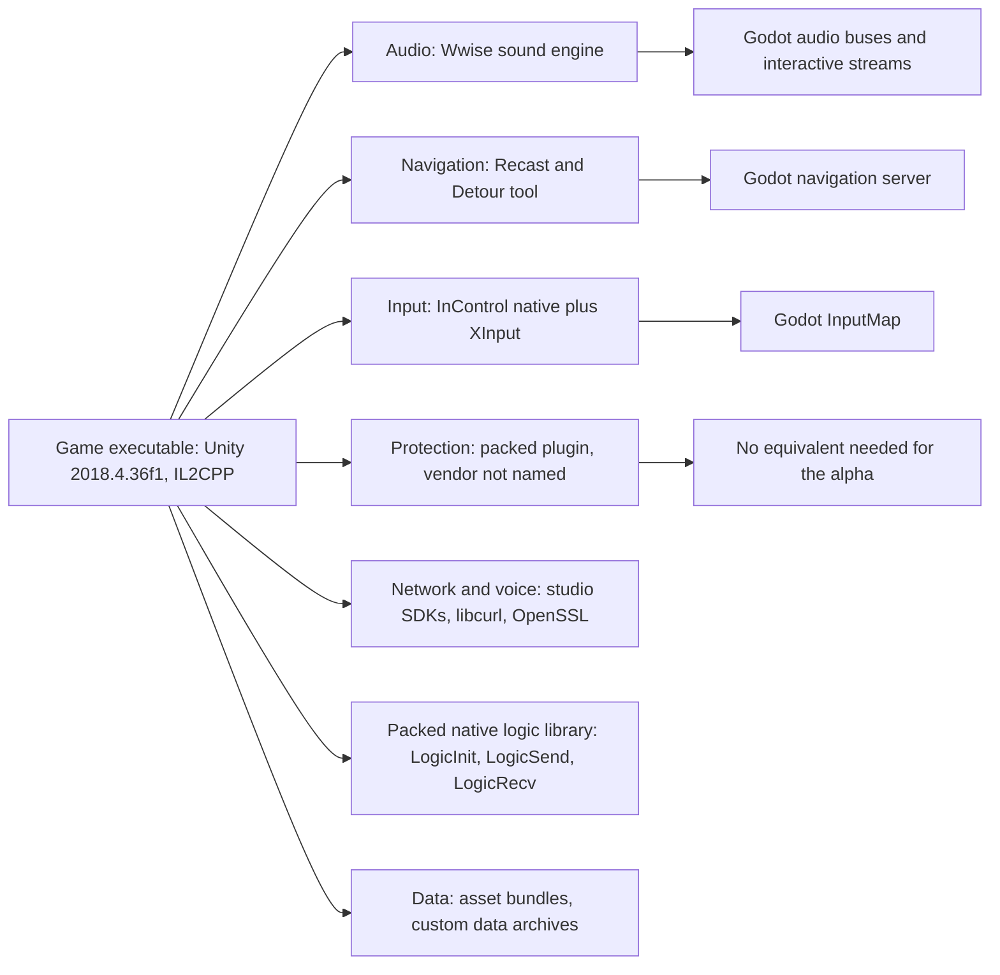

# Provenance: what Gunfire Reborn is built on, and what is free upstream

Evidence: inventory of plugin, library and font file names plus export names read from library headers, names only (level 2). Nothing was executed and no library was opened as code. License labels marked "known" come from general knowledge of the named project, not from a license file in the game; only one license text ships with the game (`OFL.txt`, 4,950 bytes in the font folder), and which of the fonts it covers was not checked. Where a license is not known, the row says "license not checked". Nothing from the game is fetched or copied; a "yes" below means the original project can be obtained from its own source under its own license, through the admission rule in `docs/project/ASSETS.md`.

## What it does

The game's third-party layer shows which problems the studio bought and which it kept. Audio middleware, navigation, input, a network accelerator, voice chat and a packed protection plugin were bought or licensed. The game logic itself is not readable: the C# compiles to native code with encrypted type metadata, and a 36.6 MB packed native library exports a message bridge. The lesson that carries to Scrapkeep is the role list, plus one warning about shipping rules where nobody can read them.

## Parameters

| Role | Product in the game | License | Free upstream usable for Scrapkeep | Godot equivalent of the role |
| --- | --- | --- | --- | --- |
| Audio middleware | Wwise (`AkSoundEngine.dll`, a `wwise` folder of 13 packs, 142.8 MB) | known: proprietary, free tier with terms; license not checked for this game | no | `AudioStreamPlayer` buses, `AudioStreamInteractive` and `AudioStreamSynchronized` for layered music |
| Navigation mesh | Recast and Detour tool (`RecastTool64.dll`, exports for cooking, loading and path finding; a second copy suffixed `_Robot`) | known: Recast and Detour are zlib-style; license not checked in the game | yes, from the Recast Navigation project, but unneeded | `NavigationServer3D` and `NavigationRegion3D` |
| Input | InControl (`InControlNative.dll`) and `XInputInterface64.dll` | InControl license not checked; XInput is a Windows API | no | `InputMap` plus a remap screen |
| Protection | A packed plugin (`EPStableUnity3D64.dll`, exports prefixed `Ep`) | vendor not named in strings, license not checked | no | not needed for the alpha; role inferred from the packed form, not confirmed |
| Network acceleration | Studio SDK pair (`dgw.dll`, `libdgw2.dll`) | proprietary (studio's own); license not checked | no | not needed for the alpha |
| Voice chat | Three voice libraries (`VoiceEngine`, `VoiceProcess`, `VoiceUtil`) | license not checked | no | not needed for the alpha |
| Network and crypto | libcurl, OpenSSL 1.1 (`libcrypto`, `libssl`) | known: curl license and OpenSSL/Apache-style terms | only if a feature needs them; Godot ships its own HTTP and TLS | `HTTPRequest`, `Crypto` |
| Store SDK | `steam_api64.dll` | Steamworks SDK terms | yes, through the Steamworks SDK terms | GodotSteam (MIT, known) |
| Logic | `m1logic4.dll`, 36.6 MB packed, exports `LogicInit`, `LogicSend`, `LogicRecv`, `LogicRelease` | proprietary | no | GDScript or C# in `native/` |
| Engine runtime | Unity 2018.4.36f1, IL2CPP; type metadata hashed or encrypted | Unity terms | no | Godot (see `adr/TADR-001-engine-language-platforms.md`) |
| Crash and logging | `Crash.dll`, `xlog.dll`, Unity crash handler, a graphics debugging runtime | license not checked | no | not needed |
| Body and fallback fonts | Noto Sans KR, Noto Sans Thai, Noto Serif SC (Bold and Medium), Sarabun | OFL 1.1 as known for both families; the shipped `OFL.txt` was not matched to a specific font | yes, from Google Fonts (Noto) and the Sarabun project, each under OFL with any Reserved Font Name clause | `FontFile` |
| Display fonts | none found in the font folder | not applicable | not applicable | not applicable |

## Why it works

Buying audio, navigation and input middleware let a small studio spend its hours on weapons, levels and content. Scrapkeep needs the same roles, and Godot covers audio, navigation and input natively, which is the point of the engine choice. The packed logic library is the opposite lesson: the same studio kept its rules behind a wall, and a study of the shipped game cannot see them. The data-tables note records the effect: combat numbers are absent from the readable data.

## What Scrapkeep borrows

- **The role list, as a checklist for the native build.** Each row's Godot column is the thing to confirm exists in `native/` before alpha. Bible section: production conventions (`docs/tech/sections/HF-01-production-conventions.md`).
- **Layered music through the engine, not middleware.** The game's music pack is 39.7 MB; Godot's interactive audio streams carry the state machine in `progression-and-music.md` without Wwise.
- **The fonts worth fetching upstream, only if a CJK or Thai fallback is needed:** Noto Sans KR, Noto Serif SC and Noto Sans Thai from Google Fonts, and Sarabun from its own project, each with its license text and the actual use recorded. The current Barlow, DM Sans and IBM Plex Mono set (already OFL, `docs/project/ASSETS.md`) stays the default. Noto Serif SC is about 11 MB per weight, so subsetting would be part of the admission record.
- **Navigation as a baked mesh with dynamic obstacles.** The Recast tool's export names (cook, load, find a slice path, add a dynamic obstacle) describe the same pipeline Godot's navigation server runs.

## What it must not copy

No library, plugin, bundle, font file, shader or data archive from the game folder. No anti-tamper or protection plugin: a single-player alpha has nothing to protect and the plugin would block the free local toolchain. No rule set hidden in a packed native library; Scrapkeep's rules stay readable in `native/` and the Bible.

## Lab measure

Not a lab item. The check is the admission record: every font and library in `native/` has a source URL, license evidence and the actual use recorded, per `docs/project/ASSETS.md`.
